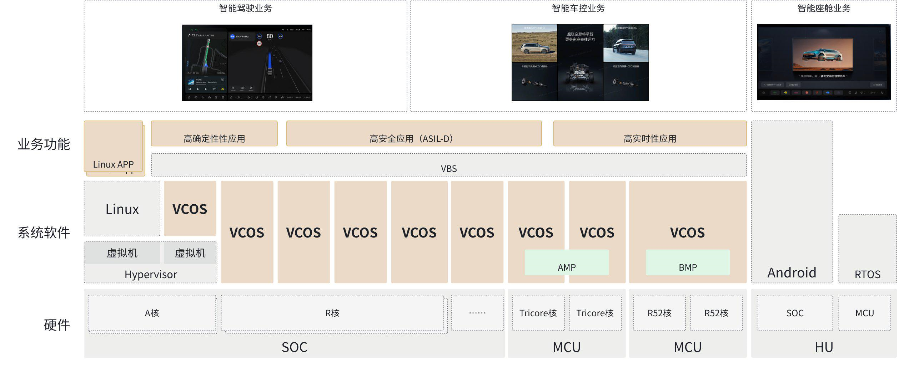
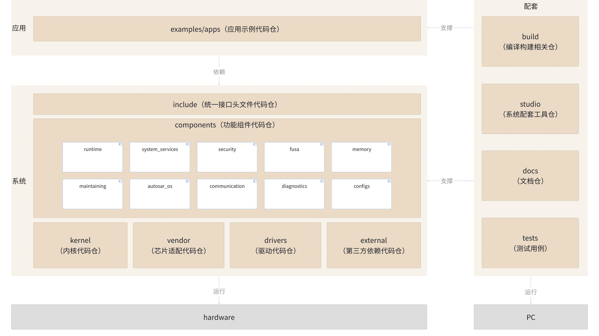
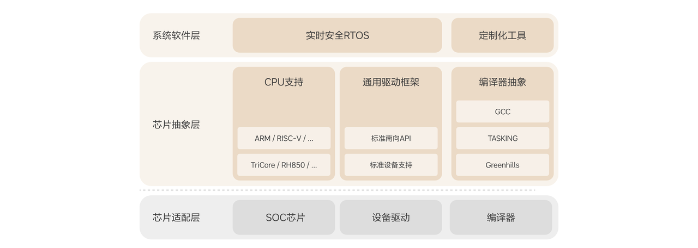
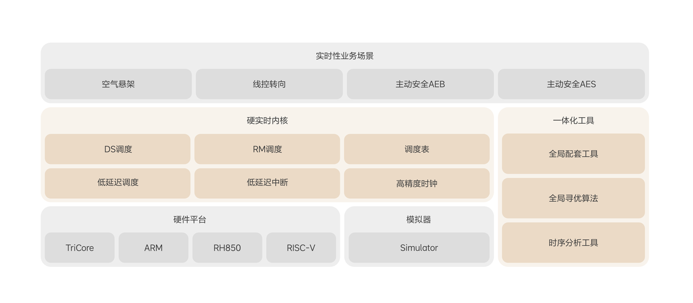
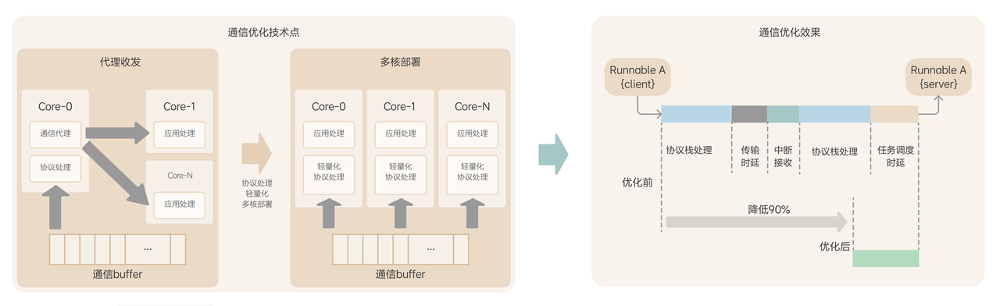
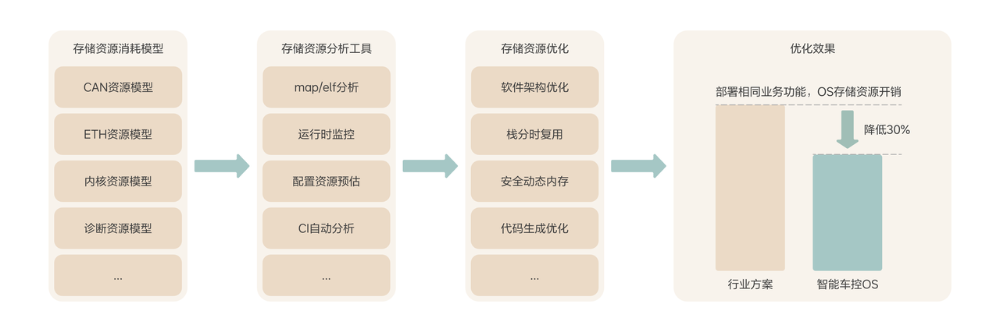
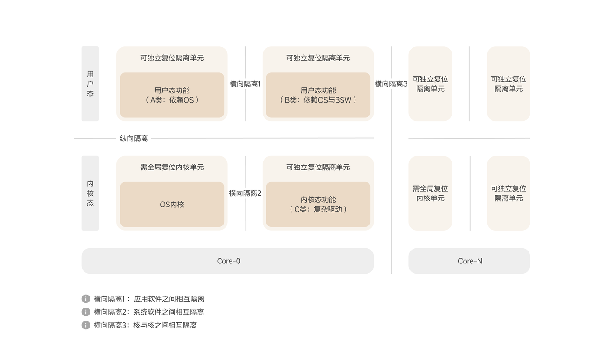

# 智能车控OS开源操作系统介绍

## 1. 项目简介

智能车控OS（VCOS）是面向车辆控制的操作系统，支撑智能汽车高安全、高实时的核心车控业务部署。系统通过硬实时调度架构确保动力控制、底盘控制等关键任务精准响应，实现感知与决策系统的高效协同，构建从硬件到软件的全链路安全防护体系。智能车控OS在实时性、确定性以及功能安全保障上实现了很高的性能表现，其设计充分考虑了未来系统的复杂性和高要求，并配备覆盖开发调试、仿真验证的可视化工具链，有效提升车企在智能控制系统开发、测试及迭代的效率

## 2. 项目架构

### 2.1. 逻辑视图

本系统可以划分为四层：接口层、框架层、内核层、硬件/模拟器

接口层：对上层封装并提供POSIX和智能车控OS功能栈接口

框架层：为车控应用提供了程序开发框架，包括安全特性、基础服务、车控服务、通信服务。主要提供以下功能：

- 安全服务：主要提供加/解密等功能
- 安全隔离：主要提供任务的时间/空间隔离功能
- 存储服务：主要提供KV、Block存储等功能
- 维测服务：主要提供在线GDB、LOG等功能
- 服务管理：主要提供状态管理和逻辑仲裁功能
- 诊断标定：主要提供UDS、XCP等功能
- 通信服务：主要提供CAN、ETH的协议栈处理和路由管理等功能

内核层：基于Nuttx内核，提供以下功能

- 外设驱动
- 内存管理
- 安全隔离与隔离单元间通信
- 可以跨多ECU系统的确定性硬实时调度
- 可以跨多核/异构架构交互的混合部署框架

硬件/模拟器：本系统支持ARM，RISC-V，TriCore，等主流控制平台以及模拟器

### 2.2. 部署视图

本系统可以部署在两类芯片上：MCU、SoC

- MCU：支持英飞凌AURIX系列、瑞萨RH850系列、芯驰E3系列
- SoC：可适配SoC上Cortex-A/R/M核心，RISC-V核心

在MCU上，本系统不光支持BMP部署，还将支持AMP部署，使得业务隔离更加彻底

### 2.3. 开发视图

本系统代码文件目录可以大致分为三个部分：应用代码、系统软件和配套支持软件。以下是各个部分的说明：

应用软件：包含两个代码仓库（packages 和 apps），应用软件依赖于系统软件来实现功能

- examples/apps：用于存放应用示例代码

系统软件：是整个软件系统的核心，负责提供各种功能和服务

- include：统一接口头文件代码仓库
- components：功能组件代码仓库，包含若干功能模块，如：
  - 实时运行环境（runtime）
  - 系统服务（system_services）
  - 安全（security）
  - 功能安全（fusa）
  - 内存管理（memory）
  - 维护（maintaining）
  - 实时框架（rt_framework）
  - 通信（communication）
  - 诊断（diagnostics）
  - 功能组件配置（configs）
- kernel：内核代码仓库
- vendor：芯片适配代码仓库
- drivers：驱动代码仓库
- external：第三方依赖代码仓库

配套支持软件：提供开发和构建支持（配套支持层运行在PC上，为系统开发和应用提供工具和文档支持）

- build：编译构建相关代码仓库
- vcos_studio：系统配套工具仓库
- docs：文档仓库
- tests：测试用例及自动化测试框架

## 3. 项目特性

### 3.1. 全方位软硬解耦

智能车控系统硬件选型的复杂性曾是制约快速迭代的瓶颈，为应对这一挑战，智能车控OS采用了彻底的软硬件解耦策略。内部设计实现了一个逻辑清晰、交互间接的芯片抽象层，通过多维度抽象建模（覆盖CPU、驱动、编译等），有效屏蔽了底层硬件差异，为上层系统提供了一致且稳定的视图。这种“隔离”设计使得适配新硬件时，把原本需要的绝大部分修改提取到抽象层内部，并借助自动化代码生成工具，适配工作量被大幅削减。这使得车企能够将过去长达数月的芯片适配周期缩短至4周，显著提升了芯片选择灵活性，为供应链的韧性提供了坚实保障，架构原理图如下：

### 3.2. 寻优算法保障硬实时

在复杂的跨域分布式场景中，会出现各种端到端实时性不达标的状况。智能车控OS在传统硬实时内核上进行了进一步强化，并借助一体化工具链和全局寻优算法支撑，进一步提升跨系统交互的端到端实时性，其核心能力如下：

- 硬实时内核： 实现了微秒级中断处理和任务切换，保证极低且可预测的中断延迟与切换开销；基于抢占式优先级调度策略，最大限度减少任务阻塞与不确定性
- 一体化工具链：提供端到端时序分析与验证功能，协助开发者在设计阶段分析复杂系统的实时性表现；基于全局寻优算法生成最优系统配置，并确保系统可以按照优化后系统配置执行，将“事后调试”转化为“设计阶段保障”

技术原理见技术报告：[《实时性关键技术原理与设计说明》](key_technical/real_time_technical_explanation.md)

### 3.3. 全链路压缩通信时延

完成一次远端服务访问过程中，协议传输层和系统任务调度层的各个环节处理都会影响到最终用户接口的访问时延。因此智能车控OS内部基于自研确定性网络、轻量化协议栈、协议栈多核部署等关键技术，大幅缩短了远端访问时延。在跨域控制器传感器资源共享的部分典型场景下，端到端访问时延减少90%，实现与本地设备基本一致的访问效果，优化效果如下：

### 3.4 多维度存储资源优化

传统OS通过一些零散功能点做存储资源优化，没有形成全流程闭环的优化逻辑，难以持续迭代优化。智能车控OS通过建立资源消耗模型，借助智能车控OS的资源分析工具，并结合资源池化等诸多优化机制，形成全流程可持续的优化方案，将OS的资源开销相比行业领先方案优化30%，具体方案与效果如下图所示：

### 3.5 轻量级安全隔离

传统操作系统常采用内核级纵向隔离，不仅资源开销大，且高度依赖特定硬件功能，例如复杂的 MMU 配置等。智能车控 OS 创新地在解耦底层硬件特殊功能的依赖基础上，构建了一套轻量级软件解耦框架。该框架实现了核与核、系统软件间、以及应用层级间的三种横向隔离机制，充分满足车载业务在功能隔离与独立复位方面的核心需求，通过最大化的轻量化设计，实现隔离安全性与资源效率间的最佳平衡，具体原理和效果如下图所示：

## 4. 开发环境

智能车控OS适配编译器包括GCC、Tasking和Green Hills编译器。开发环境可以采用Linux/Windows

### 4.1. **Linux + 编译工具链**

| 环境工具 |  说明 |
| :---------- | :------------- |
| **基础环境** | Ubuntu 20.04 LTS 及以上（内核≥5.4） |
| **编译器** | GCC、Tasking VX-Toolset、Green Hills MULTI |
| **构建工具** | CMake |
| **调试工具** | GDB、Lauterbach |

### 4.2. **Windows + 编译工具链**

| 环境工具 |  说明 |
| :---------- | :------------- |
| **基础环境** | Windows 10/11 21H2 及以上 |
| **编译器** | GCC、Tasking VX-Toolset、Green Hills MULTI |
| **构建工具** | CMake |
| **调试工具** | GDB、Lauterbach |

**适用场景与限制：**

- 图形化开发首选

## 5. 快速入门

| 开发步骤 |  指导文档 |
| :---------- | :------------- |
| **下载** | [代码下载](quick_start/01_downloading.md) |
| **安装** | [工具安装](quick_start/02_installing.md) |
| **编译** | [工程编译](quick_start/03_compiling.md) |
| **运行** | [部署运行](quick_start/04_running.md) |

## 6. 开发者手册

| 子组件 |  开发者手册 |
| :---------- | :------------- |
| **智能车控OS内核** | [《智能车控OS内核功能开发者手册》](./user_manual/kernel/kernel_user_manual.md) |
| **智能车控OS以太网TCP/IP协议栈** | [《智能车控OS以太网TCP/IP协议栈开发者手册》](./user_manual/components/ethernet_user_manual.md) |
| **智能车控OS存储功能栈** |  [《智能车控OS存储功能栈开发者手册》](./user_manual/components/non_volatile_storage_user_manual.md) |
| **智能车控OS配置工具功能** |  [《智能车控OS配置工具功能开发者手册》](./user_manual/studio/configurator_tool_user_manual.md) |
| **智能车控OS实时性分析工具** |  [《智能车控OS实时性分析工具开发者手册》](./user_manual/studio/real_time_analysis_tool_user_manual.md) |