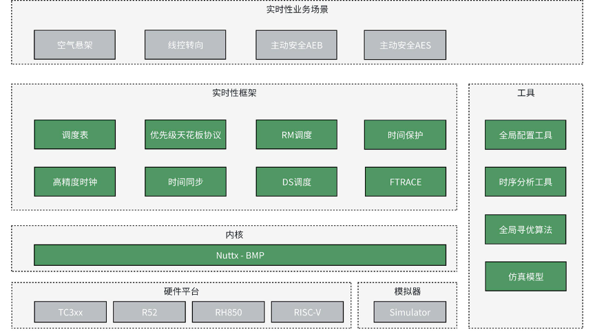
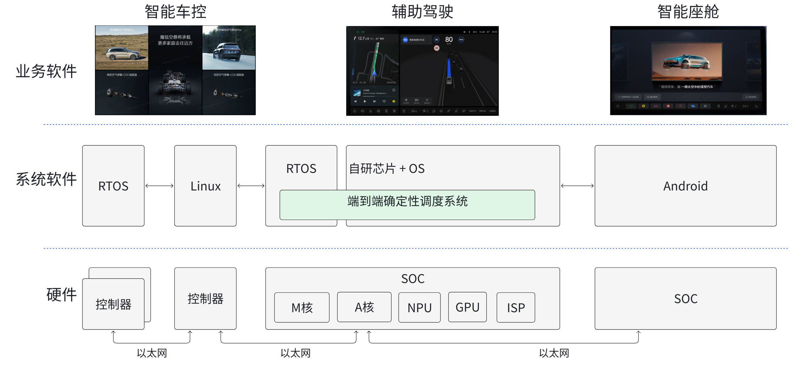

# 实时性关键技术原理与设计说明

## 1. 实时性概述

### 1.1. 实时性

实时性指系统在严格时间约束下完成指定任务的能力，其核心目标是提供确定性（Determinism）和可预测性（Predictability），确保任务能够在预定的时间期限（Deadline）内完成。在汽车等嵌入式系统中，尤其是涉及安全的关键功能，错过截止时间可能导致灾难性后果。

**确定性** ：任务执行时间的可预测性（波动范围≤5%周期时间）
**可调度性**：通过数学方法证明所有任务满足截止时间约束

实时性的误解：**“快”不等于“实时”**

- 实时性强调的是确定性和可预测性，即系统响应时间的可保证性，而不仅仅是平均速度快。
- 一个通用操作系统可能平均速度很快，但在某些情况下（如系统负载高、后台任务干扰）可能会出现不可预测的长延迟，这对于硬实时系统是不可接受的。RTOS通过其调度机制和资源管理，旨在提供可预测的、有上限的响应时间。

### 1.2. 实时性分类

汽车嵌入式软件实时性系统通常根据任务的时间约束和关键性进行分类，主要分为以下三类：

- 硬实时系统（Hard Real-Time System, HRT）：任务必须在严格的时间限制内完成，否则可能导致系统故障或安全事故。
- 软实时系统（Soft Real-Time System, SRT）：任务有时间约束，但偶尔超时不会导致灾难性后果，仅影响性能或用户体验。
- 非实时系统（Non-Real-Time System, NRT）：无严格时间要求，任务可延迟执行，通常用于后台处理或数据记录。
汽车嵌入式系统中对安全性、可靠性和确定性有严格的要求，因此需要采用硬实时操作系统。本文主要聚焦硬实时系统。

### 1.3. 影响实时性的原因

- 任务调度不当: 没有基于优先级的抢占机制，关键任务可能被非关键任务长时间阻塞。
- 资源争用与阻塞: 关键任务等待被低优先级任务持有的资源（如共享数据、外设），且没有有效的优先级反转处理机制。
- 中断处理延迟: 中断服务程序（ISR）过长，或者中断响应时间本身不确定。
- 不可预测的执行时间: 任务的执行时间受缓存（Cache Miss）、流水线、内存访问冲突等影响，变化范围很大。
- 外部系统延迟: 依赖的网络通信（如CAN、以太网）或传感器响应延迟。
- 系统过载: 处理器负载过高，任务总需求超过处理能力。

## 2. 硬实时性的关键技术

VCOS实时性设计架构图如下（绿色为VCOS对nuttx原生系统的增强）

### 2.1 确定性调度

- **RM调度策略**

- 可预测性强：RM 调度策略根据任务的周期来分配优先级，周期越短，优先级越高。由于任务的周期通常是固定的，因此任务的优先级也是固定的，这使得系统的调度行为具有很强的可预测性。开发人员可以在设计阶段就准确地分析每个任务的执行时间和调度顺序，从而更好地保证系统的实时性要求。
- 理论基础完善：RM 调度策略有完善的理论支持，通过利用率上限公式等可以方便地进行任务集可调度性分析。例如，对于一组独立的周期任务，当任务集的总利用率小于等于 n(2 1/n −1) （ n 为任务数量）时，该任务集在 RM 调度策略下是可调度的。这为系统设计和任务分配提供了科学的依据，有助于开发人员合理地规划系统资源和任务配置，保证系统的实时性和可靠性。

- **DS调度算法**

- 灵活处理非周期任务：对于周期任务和非周期任务混合调度的场景，该算法能将非周期任务的处理延迟到系统有空闲时间时进行，可灵活应对系统中随时出现的非周期任务，不会因为非周期任务的突然到来而打乱整个系统的调度计划，影响周期任务的执行。
- 调度开销低：该算法采用了较为简单的调度策略，不需要频繁地进行复杂的优先级计算和任务切换，相对其他一些复杂的调度算法，降低了调度过程中的开销，提高了系统的运行效率。
- 优先级天花板协议
- 避免了优先级反转：确保高优先级任务不会长时间被低优先级任务阻塞。一旦低优先级任务获得资源并提升优先级，其他中等优先级任务就无法抢占它，直到该低优先级任务释放资源，从而避免了优先级反转的发生，保证了高优先级任务能够及时执行。

### 2.2. 低延迟中断

- 快速响应外部事件，并将耗时处理推迟到任务层面，允许系统在保持对中断的快速响应的同时，以可控和可预测的方式处理复杂的中断逻辑。
- 中断线程化机制是一种将中断处理从中断上下文转移到线程上下文的技术。它通过将中断处理分为两个阶段，降低了中断延迟，提高了系统可预测性，简化了中断处理代码，改善了资源共享，并支持更复杂的中断处理逻辑。

### 2.3. 高精度时钟（HRT）

- 精准调度：提供ns级别的调度点，对于内核中的任务调度器而言，高精度时钟有助于实现更精准的任务时间片分配和调度。它可以精确地计算任务的执行时间，根据任务的优先级和时间需求，更合理地安排任务的执行顺序，减少任务切换的延迟，提高系统的整体运行效率。

### 2.4. 时间同步

- 多控制器协同调度：多控制器场景，计时器晶振不同，以及硬件个体差异，会产生累积误差；时间同步消除累积误差，使得各控制器协同调度。

### 2.5. 时间保护机制

- 检测和恢复故障：时间保护机制可以监测系统中各个任务的执行状态，如果某个任务出现异常长时间未完成的情况，可能是任务出现了故障。时间保护机制可以及时检测到这种情况，并采取相应的恢复措施，如重新启动任务或进行系统复位，提高系统的容错能力。

- 提高系统安全性：在一些安全关键系统中，时间保护机制可以作为一种安全防护措施，防止攻击者通过长时间占用系统资源或执行恶意任务来破坏系统的正常运行。

### 2.6. 时序分析工具

- 时序分析
  - 统计分析：对净执行时间（CET）、响应时间（RT）、抖动（JIT）、可调度性（PoMD）、端到端的延时（Latency）等做统计分析
  - UI展示：对净执行时间（CET）、响应时间（RT）、抖动（JIT）、可调度性（PoMD）、端到端的延时（Latency）等做UI展示，更直观地做时序分析
- 全局寻优算法
  - 系统配置全局自动寻优：基于全局配置工具获取系统部署全景图信息，再通过时序分析工具获取任务执行时间，采用启发式算法，以抖动约束、可调度性约束、端到端的延时约束为目标，全局寻优，找到部署最优解。
- 仿真模型
  - 提升全局寻优效率：全局寻优算法需要数万次的迭代搜索最优配置，基于硬件开发板验证，每次参数迭代需要几分钟，万次迭代需要很多天时间。为提升寻优效率，采用仿真模型，模拟调度行为，不用烧录，在PC机快速模拟配置变更对调度时序的影响，可在几分钟内完成全局寻优。
- 全局配置工具
  - 配置系统参数：配置任务、中断、运行核心、截止时间约束、端到端的延时等系统参数
  - 自动生成代码：基于UI或XML输入，自动生成C代码，提升开发效率、降低编码出错概率

### 2.7. BMP内核

- 任务隔离性好：每个核心专注于特定任务，能避免不同任务间的干扰，适合对安全性和可靠性要求高的系统，能有效防止某个任务的故障影响其他任务。
- 资源占用少：多核共用一份操作系统代码，减少资源占用。
- 性能可预测：由于每个核心的任务固定，其性能表现具有较高的可预测性，便于进行系统性能分析和优化。

## 3. 应用场景

汽车操作系统的架构图如下

其中智能车控和智能驾驶系统的实时性至关重要，它直接关系到车辆的安全性、功能可靠性以及用户体验。许多场景对时间要求极为严格，必须在规定时间内完成特定任务，若任务未能在指定时间内完成，可能会导致灾难性后果。

- 智能车控：
  - 空气魔毯：周期获取IMU数据，MCU数据处理，控制输出到悬架，主要耗时在硬件端到端延时在几ms级，延迟影响乘坐体验
  - 线控转向：周期获取转角信息，MCU数据处理，控制输出方向盘，端到端延时在几ms级，延迟可能造成事故
- 辅助驾驶：
  - 主动安全AES/AEB：Camera/Lidar输入，E2E大模型 + 主动安全控制输出，完成刹车、转向，端到端延时在几百ms级，延迟可能造成事故
- 安全气囊: 必须在碰撞发生后的极短时间内（通常是几十毫秒内）精确触发，晚了就失去保护意义，甚至可能造成二次伤害。
- ABS/ESP 系统: 必须在检测到车轮抱死或车辆失稳的瞬间，以极高的频率（通常是毫秒级）对刹车或引擎扭矩进行精确控制，任何延迟都可能导致失控或刹车距离延长。
- 电动助力转向 (EPS): 需要实时响应驾驶员的转向输入和车辆状态，确保转向助力的及时性和准确性，延迟可能导致操控困难或失控。
- 动力总成控制（发动机ECU）：燃油喷射时序误差需<0.1ms。
- 线控制动（Brake-by-Wire）：液压建压延迟直接影响制动距离（每1ms延迟增加0.3米）。

## 应用案例

魔毯空气悬架场景，对于实时性要求很高：空气悬架的处理算法为1ms周期任务，目标从IMU中断触发到IMU任务响应延时<1ms，且1ms周期任务抖动<100us。

- 系统响应更敏捷
  - 控制精度提高：实时性任务抖动降低意味着空气悬架系统能更精准地按照预设的控制策略进行操作。例如，在车辆行驶过程中遇到路面状况变化时，系统能够更准确地控制空气弹簧的刚度和减震器阻尼，将车辆的姿态控制在更精确的范围内，为乘客提供更稳定的乘坐感受。
  - 快速应对突发情况：当遇到紧急情况，如突然的变道或避让障碍物时，系统能够更迅速地做出反应，调整悬架参数，使车辆能够快速、稳定地完成相应动作，提高了车辆的操控性能和安全性。
- 数据处理更稳定
  - 传感器数据准确性提升：降低实时性任务的抖动有助于保证传感器数据的准确性和稳定性。传感器能够更精确地测量车身的运动状态和路面状况信息，为控制系统提供更可靠的数据支持，从而使系统做出更合理的决策。
  - 控制算法执行更可靠：稳定的实时性任务使得控制算法能够在准确的时间间隔内执行，避免了因抖动导致的算法执行偏差或错误。这有助于提高控制算法的性能，使空气悬架系统能够更好地适应不同的路况和行驶条件。
- 乘坐体验更舒适
  - 微小震动过滤更好：实时性任务抖动降低后，系统能够更有效地过滤掉路面带来的微小震动。这些微小震动在以往可能会被乘客感知到，而现在经过优化后的系统能够将其平滑处理，让乘客在车内几乎感受不到这些细微的颠簸，提升了乘坐的舒适性。
  - 动态调整更平稳：在车辆行驶过程中，空气悬架系统需要根据不同的工况动态调整悬架参数。实时性任务抖动的降低使得这种动态调整过程更加平稳，不会出现突然的刚度或阻尼变化，从而避免了对乘客造成的不适感。

VCOS实时性框架，通过以下技术实现上述实时性目标：

1. 采用高精度时钟精准调度
2. 将悬架相关任务部署在一个调度表中确保严格时序
3. 基于RM调度策略确保整个系统可调度性
4. 通过时间同步，协同IMU和控制器时钟
5. 通过FTRACE和时序分析工具获取全系统各任务的执行时间
6. 全局寻优算法结合全局部署工具获取的系统部署全景图，结合执行时间信息，基于仿真模型全局寻优，找到配置最优解
