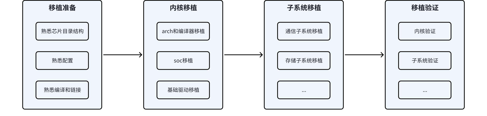
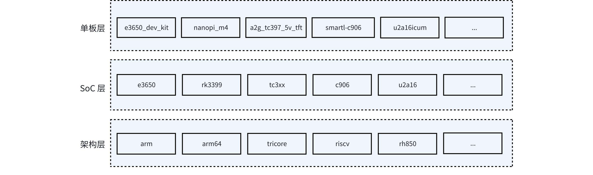
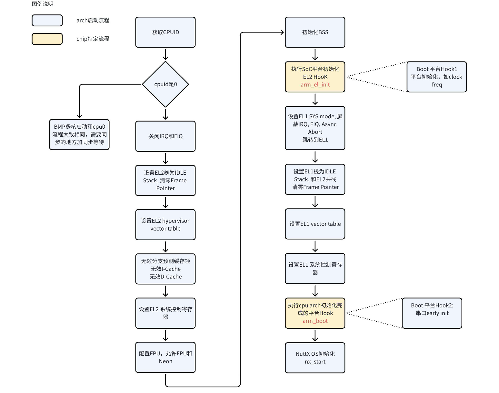
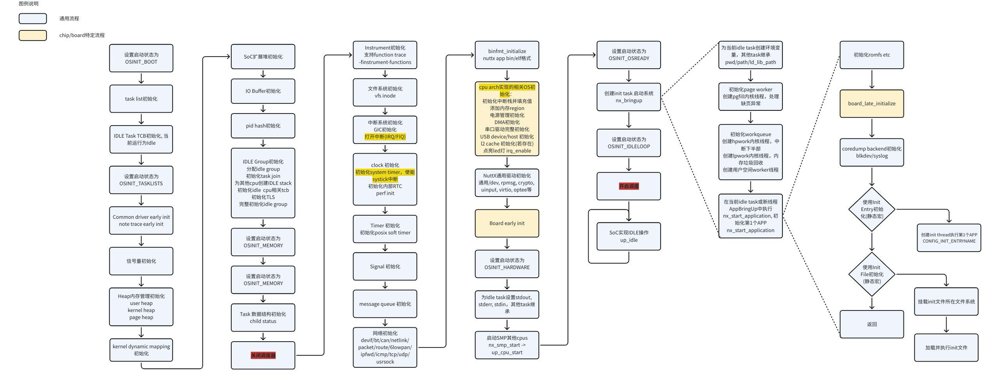
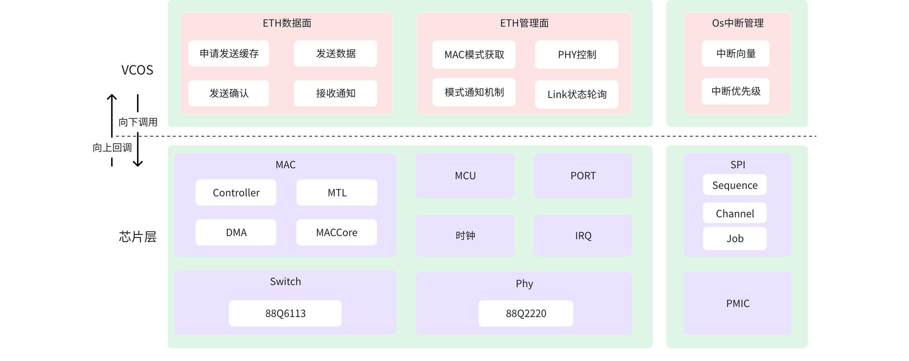
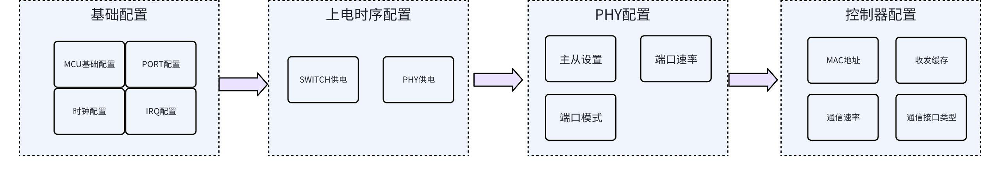
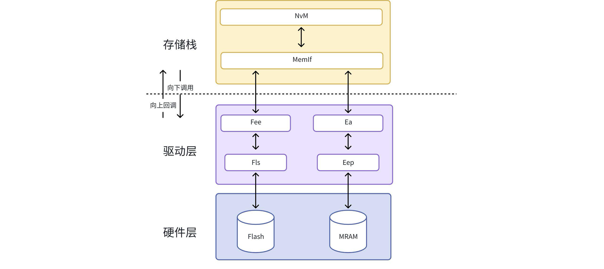
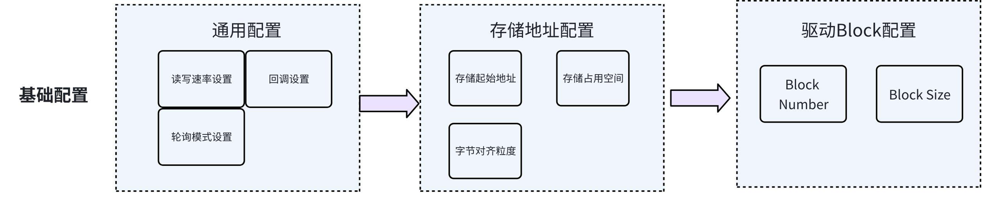

# 芯片移植指南
VCOS通过全方位彻底软硬解耦，建立逻辑清晰的硬件抽象层，使芯片移植变得简单高效。本文档用于指导芯片公司或个人开发者移植VCOS到新的芯片平台。

## 1. 移植流程
芯片移植的总体流程如下图所示：



## 2. 移植准备
### 2.1. 芯片解耦设计
芯片支持在结构上分为三层：1. 架构层， 2. SoC层， 3. 单板层，如下图所示：



### 2.2. 芯片目录结构
架构层放在`kernel/nuttx/arch`目录，SoC和单板层放在`vendor`目录，如下所示：
```plain text
vcos
├── kernel
│   └── nuttx
│       └── arch    # 内核已支持的架构代码
└── vendor
    └── <vendor_name>
        ├── boards   # 芯片移植的板级代码
        └── chips    # 芯片移植的SoC级代码
```
架构层放在`kernel/nuttx/arch`目录，结构如下所示：

```plain text
├── arch
   ├── <arch name>                       # 当前指令集架构的名称，如 arm/tricore/riscv
      ├── CMakeLists.txt                 # 用于构建当前目录和子目录的CMake脚本
      ├── include                        # 指令集架构相关适配内容的头文件目录
      │   ├── <arch variant name>        # 指令集架构相关的变量类型或者宏定义头文件
      │   ├── arch.h                     # 指令集架构相关的变量类型或者宏定义头文件
      │   ├── inttypes.h                 # 指令集架构相关的int 类型名称定义
      │   ├── irq.h                      # 指令集架构相关的int 类型名称定义
      │   ├── limits.h                   # 指令集架构相关的不同数据类型的最大值
      │   ├── spinlock.h                 # 指令集架构相关的spinlock操作定义
      │   ├── syscall.h                  # trap、svc 调用相关的定义
      │   └── types.h                    # 基础数据类型的定义
      ├── Kconfig                        # 当前指令集架构相关内容的配置
      └── src                            # 指令集架构相关适配内容的源文件目录
          ├── cmake                      # 编译器适配相关的cmake脚本
          ├── CMakeLists.txt             # 用于构建当前目录和子目录的CMake脚本
          ├── common                     # 当前指令集架构内核运行相关的公共代码
          ├── <arch variant name>        # 当前指令集架构的变体，如armv8-r
```

### 2.3. 芯片相关配置
VCOS采用Kconfig配置，遵循标准的Kconfig语法和使用方式，这里只介绍和芯片移植相关的内容。内核采用多层抽象封装，当定义一个新SoC芯片的时候，很多通用功能往往已经被内核通用化支持，只需要简单的使能即可。

例如：当适配一个基于arm cortex-r52 cpu的SoC时，只需简单的`select`即可支持对应的许多功能，如R52能力、FPU/NEON、多核、GICv3、FIQ等。
```plain text
config ARCH_CHIP_XXX
    bool "XXX CHIP (Cortex-r52)"
    select ARCH_CORTEXR52
    select ARCH_HAVE_FETCHADD
    select ARCH_HAVE_FPU
    select ARCH_HAVE_LOWVECTORS
    select ARCH_HAVE_MULTICPU
    select ARCH_HAVE_RESET
    select ARM_HAVE_NEON
    select ARMV8R_HAVE_DECODEFIQ
    select ARMV8R_DECODEFIQ
    select ARMV8R_HAVE_GICv3
    select ARMV8R_STRING_FUNCTION
    select ARCH_HAVE_PERF_EVENTS
    select ARCH_DCACHE
    select ARCH_ICACHE
    select ARCH_HAVE_IRQPRIO
    select ARCH_HAVE_CRC32
```

defconfig 为板级默认配置，和芯片相关的配置举例如下：
```plain text
CONFIG_ARCH="arm"
CONFIG_ARCH_ARM=y
CONFIG_ARCH_BOARD_CUSTOM=y
CONFIG_ARCH_BOARD_CUSTOM_DIR="../../vendor/semidrive/boards/E3650_DEV_KIT"
CONFIG_ARCH_BOARD_CUSTOM_DIR_RELPATH=y
CONFIG_ARCH_BOARD_CUSTOM_NAME="e3650_dev_kit"
CONFIG_ARCH_CHIP_ARM_CUSTOM=y
CONFIG_ARCH_CHIP_CUSTOM=y
CONFIG_ARCH_CHIP_CUSTOM_DIR="../../vendor/semidrive/chips/e3650"
CONFIG_ARCH_CHIP_CUSTOM_DIR_RELPATH=y
CONFIG_ARCH_CHIP_CUSTOM_NAME=""
CONFIG_ARCH_CHIP_E3650=y
CONFIG_ARCH_CHIP_E3650_GICD_BASE=0xF4000000
CONFIG_ARCH_CHIP_E3650_GICR_BASE=0xF4100000
CONFIG_SYS_CLOCK_HW_CYCLES_PER_SEC=24000000
CONFIG_ARCH_CHIP_E3650_TCM_ENABLE=y
CONFIG_ARCH_HAVE_DEBUG=y
CONFIG_ARCH_INTERRUPTSTACK=4096
CONFIG_ARCH_SETJMP_H=y
CONFIG_ARM_THUMB=y
```
把chip和board目录放到定制化的vendor目录下，需要通过配置项告诉编译系统，以便编译时特殊处理。

Kconfig配置项最终会生成config.h，在`out/**/include/nuttx/config.h`，编译脚本会把`out/**/include`设为头文件标准搜索路径，所以使用时 `#include <nuttx/config.h>`。 相似的可以查看`out/**/include` 路径下的头文件均可对外使用。

### 2.4. 芯片相关编译
VCOS支持CMake编译，兼容通用的CMake语法，也有一些预封装的CMake函数和变量。这里只介绍和芯片移植相关的内容。

内核编译时Chip和Board默认路径在`kernel/nuttx/arch`, `kernel/nuttx/boards`下，但也可以通过上面配置项，`CONFIG_ARCH_BOARD_CUSTOM_DIR, CONFIG_ARCH_CHIP_CUSTOM_DIR`修改到定制化的路径下，如VCOS要求的`vendor/<vendor_name>/chips/, vendor/<vendor_name>/boards/`。编译时会把`vendor/<vendor_name>/chips/`和`kernel/nuttx/arch`编译打包到同一个libarch.a，`vendor/<vendor_name>/boards/`默认编译为libboard.a。具体实现为在编译输出目录`out/arch/<isa>/src/`新建一个chip软连接到vendor对应chip目录下，对应的也会新建`board/board`软连接到对应的vendor目录下。 例如：
```plain text
out/**/arch/arm/src/
    chip -> vendor/<vendor_name>/chips/<chip_name>
    board/board -> vendor/<vendor_name>/boards/<board_name>
```

**CMake变量**
| **变量名** |  **含义** |
| :---------- | :------------- |
| NUTTX_BOARD_DIR | 指代board目录 |
| NUTTX_APPS_DIR | 指代apps目录 |
| NUTTX_DIR | 指代kernel/nuttx目录 |

**CMake函数**

内核默认封装了一些常用的CMake函数，详细可查看`kernel/nuttx/cmake/**.cmake`

## 3. 内核移植
### 3.1. ARCH移植
VCOS内核已经支持了主流的 arch，包括arm32/arm64, risc-v 32/64, tricore, rh850等，如下表所示。
>
> 注意：下面表格只列出了主要的arch，没有列全。如果您想要的arch没有在此列出，请检查vcos/kernel/nuttx/arch代码目录。
>
|  **vendor**  |  **isa**  |  **cpu arch**  |
| :---------- | :------------- | :---------- |
| arm | arm | arm9, armv6-m/armv7-m/armv8-m, armv7-r/armv8-r, armv7-a |
| arm | arm64 | armv8-a, armv8-r(r82) |
| - | risc-v | risc-v 32/64 |
| infineon | tricore | tx3xx, tc4xx |
| renesas | rh850 | rh850g3k, u2ax |
| mips | mips32 | mips32 |
| intel | x86 | i486 |
| intel | x86_64 | intel64 |

**头文件引用**
arch提供的能力，通过对外头文件提供给其他功能使用。
|  **原始头文件路径**  |  **对外引用路径**  |
| :---------- | :------------- |
| `nuttx/arch/<isa>/include` | `arch/` |

编译过程中会在编译输出目录的`<out>/<board_name>/<project_name>/include/arch/` 生成软连接到 `vcos/nuttx/arch/<isa>/include`。

### 3.2. 启动流程
启动流程一般从板子上电后，启动Bootloader，Bootloader加载系统固件，开始系统固件的启动。Bootloader阶段，不同芯片平台各自不同，这里主要介绍系统固件的启动。
#### 3.2.1 ARCH启动
系统固件的启动， 从arch的汇编代码执行，一般为`__start`函数。

不同arch的启动，具体实现不同，但完成的功能相似，都是完成cpu的初始化，包括设置异常向量表、配置CPU的系统控制寄存器、初始化BSS、设置初始栈和中断栈等、初始化CPU内子模块如FPU等。 在arch的启动流程中一般会预留Hook给芯片平台，以实现芯片平台在不同阶段完成初始化的需求，芯片平台在适配过程中，需要了解arch的启动，并实现需要的Hook API。

由于各arch启动流程不同， 这里以armv8-r启动。其他arch启动流程，请参考代码`kernel/nuttx/arch/<isa>/**/xxx_head.S`。armv8-r启动说明：

启动入口`kernel/nuttx/arch/arm/src/armv8-r/arm_head.S::__start`



armv8-r arch启动留给芯片适配的Hook API如下：

|  **Hook API**  |  **Hook level**  |  **Hook stage**  |   **Hook Description**  |
| :--------------| :----------------| :----------------|  :----------------------|
| `void arm_el_init(void)` | soc chip | armv8r el2初始化完成，即将跳转到el1| 提供soc chip在arm el2初始化阶段的需要完成的初始化|
| `void arm_boot(void)` | soc chip | armv8r arch初始化完成，即将调到内核初始化| 提供soc chip在arch初始化完成前的初始化，如BMP percpu初始化，mpu和cache配置，串口早期初始化等|

#### 3.2.2 内核启动
这里主要介绍通用的内核启动流程，入口函数 vcos/kernel/nuttx/sched/init/nx_start.c::nx_start。通用内核启动流程图如下：



nx_start是内核通用的初始化，在其过程中有预留给chip/board执行特定初始化流程的Hook函数。chip/board实现特定的Hook就可以实现特定的初始化处理。也可以理解为移植内核到一个新的芯片，启动部分按需实现这些API。
|  **Hook API**  |  **Hook level**  |  **Hook stage**  |   **Hook Description**  |
| :--------------| :----------------| :----------------|  :----------------------|
| `up_allocate_heap` | soc chip | heap内存管理初始化 | 提供user heap memory region |
| `up_allocate_kheap` | soc chip | heap内存管理初始化| 提供kernel heap memory region |
| `up_allocate_pgheap` | soc chip | heap内存管理初始化| 提供page allocator memory region |
| `up_addrenv_kmap_init` | soc chip | 内核虚拟内存映射| 内核虚拟内存映射 |
| `up_extraheaps_init` | soc chip | 额外的heap内存管理初始化| 提供额外heap 初始化 |
| `up_initial_state` | cpu arch | Idle group初始化| 初始化tcb的cpu arch相关部分，初始化任务初始上下文 |
| `up_timer_initialize` | cpu arch/soc chip | 定时器初始化 | 初始化system timer, enable systick |
| `up_rtc_initialize` | soc chip | RTC时钟初始化| 初始化片内RTC |
| `up_initialize` | cpu arch | cpu相关OS初始化 | cpu相关OS初始化 |
| `board_early_initialize` | board | 板子早期初始化 | 板子早期初始化。不能等待事件，因为在内核boot 流程中，此时还未开始调度|
| `board_late_initialize` | board | 板子延迟初始化 | 板子延迟初始化。可以等待事件，在独立的AppBringUP线程中执行。在内核初始化全部完成开启调度，当调度到AppBringUP线程时开始执行。 注意：初始化时机不确定，依赖于调度算法和AppBringUP线程的优先级。 |

### 3.3. SoC移植
#### 3.3.1. 目录介绍
SoC适配代码放到`vendor/<vendor_name>`目录，目录中文件按需可选，不强制全部实现。 详细如下所示：
```plain text
<vendor_name>
├── boards
│   └── common                  # 按需放置一些vendor和板级相关通用代码（可选）
│   └── aaa                     # 板子名称
│      └── include              # 板子对外头文件路径，对外使用路径<arch/board/yyy.h>
│           └── board.h         # 板子硬件定义，可对外使用的，如板级时钟/LED/PIN等硬件配置
│      └── configs              # 板子系统功能配置
│           └── project_name    # 工程名
│               └── defconfig   # 为此板子和工程的系统功能默认配置
│      └── scripts              # 板子脚本
│           └── linkscript.ld   # 板子的链接脚本，名称不做约束
│      └── src                  # 板子代码
│           └── xxx_bringup.c   # 板子通用启动，实现board_bringup
│           └── xxx_appinit.c   # APP控制的板子初始化，实现board_app_initialize
│           └── xxx_boot.c      # 板子早期和延迟启动代码，实现board_early_initialize和board_late_initialize
│           └── xxx_reset.c     # 实现板级复位 board_reset（可选）
│           └── xxx_zzz.c       # 板子特定驱动（如有，目录或文件名称不约束）
│      └── Kconfig              # 板子Kconfig配置定义
│      └── CMakeLists.txt       # 板子CMake脚本，支持Cmake编译
├── chips
│   └── common                  # 按需放置一些vendor和芯片相关通用代码（可选）
│   └── xxx                     # 芯片名称
│      └── include              # 芯片对外头文件路径，对外使用路径 <arch/chip/yyy.h>
│          └── chip.h           # chip.h 定义芯片资源，如芯片的内存资源（所有可用内存的定义，首地址和大小），外设资源（个数，控制寄存器地址）等
│          └── irq.h            # irq.h 定义中断号分配，如芯片外设的中断号定义等
│      └── src                  # 芯片源码目录
│          └── chip.h           # 对此目录内的芯片资源定义，不对此目录外使用的芯片资源定义
│          └── xxx_boot.c       # 实现芯片级的启动代码，实现arch层启动预留的Hook
│          └── xxx_serial.c     # 串口的初始化
│          └── <chip_driver>    # 芯片特定外设驱动代码目录（可选），目录名称不强制约束。
│      └── Kconfig              # 芯片Kconfig配置定义
│      └── CMakeLists.txt       # 芯片CMake脚本，支持CMake编译
```

#### 3.3.2. 头文件
编译过程中会在编译输出目录的`<out>/<board_name>/<project_name>/include/arch/` 生成软连接到 `vendor/<vendor_name>/chips/xxx/include`,  `vendor/<vendor_name>/boards/<aaa>/include/`。
芯片对外提供的能力，通过以下头文件对外提供。

|  **原始头文件路径**  |  **对外引用路径**  |
| :---------- | :------------- |
| `vendor/<vendor_name>/chips/xxx/include` | `arch/chip` |
| `vendor/<vendor_name>/boards/<aaa>/include/` | `arch/board` |

#### 3.3.3. 链接脚本
这里只说明VCOS对链接脚本的特殊要求。
BMP多核 percpu定义
```plain text
  .percpu_data : ALIGN(64) {
        __percpu_data_start = .;
        *(.data..percpu*)     /* 名称取决于chip对__percpu_data的宏定义 */
        . = ALIGN(64);        /* 建议按cpu cache-line对齐 */
        __percpu_data_end = .;
    } > SRAM

    .percpu_bss (NOLOAD): ALIGN(64) {
        __percpu_bss_start = .;
        *(.bss..percpu*)     /* 名称取决于chip对__percpu_bss的定义 */
        . = ALIGN(64);       /* 建议按cpu cache-line对齐 */
        __percpu_bss_end = .;
    } > SRAM

    . += NUM_CPUS * (__percpu_bss_end - __percpu_data_start);

```

#### 3.3.4. 适配接口
SoC适配ARCH的接口需要查看不同ARCH代码对SoC要求的Hook接口，下列介绍的是板级适配接口，实现文件在`<vendor_name>/boards/<aaa>/src/`，接口说明如下：

|  **接口名称**  |  **实现文件**  |  **接口描述**  |   **注意事项**  |  **配置**  |  **是否必选**  |
| :-------------| :------------| :-------------|  :-------------|  :--------|  :------------|
| `void board_early_initialize(void)` | xxx_boot.c | **描述**：实现板子早期初始化，在内核启动的上下文中调用，具体执行阶段看内核启动流程。 | 1. API内部不能阻塞，因为在内核的单线程启动流程中，此时未开启调度。2. 此时内核已基本完成初始化，可以调用大部分内核API，但此时没有初始化stdio，smp多核，workqueue。 | CONFIG_BOARD_EARLY_INITIALIZE  | **可选**，当开启对应功能配置时需实现 |
| `void board_late_initialize(void)` | xxx_boot.c | **描述**：板子延迟初始化。可以等待事件，不在内核启动线程上下文中执行。在独立的AppBringUP线程中执行，当内核初始化完成，开启调度后，当调度到AppBringUP线程时此函数才开始执行。调用board_bringup。| 此时板子延迟初始化和应用初始化并行，启动流程不保证其初始化时序。请在应用中自行保证时序 | CONFIG_BOARD_LATE_INITIALIZE  | **可选**，board_late_initialize, board_app_initialize 二选一 |
| `int board_app_initialize(uintptr_t arg)` | xxx_appinit.c | **描述**：app通过boardctl的BOARDIOC_INIT命令字控制板子初始化，调用board_bringup。<br> **入参**: arg, 类型uintptr_t, boardctl透传这个参数给board<br> **返回值**：OK(0)： 成功，<0: 失败，请返回标准POSIX 错误码（负数） | 在app的线程上下文中执行，注意栈的使用和并发问题。 app控制其调用的时机。 | CONFIG_BOARDCTL  | **可选**，board_late_initialize, board_app_initialize 二选一 |
| `int board_bringup(void)` | xxx_bringup.c | **描述**：板子后期初始化，板级驱动等.<br> **入参**: 无<br> **返回值**：OK(0)： 成功, <0: 失败，请返回标准POSIX 错误码（负数） | 当CONFIG_BOARD_LATE_INITIALIZE开启，其执行在board_late_initialize（AppBringUP线程上下文）否则其执行在board_app_initialize（app线程上下文）. | 无  | **必选** |
| `int board_reset(int status)` | xxx_reset.c | **描述**：重启板子。<br>**入参**: status, 板子需要重启的事件，板子特定的参数，OS透传参数。 板子重启成功不返回。<br> **返回值**：板子重启失败的原因 | 无 | CONFIG_BOARDCTL_RESET  | **可选**，当开启对应功能配置时需实现 |

>
> 注意： 为了APP与板子的交互方式， 内核提供了一种相对标准的实现方式，boardctl，用于实现app通过标准字符设备文件方式和板子交互，其通过ioctl实现。这实现了类似Linux操作文件的方式实现和board交互，但也造成了一定的冗余，当然您也可以选择直接调用board api，简单高效
如想在板子支持更多的ioctl功能，请参考`kernel/nuttx/boards/boardctl.c`，实现其要求的API。
>

### 3.4. 基础驱动移植
#### 3.4.1. TIMER
内核中普通TIMER为OneshotTimer, 用于支持内核tick和非高精度的rt framework counter。OneshotTimer 需要适配的接口定义位于`kernel/nuttx/include/timers/oneshot.h`:
```c
struct oneshot_operations_s
{
  CODE int (*max_delay)(FAR struct oneshot_lowerhalf_s *lower,
                        FAR struct timespec *ts);                    # 获取最大delay，格式为 struct timespec
  CODE int (*start)(FAR struct oneshot_lowerhalf_s *lower,
                    oneshot_callback_t callback, FAR void *arg,
                    FAR const struct timespec *ts);                  # 启动运行oneshot timer，在ts后触发超时
  CODE int (*cancel)(FAR struct oneshot_lowerhalf_s *lower,
                     FAR struct timespec *ts);                       # 停止运行oneshot timer,返回超时点，格式为 struct timespec
  CODE int (*current)(FAR struct oneshot_lowerhalf_s *lower,
                      FAR struct timespec *ts);                      # 获取当前timer的值，并转换为struct timespec
  CODE int (*tick_max_delay)(FAR struct oneshot_lowerhalf_s *lower,  # 获取最大delay，格式为 clock_t
                             FAR clock_t *ticks);
  CODE int (*tick_start)(FAR struct oneshot_lowerhalf_s *lower,      # 启动运行oneshot timer，在ticks后触发超时
                         oneshot_callback_t callback, FAR void *arg,
                         clock_t ticks);
  CODE int (*tick_cancel)(FAR struct oneshot_lowerhalf_s *lower,     # 停止运行oneshot timer,返回超时点，格式为 clock_t
                          FAR clock_t *ticks);
  CODE int (*tick_current)(FAR struct oneshot_lowerhalf_s *lower,    # 获取当前timer的值，并转换为clock_t
                           FAR clock_t *ticks);
};
```

以上接口适配实现可参考`kernel/nuttx/arch/arm/src/armv8-r/arm_arch_timer.c` 中的 `g_oneshot_ops`：

```c
static const struct oneshot_operations_s g_oneshot_ops =
{
  .max_delay      = arm_time_max_delay,
  .start          = arm_time_start,
  .cancel         = arm_time_cancel,
  .current        = arm_time_current,
  .tick_start     = arm_tick_start,
  .tick_current   = arm_tick_current,
  .tick_max_delay = arm_tick_max_delay,
  .tick_cancel    = arm_tick_cancel,
};
```

#### 3.4.2. HRTIMER
内核中高精度Timer， HRTimer 用于支持高精度的rt framework counter，HRTimer要适配的接口定义位于`kernel/nuttx/hrtimer.h`
```c
struct hrtimer_ops_s {
    void (*set_expire)(struct hrtimer_queue_s *, hrtimer_tick_t expiration_time); # 设置timer 的到期点
    hrtimer_tick_t (*current)(struct hrtimer_queue_s *);                          # 获取timer 当前的值
    void (*start)(struct hrtimer_queue_s *);                                      # 启动timer
    void (*trigger)(struct hrtimer_queue_s *);                                    # trigger timer 中断
};

```
以上接口适配实现可参考`kernel/nuttx/arch/arm/src/armv8-r/arm_arch_timer.c` 中的 `g_hrtimer_ops`：
```c
static const struct hrtimer_ops_s g_hrtimer_ops =
{
  .current      = arm_hrtimer_current,
  .set_expire   = arm_hrtimer_set_compare,
  .start        = arm_htimer_start,
  .trigger      = arm_htimer_trigger,
};
```

#### 3.4.3. UART
Uart需要适配的接口定义位于`kernel/nuttx/include/nuttx/serial/serial.h `：
```c
struct uart_ops_s
{
  /* Configure the UART baud, bits, parity, fifos, etc. This method is called
   * the first time that the serial port is opened. For the serial console,
   * this will occur very early in initialization; for other serial ports
   * this will occur when the port is first opened. This setup does not
   * include attaching or enabling interrupts. That portion of the UART setup
   * is performed when the attach() method is called.
   */

  CODE int (*setup)(FAR struct uart_dev_s *dev);

  /* Disable the UART.  This method is called when the serial port is closed.
   * This method reverses the operation the setup method.
   * NOTE that the serial console is never shutdown.
   */

  CODE void (*shutdown)(FAR struct uart_dev_s *dev);

  /* Configure the UART to operation in interrupt driven mode. This method is
   * called when the serial port is opened. Normally, this is just after the
   * the setup() method is called, however, the serial console may operate in
   * a non-interrupt driven mode during the boot phase.
   *
   * RX and TX interrupts are not enabled when by the attach method (unless
   * the hardware supports multiple levels of interrupt enabling). The RX
   * and TX interrupts are not enabled until the txint() and rxint() methods
   * are called.
   */

  CODE int (*attach)(FAR struct uart_dev_s *dev);

  /* Detach UART interrupts. This method is called when the serial port is
   * closed normally just before the shutdown method is called.
   * The exception is the serial console which is never shutdown.
   */

  CODE void (*detach)(FAR struct uart_dev_s *dev);

  /* All ioctl calls will be routed through this method */

  CODE int (*ioctl)(FAR struct file *filep, int cmd, unsigned long arg);

  /* Called (usually) from the interrupt level to receive one character from
   * the UART.  Error bits associated with the receipt are provided in the
   * the return 'status'.
   */

  CODE int (*receive)(FAR struct uart_dev_s *dev, FAR unsigned int *status);

  /* Call to enable or disable RX interrupts */

  CODE void (*rxint)(FAR struct uart_dev_s *dev, bool enable);

  /* Return true if the receive data is available */

  CODE bool (*rxavailable)(FAR struct uart_dev_s *dev);

#ifdef CONFIG_SERIAL_IFLOWCONTROL
  /* Return true if UART activated RX flow control to block more incoming
   * data.
   */

  CODE bool (*rxflowcontrol)(FAR struct uart_dev_s *dev,
                             unsigned int nbuffered, bool upper);
#endif

#ifdef CONFIG_SERIAL_TXDMA
  /* Start transfer bytes from the TX circular buffer using DMA */

  CODE void (*dmasend)(FAR struct uart_dev_s *dev);
#endif

#ifdef CONFIG_SERIAL_RXDMA
  /* Start transfer bytes from the TX circular buffer using DMA */

  CODE void (*dmareceive)(FAR struct uart_dev_s *dev);

  /* Notify DMA that there is free space in the RX buffer */

  CODE void (*dmarxfree)(FAR struct uart_dev_s *dev);
#endif

#ifdef CONFIG_SERIAL_TXDMA
  /* Notify DMA that there is data to be transferred in the TX buffer */

  CODE void (*dmatxavail)(FAR struct uart_dev_s *dev);
#endif

  /* This method will send one byte on the UART */

  CODE void (*send)(FAR struct uart_dev_s *dev, int ch);

  /* Call to enable or disable TX interrupts */

  CODE void (*txint)(FAR struct uart_dev_s *dev, bool enable);

  /* Return true if the tranmsit hardware is ready to send another byte.
   * This is used to determine if send() method can be called.
   */

  CODE bool (*txready)(FAR struct uart_dev_s *dev);

  /* Return true if all characters have been sent.  If for example, the UART
   * hardware implements FIFOs, then this would mean the transmit FIFO is
   * empty.  This method is called when the driver needs to make sure that
   * all characters are "drained" from the TX hardware.
   */

  CODE bool (*txempty)(FAR struct uart_dev_s *dev);

  /* Call to release some resource about the device when device was close
   * and unregistered.
   */

  CODE int (*release)(FAR struct uart_dev_s *dev);

  /* Receive multiple bytes.
   * Returns the actual number of characters received.
   */

  CODE ssize_t (*recvbuf)(FAR struct uart_dev_s *dev,
                          FAR void *buf, size_t len);

  /* This method will send multiple bytes.
   * Returns the actual number of characters sent.
   */

  CODE ssize_t (*sendbuf)(FAR struct uart_dev_s *dev,
                          FAR const void *buf, size_t len);
};
```

## 4. 子系统移植
### 4.1. 通信子系统移植
#### 4.1.1. 通信移植框架


#### 4.1.2. 以太适配流程


#### 4.1.3. 以太驱动适配接口
#### 4.1.3.1. ETH
|  **接口类型**  |  **接口名称**  |  **接口描述**  |   **注意事项**  |  **调用方向**  |  **是否必选**  |
| :-------------| :------------| :-------------|  :-------------|  :-----------|  :------------|
| ETH数据面 | BufReq_ReturnType ethif_provide_tx_buffer<br>(<br>uint8 ctrl_idx,<br> eth_frame_type frame_type,<br> uint8 priority,<br> eth_buf_idx_type *bufidx_ptr,<br> eth_data_type **buf_ptr,<br> uint16 *lenbyte_ptr<br>)|  **描述**：ethif获取发送缓存。<br> **入参**：<br>1. ctrl_idx：控制器索引<br> 2. frame_type：以太帧类型（例如VLAN帧）<br>3. priority：帧优先级（0-7）<br>4. bufidx_ptr：指向申请到的缓存索引<br> 5. buf_ptr：指向申请到的缓存<br> 6. lenbyte_ptr：申请到的缓存长度<br> **返回值**：<br> 1. BUFREQ_OK:  获取发送缓存成功<br> 2. BUFREQ_E_NOT_OK:  获取发送缓存失败<br> 3. BUFREQ_E_BUSY:  所有发送缓存都被占用<br> 4. BUFREQ_E_OVFL:  获取的发送缓存过长<br>| 1. 不可跨核裸调<br> 2. 建议由UpLayer发起调用<br>| 向下调用  | **必选** |
| ETH数据面 | Std_ReturnType ethif_transmit<br>(<br>uint8 ctrl_idx,<br> eth_buf_idx_type buf_idx,<br> eth_frame_type frame_type,<br> boolean tx_confirmation,<br> uint16 len_byte,<br> const uint8 *phys_addr_ptr<br>) | **描述**：ethif发送数据<br> **入参**：<br>1. ctrl_idx：控制器索引<br> 2. buf_idx：发送缓存索引<br> 3. frame_type：以太帧类型（例如VLAN帧）<br> 4. tx_confirmation：是否需要触发发送确认<br> 5. len_byte：数据长度<br>6. phys_addr_ptr：指向物理目标MAC地址<br> **返回值**：<br> 1. E_OK: 发送成功<br> 2. E_NOT_OK: 发送失败<br> | 1. 不可跨核裸调<br> 2. 建议由UpLayer发起调用<br>| 向下调用  | **必选** |
| ETH数据面 | void ethif_txconfirmation<br>(<br>uint8 ctrl_idx,<br> eth_buf_idx_type buf_idx<br>)| **描述**：ethif发送回调函数<br> **入参**：<br>1. ctrl_idx：控制器索引<br> 2. buf_idx：发送缓存索引<br> **返回值**：无 | 是驱动回调OS的接口 |  向上回调  | **必选** |
| ETH数据面 | void ethif_rxindication<br>(<br>uint8 ctrl_idx,<br> eth_frame_type frame_type,<br> boolean is_broadcast,<br> const uint8 *phys_addr_ptr,<br> const eth_data_type *data_ptr,<br> uint16 len_byte<br>) | **描述**：ethif接收回调<br> **入参**：<br>1. ctrl_idx：控制器索引<br> 2. frame_type：以太帧类型（例如VLAN帧）<br> 3. is_broadcast：是否为广播报文<br> 4. phys_addr_ptr：指向接收帧的物理源MAC地址<br> 5. data_ptr：指向payload的指针<br> 6. len_byte：payload长度<br> **返回值**：无 | 是驱动回调OS的接口 |  向上回调  | **必选** |
| ETH管理面 | Std_ReturnType ethif_get_controller_mode<br> (<br> uint8 ctrl_idx, <br> eth_mode_type *ctrlmode_ptr<br>)| **描述**：获取控制器状态<br> **入参**：<br>1. ctrl_idx：控制器Id<br> 2. ctrlmode_ptr：模式指针<br> ETH_MODE_DOWN：控制器禁用<br> ETH_MODE_ACTIVE：控制器正常工作<br> 返回值：<br>1. E_OK: 获取控制器状态成功<br>2. E_NOT_OK: 获取控制器状态失败 | 1. 不可跨核裸调<br> 2. 对于相同控制器，不可重入 |  向下调用  | **必选** |
| ETH管理面 | void ethif_ctrlmode_indication<br>(<br> uint8 ctrl_idx,<br> eth_mode_type ctrlmode<br>)| **描述**：设置控制器模式回调<br> **入参**：<br>1. ctrl_idx：控制器Id<br> 2. ctrlmode：控制器模式<br> ETH_MODE_DOWN：控制器禁用<br> ETH_MODE_ACTIVE：控制器正常工作<br> 返回值：无 | 是驱动回调OS的接口 |  向上回调  | **必选** |
| ETH管理面 | void ethif_set_phys_addr<br>(<br>uint8 ctrl_idx,<br> const uint8 *phys_addr_ptr<br>) | **描述**：设置PHY地址<br> **入参**：<br>1. ctrl_idx：控制器Id<br> 2. phys_addr_ptr：指向物理源MAC地址<br> 返回值：无 | 1. 由驱动发起调用，用户不应该调用<br>2. 对于相同控制器，不可重入 |  向上回调  | **必选** |
| ETH管理面 | void ethif_get_phys_addr<br>(<br>uint8 ctrl_idx,<br> uint8 *phys_addr_ptr<br>) | **描述**：获取PHY地址<br> **入参**：<br>1. ctrl_idx：控制器Id<br> 2. phys_addr_ptr：指向获取到的物理源MAC地址<br> 返回值：无 | 1. 不可跨核裸调<br>2. 对于相同控制器，不可重入 |  向下调用  | **必选** |
| ETH管理面 | Std_ReturnType ethif_update_phys_addr_filter<br>(<br>uint8 ctrl_idx,<br>const uint8 *phys_addr_ptr, <br>eth_filter_action_type action<br>) | **描述**：更新PHY地址过滤器<br> **入参**：<br>1. ctrl_idx：控制器Id<br> 2. phys_addr_ptr：要更新的目标PHY地址<br>3. action：<br> ETH_ADD_TO_FILTER：添加Filter<br> ETH_REMOVE_FROM_FILTER：移除Filter<br> 返回值：1. E_OK: 更新PHY地址过滤器成功<br>2. E_NOT_OK: 更新PHY地址过滤器失败 | 1. 不可跨核裸调<br>2. 对于相同控制器，不可重入 |  向下调用  | **可选**，要更新PHY地址过滤器时需要，例如使能多播、广播。 |
| ETH管理面 | void ethif_mainfunction_state(void) | **描述**：获取link状态主函数<br> **入参**：无 **返回值**：无 | 用户需自实现：<br> `trcv_get_linkstate`<br> `swt_get_linkstate`|  轮询调用  | **必选** |


### 4.2. 存储子系统移植
#### 4.2.1. 存储移植框架


#### 4.2.2. 存储适配流程


#### 4.2.3. 存储驱动适配接口
##### 4.2.3.1. Ea
|  **接口名称**  |  **接口描述**  |  **调用方向**  |  **是否必选**  |
| :------------| :-------------|  :-----------|  :------------|
|uint8 ea_read_block<br>(<br>uint16 block_number,<br> uint16 block_offset,<br> uint8 *buffer_ptr,<br> uint16 length<br>)|**描述**：读取存储器中的一个数据块。<br>**参数**：<br> 1. block_number：逻辑数据块编号；<br> 2. block_offset：数据块内偏移量；<br> 3. buffer_ptr：读取的数据存储地址；<br> 4. length：读取的数据长度。<br> **返回值**:<br> E_OK：读操作成功；<br> E_NOT_OK：读操作失败<br>| 向下调用 | **必选** |
|uint8 ea_write_block<br>(<br>uint16 block_number,<br> uint8 *buffer_ptr<br>)|**描述**：数据写入存储器中的一个数据块。<br> **参数**：<br> 1. block_number：逻辑数据块编号；<br> 2. buffer_ptr：写入的源数据地址。<br> **返回值**:<br> E_OK：写操作成功；<br> E_NOT_OK：写操作失败<br>| 向下调用 | **必选** |
|uint8 ea_erase_immediate_block(uint16 block_number)|**描述**：擦除存储器中数据块的数据。<br> **参数**：<br> 1. block_number：逻辑数据块编号；<br>  **返回值**:<br> E_OK：擦除操作成功；<br> E_NOT_OK：擦除操作失败<br>| 向下调用 | **必选** |
|uint8 ea_invalidate_block(uint16 block_number)|**描述**：标记存储器中的一个数据块为无效。<br> **参数**：<br> 1. block_number：逻辑数据块编号；<br>  **返回值**:<br> E_OK：标记无效操作成功；<br> E_NOT_OK：标记无效操作失败<br>| 向下调用 | **必选** |
|void ea_cancel(void)|**描述**：取消当前正在进行的读/写/擦操作。<br> **参数**： 无 <br> **返回值**:无 | 向下调用 | **必选** |
|uint8 ea_get_status(void)|**描述**：获取存储器当前的状态信息。<br> **参数**： 无 <br> **返回值**:<br>0：初始化未完成；<br>1：当前未idle状态；<br>2：当前为busy状态<br>3：内部操作busy。<br> | 向下调用 | **必选** |
|uint8 ea_get_job_result(void)|**描述**：获取读/写/擦操作的结果。<br> **参数**： 无 <br> **返回值**:<br>0：任务成功；<br> 1：任务失败；<br> 2：任务执行中；<br> 3：任务已取消；<br> 4：块数据不连续；<br>5：块数据无效。 | 向下调用 | **必选** |
|void ea_set_mode(uint8 mode)|**描述**：切换底层EEPROM驱动程序模式的函数。<br> **参数**：<br> 1. mode：需要切换到的模式 <br> **返回值**: 无 | 向下调用 | **必选** |

##### 4.2.3.2. Fee
|  **接口名称**  |  **接口描述**  |  **调用方向**  |  **是否必选**  |
| :------------| :-------------|  :-----------|  :------------|
|uint8 fee_read_block<br>(<br>uint16 block_number,<br> uint16 block_offset,<br> uint8 *buffer_ptr,<br> uint16 length<br>)|**描述**：读取存储器中的一个数据块。<br>**参数**：<br> 1. block_number：逻辑数据块编号；<br> 2. block_offset：数据块内偏移量；<br> 3. buffer_ptr：读取的数据存储地址；<br> 4. length：读取的数据长度。<br> **返回值**:<br> E_OK：读操作成功；<br> E_NOT_OK：读操作失败<br>| 向下调用 | **必选** |
|uint8 fee_write_block<br>(<br>uint16 block_number,<br> uint8 *buffer_ptr<br>)|**描述**：数据写入存储器中的一个数据块。<br> **参数**：<br> 1. block_number：逻辑数据块编号；<br> 2. buffer_ptr：写入的源数据地址。<br> **返回值**:<br> E_OK：写操作成功；<br> E_NOT_OK：写操作失败<br>| 向下调用 | **必选** |
|uint8 fee_erase_immediate_block(uint16 block_number)|**描述**：擦除存储器中数据块的数据。<br> **参数**：<br> 1. block_number：逻辑数据块编号；<br>  **返回值**:<br> E_OK：擦除操作成功；<br> E_NOT_OK：擦除操作失败<br>| 向下调用 | **必选** |
|uint8 fee_invalidate_block(uint16 block_number)|**描述**：标记存储器中的一个数据块为无效。<br> **参数**：<br> 1. block_number：逻辑数据块编号；<br>  **返回值**:<br> E_OK：标记无效操作成功；<br> E_NOT_OK：标记无效操作失败<br>| 向下调用 | **必选** |
|void fee_cancel(void)|**描述**：取消当前正在进行的读/写/擦操作。<br> **参数**： 无 <br> **返回值**:无 | 向下调用 | **必选** |
|uint8 fee_get_status(void)|**描述**：获取存储器当前的状态信息。<br> **参数**： 无 <br> **返回值**:<br>0：初始化未完成；<br>1：当前未idle状态；<br>2：当前为busy状态<br>3：内部操作busy。<br> | 向下调用 | **必选** |
|uint8 fee_get_job_result(void)|**描述**：获取读/写/擦操作的结果。<br> **参数**： 无 <br> **返回值**:<br>0：任务成功；<br> 1：任务失败；<br> 2：任务执行中；<br> 3：任务已取消；<br> 4：块数据不连续；<br>5：块数据无效。 | 向下调用 | **必选** |
|void fee_set_mode(uint8 mode)|**描述**：切换底层Flash驱动程序模式的函数。<br> **参数**：<br> 1. mode：需要切换到的模式 <br> **返回值**: 无 | 向下调用 | **必选** |

## 5. 移植验证
### 5.1. 内核验证
内核移植完成后，可以通过apps/testing/ostest用例集验证，此用例集涵盖内核的调度、任务管理、消息队列、同步与互斥、内存管理等基础功能。

打开配置TESTING_OSTEST，可以进一步按需配置其子配置项。配置完成后编译，系统运行后在shell中执行ostest命令即可。命令执行完成，且退出状态为0，即说明测试成功。否则会有错误日志打印。

### 5.2. 子系统验证
#### 5.2.1. 通信子系统验证
以太通信功能移植完成后，验证在VCOS tcpip模块配置的ip地址可以ping通。

