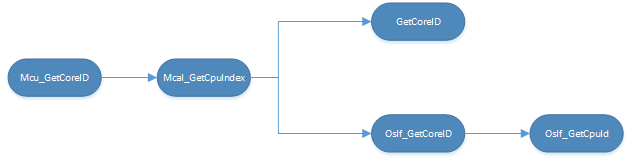
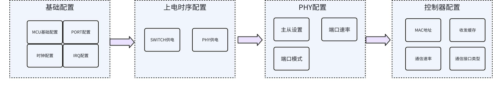
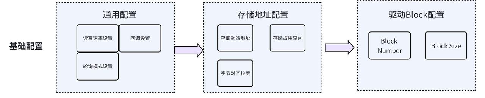
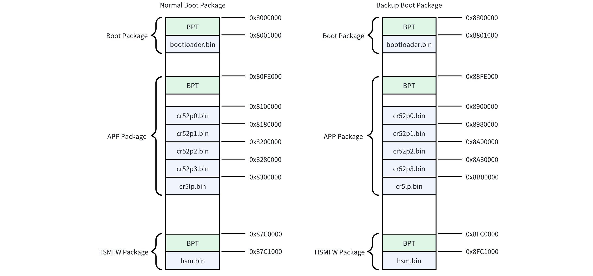

# SemiDrive E3650 芯片移植最佳实践
## 1. E3650 集成说明
### 1.1 集成建议
- 禁止直接对 semidrive/drivers/platform 中的 MCAL 静态代码进行修改；
- OS实现了临界区保护的情况下，要注意MCAL的模块可能在OS实现的临界区保护接口可用前调用临界区相关接口；因此需要注意OS的初始化和依赖OS初始化后才可用的OS接口（如临界区）的被调用的先后顺序；
- Wdg模块为了更好的兼容AUTOSAR标准，对instance进行了拆分，集成商需要根据应用需求进行单个或多个instance(s)的配置；
- 集成商需要保证FuSaMcalReportError.h/FuSaMcalReportError.c参与编译。该文件旨在保证当关闭Det功能时依然可以上报功能安全相关错误；
- 在使用AUTOSAR OS的场景下，集成商应在OS中对使用到的ISR进行注册；
- 获取CoreID接口实现如下：
- SemiDrive预期在不集成OS的情况下，使用上图中分支2，此时CoreID获取接口由MCAL内部实现；
- 当集成OS的情况下OS必须自行实现GetCoreID接口，不能直接调用MCAL的Mcu_GetCoreID 和 Mcal_GetCpuIndex 接口，否则将有可能导致递归调用。
- 禁止将非SemiDrive或SemiDrive提供的模块代码放在mcal/目录下；
- 示例工程配置了相应的MPU属性，集成商可以根据自己实际工程中的使用场景是否进行删除或者增加MPU的保护区域个数；
- MCAL Driver 提供和硬件模块相关的底层驱动（EA/FEE包含在内），上层协议栈文件（e.g. CanIf_Types.h，MemIf_Types.h）需要使用 VCOS 中间件。

### 1.2 GCC 建议添加的编译选项
|选项|预定义的值|
|-|-|
|-mcpu=|cortex-r52+|
|-mfloat-abi|hard|
|-O|0|
|-g|NA|
|-std|c99|
|-Wall|NA|
|-Werror|NA|
|-mno-unaligned-access|NA|

## 2. E3650 VCOS 内核移植
### 2.1 芯片相关移植
E3650 参考适配代码放到 vendor/semidrive 目录，具体可参考仓库[vcos/haloos/vcos_vendor_semidrive](https://gitee.com/haloos/vcos_vendor_semidrive)，目录中文件按需可选，不强制全部实现，具体驱动代码目录参考 vendor 仓库说明的 [README.md](https://gitee.com/haloos/vcos_vendor_semidrive/blob/master/README.md)。

#### 2.1.1 头文件

编译过程中会在编译输出目录的`<out>/<board_name>/<project_name>/include/arch/` 生成软连接到 `vendor/semidrive/chips/e3650/include`,  `vendor/semidrive/boards/E3650_DEV_KIT/include/`。
芯片对外提供的能力，通过以下头文件对外提供。
|原始头文件路径|对外引用路径|
|-|-|
|vendor/semidrive/chips/e3650/include|arch/chip|
|vendor/semidrive/boards/E3650_DEV_KIT/include/|arch/board|

#### 2.1.2 链接脚本
```
#include <nuttx/config.h>  
// 包含操作系统的配置头文件，用于获取编译配置信息
// 指定生成的可执行文件格式为 32 位小端序的 ARM ELF 格式
OUTPUT_FORMAT("elf32-littlearm", "elf32-littlearm", "elf32-littlearm")
// 指定目标架构为 ARM
OUTPUT_ARCH(arm)
// 指定程序的入口点为 __start 函数
ENTRY(__start)
// 定义堆的大小为 64KB
#define HEAP_SIZE  64k
// 如果定义了 CONFIG_BMP，则为每个 CPU 核心预留 12KB 的空间
#if defined(CONFIG_BMP)
#define PER_CPU_RESERVED_SIZE   12K
#endif

/********************************************* Define All Section Address Start *********************************************/
// 定义各个内存区域的起始地址和结束地址
FLASH_BPT_START         = 0x8000000; /* 4KB, Boot Package Table */
FLASH_BPT_END           = 0x8000FFF;
FLASH_BL_START          = 0x8001000; /* 256KB, Bootloader */
FLASH_BL_END            = 0x8040FFF;
FLASH_TEXT_START        = 0x8041000; /* 512KB, CR52+ Code */
FLASH_TEXT_END          = 0x80C0FFF;
FLASH_CONST_START       = 0x80C1000; /* 128KB, CR52+ Constant Data */
FLASH_CONST_END         = 0x80E0FFF;
FLASH_DATA_INIT_START   = 0x80E1000; /* 128KB, CR52+ Global Data Init */
FLASH_DATA_INIT_END     = 0x8100FFF;
FLASH_FUNC_INIT_START   = 0x8101000; /* 256KB, IRAM Func Inited */
FLASH_FUNC_INIT_END     = 0x8140FFF;
FLASH_LP_TEXT_START     = 0x8141000; /* 128KB, LP Code */
FLASH_LP_TEXT_END       = 0x8160FFF;
FLASH_LP_CONST_START    = 0x8161000; /* 32KB, LP Constant Data */
FLASH_LP_CONST_END      = 0x8168FFF;
FLASH_LP_DATA_START     = 0x8169000; /* 16KB, LP Global Data Init */
FLASH_LP_DATA_END       = 0x816CFFF;
FLASH_RESERVED2_START   = 0x816D000; /* 16KB, Reserved2 */
FLASH_RESERVED2_END     = 0x8170FFF;
FLASH_RESERVED3_START   = 0x8171000; /* 6716KB, Reserved3 */
FLASH_RESERVED3_END     = 0x87FFFFF;
FLASH_RESERVED_B_START  = 0x8800000; /* 8192KB, Used for B bank */
FLASH_RESERVED_B_END    = 0x8FFFFFF;
FLASH_DFLASH_START      = 0x9000000; /* 512KB, Used for MRAM5 */
FLASH_DFLASH_END        = 0x907FFFF;
CRAM_TEXT_START         = 0x800000;  /* 256KB, CRAM Function */
CRAM_TEXT_END           = 0x83FFFF;
CRAM_XCP_START          = 0x840000;  /* 256KB, XCP Calibration Data */
CRAM_XCP_END            = 0x87FFFF;
CRAM_RESERVED_START     = 0x880000;  /* 512KB, Reserved */
CRAM_RESERVED_END       = 0x8FFFFF;
IRAM_BT_START           = 0xA00000;  /* 16KB, Reserved for Bootrom */
IRAM_BT_END             = 0xA03FFF;
IRAM_FUNC_START         = 0xA04000;  /* 256KB, IRAM Function */
IRAM_FUNC_END           = 0xA43FFF;
IRAM_NOCACHE_START      = 0xA44000;  /* 128KB, Non-Cacheable Data */
IRAM_NOCACHE_END        = 0xA63FFF;
IRAM_DATA_START         = 0xA64000;  /* 128KB, Initialized Data */
IRAM_DATA_END           = 0xA83FFF;
IRAM_BSS_START          = 0xA84000;  /* 496KB, Uninitialized Data */
IRAM_BSS_END            = 0xAFFFFF;
IRAM_TEXT_START         = 0xB00000;  /* 256KB, IRAM Text */
IRAM_TEXT_END           = 0xB66FFF;
IRAM_CONST_START        = 0xB67000;  /* 128KB, Const Data */
IRAM_CONST_END          = 0xB9FFFF;
IRAM_DATA_INIT_START    = 0xBA0000;  /* 128KB, Initialized Data Inited */
IRAM_DATA_INIT_END      = 0xBBFFFF;
IRAM_FUNC_INIT_START    = 0xBC0000;  /* 256KB, IRAM Func Inited */
IRAM_FUNC_INIT_END      = 0xBFFFFF;
IRAM_RESERVED_START     = 0xC00000;  /* 1M IRAM3 reserved */
IRAM_RESERVED_END       = 0xCFFFFF;
CORE0TCMA_START         = 0x11000000;/* 32KB, Core0 TCM A */
CORE0TCMA_END           = 0x11007FFF;
CORE0TCMB_START         = 0x11100000;/* 32KB, Core0 TCM B */
CORE0TCMB_END           = 0x11107FFF;
CORE0TCMC_START         = 0x11200000;/* 64KB, Core0 TCM C */
CORE0TCMC_END           = 0x1120FFFF;
CORE1TCMA_START         = 0x11400000;/* 32KB, Core1 TCM A */
CORE1TCMA_END           = 0x11407FFF;
CORE1TCMB_START         = 0x11500000;/* 32KB, Core1 TCM B */
CORE1TCMB_END           = 0x11507FFF;
CORE1TCMC_START         = 0x11600000;/* 64KB, Core1 TCM C */
CORE1TCMC_END           = 0x1160FFFF;
CORE2TCMA_START         = 0x11800000;/* 32KB, Core2 TCM A */
CORE2TCMA_END           = 0x11807FFF;
CORE2TCMB_START         = 0x11900000;/* 32KB, Core2 TCM B */
CORE2TCMB_END           = 0x11907FFF;
CORE2TCMC_START         = 0x11A00000;/* 64KB, Core2 TCM C */
CORE2TCMC_END           = 0x11a0FFFF;
CORE3TCMA_START         = 0x11C00000;/* 32KB, Core3 TCM A */
CORE3TCMA_END           = 0x11c07FFF;
CORE3TCMB_START         = 0x11D00000;/* 32KB, Core3 TCM B */
CORE3TCMB_END           = 0x11D07FFF;
CORE3TCMC_START         = 0x11E00000;/* 64KB, Core3 TCM C */
CORE3TCMC_END           = 0x11E0FFFF;
/********************************************* Define All Section Address End ***********************************************/

// 定义内存区域
MEMORY
{
    /* 定义 IRAM 功能段的内存区域 */
    IRAM_FUNC       (rwx) : ORIGIN = IRAM_FUNC_START,        LENGTH = 0x40000
    /* 定义 IRAM 非缓存段的内存区域 */
    IRAM_NOC        (rw)  : ORIGIN = IRAM_NOCACHE_START,     LENGTH = 0x20000
    /* 定义 IRAM 可读写段的内存区域 */
    IRAM_RW         (rw)  : ORIGIN = IRAM_DATA_START,        LENGTH = 0x9C000
    /* 定义 Core0 TCM C 段的内存区域 */
    CORE0TCMC       (rw)  : ORIGIN = CORE0TCMC_START,        LENGTH = 0x10000
    /* 定义 Core1 TCM C 段的内存区域 */
    CORE1TCMC       (rw)  : ORIGIN = CORE1TCMC_START,        LENGTH = 0x10000
    /* 定义 Core2 TCM C 段的内存区域 */
    CORE2TCMC       (rw)  : ORIGIN = CORE2TCMC_START,        LENGTH = 0x10000
    /* 定义 Core3 TCM C 段的内存区域 */
    CORE3TCMC       (rw)  : ORIGIN = CORE3TCMC_START,        LENGTH = 0x10000
    /* 定义 IRAM 文本段的内存区域 */
    IRAM_TEXT       (rx)  : ORIGIN = IRAM_TEXT_START,        LENGTH = 0x67000
    /* 定义 IRAM 常量段的内存区域 */
    IRAM_CONST      (r)   : ORIGIN = IRAM_CONST_START,       LENGTH = 0x39000
    /* 定义 IRAM 初始化数据段的内存区域 */
    IRAM_DATA_INIT  (r)   : ORIGIN = IRAM_DATA_INIT_START,   LENGTH = 0x20000
    /* 定义 IRAM 初始化函数段的内存区域 */
    IRAM_FUNC_INIT  (r)   : ORIGIN = IRAM_FUNC_INIT_START,   LENGTH = 0x40000
    /* 定义 IRAM 保留段的内存区域 */
    IRAM_RESERVED   (r)   : ORIGIN = IRAM_RESERVED_START,    LENGTH = 0x100000
    /* 定义 FLASH 文本段的内存区域 */
    FLASH_TEXT      (rx)  : ORIGIN = FLASH_TEXT_START,       LENGTH = 0x80000
    /* 定义 FLASH 常量段的内存区域 */
    FLASH_CONST     (r)   : ORIGIN = FLASH_CONST_START,      LENGTH = 0x20000
    /* 定义 FLASH 初始化数据段的内存区域 */
    FLASH_DATA_INIT (r)   : ORIGIN = FLASH_DATA_INIT_START,  LENGTH = 0x20000
    /* 定义 FLASH 初始化函数段的内存区域 */
    FLASH_FUNC_INIT (r)   : ORIGIN = FLASH_FUNC_INIT_START,  LENGTH = 0x40000
}

// 定义各个段的布局
SECTIONS
{
    /* 定义 DMA 缓冲区段 */
    .dma_buffer (NOLOAD) : {
        _dma_buffer_start = .;  // 定义 DMA 缓冲区的起始地址
        *(.gcov_buffer)      // 包含 GCOV 缓冲区
        *(.dma_buffer)       // 包含 DMA 缓冲区
        . = ALIGN(0x20000);  // 对齐到 0x20000 字节
        _dma_buffer_end   = .;  // 定义 DMA 缓冲区的结束地址
    } > IRAM_NOC

    /* 如果定义了 CONFIG_BMP，定义 Core0 的 percpu 数据段 */
    #if defined(CONFIG_BMP)
    .core0_percpu_data : ALIGN(64) {
        _core0_percpu_data_start = .;  // 定义 Core0 percpu 数据的起始地址
        *(.data..percpu*)          // 包含 percpu 数据
        . = ALIGN(64);              // 对齐到 64 字节
        _core0_percpu_data_end = .;  // 定义 Core0 percpu 数据的结束地址
    } > IRAM_RW

    /* 定义 Core0 的 percpu BSS 段 */
    .core0_percpu_bss (NOLOAD): ALIGN(64) {
        _core0_percpu_bss_start = .;  // 定义 Core0 percpu BSS 的起始地址
        *(.bss..percpu*)           // 包含 percpu BSS 数据
        . = ALIGN(64);              // 对齐到 64 字节
        _core0_percpu_bss_end = .;  // 定义 Core0 percpu BSS 的结束地址
    } > IRAM_RW

    /* 如果定义了多核配置，为其他核心预留空间 */
    #if (CONFIG_BMP_NCPUS > 1)
    .core1_percpu_reserve (NOLOAD): ALIGN(64) {
        _core1_percpu_reserve_start = .;  // 定义 Core1 percpu 预留空间的起始地址
        . += PER_CPU_RESERVED_SIZE;       // 预留空间大小
    } > IRAM_RW
    #endif

    #if (CONFIG_BMP_NCPUS > 2)
    .core2_percpu_reserve (NOLOAD): ALIGN(64) {
        _core2_percpu_reserve_start = .;  // 定义 Core2 percpu 预留空间的起始地址
        . += PER_CPU_RESERVED_SIZE;       // 预留空间大小
    } > IRAM_RW
    #endif

    #if (CONFIG_BMP_NCPUS > 3)
    .core3_percpu_reserve (NOLOAD): ALIGN(64) {
        _core3_percpu_reserve_start = .;  // 定义 Core3 percpu 预留空间的起始地址
        . += PER_CPU_RESERVED_SIZE;       // 预留空间大小
    } > IRAM_RW
    #endif

    #endif

    /* 定义 BSS 段 */
    .bss (NOLOAD): ALIGN(64) {
        _sbss = .;  // 定义 BSS 段的起始地址
        . = ALIGN(64);  // 对齐到 64 字节
        _core0_idle_stack_start = .;  // 定义 Core0 空闲栈的起始地址
        . += CONFIG_IDLETHREAD_STACKSIZE;  // 空闲栈大小
        . = ALIGN(64);  // 对齐到 64 字节
        _core1_idle_stack_start = .;  // 定义 Core1 空闲栈的起始地址
        *(.core1_sys_stack*)  // 包含 Core1 系统栈
        . = ALIGN(64);  // 对齐到 64 字节
        _core2_idle_stack_start = .;  // 定义 Core2 空闲栈的起始地址
        *(.core2_sys_stack*)  // 包含 Core2 系统栈
        . = ALIGN(64);  // 对齐到 64 字节
        _core3_idle_stack_start = .;  // 定义 Core3 空闲栈的起始地址
        *(.core3_sys_stack*)  // 包含 Core3 系统栈
        KEEP(*(.bss.prebss.*))  // 保留 prebss 数据
        *(.bss .bss.*)  // 包含 BSS 数据
        *(.gnu.linkonce.b.*)  // 包含 GNU linkonce B 数据
        *(COMMON)  // 包含公共数据
        . = ALIGN(64);  // 对齐到 64 字节
        _ebss = .;  // 定义 BSS 段的结束地址
    } > IRAM_RW

    /* 定义数据段 */
    .data : ALIGN(64) {
        _data_start = .;  // 定义数据段的起始地址
        *(.data .data.*)  // 包含数据段
        . = ALIGN(64);  // 对齐到 64 字节
        _data_end = .;  // 定义数据段的结束地址
    } > IRAM_RW AT > IRAM_DATA_INIT

    /* 定义数据段的加载地址 */
    _load_data_start = LOADADDR(.data);

    /* 定义文本段 */
    .text :
    {
        . = ALIGN(64);  // 对齐到 64 字节
        KEEP(*(.sys_vectors))  // 保留系统向量
        . = ALIGN(64);  // 对齐到 64 字节
        _stext = ABSOLUTE(.);  // 定义文本段的起始地址
        KEEP(*(.hyp_vectors))  // 保留超线程向量
        *(.text .
```

#### 2.1.3 适配接口
适配 E3650 架构的接口需要查看不同ARCH代码对SoC要求的Hook接口，下列介绍的是板级适配接口，实现文件在`semidrive/boards/E3650_DEV_KIT/src/`，接口说明如下：
|接口名称|实现文件|接口描述|注意事项|配置|是否必选|
|-|-|-|-|-|-|
|`void board_early_initialize(void)`|e3650_boardinit.c|描述：实现板子早期初始化，在内核启动的上下文中调用，具体执行阶段看内核启动流程。|1. API内部不能阻塞，因为在内核的单线程启动流程中，此时未开启调度。2. 此时内核已基本完成初始化，可以调用大部分内核API，但此时没有初始化stdio，smp多核，workqueue。|CONFIG_BOARD_EARLY_INITIALIZE|可选，当开启对应功能配置时需实现|
|`void board_late_initialize(void)`|e3650_boardinit.c|描述：板子延迟初始化。可以等待事件，不在内核启动线程上下文中执行。在独立的AppBringUP线程中执行，当内核初始化完成，开启调度后，当调度到AppBringUP线程时此函数才开始执行。调用board_bringup。|此时板子延迟初始化和应用初始化并行，启动流程不保证其初始化时序。请在应用中自行保证时序|CONFIG_BOARD_LATE_INITIALIZE|可选，board_late_initialize, board_app_initialize 二选一|
|`int board_app_initialize(uintptr_t arg)`|e3650_appinit.c||描述：app通过boardctl的BOARDIOC_INIT命令字控制板子初始化，调用board_bringup。|在app的线程上下文中执行，注意栈的使用和并发问题。 app控制其调用的时机。|CONFIG_BOARDCTL|可选，board_late_initialize, board_app_initialize 二选一|
|`int e3650_bringup(void)`|e3650_bringup.c|描述：板子后期初始化，板级驱动等.||当CONFIG_BOARD_LATE_INITIALIZE开启，其执行在board_late_initialize（AppBringUP线程上下文）否则其执行在board_app_initialize（app线程上下文）|无|必选|

### 2.2 基础驱动移植
#### 2.2.1 HRTIMER 

E3650 集成的 ARM Cortex-R52 Plus 内核集成了 Generic Timer，Cortex-R52+ 的 Generic Timer 是一个系统级定时器框架，提供统一的时间基准和定时功能。它包括一个全局的系统计数器（System Counter），以固定频率递增。每个核心还配备了一组定时器，包括 EL1 物理定时器、EL2 物理定时器和虚拟定时器，用于操作系统和虚拟化环境中的时间管理。定时器通过控制寄存器（CTL）、比较值寄存器（CVAL）和定时值寄存器（TVAL）进行配置，支持绝对时间触发和相对时间触发两种方式。定时器的输出信号可以发送到通用中断控制器（GIC），并触发私有外设中断（PPI），用于中断处理。芯片驱动中提供的常用接口如下，详细说明请见 ARM 官方文档《Arm Cortex-R52+ Processor Technical Reference Manual》；

```
// 查看 generic timer 频率，不需要写，默认为 0
ARM_CP15_REG_FUNCS(cntfrq, 0, c14, c0, 0);

// 读 generic timer counter 
ARM_CP15_REG64_FUNCS(cntpct, 0, c14);

// generic timer 控制位，设置使能/禁能
ARM_CP15_REG_FUNCS(cntpctl, 0, c14, c2, 1);

// 设置 generic timer compare value
ARM_CP15_REG64_FUNCS(cntpcval, 2, c14);
```

内核中高精度Timer， HRTimer 用于支持高精度的 rt framework counter，HRTimer要适配的接口定义位于`kernel/nuttx/hrtimer.h`。

```
struct hrtimer_ops_s {
    void (*set_expire)(struct hrtimer_queue_s *, hrtimer_tick_t expiration_time); # 设置timer 的到期点
    hrtimer_tick_t (*current)(struct hrtimer_queue_s *);                          # 获取timer 当前的值
    void (*start)(struct hrtimer_queue_s *);                                      # 启动timer
    void (*trigger)(struct hrtimer_queue_s *);                                    # trigger timer 中断
};
```
以上接口适配实现可参考kernel/nuttx/arch/arm/src/armv8-r/arm_arch_timer.c 中的 g_hrtimer_ops：
```
static const struct hrtimer_ops_s g_hrtimer_ops =
{
  .current      = arm_hrtimer_current,
  .set_expire   = arm_hrtimer_set_compare,
  .start        = arm_htimer_start,
  .trigger      = arm_htimer_trigger,
};
```

#### 2.2.2 UART 移植
Uart需要适配的接口定义位于kernel/nuttx/include/nuttx/serial/serial.h 。芯驰提供了如下接口，用户可参考 e3650_serial.c 进行适配。

|接口名称|功能描述|
|-|-|
|Uart_Init|初始化 UART 模块，配置各个通道的参数，使能 UART 功能。|
|Uart_Deinit|反初始化 UART 模块，关闭各个通道，释放相关资源。|
|Uart_SetBaudrate|设置指定通道的波特率。|
|Uart_GetBaudrate|获取指定通道的波特率。|
|Uart_SyncSend|同步发送数据，直到数据发送完成或超时。|
|Uart_SyncReceive|同步接收数据，直到数据接收完成或超时。|
|Uart_AsyncSend|异步发送数据，立即返回，发送完成时触发回调函数。|
|Uart_AsyncReceive|异步接收数据，立即返回，接收完成时触发回调函数。|
|Uart_StartRealTimeRecv|启动实时接收模式，持续接收数据，直到停止接收。|
|Uart_StopRealTimeRecv|停止实时接收模式。|
|Uart_Abort|中止指定通道的发送或接收操作。|
|Uart_GetStatus|获取指定通道的发送或接收状态，包括剩余字节数等信息。|
|Uart_GetVersionInfo|获取 UART 驱动的版本信息，包括供应商 ID、模块 ID、软件版本号等。|

### 2.3 通信子系统移植
#### 2.3.1 以太网适配流程

#### 2.3.2 以太网驱动适配接口
Eth 驱动对上向EthIf 提供数据收发服务底层实现，AUTOSAR 定义Eth 驱动的相关概念和接口定义。驱动设计旨在满足相关上述需求文档提到的软件需求，且本文不再重复描述 AUTOSAR 针对Eth定义的接口调用序列等信息，具体概念参考AUTOSAR_SWS_EthernetDriver.pdf 。

| 接口名称 | 功能描述 | 备注 | 
| --- | --- | --- | 
| Eth_Init | 初始化 Ethernet 驱动模块，配置控制器实例。 | 初始化整个 Ethernet 驱动模块，包括控制器和相关资源。 | 
| Eth_SetController_Mode | 设置指定 Ethernet 控制器的操作模式。 | 支持启用或禁用控制器。 | 
| Eth_GetController_Mode | 获取指定 Ethernet 控制器的当前操作模式。 | 查询控制器的当前状态。 | 
| Eth_GetPhysAddr | 获取指定 Ethernet 控制器的物理地址（MAC 地址）。 | 获取控制器的 MAC 地址。 | 
| Eth_SetPhysAddr | 设置指定 Ethernet 控制器的物理地址（MAC 地址）。 | 配置控制器的 MAC 地址。 | 
| EthUpdatePhysAddrFilter | 更新指定 Ethernet 控制器的物理地址过滤器。 | 添加或删除 MAC 地址过滤规则。 | 
| Eth_Write_Mii | 向指定的 MII/MDIO 寄存器写入值。 | 配置 PHY 寄存器。 | 
| Eth_Read_Mii | 从指定的 MII/MDIO 寄存器读取值。 | 读取 PHY 寄存器的值。 | 
| Eth_GetCounterValues | 获取指定 Ethernet 控制器的计数器值。 | 获取控制器的统计信息。 | 
| Eth_GetRxStats | 获取指定 Ethernet 控制器的接收统计信息。 | 查询接收相关的统计信息。 | 
| Eth_GetTxStats | 获取指定 Ethernet 控制器的发送统计信息。 | 查询发送相关的统计信息。 | 
| Eth_GetTxErrorCounterValues | 获取指定 Ethernet 控制器的发送错误计数器值。 | 查询发送错误相关的统计信息。 | 
| Eth_GetCurrentTime | 获取指定 Ethernet 控制器的当前时间戳。 | 获取控制器的当前时间戳。 | 
| Eth_EnableEgress_TimeStamp | 为指定的发送缓冲区启用发送时间戳功能。 | 启用发送时间戳功能。 | 
| Eth_GetEgress_TimeStamp | 获取指定发送缓冲区的发送时间戳。 | 查询发送时间戳。 | 
| Eth_GetIngress_TimeStamp | 获取指定接收帧的接收时间戳。 | 查询接收时间戳。 | 
| Eth_ProvideTxBuffer | 为指定的 Ethernet 控制器分配发送缓冲区。 | 分配发送缓冲区。 | 
| Eth_Transmit | 使用指定的 Ethernet 控制器发送帧。 | 发送 Ethernet 帧。 | 
| Eth_Receive | 处理指定 Ethernet 控制器的接收操作。 | 处理接收的 Ethernet 帧。 | 
| Eth_TxConfirmation | 处理指定 Ethernet 控制器的发送确认操作。 | 处理发送确认。 | 
| Eth_GetVersionInfo | 获取 Ethernet 驱动模块的版本信息。 | 查询驱动模块的版本信息。 | 

### 2.4 存储子系统移植
#### 2.4.1 存储适配流程

#### 2.4.2 存储驱动适配接口
##### 2.4.2.1 EA 接口
| 接口名称 | 功能描述 | 备注 | 
| --- | --- | --- | 
| Ea_Init | 初始化 EEPROM Abstraction 模块。 | 初始化 Ea 模块及其内部状态。 | 
| Ea_SetMode | 设置 Ea 模块的工作模式。 | 调用底层 EEPROM 驱动的 Eep_SetMode 函数。 | 
| Ea_Read | 从指定的 EEPROM 区块中读取数据。 | 配置读取作业并调度执行。 | 
| Ea_Write | 向指定的 EEPROM 区块中写入数据。 | 配置写入作业并调度执行。 | 
| Ea_Cancel | 取消正在进行的作业。 | 取消当前正在进行的 EEPROM 操作。 | 
| Ea_GetStatus | 获取 Ea 模块的当前状态。 | 查询 Ea 模块的当前工作状态。 | 
| Ea_GetJobResult | 获取上一次作业的执行结果。 | 查询上一次作业的执行结果。 | 
| Ea_GetJobType | 获取当前作业类型。 | 查询当前正在执行的作业类型。 | 
| EaIntl_GetStatus | 获取 Ea 内部状态。 | 查询 Ea 内部状态。 | 
| EaIntl_GetJobResult | 获取上一次内部作业的执行结果。 | 查询上一次内部作业的执行结果。 | 
| EaIntl_GetJobType | 获取当前内部作业类型。 | 查询当前正在执行的内部作业类型。 | 
| Ea_InvalidateBlock | 将指定的 EEPROM 区块标记为无效。 | 配置无效化区块作业并调度执行。 | 
| Ea_EraseImmediateBlock | 立即擦除指定的 EEPROM 区块。 | 配置立即擦除区块作业并调度执行。 | 
| Ea_GetVersionInfo | 获取 Ea 模块的版本信息。 | 查询 Ea 模块的版本信息。 | 
| Ea_JobEndNotification | 通知 Ea 模块异步操作成功完成。 | 通知 Ea 模块异步操作成功完成。 | 
| Ea_JobErrorNotification | 通知 Ea 模块异步操作失败。 | 通知 Ea 模块异步操作失败。 | 
| Ea_MainFunction | 执行 Ea 模块的主功能，处理作业调度和状态更新。 | 调度作业执行和状态更新。 | 


## 3 镜像生成
### 3.1 手动一键生成启动相关镜像
pacconfig_e3650 目录下提供了适用于 Windows 环境的 e3650_pac.bat 脚本，和适用于 Linux 环境的 e3650_pac.sh 脚本。用户可以输入格式如下的命令进行一键打包，生成芯驰下载工具所需的 PAC 文件。输入参数说明请见下方 3.1.3 章节。

`e3650_pac.bat <编译产物路径>/nuttx.bin 0x208 0xA64000 0x00b00000`;

### 3.2 镜像分布格式


### 3.3 生成 Boot Package 镜像
Boot Package 是 Safety BootROM （指 ARM Cortex-R52 Plus 固化在芯片内部的启动程序）的下一级启动镜像。SF BootROM 规定了 Boot Package 的格式是 BPT （Boot package table）头与启动镜像组合的方式。芯驰提供了 pacconfig_e3650 工具包可以将编译产物转为芯片&工具识别的 Boot Package 格式。

atb_signer 工具命令中的参数解析如下表：
| 参数 | 描述 | 
| --- | --- | 
| sign | 在生成 boot package 时， 的首个参数必须是 。 | 
| --v | 固定写 ，表示当前  版本为 v2。 | 
| --sec_ver | 表示安全启动的版本，ROM 会与 FUSE_PKG_VER[0:127] 中烧写的版本信息进行比较，如果低于 fuse 中烧写的版本号，则无法用于启动，该功能用于防回滚到某个较低版本。 | 
| --dgst | 指定校验算法的类型（/）。 | 
| --rcp | 表示签名使用的私钥相关信息。 | 
| --iib | 每一个 image 都通过一个  表示，iib 之后的参数为： | 
| flag（可选） | bit6: skip load image，bit4: skip hash，bit7: skip kick core。 | 
| core | 对应镜像所属核。 | 
| type | 镜像的类型。 | 
| path | 镜像文件的路径。 | 
| dlp（可选） | 表示镜像在 Boot Package 中存储的相对位置，以 512 字节为单位。 | 
| to | 镜像的加载地址。 | 
| entry | 程序的入口地址。 | 
| nohash（可选） | 表示该 iib 对应的程序不做 HASH 校验。 | 
| --psn | 指定 PSN 版本号。 | 
| --of | 指定输出文件的路径。 | 


上述就可以相对完整的移植芯驰科技的 E3650 到 HaloOS 的 VCOS，更多高级功能欢迎提交 Issue 咨询。