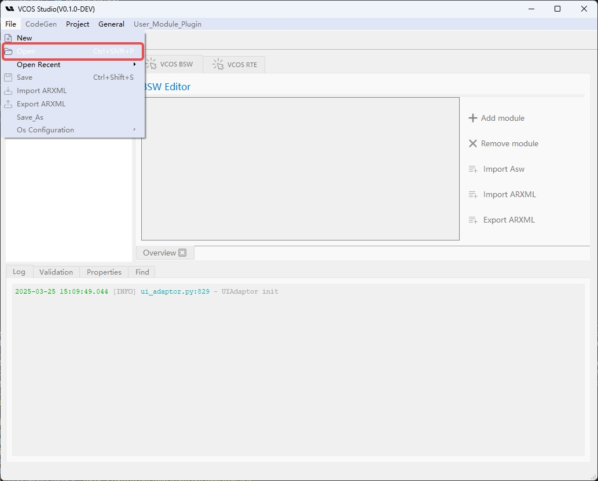
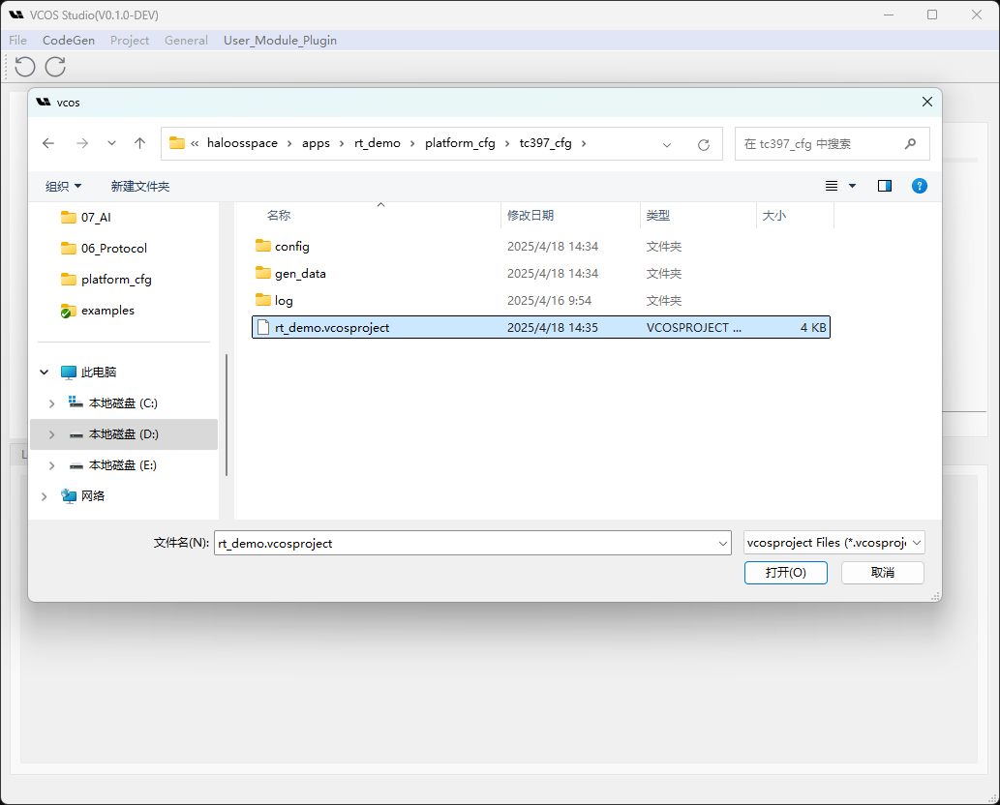
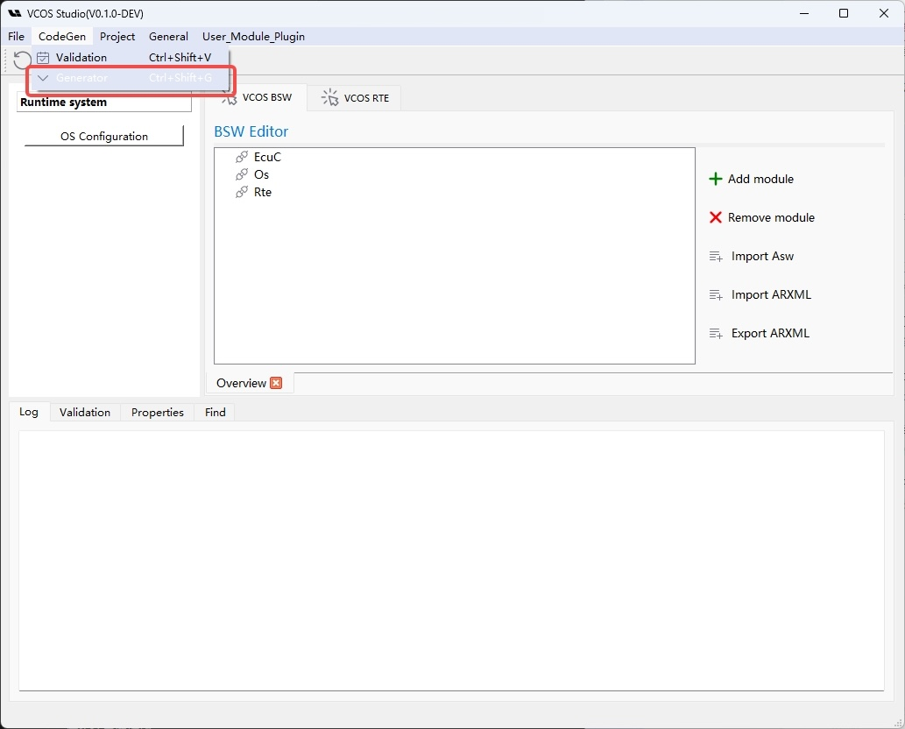
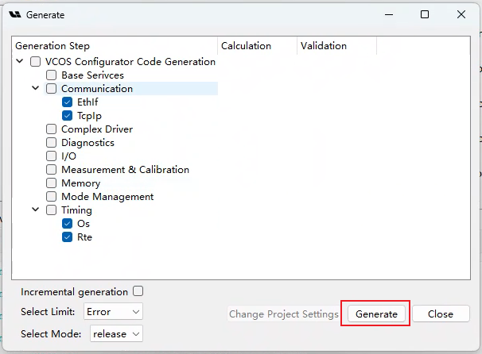

# 工具安装

本文将基于VCOS开放的rt_demo应用快速完成代码生成，以支持后续编译与验证。在Windows系统上我们将展示界面的初步使用，在Linux系统上我们将展示工具的命令行的初步使用。详细的工具以及配置使用可以进一步参考：[VCOS Studio 配置工具开发者手册](../user_manual/studio/configurator_tool_user_manual.md)（包括在Linux下如何使用界面做配置）
> 注意：本工具强依赖于python3.8.10，请在【[代码下载](01_downloading.md)】中获取安装方法；如果已安装，请忽略
>
## 1. Windows系统

### 1.1. 安装Studio依赖插件

1. 以【管理员权限】打开powershell，切换目录到下载的VCOS代码目录（haloosspace/vcos）下
2. 执行以下命令

    ```bash
    python ./vcos_studio/configurator/init_env.py -a
    ```

### 1.2. 打开Studio工具

在代码空间中通过运行`.\vcos_studio\configurator\configurator.bat`脚本，打开Studio工具（首次打开可能需要等待一段时间）

### 1.3. 打开系统预设工程

1. 点击界面左上角【File】->【Open】

    

2. 在弹出的文件选择界面里选择`haloosspace/apps/rt_demo/platform_cfg/tc397_cfg/rt_demo.vcosproject`，点击【打开】
    > 提示：这里以rt_demo为例，如果需要打开其他工程，可以选其他的vcosproject工程文件打开

    

### 1.4. 生成动态代码

1. 点击界面左上角【CodeGen】->【Generator】

    

2. 在弹出的界面里点击【Generate】

    

3. 等待一段时间后，在`haloosspace/apps/rt_demo/platform_cfg/tc397_cfg/gen_data`下检查如果有代码生成，即代表运行成功

## 2. Linux（Ubuntu）

### 2.1. 安装Studio依赖插件

1. 打开Linux终端，切换目录到下载的VCOS代码目录（haloosspace/vcos）下
2. 执行以下命令

    ```bash
    sudo apt update
    sudo apt install python3.8-venv libxcb-cursor0
    python ./vcos_studio/configurator/init_env.py -a
    ```

    > 在高版本的Ubuntu下如果python3.8-venv找不到，请运行`sudo add-apt-repository ppa:deadsnakes/ppa`以添加 deadsnakes PPA（提供旧版本 Python），后再次运行上述命令
 >
### 2.2. 命令行生成动态代码

1. 打开Linux终端，切换目录到下载的VCOS代码目录（haloosspace/vcos）下
2. 激活虚拟环境默认虚拟环境路径: VCOS代码目录，执行以下命令（每次重新激活工具命令时，需要重新激活虚拟环境）

    ```bash
    chmod +x .venv/bin/activate
    source .venv/bin/activate
    ```

    > 输入命令`deactivate`，可以退出虚拟环境
3. 执行以下命令（该脚本可以打开工程，以及生成代码）

    ```bash
    python vcos_studio/configurator/cmd_api/auto_cli.py -p ../apps/rt_demo/platform_cfg/tc397_cfg/rt_demo.vcosproject Generate
    ```

    > 提示：这里以rt_demo为例，如果需要打开其他工程，可以选其他的vcosproject工程文件打开

4. linux终端提示`AutoCli successfully`，并在`haloosspace/apps/rt_demo/platform_cfg/tc397_cfg/gen_data`下检查如果有代码生成，即代表生成成功
