# 诊断协议栈开发者手册

## 1. 简介

汽车诊断在现代汽车维护中扮演着至关重要的角色。它不仅可以降低维修成本和停机时间，还可以提高车辆的可靠性、安全性和用户体验。随着汽车技术的不断发展，汽车诊断的重要性日益凸显，将继续在汽车行业中发挥着越来越重要的作用。本文基于CAN诊断Demo，提供了汽车诊断的数据传输以及典型服务的实现。

## 2. 代码目录

诊断协议栈源代码在haloosspace/vcos/components/diagnostics目录下，目录结构如下图所示：

```plaintext
diagnostics
├── CMakeLists.txt          # diagnostics仓库的编译脚本，用于控制编译相关资源
├── DISCLAIMER.md           # 免责声明文档
├── LICENSE                 # 项目许可证文件
├── README.md               # diagnostics仓库的readme，用于介绍该代码仓库(即本文)
├── service                 # 诊断服务模块代码目录
│   ├── CMakeLists.txt      # 诊断服务模块的编译脚本，用于控制编译相关资源
│   ├── dcm                 # 诊断通信管理服务模块，用于诊断通信管理和UDS服务实现
│   └── dem                 # 诊断事件管理服务模块，用于诊断事件和DTC管理
├── transport               # 诊断传输模块代码目录
│   ├── cantp               # can诊断传输模块
│   └── CMakeLists.txt      # 诊断传输模块的编译脚本，用于控制编译相关资源
```

## 3. 主要功能描述

### 3.1. 功能讲解

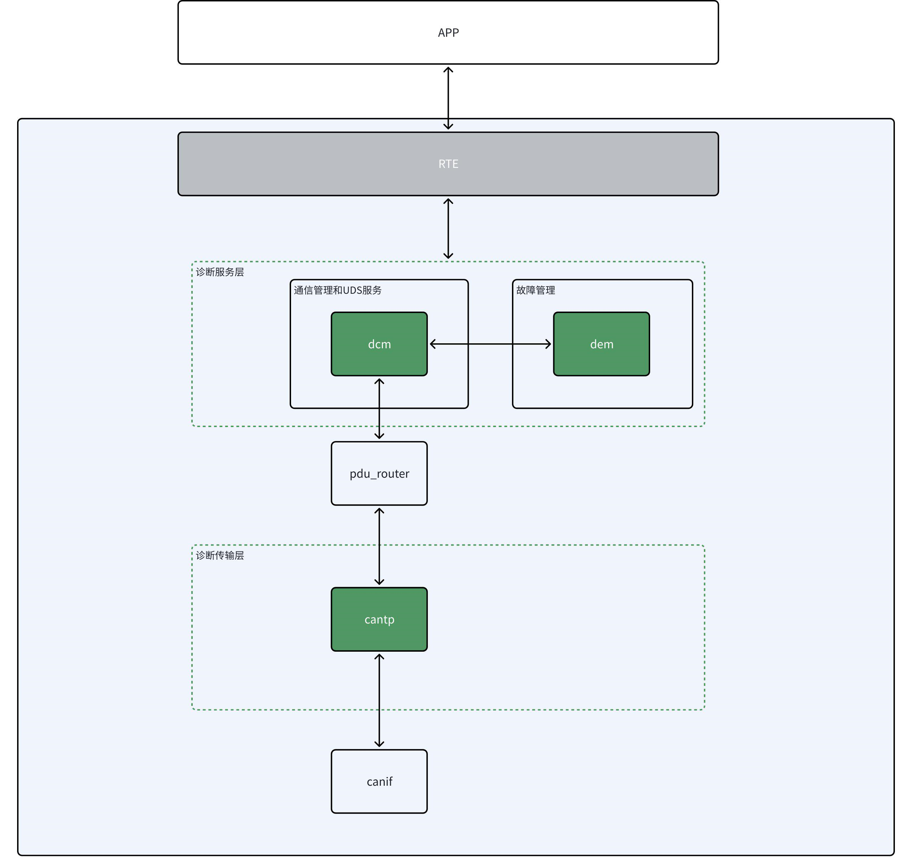

* cantp提供CAN诊断报文的传输能力，包括单帧，多帧（首帧，流控帧，续帧）的收发处理
* dcm提供诊断通信的管理以及UDS协议的实现
* dem提供诊断故障管理，包括故障上报后处理，存储，老化等能力

## 4. 功能配置方法

### 4.1. cantp配置项介绍

#### 4.1.1. cantp通用配置

CanTpGeneral 主要用于控制CanTp通用宏等开关

* CanTpDevErrorDetect：用于配置det
* CanTpFlexibleDataRateSupport：cantp灵活数据速率支持
* CanTpEnableSynchronousTransmit：cantp同步发送开启
* CanTpReadParameterApi：cantp读参数API
* CanTpPaddingByte：cantp填充字节

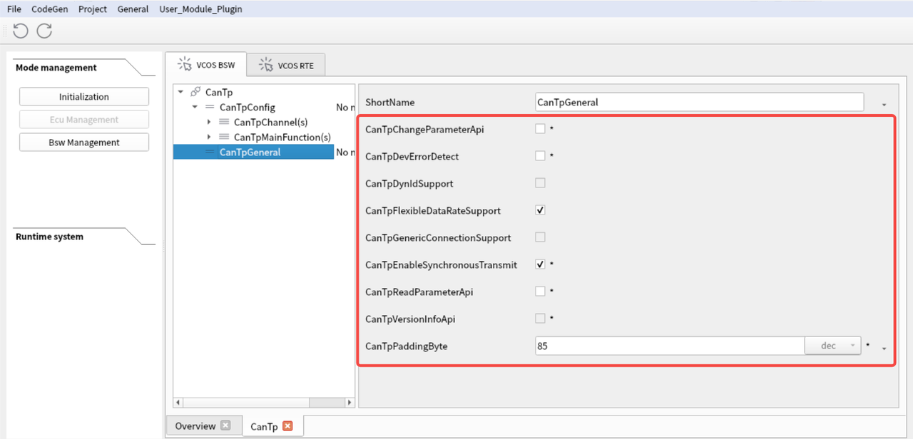

#### 4.1.2. cantp配置

CanTpConfig 用于配置CanTp相关的参数

* CanTpChannel：用于配置CanTp通道
* CanTpMainFunction：用于配置CanTp主循环函数

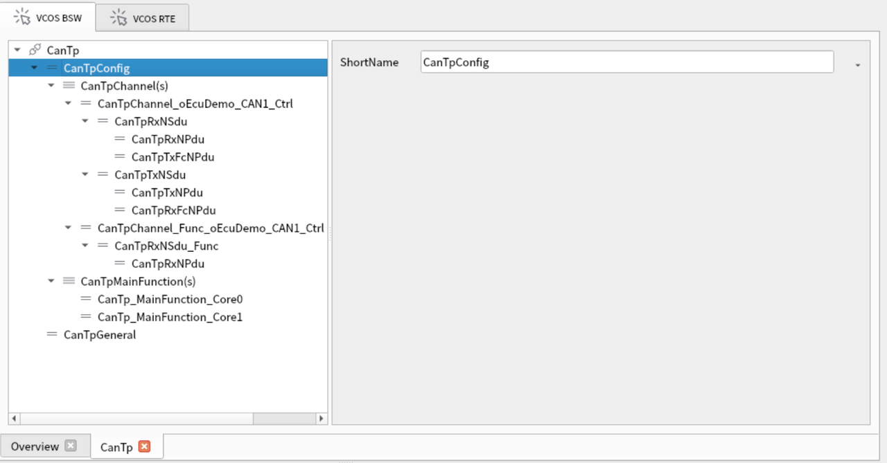

### 4.2. dcm配置项介绍

#### 4.2.1. dcm通用配置

DcmGeneral 用于控制Dcm通用宏等开关

* DcmDevErrorDetect：用于配置det
* DcmTaskTime：用于配置Dcm task的周期
* DcmHeaderFileInclusion：用于配置Dcm回调函数的头文件

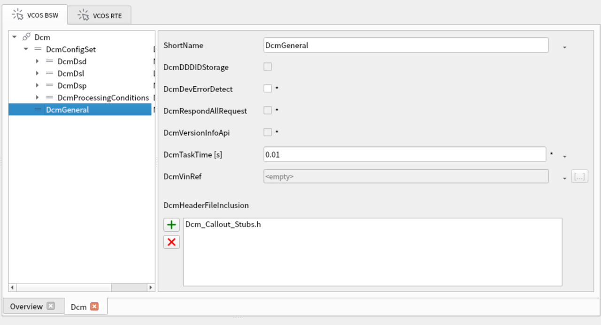

#### 4.2.2. dcm配置

* DcmDsd：用于dcm消息分发相关配置
* DcmDsl：用于dcm会话相关配置
* DcmDsp：用于dcm消息处理相关配置
* DcmProcessingConditions：用于dcm消息处理条件相关配置

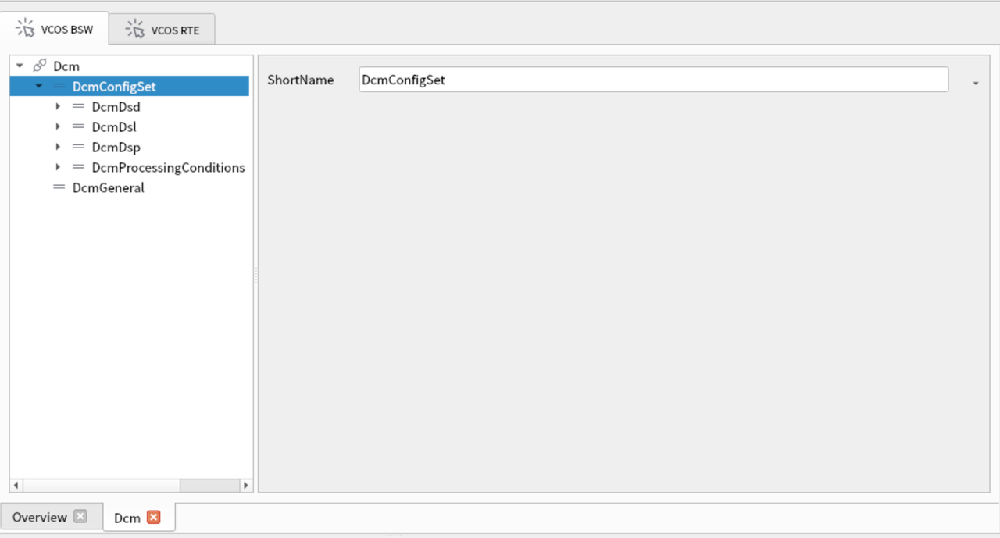

### 4.3. dem配置项介绍

#### 4.3.1. dem通用配置

* DemDebounceDisable：是否关闭Dem的debounce功能
* DemDevErrorDetect：用于配置det
* DemConfigurationId：用于配置Dem配置Id，当配置Id变化时，将会丢弃Flash存储的相关数据
* DemEventCombinationSupport：用于配置事件组合功能开关，请注意，当前功能还在开发中
* DemOBDSupport：用于配置Dem是否支持OBD
* DemSuppressionSupport：用于配置Dem支持DTC抑制功能
* DemTaskTime：用于配置Dem主循环task周期
* DemMaxNumberPrestoredFF：用于配置最大预存储冻结帧数量
* DemMasterOsApplicationRef：用于配置Dem Master所处的Os Application
* DemClient：用于配置Dem客户端
* DemDataElementClass：用于配置Dem数据元素
* DemDidClass：用于配置did类
* DemEnableCondition：用于配置使能条件
* DemEnableConditionGroup：用于配置使能条件组
* DemExtendedDataClass：用于配置扩展数据类
* DemExtendedDataRecordClass：用于配置扩展数据记录类
* DemFreezeFrameClass：用于配置冻结帧类
* DemFreezeFrameRecNumClass：用于配置冻结帧记录数类
* DemFreezeFrameRecordClass：用于配置冻结帧记录类
* DemNvRamBlockId：用于配置Dem NvM存储区块
* DemOperationCycle：用于配置Dem操作周期
* DemStorageCondition：用于配置存储条件
* DemStorageConditionGroup：用于配置存储条件组
* DemEventMemorySet：用于配置事件存储集

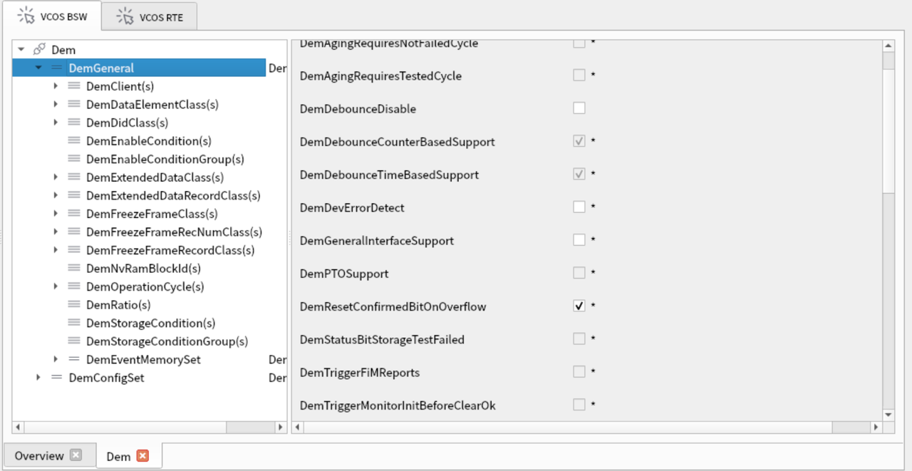

#### 4.3.2. dem配置

* DemDTC：DTC相关配置
* DemDTCAttributes：DTC属性相关配置
* DemDebounceCounterBasedClass：基于计数去抖相关配置
* DemDebounceTimeBaseClass：基于时间去抖相关配置
* DemEventParameter：故障事件相关配置
* DemObdDTC：OBD DTC配置
* DemPidClass：用于OBD的pid类配置

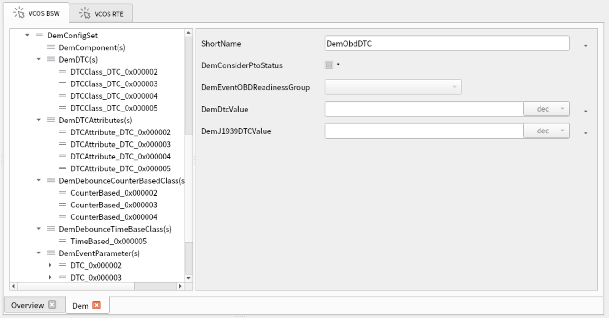

## 5. 使用示例

### 5.1. 模拟故障上报

在pre init启动流程后，模拟进行故障上报：

```C
dem_pre_init(&dem_config);
// set event 1
dem_set_event_status(1, DEM_EVENT_STATUS_PREPASSED);
dem_set_event_status(1, DEM_EVENT_STATUS_PREFAILED);

```

在init启动流程后，模拟进行故障上报：

```C
void diag_dem_set_event_test(void)
{
#if (CONFIG_MODULE_DEM == 1)
    // set event 2
    dem_set_event_status(2, DEM_EVENT_STATUS_PREFAILED);
    dem_set_event_status(2, DEM_EVENT_STATUS_PASSED);
    dem_set_event_status(2, DEM_EVENT_STATUS_FAILED);
    dem_set_event_status(2, DEM_EVENT_STATUS_PASSED);
    dem_set_event_status(2, DEM_EVENT_STATUS_FAILED);
    dem_set_event_status(2, DEM_EVENT_STATUS_PREPASSED);
    dem_set_event_status(2, DEM_EVENT_STATUS_FAILED);
    dem_set_event_status(2, DEM_EVENT_STATUS_FAILED);
    dem_set_event_status(2, DEM_EVENT_STATUS_FAILED);
    dem_set_event_status(2, DEM_EVENT_STATUS_PASSED);
    dem_set_event_status(2, DEM_EVENT_STATUS_PASSED);
    dem_set_event_status(2, DEM_EVENT_STATUS_FAILED);

    // set event 3
    dem_set_event_status(3, DEM_EVENT_STATUS_PASSED);
    dem_set_event_status(3, DEM_EVENT_STATUS_FAILED);
    dem_set_event_status(3, DEM_EVENT_STATUS_PREFAILED);
    dem_set_event_status(3, DEM_EVENT_STATUS_PREPASSED);

    // set event 4
    dem_set_event_status(4, DEM_EVENT_STATUS_FAILED);
    dem_set_event_status(4, DEM_EVENT_STATUS_PREPASSED);
    dem_set_event_status(4, DEM_EVENT_STATUS_PASSED);
    dem_set_event_status(4, DEM_EVENT_STATUS_PREFAILED);

    // set invalid event 5
    dem_set_event_status(5, DEM_EVENT_STATUS_PASSED);
#endif
}

void core0_demo_runnable_10ms(void)
{
    static boolean is_diag_test_run = FALSE;

    if (FALSE == is_diag_test_run) {
        is_diag_test_run = TRUE;
        diag_dem_set_event_test();
    }
}

```

### 5.5. CAN诊断验证

#### 5.5.1. 物理接线图

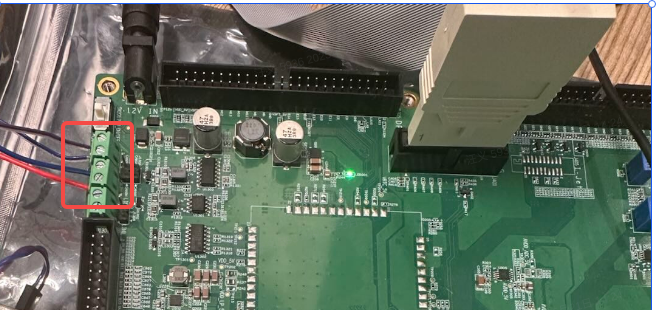

#### 5.5.2. 上位机连接示意图

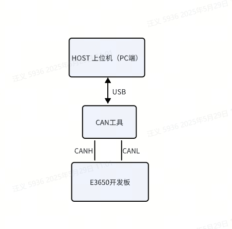

#### 5.5.3. 基于CAN的UDS 10 03诊断 - 请求切换到扩展会话

上位机发送10 03的CAN诊断报文，可收到下位机（E3650开发板）响应，切换会话成功。

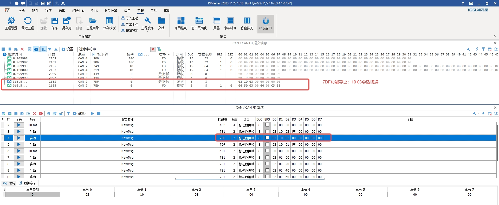

#### 5.5.4. 基于CAN的UDS 19 01诊断 - 请求符合条件的DTC数量

上位机发送19 01的CAN诊断报文，可收到下位机（E3650开发板）响应，符合条件DTC数量为4。

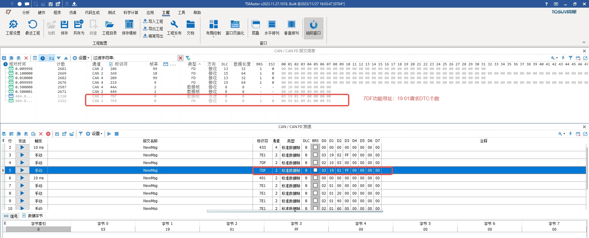

#### 5.5.5. 基于CAN的UDS 19 02诊断 - 请求所有符合条件的DTC和状态

上位机发送19 02的CAN诊断报文，可收到下位机（E3650开发板）响应，4个符合条件的DTC和状态都回复出来。

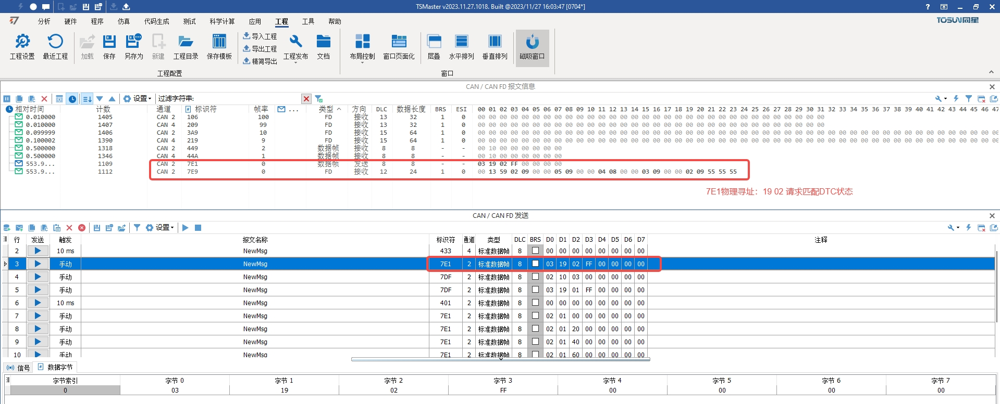

#### 5.5.6. 基于CAN的UDS 14诊断 - 清除所有符合条件的DTC

上位机发送14的CAN诊断报文，可收到下位机（E3650开发板）响应，回复清除成功。

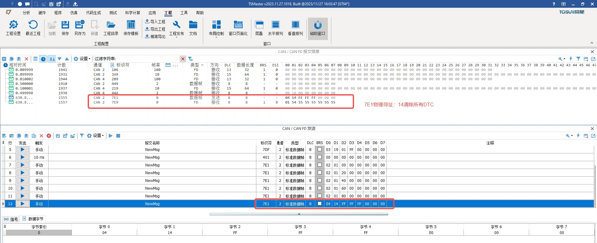

#### 5.5.6. 基于CAN的19 02诊断 - 请求所有符合条件的DTC和状态

上位机发送19 02的CAN诊断报文，可收到下位机（E3650开发板）响应，当前没有符合条件的DTC。

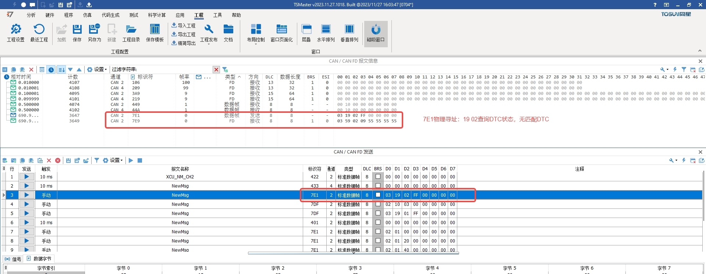

## 6. 配置项参考规范

[cantp 配置项参考规范](../../configuration_reference/cantp_cfg.md)

[dcm 配置项参考规范](../../configuration_reference/dcm_cfg.md)

[dem 配置项参考规范](../../configuration_reference/dem_cfg.md)

[com 配置项参考规范](../../configuration_reference/com_cfg.md)

[pdur 配置项参考规范](../../configuration_reference/pdur_cfg.md)

[comm 配置项参考规范](../../configuration_reference/comm_cfg.md)

[canif 配置项参考规范](../../configuration_reference/canif_cfg.md)

## 7. 应用接口参考规范

[cantp API 参考规范](../../api_reference/cantp_api.md)

[dcm API 参考规范](../../api_reference/dcm_api.md)

[dem API 参考规范](../../api_reference/dem_api.md)

[com API 参考规范](../../api_reference/com_api.md)

[pdur API 参考规范](../../api_reference/pdur_api.md)

[comm API 参考规范](../../api_reference/comm_api.md)

[canif API 参考规范](../../api_reference/canif_api.md)
