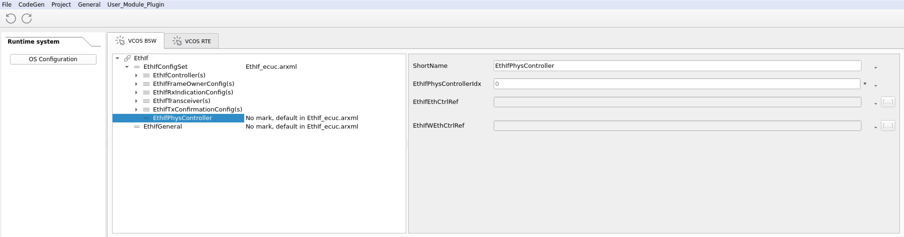
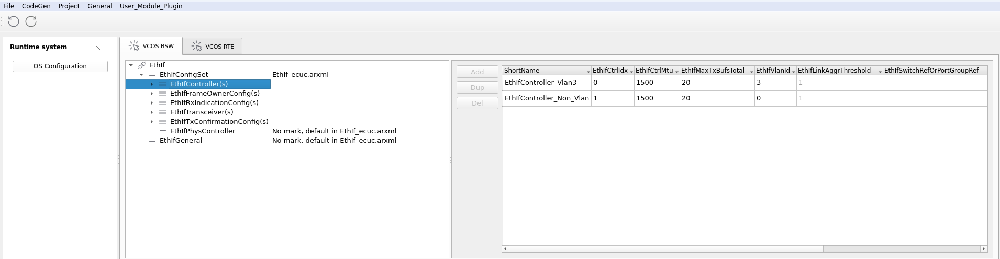

# 以太协议栈开发者手册

## 1. 简介

以太网提供高带宽、低延迟的特性，成为了现代车载网络架构的关键组成之一。本文基于TCP/IP协议栈与网络接口抽象层，提供以太网开发的基础配置与编程方式

## 2. 代码目录

```plaintext
communication
├── CMakeLists.txt          # communication仓库的编译脚本，用于控制编译相关资源
├── DISCLAIMER.md           # 免责声明文档
├── Kconfig                 # communication模块的Kconfig文件
├── LICENSE                 # 项目许可证文件
├── README.md               # communication仓库的readme，用于介绍该代码仓库(即本文)
├── external                # 第三方代码目录，用于存放其它开源项目代码
│   └── lwip                # lwip相关代码目录
├── net_dev                 # 驱动抽象层，对驱动资源及功能进行抽象封装，供上层模块使用
│   ├── CMakeLists.txt      # 驱动抽象层的编译脚本，用于控制编译相关资源
│   └── eth                 # 以太网的驱动抽象层
└── net_protocols           # 协议栈层的代码
    ├── CMakeLists.txt      # 协议栈层的编译脚本，用于控制编译相关资源
    ├── arp                 # arp协议实现
    ├── icmp                # icmp协议实现
    ├── ipv4                # ipv4协议实现
    ├── sockets             # 网络编程接口实现
    ├── tcp                 # tcp协议实现
    └── udp                 # udp协议实现
```

## 3. 主要功能描述

### 3.1. 功能讲解


* 设备抽象层封装硬件驱动细节，为协议层提供硬件操作接口
* 协议层实现各种网络通信协议，为上层应用提供服务

## 4. 功能配置方法
### 4.1. EthIf配置项介绍

#### 4.1.1. EthIfPhysController



* 根据以太控制器数量添加EthIfPhysController
* EthIfPhysControllerIdx默认为0

#### 4.1.2. EthIfController



* 根据需求创建EthIfController
* EthIfCtrlId需要从0依次递增填写
* EthIfPhysControllerRef引用EthIfConfigSet中的EthIfPhysController

#### 4.1.3. EthIfFrameOwnerConfigs


* 每个子项为一个帧类型，默认2种帧：ARP帧（2054）、IPv4帧（2048）

#### 4.1.4. EthIfRxIndicationConfigs


* 引用EthIfFrameOwnerConfigs，为每种帧类型配置对应的回调函数（回调函数需自行实现），EthIfRxIndicationFunction配置项填写函数的名称，以及对应的帧类型

#### 4.1.5. EthIfTxConfirmationConfigs


* EthIfTxConfirmationFunction配置项填写函数的名称，需配置为已实现的函数
* FrameOwnerRef配置项填写对应的帧类型

### 4.2. TcpIp模块配置项介绍

#### 4.2.1. TcpIpCtrl


* TcpIpCtrl引用EthIfController

#### 4.2.2. TcpIpLocalAddr


* 配置网关地址，ip地址，TcpIp控制器与NetMask

#### 4.2.3. TcpIpSocketOwnerConfig


* 添加socket，可配置socket owner的相关的各种函数

## 5. 使用示例
### 5.1. 配置增加网卡


* 参考4.1.2节，新建EthIfController

### 5.2. 配置IP地址


* 参考4.2.1节，新建TcpIpCtrl，引用上一步添加的EthIfController


* 参考4.2.2节，新建TcpIpLocalAddr，引用上一步添加的TcpIpCtrl

### 5.3. 配置socket


* 参考4.2.3节，添加socket

### 5.4. TCP、UDP收发示例
* TCP Client使用示例
```C
#include "TcpIp.h"

boolean tcp_transmit_start = false;
tcpip_socket_id_type socket_id;

/*建立TCP连接接口*/
void client_tcp_connect(void) 
{
    /* 1. 获取socket// TcpIp_ClientGetSocket是为上节配置的TcpIpSocketOwner生成的API */
    TcpIp_ClientGetSocket(AF_INET, TCPIP_IPPROTO_TCP, &socket_id);
    
    /*  2. Bind socket TcpIpConf_TcpIpLocalAddr_TcpIpLocalAddr_Vlan_Unicast是为配置IP地址一节生成的对应宏 */
    uint16 bind_port = 23;
    tcpip_bind(socket_id, TcpIpConf_TcpIpLocalAddr_TcpIpLocalAddr_Vlan_Unicast, &bind_port);
    
    /*  3. Client端连接Server  */
    tcpip_sock_addr_type remote_addr;
    char server_ip[] = "192.168.3.71";   // 此处为目标IP地址
    uint16 server_port = 33;    // 此处为目标端口
    remote_addr.domain = TCPIP_AF_INET;
    remote_addr.port = lwip_htons(server_port);
    ip_addr.addr = inet_addr(server_ip);
    tcpip_ip_addr_32_to_8(ip_addr.addr, remote_addr.addr);
    tcpip_tcp_connect(socket_id, &remote_addr);
}

/*TCP连接建立回调接口*/
void client_tcp_connected( TcpIp_SocketIdType SocketId ){
   /* 4. 等待连接远程tcp server成功，connected回调函数被调用*/
    tcp_transmit_start = true;
}

/*TCP client发送接口*/
void client_tcp_transmit(void) 
{
    if(tcp_transmit_start == true) {
        /* 5. 发送数据 */
        uint8 data[10] = {"H", "e", "l", "l", "o", ",", "H", "a", "l", "o"};
        tcpip_tcp_transmit(socket_id, data, sizeof(data), TRUE);
        
        /*6. 发送完成，关闭socket */
        tcpip_close(socket_id, TRUE);
    }
}
```
 * TCP Server使用示例
```C
#include "TcpIp.h"

boolean tcp_rec_start = false;
tcpip_socket_id_type socket_id;
/*TCP server监听接口*/
void server_tcp_listen(void)
{
    /* 1. 获取socket TcpIp_ServerGetSocket是为上节配置的TcpIpSocketOwner生成的API */
    tcpip_socket_id_type socket_id;
    TcpIp_ServerGetSocket(AF_INET, TCPIP_IPPROTO_TCP, &socket_id);
    
    /* 2. Bind socket  TcpIpConf_TcpIpLocalAddr_TcpIpLocalAddr_Vlan_Unicast是为配置IP地址一节生成的对应宏*/
    uint16 bind_port = 23;
    tcpip_bind(socket_id, TcpIpConf_TcpIpLocalAddr_TcpIpLocalAddr_Vlan_Unicast, &bind_port);
    
    /* 3. Server端监听Client连接 */
    uint16 max_channel = 3; // 最大连接数
    tcpip_tcp_listen(socket_id, max_channel);
}

/*TCP server新连接回调接口*/
/* 4. 等待远程Tcp client连接成功 ，accepted回调函数被调用 */
void server_tcp_accepted( TcpIp_SocketIdType SocketId, TcpIp_SocketIdType SocketIdConnected, const TcpIp_SockAddrType* RemoteAddrPtr ){
    (void) SocketId;  //监听套接字ID
    (void) SocketIdConnected； //连接套接字ID
    (void) RemoteAddrPtr；//远端地址端口信息
    tcp_rec_start = true;
}

/*TCP server数据回调接口*/
/* 5. 在接收回调中等待数据接受 */
void server_rx_indication( TcpIp_SocketIdType SocketId, const TcpIp_SockAddrType* RemoteAddrPtr, uint8* BufPtr, uint16 Length )
{
    (void) SocketId   //连接套接字ID
    (void) RemoteAddrPtr；//远端地址端口信息
    (void) BufPtr；//接收数据指针
    (void) Length； //接收数据长度

    /*6. 接收完成关闭套接字 */
    tcpip_close(socket_id, TRUE);
}
```

* UDP示例
```C
#include "TcpIp.h"

tcpip_socket_id_type socket_id;

/*udp发送接口*/
void app_udp_transmit(void)
{
    /* 1. 获取socket TcpIp_APPGetSocket是为上节配置的TcpIpSocketOwner生成的API */
    TcpIp_APPGetSocket(AF_INET, TCPIP_IPPROTO_UDP, &socket_id);
    
    /* 2. Bind socket// TcpIpConf_TcpIpLocalAddr_TcpIpLocalAddr_Vlan_Unicast是为配置IP地址一节生成的对应宏 */
    uint16 bind_port = 23;
    tcpip_bind(socket_id, TcpIpConf_TcpIpLocalAddr_TcpIpLocalAddr_Vlan_Unicast, &bind_port);
    
    /* 3. 发送数据 */
    uint8 data[10] = {"H", "e", "l", "l", "o", ",", "H", "a", "l", "o"};
    tcpip_sock_addr_type local_addr = {
            .addr = {0xC0u, 0xA8u, 0x01u, 0x64u},   // 示例：192.168.1.100；此处应为目标IP地址
            .port = 5001u,  // 端口号
            .domain = TCPIP_AF_INET};
    tcpip_udp_transmit(socket_id, data, &local_addr, 10);
}

/*udp接收接口*/
/* 4. 在接收回调中等待数据接受 */
void app_rx_indication( TcpIp_SocketIdType SocketId, const TcpIp_SockAddrType* RemoteAddrPtr, uint8* BufPtr, uint16 Length )
{
    (void) SocketId   //连接套接字ID
    (void) RemoteAddrPtr；//远端地址端口信息
    (void) BufPtr；//接收数据指针
    (void) Length； //接收数据长度
    // 5.关闭socket
    tcpip_close(socket_id, TRUE);
}
```

## 6. 配置项参考规范
[TcpIp 配置项参考规范](../../configuration_reference/tcpip_cfg.md)

[EthIf 配置项参考规范](../../configuration_reference/ethif_cfg.md)


## 7. 应用接口参考规范

[TcpIp API 参考规范](../../api_reference/tcpip_api.md)
