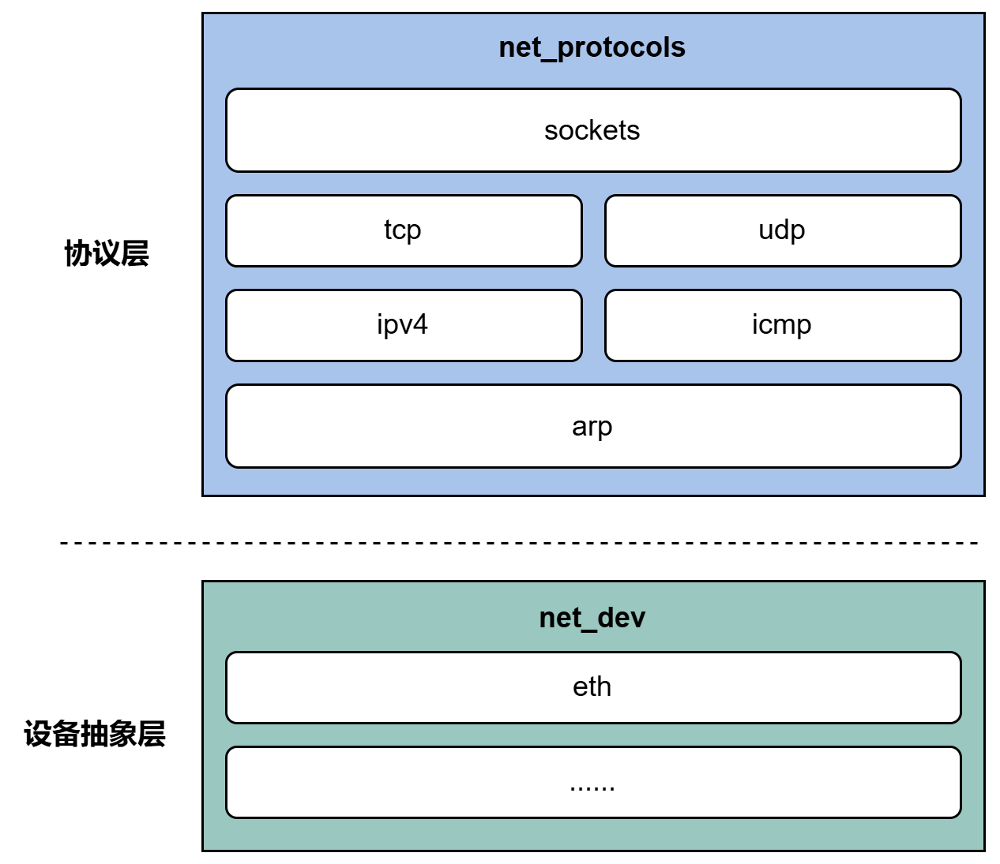
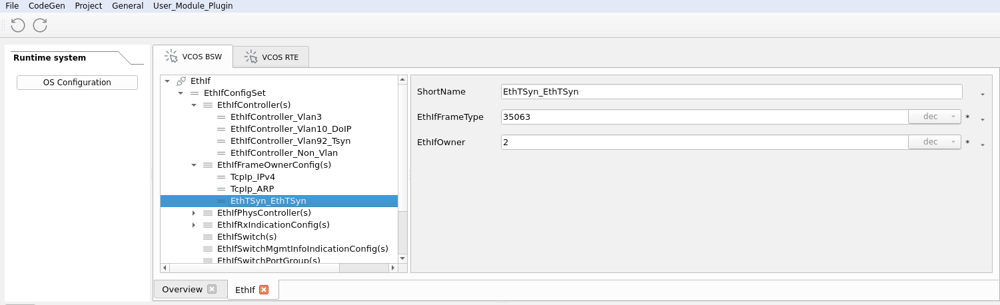
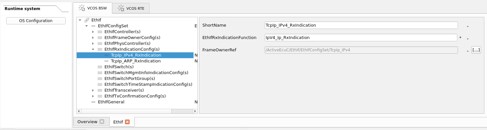
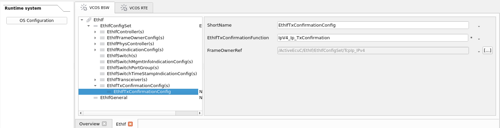
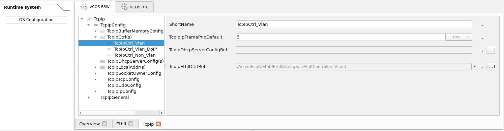
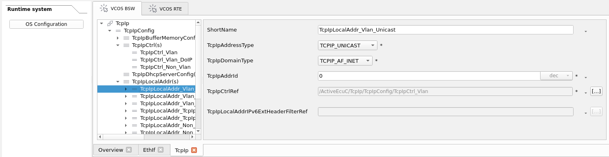
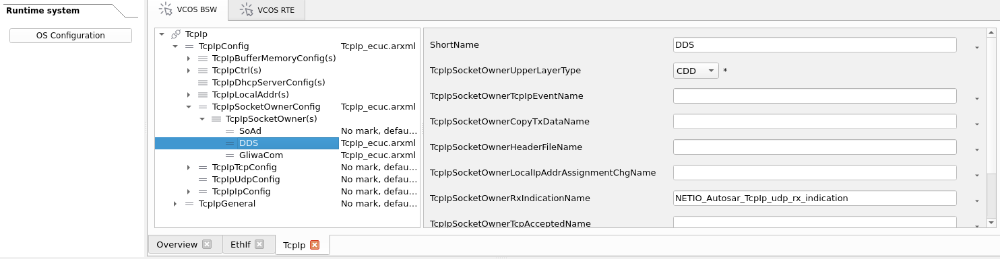

# 以太协议栈开发者手册

## 1. 简介

以太网提供高带宽、低延迟的特性，成为了现代车载网络架构的关键组成之一。本文基于TCP/IP协议栈与网络接口抽象层，提供以太网开发的基础配置与编程方式

## 2. 代码目录

```plaintext
communication
├── CMakeLists.txt          # communication仓库的编译脚本，用于控制编译相关资源
├── Kconfig                 # communication模块的Kconfig文件
├── README.md               # communication仓库的readme，用于介绍该代码仓库(即本文)
├── external                # 第三方代码目录，用于存放其它开源项目代码
│   └── lwip                # lwip相关代码目录
├── net_dev                 # 驱动抽象层，对驱动资源及功能进行抽象封装，供上层模块使用
│   ├── CMakeLists.txt      # 驱动抽象层的编译脚本，用于控制编译相关资源
│   └── eth                 # 以太网的驱动抽象层
└── net_protocols           # 协议栈层的代码
    ├── CMakeLists.txt      # 协议栈层的编译脚本，用于控制编译相关资源
    ├── arp                 # arp协议实现
    ├── icmp                # icmp协议实现
    ├── ipv4                # ipv4协议实现
    ├── sockets             # 网络编程接口实现
    ├── tcp                 # tcp协议实现
    └── udp                 # udp协议实现
```

## 3. 主要功能描述

### 3.1. 功能讲解



* 设备抽象层封装硬件驱动细节，为协议层提供硬件操作接口
* 协议层实现各种网络通信协议，为上层应用提供服务
* 应用层调用协议层提供的服务，进行网络通信

## 4. 功能配置方法
### 4.1. EthIf配置项介绍

#### 4.1.1. EthIfPhysControllers


* 根据以太控制器数量添加EthIfPhysController
* EthIfPhysControllerIdx默认为0

#### 4.1.2. EthIfController


* 根据需求创建EthIfController
* EthIfCtrlId需要从0依次递增填写
* EthIfPhysControllerRef引用EthIfConfigSet中的EthIfPhysControllers

#### 4.1.3. EthIfFrameOwnerConfigs



* 每个子项为一个帧类型，默认3种帧：ARP帧（2054）、IPv4帧（2048）、时间同步帧（35063）

#### 4.1.4. EthIfRxIndicationConfigs



* 引用EthIfFrameOwnerConfigs，为每种帧类型配置对应的回调函数（回调函数需自行实现），EthIfRxIndicationFunction配置项填写函数的名称，以及对应的帧类型

#### 4.1.5. EthIfTxConfirmationFunction



* EthIfTxConfirmationFunction配置项填写函数的名称，需配置为已实现的函数
* FrameOwnerRef填写对应的帧类型

### 4.2. TcpIp模块配置项介绍

#### 4.2.1. TcpIpCtrl



* TcpIpCtrl引用EthIfController

#### 4.2.2. TcpIpLocalAddr



* 配置网关地址，ip地址，TcpIp控制器与NetMask

#### 4.2.3. TcpIpSocketOwnerConfig



* 添加socket，可配置socket owner的相关的各种函数

## 5. 使用示例
### 5.1. 配置增加网卡


* 参考4.1.2节，新建EthIfController

### 5.2. 配置IP地址


* 参考4.2.1节，新建TcpIpCtrl，引用上一步添加的EthIfController


* 参考4.2.2节，新建TcpIpLocalAddr，引用上一步添加的TcpIpCtrl

### 5.3. 配置socket


* 参考4.2.3节，添加socket

### 5.4. TCP、UDP收发送示例
* TCP使用示例
```C
#include "tpip_types.h"
#include "tcpip_cfg.h"
// 1. 获取socket
// TcpIp_DDSGetSocket是为上节配置的TcpIpSocketOwner生成的API
tcpip_socket_id_type socket_id;
TcpIp_DDSGetSocket(AF_INET, TCPIP_IPPROTO_TCP, &socket_id);

// 2. Bind socket
// TcpIpConf_TcpIpLocalAddr_TcpIpLocalAddr_Vlan_Unicast是为配置IP地址一节生成的对应宏
uint16 bind_port = 23;
tcpip_bind(socket_id, TcpIpConf_TcpIpLocalAddr_TcpIpLocalAddr_Vlan_Unicast, &bind_port);

// 3. Server端监听Client连接
uint16 max_channel = 1; // 最大连接数
tcpip_tcp_listen(socket_id, max_channel);

// 4. Client端连接Server
tcpip_sock_addr_type remote_addr;
char server_ip[] = "172.31.3.71";   // 此处为目标IP地址
uint16 server_port = 33;    // 此处为目标端口
remote_addr.domain = TCPIP_AF_INET;
remote_addr.port = lwip_htons(server_port);
ip_addr.addr = inet_addr(server_ip);
tcpip_ip_addr_32_to_8(ip_addr.addr, remote_addr.addr);
tcpip_tcp_connect(socket_id, &remote_addr);

// 5. 发送数据
uint8 data[10] = {"H", "e", "l", "l", "o", ",", "H", "a", "l", "o"};
tcpip_tcp_transmit(socket_id, data, 10, TRUE);

// 6. 接收数据，4.3.3节配置socket时将接收函数配置为RxIndication

// 7. 关闭socket
tcpip_close(socket_id, TRUE);
```

* UDP示例
```C
#include "tpip_types.h"
#include "tcpip_cfg.h"

// 1. 获取socket
// TcpIp_DDSGetSocket是为上节配置的TcpIpSocketOwner生成的API
tcpip_socket_id_type socket_id;
TcpIp_DDSGetSocket(AF_INET, TCPIP_IPPROTO_UDP, &socket_id);

// 2. Bind socket
// TcpIpConf_TcpIpLocalAddr_TcpIpLocalAddr_Vlan_Unicast是为配置IP地址一节生成的对应宏
uint16 bind_port = 23;
tcpip_bind(socket_id, TcpIpConf_TcpIpLocalAddr_TcpIpLocalAddr_Vlan_Unicast, &bind_port);

// 3. 发送数据
uint8 data[10] = {"H", "e", "l", "l", "o", ",", "H", "a", "l", "o"};
tcpip_sock_addr_type local_addr = {
        .addr = {0xACu, 0x1Fu, 0x01u, 0x64u},   // 示例：172.31.1.100；此处应为目标IP地址
        .port = 0x00u,  // 端口号
        .domain = TCPIP_AF_INET};
tcpip_udp_transmit(socket_id, data, &local_addr, 10);

// 4. 接收数据，4.3.3节配置socket时将接收函数配置为RxIndication

// 5. 关闭socket
tcpip_close(socket_id, TRUE);
```

## 6. 配置项参考规范

[EthIf 配置项参考规范](../../configuration_reference/ethif_cfg.md)

[TcpIp 配置项参考规范](../../configuration_reference/tcpip_cfg.md)

## 7. 应用接口参考规范

[TcpIp API 参考规范](../../api_reference/tcpip_api.md)
