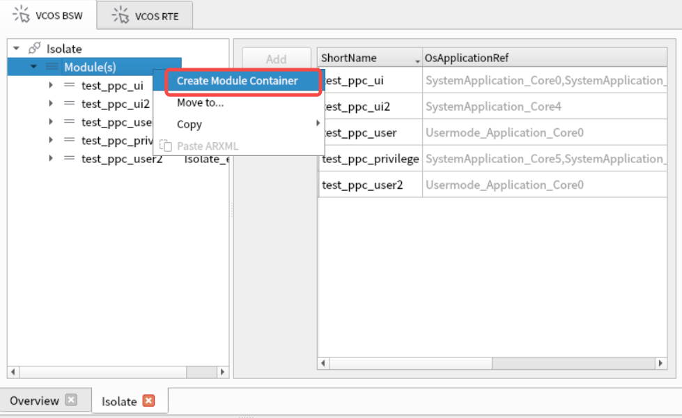
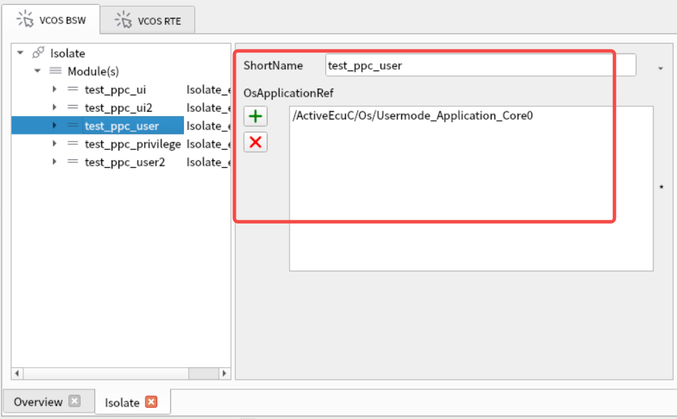
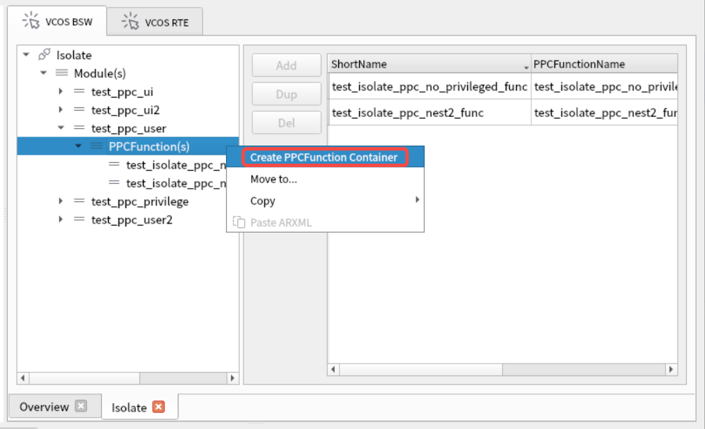
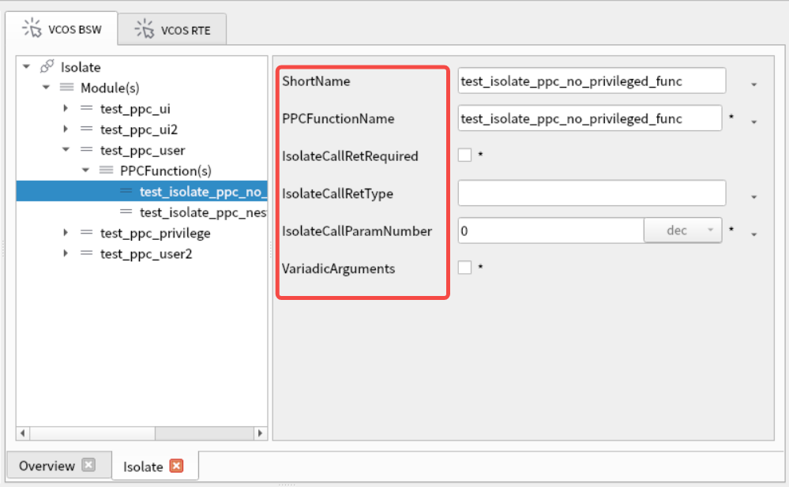

# 软软解耦开发者手册

## 1. 简介

软软解耦特性，支撑系统按照安全等级SC3模式运行，支持业务按照功能安全等级划分，支持内存映射按照功能集合划分，通过内存实时动态保护限制功能集间非法访问，为功能集合隔离提供高性能通信。

## 2. 代码目录

```plaintext
fusa                            # 功能安全模块
└── isolate                     # 软软解耦模块
    └── config_plug_in          # 配置信息
        ├─base_config           # 基础配置
        │  └─bswmd              # 配置项模版
        │     └─comm_bswmd      # 配置文件
        ├─generator             # 代码生成器
        │  ├─context            # 基础函数脚本
        │  └─template           # 生成脚本
        └─validation            # 验证校验
            ├─config            # 语义校验
            └─rules             # 规则校验
```

## 3. 主要功能描述

### 3.1. 功能讲解

#### 3.1.1. PPC隔离通信功能讲解

不同功能集之间内存隔离，由直接函数调用变更为跨功能集远程调用会导致不同功能集之间的调用增加系统开销，高频调用会增加CPU负载，故我们支持高效的同核跨Application的通信机制，我们称作PPC(Protected Procedure Call)。

1. PPC支持权限自动切换

    - 发生PPC调用时，PPC会将运行权限（特权态，MPU权限）临时切换至目标Application
    - 完成实际函数调用后，PPC自动将权限恢复至原有权限

1. PPC支持嵌套使用

    - PPC发生嵌套调用时，会根据调用顺序逐级切换或恢复权限设置

1. 不同核心的灵活配置

    - 允许为函数在不同核下分别绑定不同的Application
    - 当PPC发生调用时会自动根据核心切换至目标Application，开发者无需特殊处理

1. 开发者友好的使用方式

    - 与直接函数调用相比，开发者只需要使用生成的头文件，即可完成从直接函数调用到PPC调用的转变

## 4. 软软解耦模块配置

### 4.1. 配置功能集模块Module

步骤一：在Modules处右键点击新增功能集模块



步骤二：填写Module的名称，配置属性



|**配置项**|**配置说明**|
|---|---|
|ShortName|功能集模块Module名称|
|OsApplicationRef|关联引用配置项，表明当前模块需要在每个核上关联的Application|

### 4.2. 配置PPC函数

步骤一：在PPCFunction处右键点击新增PPC函数配置



步骤二：填写PPCFunction的名称及配置属性



|**配置项**|**配置说明**|
|---|---|
|ShortName|当前PPC配置项名称|
|PPCFunctionName|PPC实际调用函数名称|
|IsolateCallRetRequired|Bool类型，用于表明当前函数是否需要返回值|
|IsolateCallRetType|返回类型名称|
|IsolateCallParamNumber|整数类型，用于表明当前函数入参个数|
|VariadicArguments|Bool类型，用于表明当前函数是否存在可变参数|

## 5. 软软解耦示例

### 5.1. 使用同核隔离通信机制

假设用户有一个foo()函数，在软软解耦配置中，关联在了my_module的功能集中，那么：

```C
// 假设foo()函数正常情况下的调用方式为：
void core_main(void)
{
    foo();
}
// 使用PPC机制，则要求调用方式新增引用功能集的头文件, 即：
#include "my_module_ppc_cfg.h"
void core_main(void)
{
    foo();
}
```

## 6. 配置项参考规范

[软软解耦配置项参考规范](../../configuration_reference/isolate_cfg.md)
