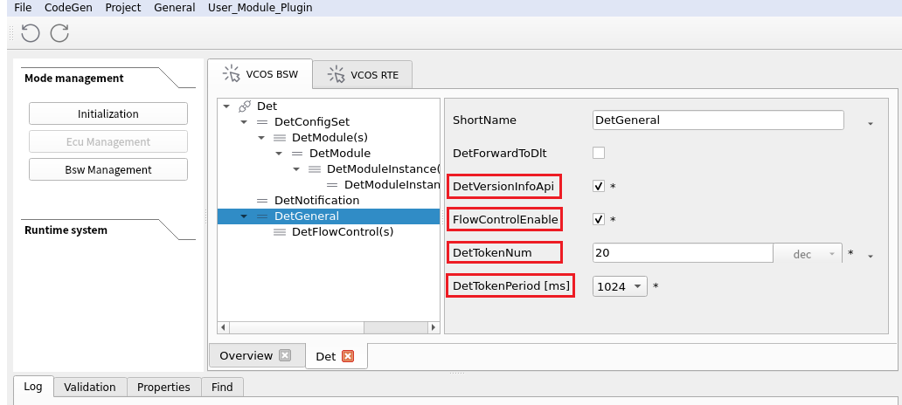
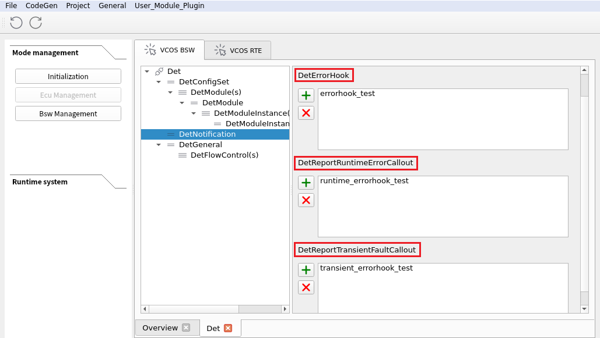

# 维测栈开发者手册

## 1. 简介

维测栈是一种记录系统运行时详细信息的技术手段，用于追踪代码执行流程、调试问题、监控性能，以及分析异常行为。支持追踪、默认错误追踪器与日志等功能。

## 2. 代码目录

maintaining 源代码在 haloosspace/vcos/components/maintaining 目录下，目录结构如下图所示：

```plaintext
maintaining                     # 维测子系统代码
├── CMakeLists.txt              # 维测子系统构建配置，定义模块编译规则
├── DISCLAIMER.md               # 维测子系统免责声明
├── LICENSE                     # 开源协议
├── README.md                   # vcos_components_maintaining 仓库介绍
├── traced                      # 跟踪模块后台服务（数据采集与传输）
│   ├── CMakeLists.txt          # 构建规则
│   ├── inc                     # 头文件
│   ├── Kconfig                 # 配置文件
│   └── src                     # 源文件
└── det                         # 日志接口层
│   └── inc                     # 日志分级控制API头文件
│   └── src                     # 源文件
│   └── config_plug_in          # 配置项生成文件
│   └── CMakeLists.txt          # 构建规则
│   └── Kconfig                 # 配置文件
└── vcos_log                    # 日志接口层
    └── inc                     # 日志分级控制API头文件
```

## 3. 主要功能描述

### 3.1. 功能讲解

#### 3.1.1. 追踪

是VCOS内核内置的一个高性能跟踪工具，用于分析和调试内核行为。它能够跟踪函数调用路径、中断延迟、调度行为等内核级事件，帮助开发者诊断性能问题或定位内核逻辑错误

* **trace信息握手**：VCOS是运行时确定的系统，运行过程中任务基本信息保持不变，因此trace数据分析前通过握手，将任务信息传出，避免trace记录过程中占用过多内存

* **trace事件**：默认支持任务的生命周期管理事件、中断管理事件、堆内存管理事件、临界区管理事件、wdog管理事件以及自定义事件等

#### 3.1.2. 默认错误追踪器

用于在软件开发阶段，支持其他模块，来实现错误检测和错误追踪的支持模块，其接收来自其他模块的错误信息，由默认错误追踪器统一以日志的形式向外传输，同事支持由开发者自行定义对于这些错误信息的处理方式

* **令牌桶**：支持基于令牌捅的流控算法，以防止错误码刷屏

* **自定义处理**：支持用户异常Hook动态代码的自动生成

#### 3.1.2. 日志

提供编译时日志过滤能力，支持将日志动态重定向至终端、文件或网络等多样通道，并可基于模块划分配置独立过滤策略，实现资源优化与输出目标的灵活管控

## 4. 功能配置方法

### 4.1. 默认错误追踪器配置项说明入门

#### 4.1.1. DetGeneral

默认错误追踪器的通用配置，该配置项包括配置是否启用Det版本号获取的Api，以及流量控制相关的配置项

* DetVersionInfoApi：选择是否启用Det版本号获取的Api
* FlowControlEnable：选择是否启用流量控制
* DetTokenNum：如果FlowControlEnable配置为使能，则此项配置用于配置单位时间内可提供的令牌数量
* DetTokenPeriod[ms]：如果FlowControlEnable配置为使能，则此项配置用于配置更新令牌数量的最小时间



#### 4.1.2. DetNotification

用于配置不同故障场景下的用户处理hook

* DetErrorHook：用于配置普通场景下，故障上报时的用户处理hook
* DetReportRuntimeErrorCallout：用于配置RuntimeError场景下，故障上报时的用户处理hook
* DetReportTransientFaultCallout: 用于配置TransientFault场景下，故障上报时的用户处理hook



### 4.2. 使用示例

#### 4.2.1. 添加配置

* 参考4.1节，在 DetGeneral 中配置是否启用版本号获取Api，以及Det流量控制相关的内容
* 参考4.2节，在 DetNotification 中配置，针对特定的故障信息，是否添加相应的用户自定义处理

#### 4.2.2. 故障上报示例

本 Demo 介绍了如何使用API接口进行故障上报

```C
#include "Det.h"

void det_demo(void)
{
    // 普通场景故障上报
    Det_ReportError(ModuleId, InstanceId, ApiId, ErrorId);

    // RuntimeError场景故障上报
    Det_ReportRuntimeError(ModuleId, InstanceId, ApiId, ErrorId);

    // TransientFault场景故障上报
    Det_ReportTransientFault(ModuleId, InstanceId, ApiId, FaultId);

    // 故障上报，且携带故障信息
    struct Type error_msg;
    Det_ReportErrorWithInfo(errorId, &error_msg, sizeof(struct Type));
}

```

## 5. 配置项参考规范

[Det 配置项参考规范](../../configuration_reference/det_cfg.md)

## 6. 应用接口参考规范

[Det API 参考规范](../../api_reference/det_api.md)
