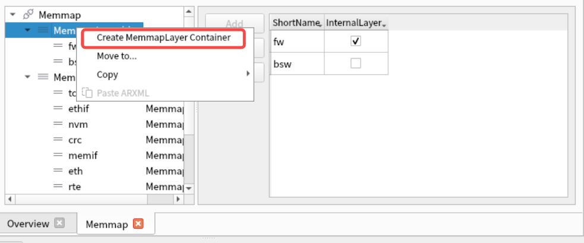
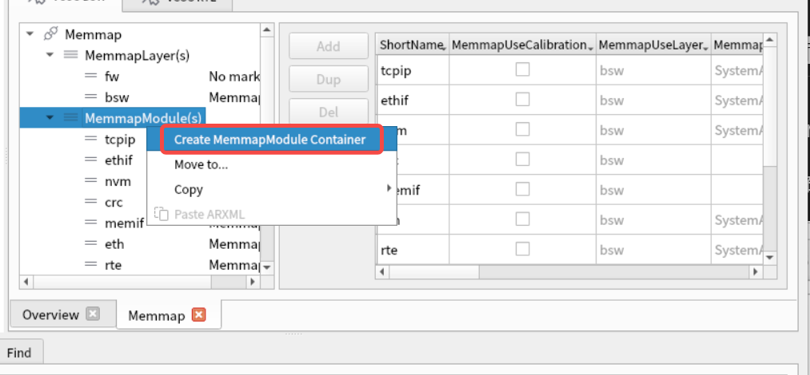
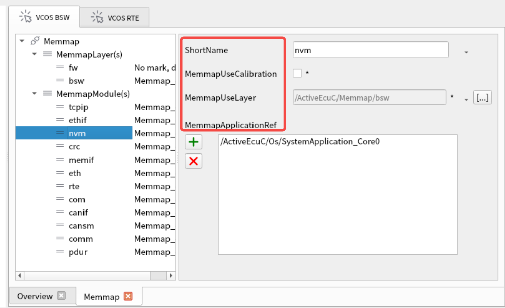

# 内存映射开发者手册

## 1. 简介

内存映射模块提供一套机制，使得用户可以借助这套机制提供的内存映射宏，模块头文件和生成链接脚本完成对内存的映射和控制内存的布局，实现内存资源的高效利用，支撑上层的内存保护模块的应用和对资源的分区管理

## 2. 代码目录

```plaintext
memory                          # 内存相关框架
└── memmap                      # 内存映射模块
    └── config_plug_in          # 配置信息
        ├─base_config           # 基础配置
        │  └─bswmd              # 配置项模版
        │     └─comm_bswmd      # 配置文件
        ├─generator             # 代码生成器
        │  ├─context            # 基础函数脚本
        │  └─template           # 生成脚本
        └─validation            # 验证校验
            ├─config            # 语义校验
            └─rules             # 规则校验
```

## 3. 主要功能描述

### 3.1. 功能讲解

- 内存映射机制

根据开发者配置的MemmapModule，系统会为开发者生成对应的模块内存映射宏和内存映射头文件。开发者通过引用生成的宏定义，可将特定数据对象映射至目标内存段

- 内存权限抽象

内存映射模块为每个配置的模块，都自动生成以下几种权限类型抽象：

1. Private：私有数据，仅所属Application具有R/W权限
1. Semishare：半共享数据，所属Application具有R/W权限，其他Application具有R权限
1. Multi-app：多应用共享，指定Application集合具有R/W权限

- 内存布局配置

内存映射模块会根据配置提供链接脚本文件，开发者通过在链接脚本中，可自定义地决定数据在内存布局中的位置，实现内存资源灵活布局

## 4. Memmap模块配置

### 4.1. 配置MemmapLayer

步骤一：在MemmapLayer处右键点击新增内存映射软件层级



步骤二：填写MemmapLayer的名称，配置属性


|**配置项**|**配置说明**|
|---|---|
|ShortName|layer名称|
|InternalLayer|Bool类型，用于指定内部底层的内存映射软件层级|

### 4.2. 配置MemmapModule

步骤一：在MemmapModule处右键点击新增内存映射模块关联实体



步骤二：填写MemmapModule的名称及配置属性



|**配置项**|**配置说明**|
|---|---|
|ShortName|当前模块的名称|
|MemmapUseCalibration|Bool类型，用于表用当前模块是否需要使用标定段|
|MemmapUseLayer|关联引用配置项，用于引用已创建的MemmapLayer，表明此模块的数据会被映射到的区域|
|MemmapApplicationRef|关联引用配置项，表明当前模块需要映射到哪些Application的内存区域|

## 5. 内存映射示例

### 5.1. 使用内存映射宏和内存映射模块头文件

假设开发者配置了一个名叫“my_module”的模块，并想将自己代码里的一个叫“myData”的无初始化变量映射到模块的私有区域，那么他可以这样使用内存映射的机制：

```C
#define MY_MODULE_START_SEC_PRIVATE_BSS
#include "my_module_memmap.h"
VAR(MyDataType, MY_MODULE_PRIVATE_BSS) myData;
#define MY_MODULE_STOP_SEC_PRIVATE_BSS
#include "my_module_memmap.h"
```

## 6. 配置项参考规范

[Memmap 配置项参考规范](../../configuration_reference/memmap_cfg.md)
