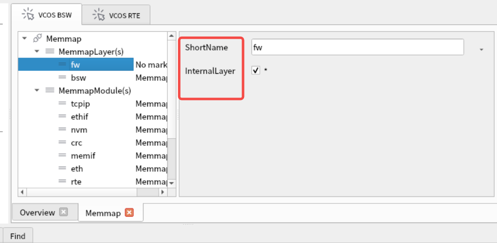

# 内存映射开发者手册

## 1. 简介

内存映射模块提供一套机制，使得用户可以借助这套机制提供的内存映射宏，模块头文件和生成链接脚本完成对内存的映射和控制内存的布局，实现内存资源的高效利用，支撑上层的内存保护模块的应用和对资源的分区管理

## 2. 代码目录

```plaintext
memory                          # 内存相关框架
└── memmap                      # 内存映射模块
    └── config_plug_in          # 配置信息
        ├─base_config           # 基础配置
        │  └─bswmd              # 配置项模版
        │     └─comm_bswmd      # 配置文件
        ├─generator             # 代码生成器
        │  ├─context            # 基础函数脚本
        │  └─template           # 生成脚本
        └─validation            # 验证校验
            ├─config            # 语义校验
            └─rules             # 规则校验
```

## 3. 主要功能描述

### 3.1. 功能讲解

#### 3.1.1. 内存映射机制

内存映射机制允许开发人员根据Application配置和内存保护配置把内存数据合理地映射不同的数据段。

1. 完整的内存映射类型支持

    - 支持Data, Bss, Text和Rodata的内存映射需求
    - 额外支持标定（Calibration）内存的按需选择

1. 支撑内存保护功能：

    - 提供私有（Private）数据段，仅所属Application具有R/W权限
    - 提供半共享（Semishare）数据段，所属Application具有R/W权限，其他Application具有R权限
    - 提供多应用共享（Multi-app）数据段，指定Application集合具有R/W权限

1. 支持用户自定义内存层级

    - 使用至少一个内部内存层级（Internal Layer）作为默认的层级
    - 用户在新增内存映射模块时，可灵活地选择目标内存层级
    - 自定义内存层级有利于代码统计等功能的开发，识别资源使用可优化点

1. 支持用户自定义内存映射模块

    - 开发者可自定义内存映射模块，完成特殊的内存映射需求或覆盖系统自动的内存映射推理逻辑
    - 为每个SWC提供Autosar CP风格兼容的内存映射方法，降低开发者配置内存映射模块和适配内存映射宏变化的工作量

#### 3.1.2. 内存布局配置

内存映射模块会根据配置提供链接脚本文件，开发者通过在链接脚本中，可自定义地决定数据在内存布局中的位置，实现内存资源灵活布局

1. 链接脚本片段生成

    - 根据内核的内存类型，Application，核心数等信息，生成默认的链接脚本片段
    - 开发者只需在连接脚本中引用连接脚本片段即可完成布局配置

1. 灵活且完整的段起止标识符支持

    - 在内存段的不同层级都加入了段起止标识符，并确保地址对齐
    - 开发者可利用段起止标识符灵活地配置内存保护属性

## 4. Memmap模块配置

### 4.1. 配置MemmapLayer

步骤一：在MemmapLayer处右键点击新增内存映射软件层级


步骤二：填写MemmapLayer的名称，配置属性



|**配置项**|**配置说明**|
|---|---|
|ShortName|layer名称|
|InternalLayer|Bool类型，用于指定内部底层的内存映射软件层级|

### 4.2. 配置MemmapModule

步骤一：在MemmapModule处右键点击新增内存映射模块关联实体


步骤二：填写MemmapModule的名称及配置属性


|**配置项**|**配置说明**|
|---|---|
|ShortName|当前模块的名称|
|MemmapUseCalibration|Bool类型，用于表用当前模块是否需要使用标定段|
|MemmapUseLayer|关联引用配置项，用于引用已创建的MemmapLayer，表明此模块的数据会被映射到的区域|
|MemmapApplicationRef|关联引用配置项，表明当前模块需要映射到哪些Application的内存区域|

## 5. 内存映射示例

### 5.1. 使用内存映射宏和内存映射模块头文件

假设开发者配置了一个名叫“my_module”的模块，并想将自己代码里的一个叫“myData”的无初始化变量映射到模块的私有区域，那么他可以这样使用内存映射的机制：

```C
#define MY_MODULE_START_SEC_PRIVATE_BSS
#include "my_module_memmap.h"
VAR(MyDataType, MY_MODULE_PRIVATE_BSS) myData;
#define MY_MODULE_STOP_SEC_PRIVATE_BSS
#include "my_module_memmap.h"
```

假设开发者希望在my_module这个模块里，把hello_world()函数映射到这个模块里，那么他可以：

原有函数实现：

```C
void hello_world(void)
{
    /* do something */
}
```

内存映射后的函数实现：

```C
#define MY_MODULE_START_SEC_CODE
#include "my_module_memmap.h"

FUNC(void, MY_MODULE_CODE) hello_world(void)
{
    /* do something */
}

#define MY_MODULE_STOP_SEC_CODE
#include "my_module_memmap.h"
```

### 5.2. 使用链接脚本片段完成内存布局设计

假设开发者希望把Core 0的栈（Stack）放在RAM0中，且在.mysection1和.mysection2之间，那么他可以这样使用链接脚本片段：

原有的链接脚本：

```linker-script
.mysection1 : {
    /* some sections */
} > RAM0


.mysection2 : {
    /* some sections */
} > RAM0

```

使用链接脚本片段之后：

```linker-script
.mysection1 : {
    /* some sections */
} > RAM0

#define OS_LAYOUT_RAM_ADDR_MACRO RAM0
#include "default_stacks_core0.ld"

.mysection2 : {
    /* some sections */
} > RAM0

```

## 6. 配置项参考规范

[Memmap 配置项参考规范](../../configuration_reference/memmap_cfg.md)
