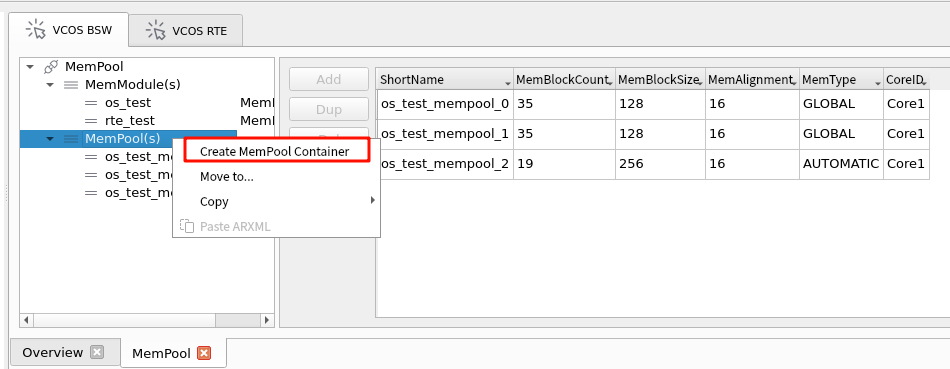
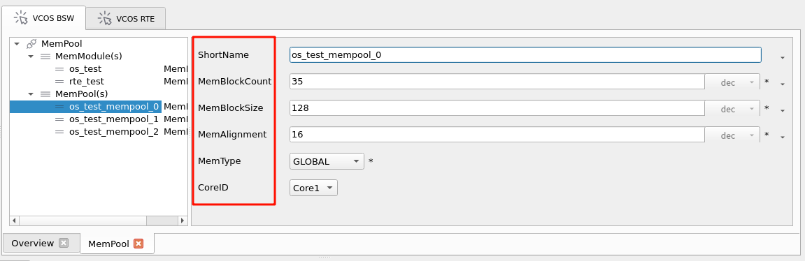
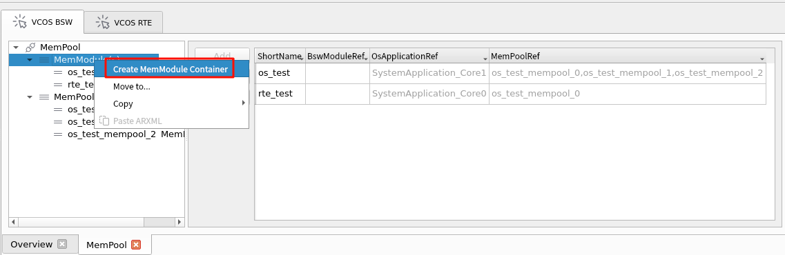
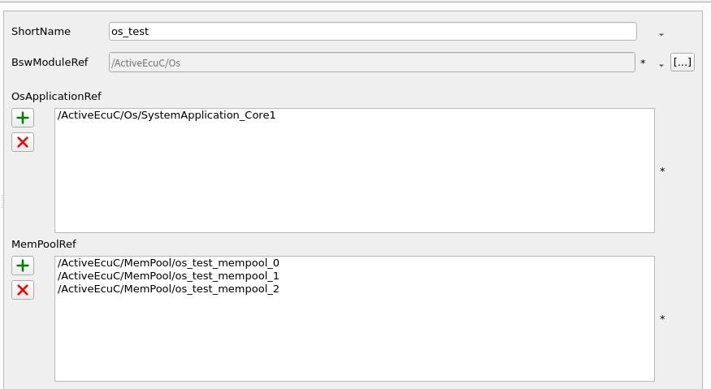

# 内存池开发者手册

## 1. 简介

内存池模块采用统一接口和标准化实现，支持多实例和模块化配置，能够根据用户配置自动分配到不同内存区域，并具备数据一致性保护和内存自动回收功能，为系统提供高效、灵活和安全的内存管理方案

## 2. 代码目录

```text
components #
└── memory                          # 内存相关框架
    └── mempool                     # 内存池模块
        └── config_plug_in          # 配置信息
            ├─base_config           # 基础配置
            │  ├─base_ecuc          # 内存池配置
            │  │  └─comm_ecuc       # 配置文件
            │  └─bswmd              # 配置项模版
            │     └─comm_bswmd      # 配置文件
            ├─generator             # 代码生成器
            │  ├─context            # 基础函数脚本
            │  └─template           # 生成脚本
            ├─linkage               # 基础校验规则配置
            └─validation            # 验证校验
                ├─config            # 语义校验
                └─rules             # 规则校验
```

## 3. 主要功能描述

### 3.1. 功能讲解

#### 3.1.1. 内存分配和释放

内存的分配和释放基于单向链表实现，内存分配是出链表操作，内存释放是插入链表操作

#### 3.1.2. 数据保护

根据配置，系统可自动推理并生成相应的数据一致性保护机制：

- 当内存池仅关联单个OSA时，采用关中断保护方式
- 当内存池关联多个位于同一核的OSA时，同样采用关中断保护
- 关联多个跨核的OSA，spinlock 保护 （MemPool 模块自动推理生成Spinlock）

#### 3.1.3. 内存隔离

内存池的内存结构分为三部分：常量配置部分、可变量配置部分和数据部分。其中，常量配置部分通过内存映射机制直接映射到const段，以实现只读和高效访问。对于可变量配置部分和数据部分，系统会根据内存池模块关联的OSA数量和分布情况进行自动推理和区域映射：

- 若仅关联单个OSA，则映射到CORE区，实现专属管理和访问
- 若关联多个跨核OSA，则映射到Global区，实现跨核共享和统一管理

#### 3.1.4. 内存池模式

内存池模式用于灵活划分和管理系统内存资源，支持多种应用场景。不同模式根据模块与应用的关联关系，实现内存池的专属分配或全局共享，满足系统对内存隔离性与共享性的多样化需求。通过配置合适的内存池模式，可有效提升资源利用率、管理灵活性以及系统运行的稳定性和安全性。内存池各个模式介绍如下：

- CORE模式：通过与具体的application关联，自动将内存池分配到对应的application区域，实现资源的专属管理
- GLOBAL模式：作为全局共享区域，供所有模块和应用共同访问和使用
- AUTOMATIC模式：为自动推理模式。系统根据模块关联的application数量自动判断：若关联2个及以上application，默认切换为GLOBAL模式；否则分配为CORE模式，实现智能化的内存池分配

## 4. MemPool模块配置

### 4.1. 配置MemPool实体

步骤一：在MemPool处右键点击新增内存池实体



步骤二：填写MemPool的名称，配置属性



|**配置项**|**配置说明**|
|---|---|
|MemBlockCount|整型参数配置项，用于定义内存块的数量|
|MemBlockSize|整型参数配置项，用于定义单个内存块的大小|
|MemAlignment|整型参数配置项，用于定义内存对齐的方式|
|MemType|枚举参数配置项，用于定义内存池的类型。通过配置MemType，可以指定内存池的具体类型，以满足不同应用场景的需求，从而实现更高效的内存管理和资源利用|

### 4.2. 配置MemModule

步骤一：在MemModule处右键点击新增内存池模块关联实体



步骤二：填写MemModule的名称，配置属性以及关联的内存池对象



|**配置项**|**配置说明**|
|---|---|
|BswModuleRef|外部引用配置项，用于关联指定的Bsw模块实例|
|OsApplicationRef|关联引用配置项，用于指定当前软件组件所部署的OsApplication的引用|
|MemPoolRef|关联引用配置项，用于引用已创建的内存池，便于在应用中进行内存池的管理与操作|

用户可通过点击对应区域的“＋”按钮按需新增关联对象，或点击“×”按钮删除不需要的关联对象

## 5. 配置项参考规范

[MemPool 配置项参考规范](../../configuration_reference/mempool_cfg.md)
