# 网络管理休眠唤醒开发者手册

## 1. 简介

CAN网络管理休眠唤醒的特性，成为了现代ECU资源节省的重要组成之一。本文基于CAN通信的网络管理模式，提供CAN通信休眠唤醒的基础配置与编程方式

## 2. 代码目录

网络管理休眠唤醒源代码在haloosspace/vcos/components/communication目录下，目录结构如下图所示：

```plaintext
communication
├── CMakeLists.txt          # communication仓库的编译脚本，用于控制编译相关资源
├── DISCLAIMER.md           # 免责声明文档
├── Kconfig                 # communication模块的Kconfig文件
├── LICENSE                 # 项目许可证文件
├── README.md               # communication仓库的readme，用于介绍该代码仓库(即本文)
├── external                # 第三方代码目录，用于存放其它开源项目代码
│   └── lwip                # lwip相关代码目录
├── net_dev                 # 驱动抽象层，对驱动资源及功能进行抽象封装，供上层模块使用
│   ├── CMakeLists.txt      # 驱动抽象层的编译脚本，用于控制编译相关资源
│   └── eth                 # 以太网的驱动抽象层
│   └── canif               # canif实现
│   └── cantrcv1145         # cantrcv1145实现
└── net_manager             # 网络管理休眠唤醒的代码
    ├── CMakeLists.txt      # 网络管理的编译脚本，用于控制编译相关资源
    ├── cannm               # cannm实现
    ├── cansm               # cansm实现
    ├── comm                # comm实现
    ├── nm                  # nm实现

```

## 3. 主要功能描述

### 3.1. 功能讲解

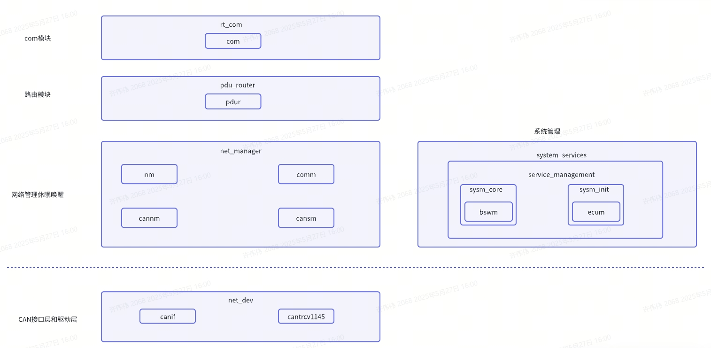

* com模块为网络管理报文填充userdata数据，为应用报文提供发送流程
* 路由模块为网络管理报文提供路由功能，为应用报文也提供路由功能
* 网络管理休眠唤醒为网络提供休眠和唤醒的主要流程
* 系统管理为唤醒源和休眠场景提供服务支持

## 4. 功能配置方法

### 4.1. com配置项介绍

#### 4.1.1. com通用配置

ComGeneral 主要用于控制一些宏等开启

* ComConfigurationUseDet：用于打开det
* ComRetryFailedTransmitRequests：用于重试发送请求
* ComSupportedIPduGroups：用于支持Ipdu组
* ComUserCbkHeaderFile：用于用户回调头文件

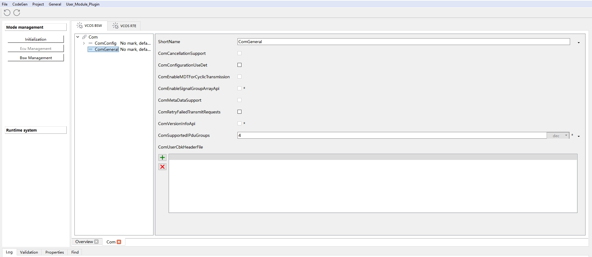

#### 4.1.2. com网络管理pdu配置

ComIpdu 用于配置通信pdu相关的参数

* ComIPduSignalProcessing：用于pdu信号处理
* ComIPduType：用于pdu类型
* ComIPduCallout：用于支持Ipdu回调函数
* ComIPduTriggerTransmitCallout：用于pdu触发发送回调函数
* ComIPduHandleId：用于pduid配置
* ComPduIdRef：用于Ipdu引用
* IPduMainFunctionRef：用于pdu对应的发送主函数
* ComIPduGroupRef：用于Ipdu组引用
* ComIPduSignalGroupRef：用于Ipdu信号组引用
* ComIPduSignalRef：用于Ipdu信号引用

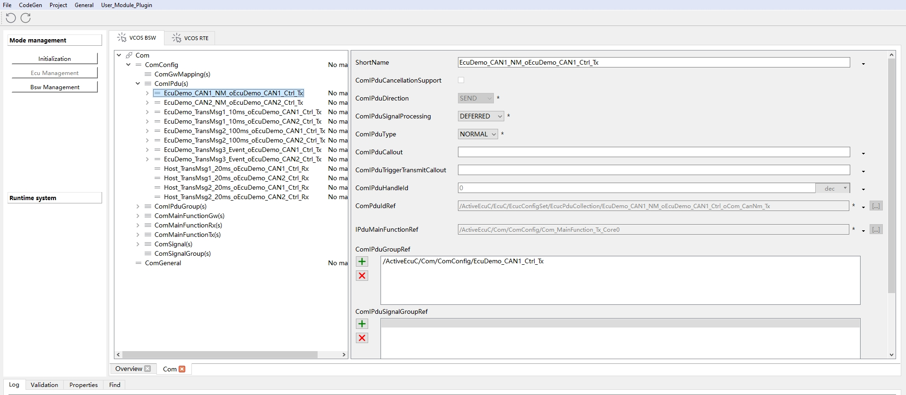

### 4.2. pdur配置项介绍

#### 4.2.1. pdur模块配置

PduRBswModule 用于配置PduR支持的路由上下游模块

* ShortName：用于配置PduR上下游模块
* PduRCancelReceive：用于配置是否支持取消接收
* PduRCancelTransmit：用于配置是否支持取消接收
* PduRCommunicationInterface：该模块是否属于通信接口
* PduRLowerModule：该模块是否属于下层模块
* PduRRetransmission：判断是否重传
* PduRTransportProtocol：该模块是否属于TP模块
* PduRTriggertransmit：判断是否触发发送
* PduRTxConfirmation：判断是否支持发送确认
* PduRUpperModule：该模块是否属于上层模块
* PduRUseTag：判断是否使用tag
* PduRBswModuleRef：pdur引用的模块

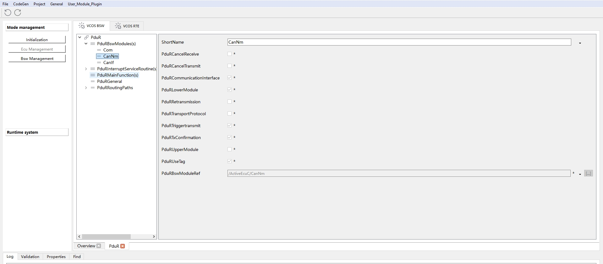

#### 4.2.2. pdur源网络管理pdu配置

* ShortName：源pdu名称
* PduRSrcPduUpTxConf：用于配置源pdu上层发送确认
* PduRSourcePduBlockSize：用于配置源pdu块大小
* PduRSourcePduHandleId：用于配置源pduid
* PduRSrcPduRef：用于配置引用的源pdu

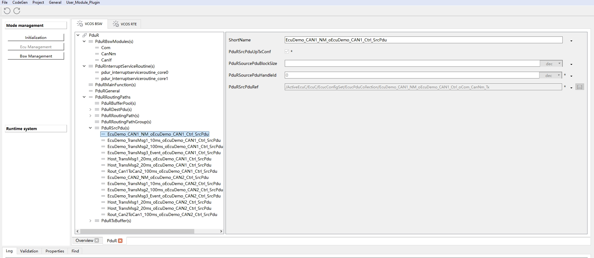

#### 4.2.3. pdur目的网络管理pdu配置

* ShortName：目的pdu名称
* PduRTransmissionConfirmation：用于配置目的pdu发送确认
* PduRDestPduDataProvision：用于配置目的pdu提供方式
* PduRDestPduLengthHandlingStrategy：用于配置目的pdu长度处理策略
* PduRDestPduHandleId：用于配置目的pduid
* PduRDestPduRef：用于配置引用的目的pdu

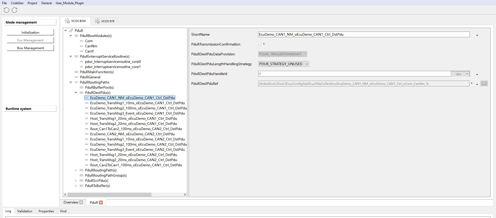

#### 4.2.4. pdur网络管理pdu路由路径配置

* ShortName：路由路径名称
* PduRQueueDepth：用于配置pdu队列深度
* PduRTpThreshold：用于配置TP阈值
* PduRSrcPduRRef：用于配置引用源pdu
* PduRDestPduRRef：用于配置引用目的pdu
* PduRDestTxBufferRef：用于配置目的pdu的发送buffer

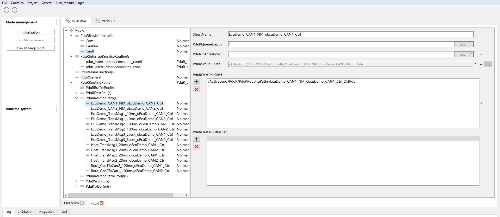

### 4.3. comm配置项介绍

#### 4.3.1. comm通用配置

* ShortName：comm通用名称
* ComMDevErrorDetect：用于打开故障上报det
* ComMModeLimitationEnabled：用于配置限制模式使能
* ComMSynchronousWakeUp：用于配置同步唤醒
* ComMWakeupInhibitionEnabled：用于配置唤醒使能
* ComMTMinFullComModeDuration：用于配置最小全通信模式持续时间
* ComMEcuGroupClassification：用于配置ecu组分类

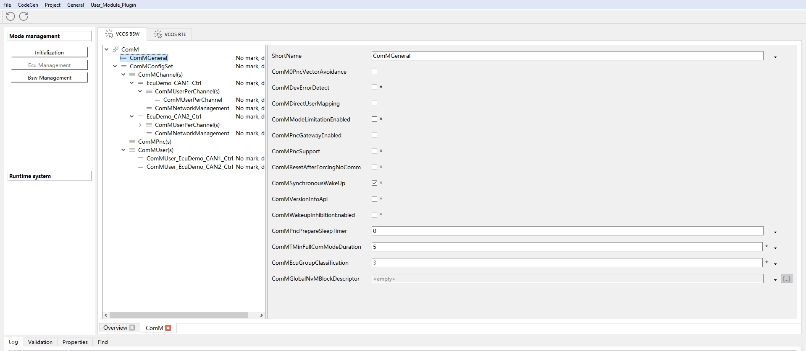

#### 4.3.2. comm通道配置

* ShortName：comm通道名称
* ComMFullCommRequestNotificationEnabled：用于使能全通信请求通知
* ComMMainFunctionPeriod：用于配置主函数周期
* ComMChannelId：用于配置通道ID

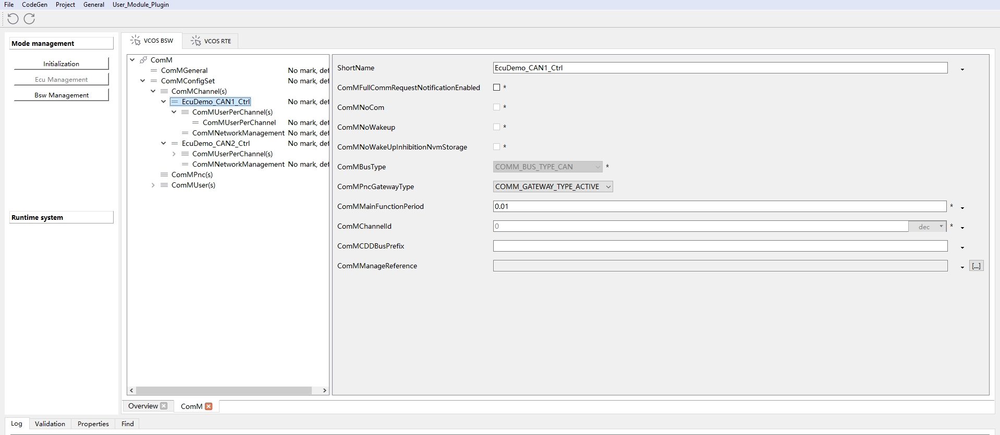

### 4.4. cansm配置项介绍

#### 4.4.1. cansm通用配置

* ShortName：cansm通用名称
* CanSMDevErrorDetect：用于打开故障上报det
* CanSMIcomSupport：用于配置通信使能
* CanSMGetBusOffDelayFunction：用于配置busoff延迟函数
* BusOffBeginFunction：用于配置busoff开始函数
* BusOffEndFunction：用于配置busoff结束函数
* CanSMGetBusOffDelayHeader：用于配置busoff延迟头
* CanSMSpinlockRetryCounter：用于配置自旋锁重试次数
* CanSMInitFastExecuteThreshold：用于配置初始化快速执行阈值
* CanSMMainFuncFastExecuteThreshold：用于配置主函数快速执行阈值

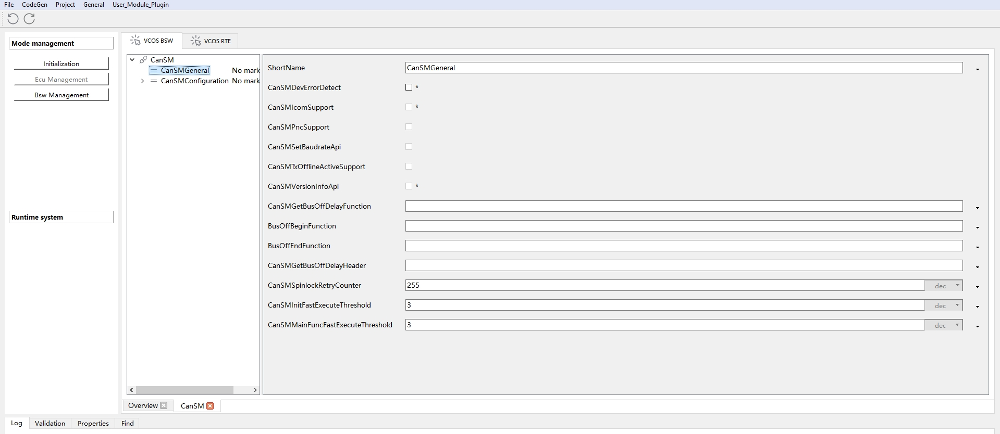

#### 4.4.2. cansm通道配置

* ShortName：cansm通道名称
* CanSMBorTimeL1：用于配置等级1的busoff恢复时间
* CanSMBorTimeL2：用于配置等级2的busoff恢复时间
* CanSMBorTimeTxEnsured：用于配置busoff恢复时间发送确认
* CanSMBorCounterL1ToL2：用于配置busoff恢复计数从L1到L2
* CanSMComMNetworkHandleRef：用于配置引用的通信通道
* CanSMTransceiverId：用于配置收发器ID

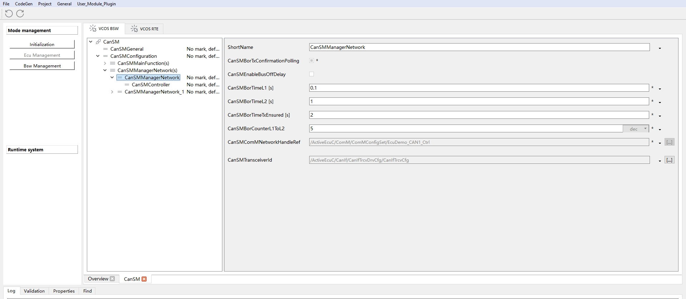

### 4.5. nm配置项介绍

#### 4.5.1. nm通用配置

* ShortName：nm通用名称
* NmComControlEnabled: 用于配置通信控制使能
* NmPduRxIndicationEnabled：用于配置接收pdu使能
* NmPduRcvIndCallback：用于配置接收回调函数
* NmStateChangeIndEnabled：用于配置状态切换使能
* NmUserDataEnabled：用于配置userdata使能
* NmStateChangeIndCallback：用于配置状态切换回调函数
* NmCallbacksPrototypeHeader：用于配置回调头文件

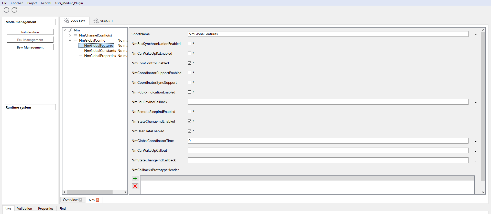

#### 4.5.2. nm通道配置

* ShortName：nm通道名称
* NmComUserDataSupport：用于配置Com用户数据使能
* NmPassiveModeEnabled：用于配置被动模式使能
* NmStateReportEnabled：用于配置状态上报使能
* NmComMChannelRef：用于配置引用的通信通道

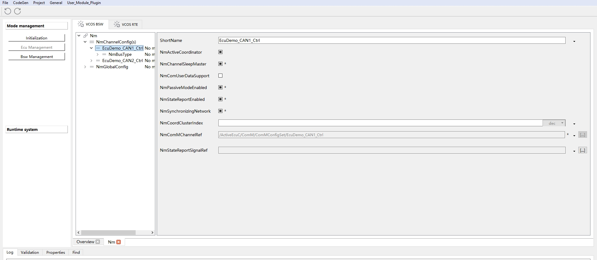

### 4.6. cannm配置项介绍

#### 4.6.1. cannm通用配置

* ShortName：cannm通用名称
* CanNmComControlEnabled：用于配置通信控制使能
* CanNmComUserDataSupport：用于配置用户数据使能
* CanNmDevErrorDetect：用于配置开发错误上报
* CanNmPassiveModeEnabled：用于配置被动模式使能
* CanNmPduRxIndicationEnabled：用于配置接收使能
* CanNmStateChangeIndEnabled：用于配置状态通知使能
* CanNmUserDataEnabled：用于配置用户数据使能
* CanNmTransmitCalloutFunc：用于配置发送回调函数

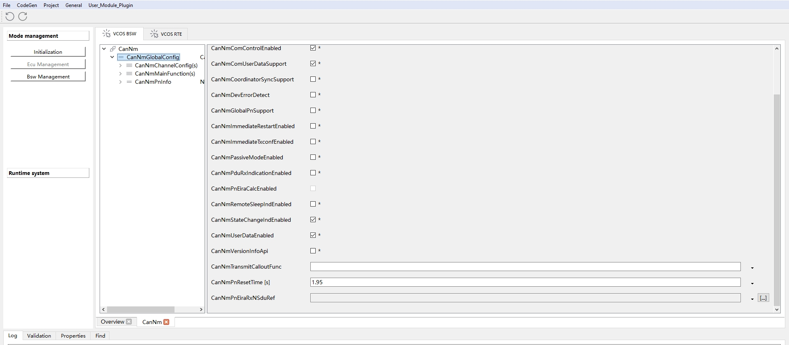

#### 4.6.2. cannm通道配置

* ShortName：cannm通道名称
* CanNmActiveWakeupBitEnabled：用于配置激活唤醒bit使能
* CanNmAllNmMessagesKeepAwake：用于配置所有nm报文保持唤醒使能
* CanNmNodeDetectionEnabled：用于配置节点探测使能
* CanNmNodeIdEnabled：用于配置节点id使能
* CanNmRetryFirstMessageRequest：用于配置重试首帧报文请求
* CanNmRepeatMsgIndEnabled：用于配置重试消息使能
* CanNmPduCbvPosition：用于配置cbv位置
* CanNmPduNidPosition：用于配置nid位置
* CanNmImmediateNmCycleTime：用于配置立即周期发送时间
* CanNmMsgCycleOffset：用于陪孩子消息周期offset
* CanNmMsgCycleTime：用于配置消息周期时间
* CanNmMsgReducedTime：用于配置消息减少时间
* CanNmMsgTimeoutTime：用于配置消息超时时间
* CanNmRemoteSleepIndTime：用于配置远端时间时间
* CanNmRepeatMessageTime：用于配置重复消息时间
* CanNmTimeoutTime：用于配置超时时间
* CanNmWaitBusSleepTime：用于配置等待总线睡眠时间
* CanNmImmediateNmTransmissions：用于立即发送nm消息次数
* CanNmNodeId：用于配置节点id
* CanNmComMNetworkHandleRef：用于配置引用的通道id

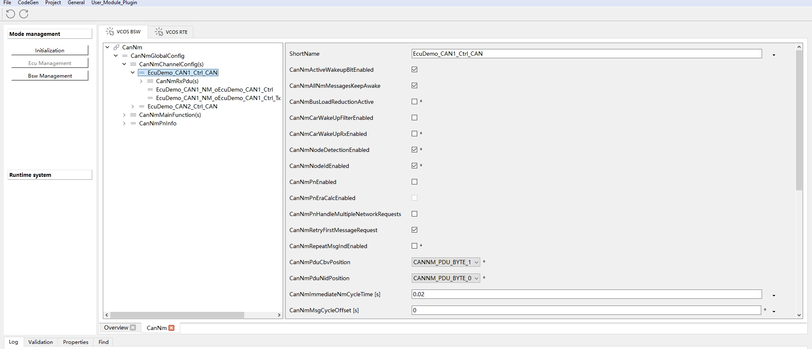

### 4.7. bswm配置项介绍

#### 4.7.1. bswm通用配置

BswMGeneral 主要用于控制一些宏等开启和设备配置，简要介绍 BswMGeneral 中一些主要的配置项

* BswMCanSMEnabled：用于启用对CanSM模块的状态管理
* BswMComMEnabled：用于启用对ComM模块的状态管理
* BswMMainFunctionPeriod: 设置mainfunction周期

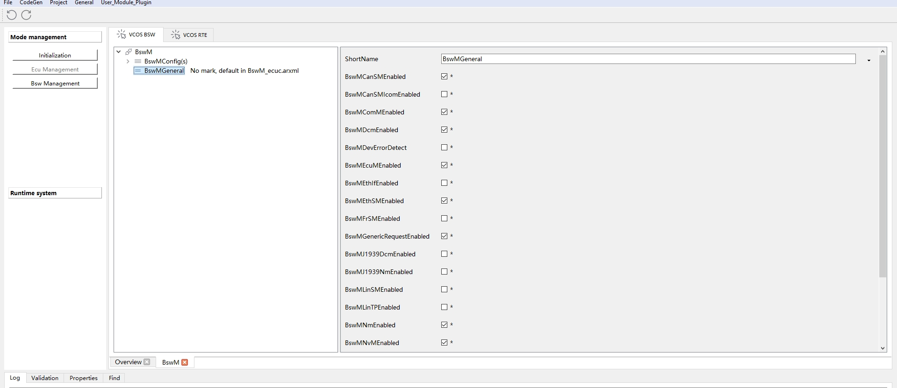

#### 4.7.2. bswm配置逻辑表达式

配置逻辑表达式，用于规则中的条件判断:

* BswMLogicalOperator：配置不同condition之间的关系（与、或、非）
* BswMArgumentRef：引用condition

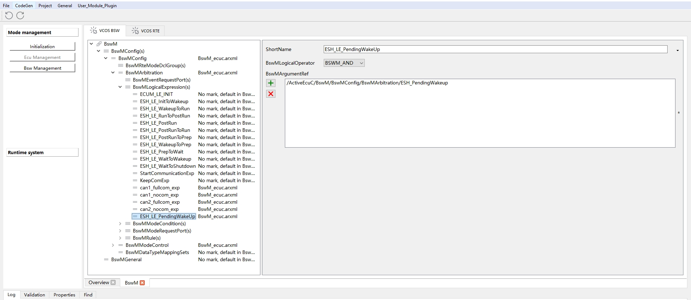

#### 4.7.3. bswm配置模式条件

配置条件，用于组成逻辑表达式:

* BswMConditionType：配置Port与BswMode之间的关系（等于、不等于）
* BswMConditionMode：引用到一个模式请求端口（Port）

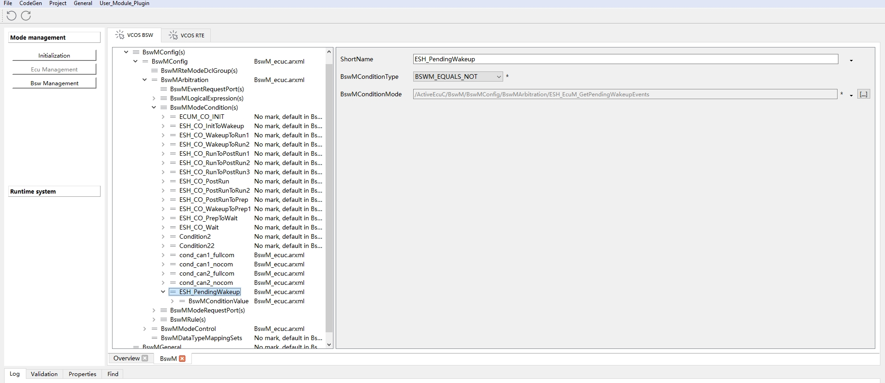

#### 4.7.4. bswm配置模式请求端口

其他模块在BswM中注册端口，状态变化会反应到端口上:

* BswMRequestProcessing：端口改变时的触发模式（立即仲裁还是mainfunction中仲裁）
* BswMArbitrateOnInit：是否在初始化时仲裁

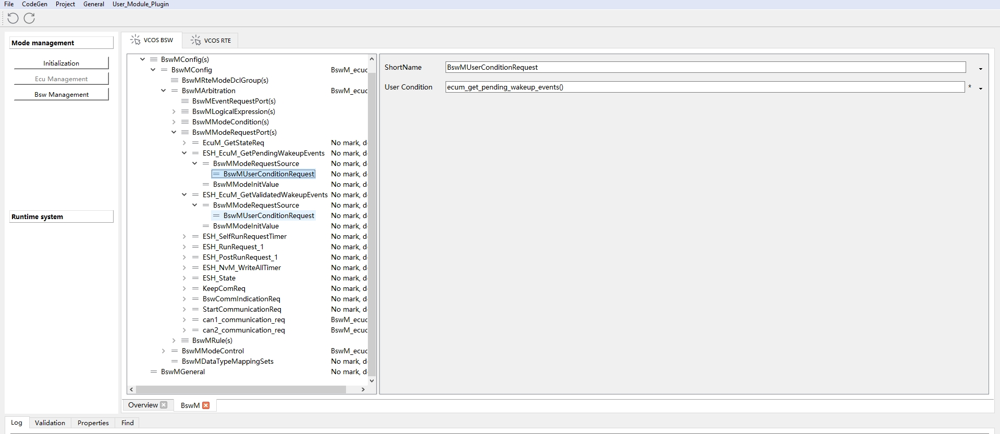

#### 4.7.5. bswm配置规则

* BswMRuleInitState：规则的初始状态，评估规则所依据的状态
* BswMRuleExpressionRef：引用对应的逻辑表达式
* BswMRuleFalseActionList：逻辑表达式评估FALSE时执行的动作列表
* BswMRuleTrueActionList：逻辑表达式评估TRUE时执行的动作列表

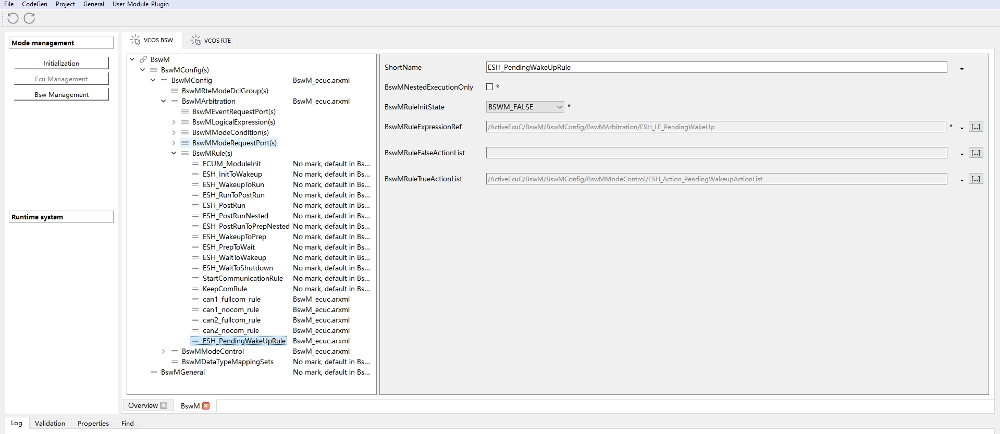

#### 4.7.6. bswm配置动作

* BswMUserCalloutFunction：用于配置用户回调函数

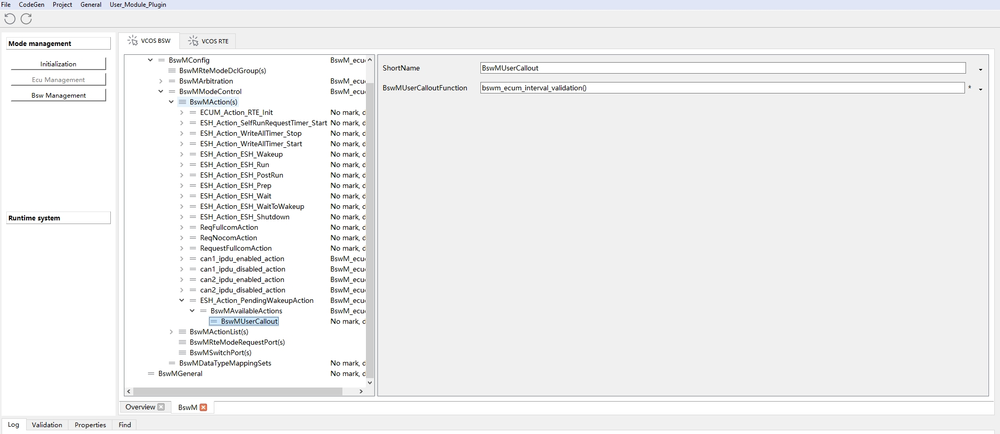

#### 4.7.7. bswm配置动作列表

* BswMActionListExecution：触发方式（边沿触发、水平触发）

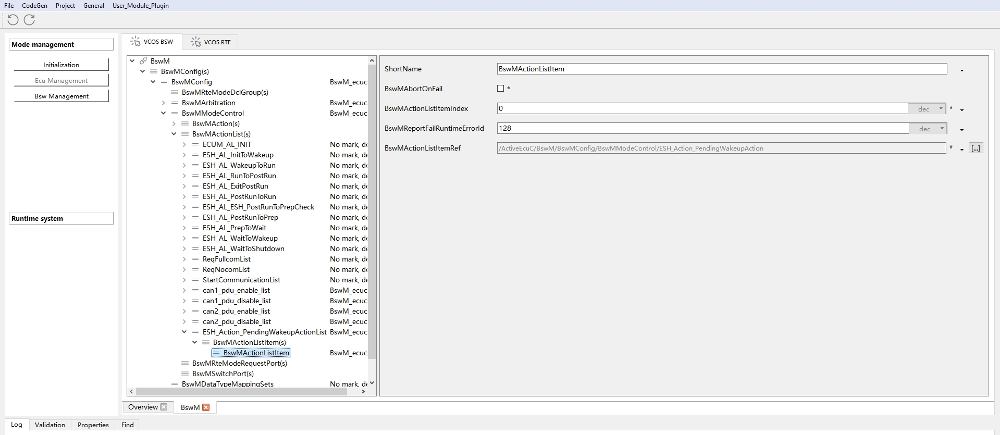

### 4.8. ecum配置项介绍

#### 4.8.1. ecum通用配置

* EcuMDevErrorDetect：用于打开det
* EcuMIncludeDet：用于包含det的头文件
* EcuMVersionInfoApi：用于启用版本查询API
* EcuMMainFunctionPeriod：设置mainfunction周期

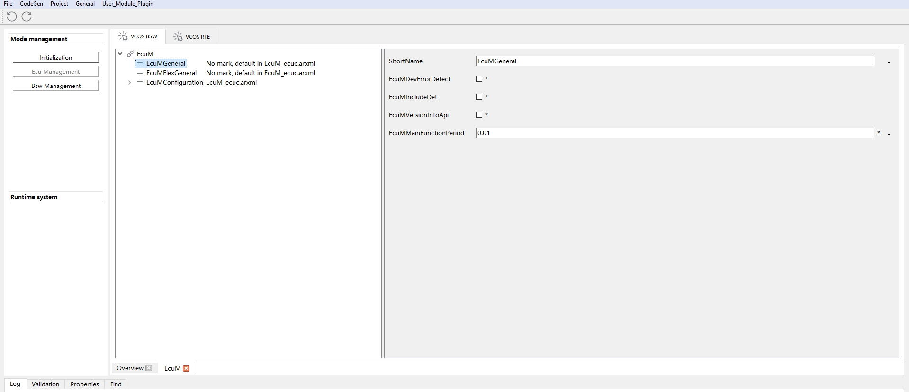

#### 4.8.2. ecum配置唤醒源

* ShortName：唤醒源名称
* EcuMValidationTimeout：唤醒源校验超时时间，超时后判定校验失败
* EcuMWakeupSourceId：唤醒源id，若有多个唤醒源，该参数从0递增
* EcuMComMChannelRef：唤醒源对应的comm通道
* EcuMComMPNCRef：唤醒源对应的comm PNC
* EcuMResetReasonRef：唤醒源对应的复位原因

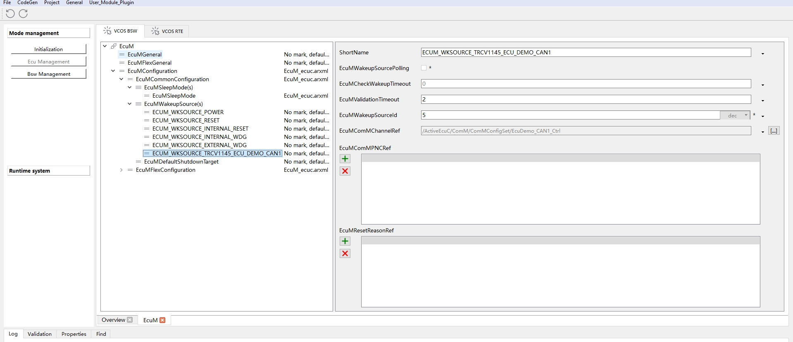

#### 4.8.3. ecum配置休眠模式

* EcuMSleepModeId：休眠模式id，id从0递增
* EcuMWakeupSourceMask：用于定义唤醒源的掩码，该掩码指定了哪些唤醒源可以正常进入唤醒校验流程

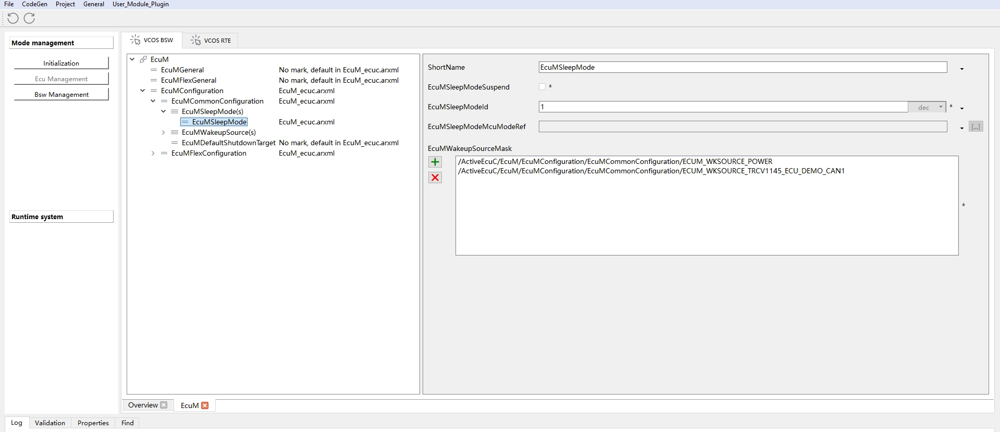

### 4.9. canif配置项介绍

#### 4.9.1. canif收发器配置

* CanIfTrcvWakeupSupport：用于配置收发器唤醒支持
* CanIfTrcvId：用于配置收发器Id
* CanIfTrcvCanTrcvRef：用于配置引用的收发器
* CanIfTrcvChnlToCanIfCtrlChnlRef：用于配置引用的can通道

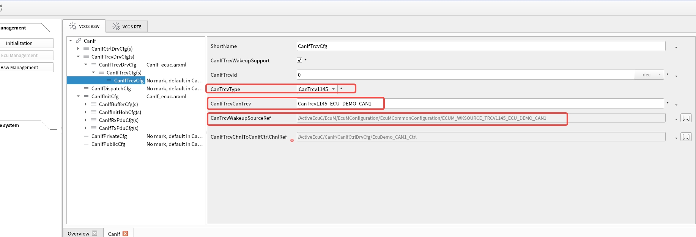

#### 4.9.2. canif唤醒休眠回调函数配置

* CanIfDispatchUserValidateWakeupEventUL：用于配置EcuM唤醒
* CanIfDispatchUserCheckTrcvWakeFlagIndicationName：用于配置唤醒校验名称
* CanIfDispatchUserClearTrcvWufFlagIndicationName：用于配置清除唤醒标志位名称
* CanIfDispatchUserCtrlModeIndicationName：用于配置控制模式名称
* CanIfDispatchUserTrcvModeIndicationName：用于配置收发模式名称
* CanIfDispatchUserValidateWakeupEventName：用于配置使能唤醒时间校验名称

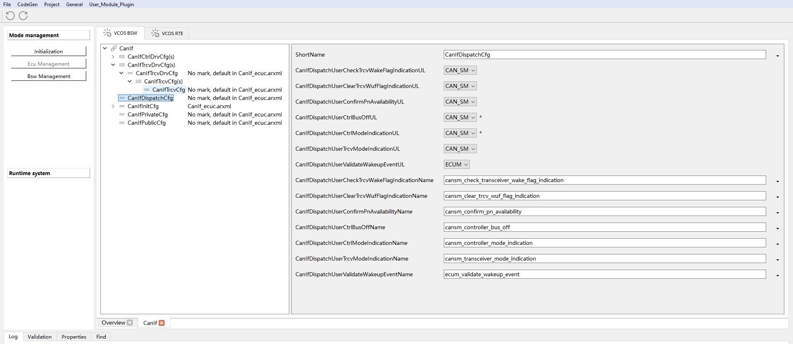

#### 4.9.3. canif接收网络管理报文配置

* CanIfRxPduDataLengthCheck：用于配置接收数据长度检查
* CanIfRxPduCanIdType：用于配置接收pdu canid类型
* CanIfRxPduUserRxIndicationUL：用于配置pdu用户接收
* CanIfRxPduUserRxIndicationName：用于配置接收pdu用户名称
* CanIfRxPduCanId：用于配置接收pdu canid
* CanIfRxPduCanIdMask：用于配置接收pdu canid 掩码
* CanIfRxPduDataLength：用于配置接收数据长度
* CanIfRxPduId：用于配置接收PduId
* CanIfRxPduHrhIdRef：用于配置接收pdu hrh引用
* CanIfRxPduRef：用于配置接收pdu引用

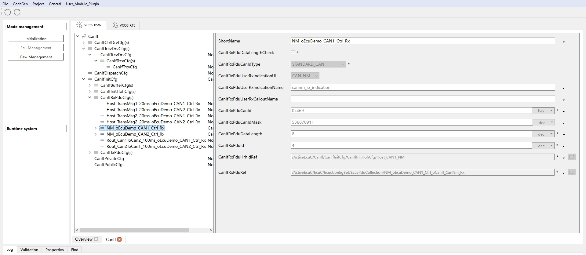

#### 4.9.4. canif发送网络管理报文配置

* CanIfTxPduCanIdType：用于配置发送数据canid类型
* CanIfTxPduType：用于配置发送pdu类型
* CanIfTxPduUserTxConfirmationUL：用于配置发送pdu用户确认类型
* CanIfTxPduUserTxConfirmationName：用于配置发送pdu用户确认类型名称
* CanIfTxPduCanId：用于配置发送pdu canid
* CanIfTxPduCanIdMask：用于配置发送pdu canid 掩码
* CanIfTxPduId：用于配置发送pduid
* CanIfTxPduDataLength：用于配置发送pdu数据长度
* CanIfTxPduBufferRef：用于配置发送pdu buffer引用
* CanIfTxPduRef：用于配置发送pdu引用

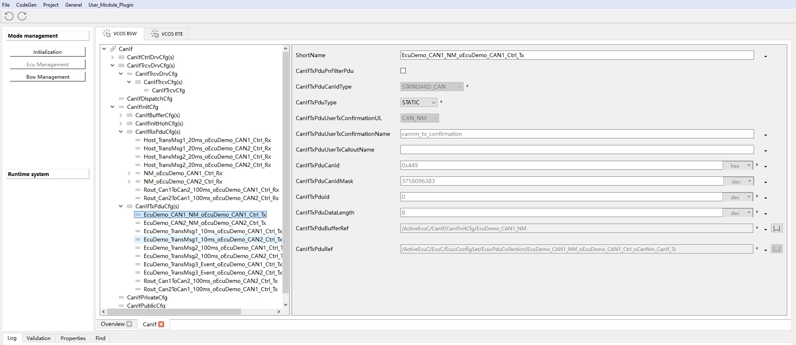

#### 4.9.5. canif公共配置

* CanIfPublicWakeupCheckValidByNM：用于配置是否通过nm形式进行唤醒校验检查
* CanIfPublicWakeupCheckValidSupport：用于配置唤醒源有效性使能
* CanIfWakeupSupport：用于配置是否支持唤醒

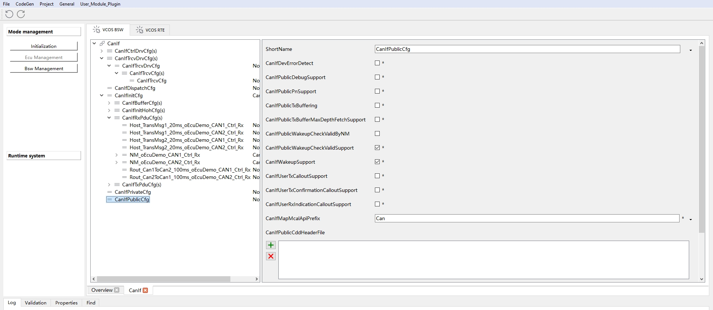

### 4.10 cantrcv1145配置项介绍

#### 4.10.1. cantrcv1145通用配置

* CanTrcvDevErrorDetect：用于配置开发错误检查
* CanTrcvWakeUpSupport：用于配置是否支持唤醒
* CanTrcvIndex：用于配置收发器索引
* CanTrcvMainFunctionPeriod：用于配置主函数周期
* CanTrcvWaitTime：用于配置CAN收发器从睡眠状态唤醒到正常状态所需等待的时间

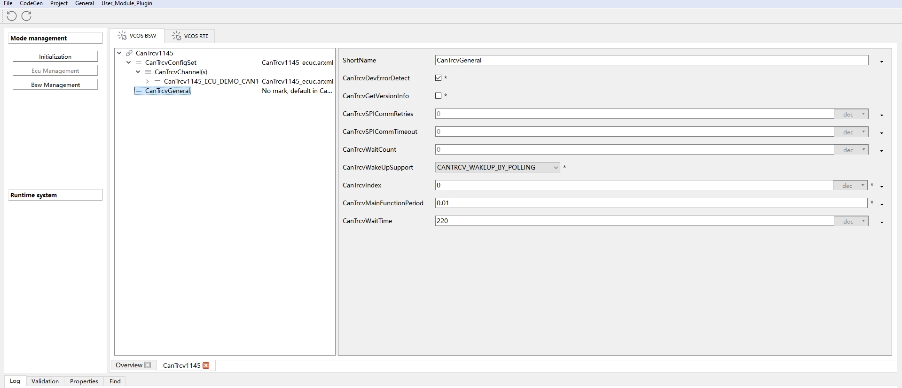

#### 4.10.2. cantrcv1145通道配置

* CanTrcvChannelId：用于配置收发器通道id
* CanTrcvChannelUsed：用于配置通道是否使用
* CanTrcvInitState：用于配置初始化状态
* CanTrcvWakeupByBusUsed：用于配置是否通过总线唤醒
* CanTrcvWakeupSourceRef：用于配置所引用的唤醒源

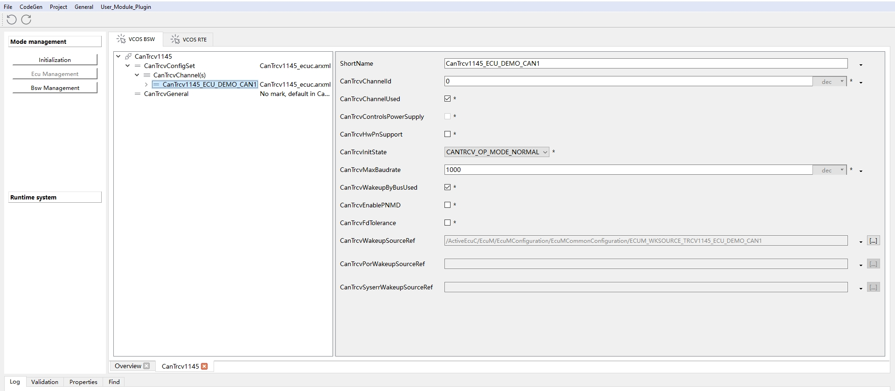

## 5. 使用示例

### 5.1. 主动唤醒

在启动流程中，上层请求CAN2通道为FULL通信：

```C
comm_request_com_mode(ComMConf_ComMUser_ComMUser_EcuDemo_CAN2_Ctrl, COMM_FULL_COMMUNICATION);
comm_communication_allowed((NetworkHandleType)ComMConf_ComMUser_ComMUser_EcuDemo_CAN2_Ctrl, (boolean)TRUE);

```

### 5.2. 主动休眠

在启动流程中，上层请求CAN1通道为NO通信：

```C
comm_request_com_mode(ComMConf_ComMUser_ComMUser_EcuDemo_CAN1_Ctrl, COMM_NO_COMMUNICATION);
comm_communication_allowed((NetworkHandleType)ComMConf_ComMUser_ComMUser_EcuDemo_CAN1_Ctrl, (boolean)TRUE);

```

### 5.3. 被动唤醒

cantrcv1145支持唤醒源校验：

```C
if (CANTRCV_STATE_WK_IS_BUS(cantrcv_prob[index].status_flg)) {
    cantrcv_prob[index].wk_reason = CANTRCV_WK_BY_BUS;
    if (cantrcv_prob[index].wk_report == CANTRCV_TJA1145_WU_ENABLE) {
        ecum_check_wakeup(CanTrcv_Tja1145_GetWakeupSource(index));
    }
}

```

ecum支持唤醒源校验：

```C
FUNC(void, ECUM_CODE) ecum_check_wakeup(ecum_wakeup_source_t wakeup_source)
{
    if (wakeup_source == ECUM_WKSOURCE_TRCV1145_ECU_DEMO_CAN1){
        (void)canif_check_wakeup(wakeup_source);
    }
}

```

canif支持唤醒源校验：

```C
FUNC(Std_ReturnType, CANIF_CODE) canif_check_wakeup(ecum_wakeup_source_t wakeup_source)
{
    Std_ReturnType ret = E_NOT_OK;
    boolean wu_src_found = canif_check_is_wu_src_valid(wakeup_source);
    CANIF_DET_REPORTERR_NO_RV((wu_src_found), CANIF_CANIF_CHECKWAKEUP_ID_CANIF_E_PARAM_WAKEUPSOURCE, E_NOT_OK);
    ret = canif_cantrcv_check_wakeup(wakeup_source);
    return ret;
}

```

cantrcv1145支持唤醒源校验：

```C
FUNC(Std_ReturnType, CANTRCV1145_CODE) cantrcv_tja1145_wk_check(uint8 cantrcv_idx)
{
    Std_ReturnType ret_val = E_NOT_OK;

    if(CanTrcv_Tja1145_IsWakeupByBusUsed(cantrcv_idx) &&
    (cantrcv_prob[cantrcv_idx].wk_report == CANTRCV_TJA1145_WU_ENABLE)) {
        SchM_Enter_CANTRCV_TJA1145_EXCLUSIVE_AREA_0();
        if (cantrcv_prob[cantrcv_idx].wk_reason == CANTRCV_WK_BY_PIN ||
            cantrcv_prob[cantrcv_idx].wk_reason == CANTRCV_WK_BY_BUS) {
            cantrcv_tja1145_wk_report(cantrcv_idx);
            ret_val = E_OK;
        } else {
            cantrcv_prob[cantrcv_idx].req_stat |= CANTRCV_REQ_CBV_BY_BUS_FLAG;
            if (cantrcv_prob[cantrcv_idx].wk_reason == CANTRCV_WK_BY_PIN ||
                cantrcv_prob[cantrcv_idx].wk_reason == CANTRCV_WK_BY_BUS) {
                ret_val = E_OK;
            } else {
                ret_val = E_NOT_OK;
            }
        }
        SchM_Exit_CANTRCV_TJA1145_EXCLUSIVE_AREA_0();
    }
    return ret_val;
}

```

cantrcv1145通过唤醒上报通知ecum:

```C
FUNC(void, CANTRCV1145_CODE) cantrcv_tja1145_wk_report(uint8 cantrcv_idx)
{
    CanTrcv_TrcvWakeupReasonType wuReason = cantrcv_prob[cantrcv_idx].wk_reason;

    switch(wuReason) {
        case CANTRCV_TJA1145_WU_POWER_ON:
#if (CANTRCV_TJA1145_USE_EXTENDED_WU_SRC == STD_ON)
            ecum_set_wakeup_event(CanTrcv_Tja1145_GetWuSrcPor(cantrcv_idx));
            break;
#endif
        case CANTRCV_WK_BY_BUS:
        case CANTRCV_WK_BY_PIN:
            ecum_set_wakeup_event(CanTrcv_Tja1145_GetWakeupSource(cantrcv_idx));
            break;
        default:
            break;
    }
}

```

ecum校验唤醒源事件：

```C
FUNC(void, ECUM_CODE) ecum_validate_wakeup_event(ecum_wakeup_source_t sources)
{
#if (ECUM_DEV_ERROR_DETECT == STD_ON)
    if (ecum_validate_wakeup_source(sources, ECUM_VALIDATE_WAKEUP_EVENT_ID) == FALSE) {
        return;
    }
#endif
    (void)Os_AtomicOr((Atomic *)&ecum_world.valid_events, (sint32)sources);
#if (CONFIG_MODULE_COMM == 1)
    const ecum_wakeup_source_config_t *wkup_cfg_ptr;

    for (uint32 i = 0; i < (uint32)ECUM_WKSOURCE_USER_CNT; i++) {
        wkup_cfg_ptr = &ecum_world.config->ecum_wakeup_source_config[ecum_wk_source_id(i)];
        if (((sources & wkup_cfg_ptr->ecum_wakeup_source_id) != 0u) &&
            (wkup_cfg_ptr->ecum_comm_channel != ECUM_COMM_CHANNEL_ILL)) {
            comm_ecum_wake_up_indication(wkup_cfg_ptr->ecum_comm_channel);
        }
    }
#endif

#if (CONFIG_SERVM_BSWM == 1)
    if (ecum_world.current_state > ECUM_STATE_STARTUP_TWO) {
        bswm_ecum_current_wakeup(sources, ECUM_WKSTATUS_VALIDATED);
    }
#endif
}

```

ecum启动唤醒源：

```C
FUNC(void, ECUM_CODE) ecum_start_wakeup_sources(ecum_wakeup_source_t wakeup_source)
{
#if (CONFIG_MODULE_CANSM == 1)
    if ((wakeup_source & ECUM_WKSOURCE_TRCV1145_ECU_DEMO_CAN1) != 0) {
        (void)cansm_start_wake_up_source(ComMConf_ComMChannel_EcuDemo_CAN1_Ctrl);
        (void)VCOS_LOG(ECUM_MODULE_ID, VCOS_LOG_INFO, ECUM_DLT_WAKEUPSOURCE_ID, wakeup_source);
    }
#endif
}

```

cansm启动唤醒源：

```C
FUNC(Std_ReturnType, CANSM_CODE) cansm_start_wake_up_source(network_handle_type network_handle)
{
    if (cansm_get_module_status() == CANSM_STATUS_UNINIT) {
        CANSM_DET_REPORTERROR(CANSM_CANSM_SERVICEID_STARTWAKEUPSOURCE_CANSM_E_UNINIT);
        return E_NOT_OK;
    }
    cansm_external_network_type *network_sm_global_ptr = cansm_get_cansm_global_network_index(network_handle);

    if (network_sm_global_ptr == NULL) {
        return E_NOT_OK;
    }
    network_sm_global_ptr->start_wake_up_flag = (boolean)TRUE;
    return E_OK;
}

```

ecum检查校验：

```C
FUNC(void, ECUM_CODE) ecum_check_validation(ecum_wakeup_source_t wakeup_source)
{
    (void) wakeup_source;
    SHELL_PRINT(ECUM_DLT_WAKEUPSOURCE_ID, wakeup_source);
#if (CONFIG_MODULE_CANIF == 1)
    if (wakeup_source == ECUM_WKSOURCE_TRCV1145_ECU_DEMO_CAN1) {
        Std_ReturnType ret = canif_check_validation(wakeup_source);
        if (ret == E_OK) {
            (void)ecum_clear_wakeup_event(wakeup_source);
        }
    }
#endif
}

```

ecum 校验唤醒事件：

```C
FUNC(void, ECUM_CODE) ecum_validate_wakeup_event(ecum_wakeup_source_t sources)
{
#if (ECUM_DEV_ERROR_DETECT == STD_ON)
    if (ecum_validate_wakeup_source(sources, ECUM_VALIDATE_WAKEUP_EVENT_ID) == FALSE) {
        return;
    }
#endif
    (void)Os_AtomicOr((Atomic *)&ecum_world.valid_events, (sint32)sources);
#if (CONFIG_MODULE_COMM == 1)
    const ecum_wakeup_source_config_t *wkup_cfg_ptr;

    for (uint32 i = 0; i < (uint32)ECUM_WKSOURCE_USER_CNT; i++) {
        wkup_cfg_ptr = &ecum_world.config->ecum_wakeup_source_config[ecum_wk_source_id(i)];
        if (((sources & wkup_cfg_ptr->ecum_wakeup_source_id) != 0u) &&
            (wkup_cfg_ptr->ecum_comm_channel != ECUM_COMM_CHANNEL_ILL)) {
            comm_ecum_wake_up_indication(wkup_cfg_ptr->ecum_comm_channel);
        }
    }
#endif

#if (CONFIG_SERVM_BSWM == 1)
    if (ecum_world.current_state > ECUM_STATE_STARTUP_TWO) {
        bswm_ecum_current_wakeup(sources, ECUM_WKSTATUS_VALIDATED);
    }
#endif
}

```

comm收到标志位更新通信模式：

```C
FUNC(Std_ReturnType, COMM_CODE) comm_handle_channel_state(const comm_channel_config_type *channel_cfg,
                              boolean is_request)
{
    Std_ReturnType status = E_NOT_OK;
    comm_channel_type *channel_info = &g_comm_mgr.channels[channel_cfg->comm_channel];

    if (COMM_NO_COMMUNICATION == channel_info->mode) {
        status = comm_handle_from_no_com(channel_cfg, channel_info, is_request);
    } else if (COMM_FULL_COMMUNICATION == channel_info->mode) {
        status = comm_handle_from_full_com(channel_cfg, channel_info, is_request);
    } else if (COMM_SILENT_COMMUNICATION == channel_info->mode) {
        status = comm_handle_from_silent_com(channel_cfg, channel_info, is_request);
    } else {
        /* do nothing */
    }
    return status;
}

```

comm将通信状态通知nm，nm通知cannm被动启动：

```C
FUNC(Std_ReturnType, CANNM_CODE) cannm_pas_stup(const network_handle_type nm_id)
{
    if (CANNM_STATUS_UNINIT == cannm_internal.init_status) {
        CANNM_DET_REPORT(CANNM_CANNM_SERVICEID_PASSIVESTARTUP_CANNM_E_NO_INIT);
        return E_NOT_OK;
    }
    if (nm_id >= cannm_config_ptr->chnl_num_len) {
        CANNM_DET_REPORT(CANNM_CANNM_SERVICEID_PASSIVESTARTUP_CANNM_E_INVALID_CHANNEL);
        return E_NOT_OK;
    }

    Std_ReturnType status = E_OK;
    network_handle_type cannm_net_id = cannm_config_ptr->tunnel_trans[nm_id];
    uint8 channel_index = cannm_config_ptr->chnl_num[cannm_net_id];

    const cannm_chnl_cate *channel_conf = &cannm_config_ptr->nm_tunnel[channel_index];

    cannm_op_chnl_cate *channel_internal = &cannm_internal.nm_tunnel[channel_index];

    switch (channel_internal->mode) {
        case NM_MODE_BUS_SLEEP:
            cannm_bs_to_rpt_msg_proc(channel_conf, channel_internal, (boolean)FALSE);
            status = E_OK;
            break;
        case NM_MODE_PREPARE_BUS_SLEEP:
            cannm_pbs_to_rpt_msg_proc(channel_conf, channel_internal, (boolean)FALSE);
            status = E_OK;
            break;
        default:
            status = E_NOT_OK;
            break;
    }

    return status;
}

```

cannm从总线睡眠切换到网络状态：

```C
FUNC(void, CANNM_CODE) cannm_bs_to_rpt_msg_proc(const cannm_chnl_cate *channel_conf,
    cannm_op_chnl_cate *channel_internal, boolean is_nw_req)
{
    if ((NULL == channel_conf) || (NULL == channel_internal)) {
        CANNM_DET_REPORT(CANNM_CANNM_SERVICEID_MAINFUNCTION_CANNM_E_NULL_POINTER);
        return;
    }
#if (CANNM_RETRY_FIRST_MESSAGE_REQUEST == STD_ON)
    network_handle_type cannm_net_id = cannm_config_ptr->tunnel_trans[channel_conf->id_net];

    cannm_retry_first_msg_flg[cannm_net_id] = (boolean)TRUE;
#endif
    SchM_Enter_CANNM_EXCLUSIVE_AREA_0();
    cannm_switch_mode_state_proc(channel_internal, NM_MODE_NETWORK, NM_STATE_REPEAT_MESSAGE);
    if ((channel_conf->imdt_tx > 0U) && is_nw_req) {
        cannm_imdt_tx_proc(channel_internal);
    } else {
        channel_internal->left_msg_cyc_tm = channel_conf->msg_cys_ofst_tm + channel_conf->m_func_pid;
    }
    channel_internal->left_tmot_tm = channel_conf->tm_out + channel_conf->m_func_pid;
    channel_internal->left_rpt_msg_tm = channel_conf->rpt_msg_tm + channel_conf->m_func_pid;
    nm_mode_net_proc(channel_conf->id_net);
#if (CANNM_STATE_CHANGE_IND_ENABLED == STD_ON)
    nm_ntfy_state_chg_bswm(channel_conf->id_net, NM_STATE_BUS_SLEEP, NM_STATE_REPEAT_MESSAGE);
#endif
    SchM_Exit_CANNM_EXCLUSIVE_AREA_0();
#if (CANNM_STATE_CHANGE_IND_ENABLED == STD_ON)
    nm_ntfy_state_chg(channel_conf->id_net, NM_STATE_BUS_SLEEP, NM_STATE_REPEAT_MESSAGE);
#endif
}

```

cannm切换到网络模式之后，会周期性发送网络管理报文，实现网络唤醒

### 5.4. 被动休眠

停发网络管理报文之后，cannm切换到prepare bussleep，通知comm进入silent模式。之后cannm切换到bussleep，通知comm进入nocom模式

ecum调用ecum_stop_wakeup_sources：

```C
FUNC(void, ECUM_CODE) ecum_stop_wakeup_sources(ecum_wakeup_source_t wakeup_source)
{
#if (CONFIG_MODULE_CANSM == 1)
    if ((wakeup_source & ECUM_WKSOURCE_TRCV1145_ECU_DEMO_CAN1) != 0) {
        (void)cansm_stop_wake_up_source(ComMConf_ComMChannel_EcuDemo_CAN1_Ctrl);
        (void)VCOS_LOG(ECUM_MODULE_ID, VCOS_LOG_INFO, ECUM_DLT_WAKEUPSOURCE_ID, wakeup_source);
    }
#endif
}

```

cansm调用cansm_stop_wake_up_source：

```C
FUNC(Std_ReturnType, CANSM_CODE) cansm_stop_wake_up_source(network_handle_type network_handle)
{
    if (cansm_get_module_status() == CANSM_STATUS_UNINIT) {
        CANSM_DET_REPORTERROR(CANSM_CANSM_SERVICEID_STOTWAKEUPSOURCE_CANSM_E_UNINIT);
        return E_NOT_OK;
    }
    cansm_external_network_type *network_sm_global_ptr = cansm_get_cansm_global_network_index(network_handle);

    if (network_sm_global_ptr == NULL) {
        return E_NOT_OK;
    }
    network_sm_global_ptr->stop_wake_up_flag = (boolean)TRUE;
    if (COMM_NO_COMMUNICATION == network_sm_global_ptr->req_mode) {
        network_sm_global_ptr->cur_com_mode = COMM_NO_COMMUNICATION;
    }
    return E_OK;
}

```

网络切换到no通信之后，不再发送网络管理报文，网络进入休眠状态

### 5.5. 休眠唤醒验证

#### 5.5.1. 物理接线图

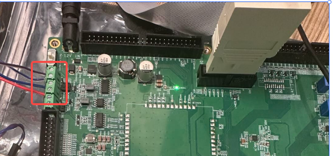

#### 5.5.2. 上位机连接示意图

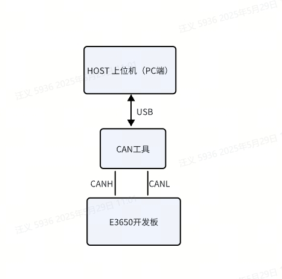

#### 5.5.3. 主动唤醒和主动休眠

can4通过主动请求FULL通信实现唤醒（有报文发出），can2通过主动请求NO通信实现休眠（没有报文发出）：

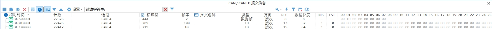

#### 5.5.4. 被动唤醒

通过对can2上发送网络管理报文，实现can2的被动唤醒，出现报文外发：

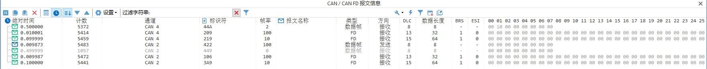

#### 5.5.5. 被动休眠

停止对can2的报文发送，观察该路报文逐渐不再发送，实现can2的网络休眠：

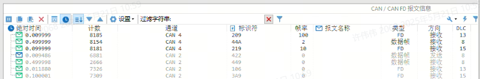

#### 5.5.6. 多次测试

支持多次的被动唤醒和休眠。通过对can2发送网络管理报文，可以再次实现被动唤醒，该路继续出现报文外发：


停止对can2的报文发送，观察该路报文逐渐不再发送，实现can2的网络休眠：


## 6. 配置项参考规范

[com 配置项参考规范](../../configuration_reference/com_cfg.md)

[pdur 配置项参考规范](../../configuration_reference/pdur_cfg.md)

[comm 配置项参考规范](../../configuration_reference/comm_cfg.md)

[cansm 配置项参考规范](../../configuration_reference/cansm_cfg.md)

[nm 配置项参考规范](../../configuration_reference/nm_cfg.md)

[cannm 配置项参考规范](../../configuration_reference/cannm_cfg.md)

[ecum 配置项参考规范](../../configuration_reference/sysm_init_cfg.md)

[bswm 配置项参考规范](../../configuration_reference/sysm_core_cfg.md)

[canif 配置项参考规范](../../configuration_reference/canif_cfg.md)

[cantrcv1145 配置项参考规范](../../configuration_reference/cantrcv1145_cfg.md)

## 7. 应用接口参考规范

[com API 参考规范](../../api_reference/com_api.md)

[pdur API 参考规范](../../api_reference/pdur_api.md)

[comm API 参考规范](../../api_reference/comm_api.md)

[cansm API 参考规范](../../api_reference/cansm_api.md)

[nm API 参考规范](../../api_reference/nm_api.md)

[cannm API 参考规范](../../api_reference/cannm_api.md)

[ecum API 参考规范](../../api_reference/sysm_init_api.md)

[bswm API 参考规范](../../api_reference/sysm_core_api.md)

[canif API 参考规范](../../api_reference/canif_api.md)

[cantrcv1145 API 参考规范](../../api_reference/cantrcv_tja1145_api.md)
