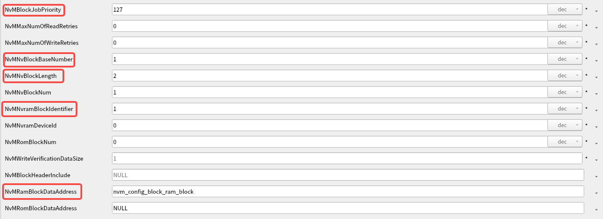
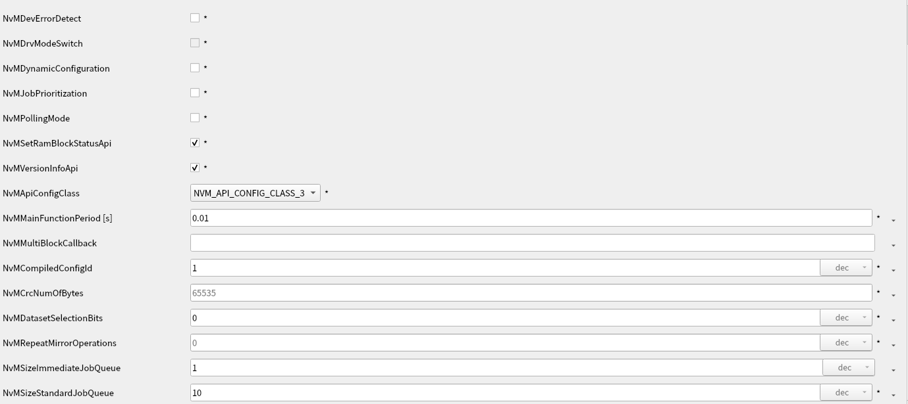
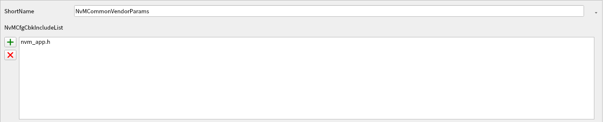
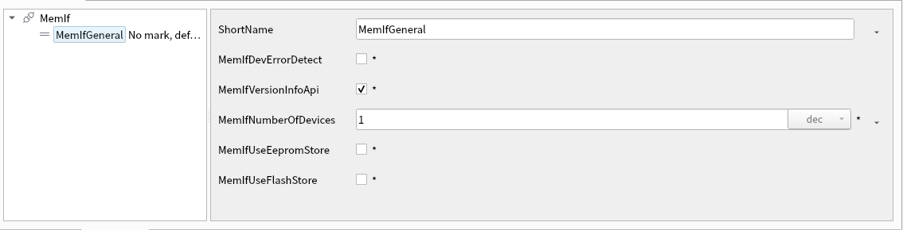

# 存储栈开发者手册

## 1. 简介

存储栈是一个基于块（Block）的数据存储管理系统，支持MRAM、Flash、EEPROM等多种硬件存储介质。通过分层式硬件抽象化设计，实现存储逻辑与物理介质的强解耦，满足了车载系统高可靠、高性能数据读写的需求。存储栈由两大核心模块组成，分别是数据存储服务层和存储驱动适配层

* **数据存储服务层**：数据存储服务层不仅为应用提供了基础读写接口，还提供了数据一致性校验、冗余管理、容错管理和并发读写访问等功能
* **存储驱动适配层**：存储驱动适配层用于适配不同驱动，屏蔽硬件差异，为数据存储服务层提供了统一的驱动操作接口

## 2. 代码目录

memory源代码在haloosspace/vcos/components/memory目录下，目录结构如下图所示：

```plaintext
memory                      # 存储栈代码
├── CMakeLists.txt          # 存储子系统顶层构建配置，定义模块编译规则
├── DISCLAIMER.md           # 存储组件免责声明
├── LICENSE                 # 开源协议
├── memif                   # 存储驱动适配层，适配不同驱动
│   ├── CMakeLists.txt      # 构建规则
│   ├── config_plug_in      # 配置项生成文件
│   ├── inc                 # 头文件
│   ├── Kconfig             # memif模块使能配置
│   └── src                 # 源文件
├── nvm                     # 数据存储服务层，非易失性数据管理
│   ├── CMakeLists.txt      # 构建规则
│   ├── config_plug_in      # 配置项生成文件
│   ├── inc                 # 头文件
│   ├── Kconfig             # nvm模块使能配置
│   └── src                 # 源文件
└── README.md               # memory仓库介绍
```

## 3. 主要功能描述

### 3.1. 功能讲解

#### 3.1.1. 数据存储服务层

数据存储服务层的核心功能包含非易失性数据存储、数据一致性校验、冗余管理、容错管理和并发读写访问等，本章节将展开讲解这些功能

* **非易失性数据存储**：数据存储服务层提供了多块读写和单块读写接口，可以灵活应用于ECU运行时的各个阶段。1）在ECU被唤醒时通过多块读取接口能够将所有非易失性数据一次性读取到RAM中，以确保系统能够使用最新的数据和状态信息。2）在ECU休眠时，使用多块写入接口，能够将RAM中所有需要落盘的数据保存到非易失性存储器中。3）在系统的运行过程中，用户可以随时使用单块读写接口进行数据的存储操作

* **数据一致性校验**：每份需要存储的数据都可以增加CRC校验值以用于数据一致性校验。数据在写入时，会将原始数据和CRC校验值一并写入，在数据读取时，系统将对数据和该CRC值进行一致性校验，以检测数据是否遭到破坏，校验不通过的数据即认为是不可信的

* **支持数据冗余存储**：同一份数据可以在非易失性存储器中存储两份，即主备双份存储。当数据（主区）读取失败时，系统可以自动使用备区数据进行恢复，确保数据的高可用性和可靠性

* **数据容错管理**：数据存储服务层不仅针对每一种错误上报不同的故障码，还提供了错误处理机制。数据读取失败时可以对失败操作进行重试，数据默认值恢复等操作以尽可能降低对系统的影响，数据写入失败时也可以进行重写尝试，以增强操作成功率

* **支持数据并发读写访问**：数据存储服务层能够同时接受多个读写请求，模块内部会将请求缓存在任务队列中，服务层会周期的从队列里获取请求处理，有效的解决了存储资源并发访问冲突问题。

此外，数据存储服务层还提供了其他扩展的存储管理服务，可以进行自定义通知，锁定，写保护等功能，能够更好的应用于不同的用户场景中

* **提供任务结束的通知**：用户可以为每个非易失性存储块设置一个回调函数，以便在异步操作完成时及时接收通知，并能够通过接口查询该块的最新错误状态

* **支持数据只能存一次**：写保护机制确保每个Block数据在首次写入后无法再次被改写，保障数据的安全性

* **支持将Block 锁定**：允许将特定Block锁定，限制其后续写入或擦除，仅对底层软件模块开放，以增强数据控制

* **支持将Block 标记为无效**：提供功能标记将不再使用的Block置为无效，避免存储无意义数据，以提高存储资源效率

#### 3.1.2. 存储驱动适配层

存储驱动适配层通过标准化的接口架构实现了存储介质的跨平台兼容性。该层采用函数绑定机制，基于预定义的驱动操作矩阵注册不同存储介质的控制例程，有效解耦了上层服务与底层硬件的依赖关系。该架构为存储服务层提供了统一的操作语义空间，使业务逻辑层无需感知物理介质的特性差异即可执行标准化的存储操作。这种基于接口契约的架构设计显著提升了系统的灵活性和可移植性

## 4. 功能配置方法

### 4.1. NvM配置项说明入门

#### 4.1.1. NvMBlockDescriptors

用户要新增数据存储时，应在NvMBlockDescriptors下里新建 Block，必填项里配置了 Block 的基本信息，指明了所要存储数据的地址，长度，ID，并且与驱动抽象层的Block建立映射

##### 4.1.1.1. 必填项

* ShortName：用于填写block的名称，推荐格式为 NvMBlockDescriptor_XXX
* NvMBlockJobPriority：启用NvM优先级功能时配置 block 优先级等级
* NvMNvramBlockIdentifier：即该 block 的ID，作为该 block 的唯一标识
* NvBlockBaseNumber：为该 Block 所对应的存储驱动抽象层(Fee/Ea) 模块的BlockNumber
* NvBlockLength：为所要存储的数据的长度，即 NvMRamBlockDataAddress 所指向数据的大小，需要严格匹配谨防越界
* NvMBlockManagementType: Block 类型，支持 NVM_BLOCK_NATIVE（单份存储）和 NVM_BLOCK_REDUNDANT （主备份存储）类型
* NvMRamBlockDataAddress：数据指针，用于指向RAM中所要存储的数据。如果配置为空，需要在API调用时传入数据指针。



> 需要注意的是如果 NvMRamBlockDataAddress 或是 callback 引用其他文件的变量或函数，需要在 NvMCommonVendorParams 中的 NvMCfgCbkIncludeList 中增加头文件配置

##### 4.1.1.2. 选填项

* NvMBlockCrcType：配置 CRC 类型，由于 CRC8 误码率达到 1/256，目前仅支持 CRC16 和 CRC32
* NvMBlockUseCrc：选择是否启用 CRC 校验
* NvMBlockUseCRCCompMechanism：选择是否开启 CRC 比较机制
* NvMMaxNumOfReadRetries：默认值为 0，定义为读取操作失败时的最大重试次数
* NvMMaxNumOfWriteRetries：默认值为 0，定义为写入操作失败时的最大重试次数
* NvMRomBlockDataAddress：用于配置当读取失败时，进行默认值恢复的数据地址
* NvMInitBlockCallback：用于配置读失败进行处理的回调函数
* NvMSingleBlockCallback：当单块 Block 操作完成（如 Write、Read Block）时触发的回调
* NvMWriteBlockOnce：用于配置 Block 数据只能存一次，目前开启 NvMWriteBlockOnce 必须配套开启 Crc 校验功能

#### 4.1.2. NvMCommon

NvMCommon 主要用于控制一些宏等开启，简要介绍 NvMCommon 中一些主要的配置项，只使用读写基本功能时这里保持默认配置即可

* NvMDevErrorDetect：用于打开 NvM 的 Det
* NvMJobPrioritization：选择是否启用优先级机制，默认关
* NvMCompiledConfigId: 表示是否使用配置 ID 号（Config ID），和 Config ID 检查功能联动使用
* NvMDynamicConfiguration：表示是否开启 Config ID 检查
* NvMSetRamBlockStatusApi：表示是否打开 API nvm_set_ram_block_status
* NvMApiConfigClass：表示对外开启的 API 等级，默认是最高级别 NVM_API_CONFIG_CLASS_3
* NvMMultiBlockCallback：用于配置多块操作完成时的回调函数
* NvMSizeStandardJobQueue: 用于配置 NvM 队列的长度



#### 4.1.3. NvMCommonVendorParams

进行 NvM_Cfg.c 包含的头文件的配置



### 4.2. MemIf配置项简介

#### 4.2.1. MemIfGeneral

MemIfGeneral 主要用于控制一些宏等开启和设备配置，简要介绍 MemIfGeneral 中一些主要的配置项

* MemIfDevErrorDetect：用于打开 MemIf 的 Det
* MemIfVersionInfoApi：选择是否启用版本查询Api，默认关
* MemIfUseEepromStore: 表示底层选择使用EEPROM的硬件和驱动进行存储
* MemIfUseFlashStore: 表示底层选择使用Flash的硬件和驱动进行存储



### 4.3. 使用示例

#### 4.3.1. 添加配置

* 参考4.1节，在 NvM 中新建Block，配置项中的NvMNvramBlockIdentifier 是后续存储操作的唯一标识(Block ID)
* 参考4.2节，进行 MemIf 的配置，根据实际芯片移植情况选择勾选使用 Eeprom 还是 Flash 的驱动接口

#### 4.3.2. 数据存储示例

本 Demo 介绍了如何使用API接口写入和读取示例数据

```C
#include "nvm.h"

#define DEMO_BLOCK_ID (2u)

uint8 write_buffer[10] = {"H", "e", "l", "l", "o", ",", "H", "a", "l", "o"};
uint8 read_buffer[10] = {};

void storage_demo(void)
{
    // 1. 初始化存储驱动层（本Demo以使用Eeprom为例)
    ea_eep_init()；

    // 2. 初始化存储栈
    nvm_init()；

    // 3. 发起数据写入请求
    nvm_write_block(DEMO_BLOCK_ID, write_buffer);

    // 4. 发起数据读取请求
    nvm_read_block(DEMO_BLOCK_ID, read_buffer);
}

```

## 5. 配置项参考规范

[NvM 配置项参考规范](../../configuration_reference/nvm_cfg.md)

## 6. 应用接口参考规范

[NvM API 参考规范](../../api_reference/nvm_api.md)
