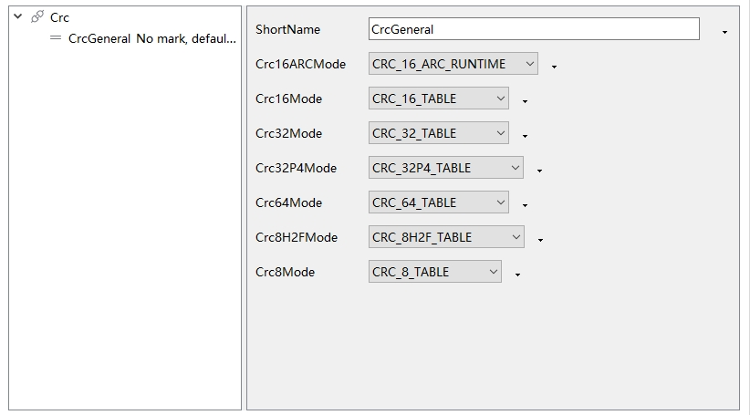

# 安全模块开发者手册

## 1. 简介

安全模块当前主要用于保护信息传输或者信息系统免受异常和入侵的干扰与破坏，其主要方法为使用校验方法检测是否有丢失、错位、超时、伪造、篡改等主动或被动错误。
当前本项目中开源的CRC是常见的安全性校验方法，广泛运用在通信，存储等领域，可以检测出错位等错误；E2E是端到端校验方法，其主要依赖CRC和循环计数的方法保证通讯安全，可以检测出丢失、错位、超时等错误。

## 2. 代码目录

```plaintext
security
├── CMakeLists.txt          # communication仓库的编译脚本，用于控制编译相关资源
├── DISCLAIMER.md           # 免责声明文档
├── Kconfig                 # communication模块的Kconfig文件
├── LICENSE                 # 项目许可证文件
├── README.md               # communication仓库的readme，用于介绍该代码仓库(即本文)
├── crc                     # 循环冗余校验
└── e2e                     # 实时通信层
```

## 3. 主要功能描述

### 3.1. 功能讲解

* CRC模块可以提供Crc8、Crc16和Crc32的计算功能
* E2E模块可以提供Profile01、Profile02、Profile04和Profile05的计算功能

## 4. 功能配置方法

当前E2E模块仅提供库实现，无配置项。用户需要自行构建参数结构体传入E2E模块提供的外部接口。CRC模块有配置项需要用户配置

### 4.1. CRC配置项说明入门


#### 4.1.1. CrcGeneral
CrcGeneral 主要是用来配置各Crc标准下的计算模式，每个Crc标准都提供了查表(Table)和逐位计算(Runtime)两种计算模式，默认配置为查表模式

* Crc16ARCMode: 选择CRC 16-bit ARC (polynomial 8005)标准的计算模式
* Crc16Mode: 选择CRC 16-bit (CCITT)标准的计算模式
* Crc32Mode: 选择CRC 32-bit (IEEE-802.3 CRC32 Ethernet Standard)标准的计算模式
* Crc32P4Mode: 选择CRC 32-bit (E2E Profile 4)标准的计算模式
* Crc64Mode: 选择CRC 64-bit标准的计算模式
* Crc8H2FMode: 选择CRC 8-bit (2Fh polynomial)标准的计算模式
* Crc8Mode: 选择CRC 8-bit (SAE J1850)标准的计算模式



## 5. 使用示例

### 5.1. 使用构建E2E保护

* 使用E2E Profile 01
示例配置
e2e_p01_config_type config_struct = {
    .counter_offset = 8,
    .crc_offset = 0,
    .data_id = 0x123,
    .data_id_nibble_offset = 12,
    .data_id_mode = E2E_P01_DATAID_BOTH,
    .data_length = 64,
    .max_delta_counter_init = 1,
    .max_no_update_data = 15,
    .sync_counter_init = 0,
};

e2e_p01_protect_state_type protect_state_struct = {
    .counter = 0;
};

e2e_p01_check_state_type check_state_struct = {
    .e2e_status = E2E_P01_STATUS_OK,
    .last_valid_counter = 0,
    .max_delta_counter = 0,
    .lost_data = 0,
    .sync_counter = 0,
    .no_update_counter = 0,
    .is_wait_for_first_data = TRUE,
    .is_new_data_available = FALSE,
};

uint8 send_data[64];

调用方法
// 使用Check方法
check_return = e2e_p01_check(&config_struct, &check_state_struct, &send_data[0]);

// 使用Protect方法
protect_return = e2e_p01_protect(&config_struct, &protect_state_struct, &send_data);

// 向SM映射状态
profile_status = e2e_p01_map_status_to_sm(check_return, check_state_struct.e2e_status, True);

* 使用E2E Profile 02
示例配置
e2e_p02_config_type config_struct = {
    .data_length = 64,
    .offset = 0,
    .data_id_list[16] = [0x01, 0x02, 0x03, 0x04, 0x05, 0x06, 0x07, 0x08, 0x09, 0x0A, 0x0B, 0x0C, 0x0D, 0x0E, 0x0F, 0x10],
    .max_delta_counter_init = 1,
    .max_no_update_counter = 15,
    .sync_counter_init = 0,
};

e2e_p02_protect_state_type protect_state_struct = {
	uint8 counter = 0,
};

e2e_p02_check_state_type check_state_struct = {
    e2e_status = E2E_P02_STATUS_OK,
    last_valid_counter = 0,
    max_delta_counter = 0,
    sync_counter = 0,
    no_update_counter = 0,
    lost_data = 0,
    is_wait_for_first_data = TRUE,
    is_new_data_available = FALSE,
} ;

uint8 send_data[64];

调用方法
// 使用Check方法
check_return = e2e_p02_check(&config_struct, &check_state_struct, &send_data[0]);

// 使用Protect方法
protect_return = e2e_p02_protect(&config_struct, &protect_state_struct, &send_data[0]);

// 向SM映射状态
profile_status = e2e_p02_map_status_to_sm(check_return, check_state_struct.e2e_status, True);

* 使用E2E Profile 04
示例配置
e2e_p04_config_type config_struct = {
    .data_id = 0x0A0B0C0D,
    .offset = 0x0000,
    .min_data_length = 96,
    .max_data_length = 32768,
    .max_delta_counter = 1,
};

e2e_p04_protect_state_type protect_state_struct = {
    .counter = 0,
};

e2e_p04_check_state_type check_state_struct = {
    .counter = 0,
    .e2e_status = E2E_P04_STATUS_OK,
};

uint8 send_data[96];

调用方法
// 使用Check方法
check_return = e2e_p04_check(&config_struct, &check_state_struct, &send_data[0], 96);

// 使用Protect方法
protect_return = e2e_p04_protect(&config_struct, &protect_state_struct, &send_data[0], 96);

// 向SM映射状态
profile_status = e2e_p04_map_status_to_sm(check_return, check_state_struct.e2e_status);

* 使用E2E Profile 04
示例配置
e2e_p05_config_type config_struct = {
    .offset = 0x0000;
    .data_length = 24;
    .data_id = 0x1234;
    .max_delta_counter = 1;
};

e2e_p05_protect_state_type protect_state_struct = {
    .counter = 0;
};

e2e_p05_check_state_type check_state_struct = {
    .e2e_status = E2E_P05_STATUS_OK;
    .counter = 0;
};

uint8 send_data[24];

调用方法
// 使用Check方法
check_return = e2e_p05_check(&config_struct, &check_state_struct, &send_data[0], 24);

// 使用Protect方法
protect_return = e2e_p05_protect(&config_struct, &protect_state_struct, &send_data[0], 24);

// 向SM映射状态
profile_status = e2e_p05_map_status_to_sm(check_return, check_state_struct.e2e_status);


* 使用E2E State Machine
e2e_sm_config_type sm_config_struct = {
    .window_size = 10,
    .min_ok_state_init = 9,
    .max_error_state_init = 0,
    .min_ok_state_valid = 9,
    .max_error_state_valid = 1,
    .min_ok_state_invalid = 9,
    .max_error_state_invalid = 1,
};

sm_profile_status_window[10] = {0, 0, 0, 0, 0, 0, 0, 0};

e2e_sm_check_state_type sm_check_state_struct = {
    *profile_status_window = &sm_profile_status_window[0];
    sm_state = E2E_SM_DEINIT;
    window_top_index = 0;
    ok_count = 0;
    error_count = 0;
};

调用方法
profile_status // 本轮check方法的输出
e2e_sm_check(profile_status, &sm_config_struct, &sm_check_state_struct);

## 6. 配置项参考规范
[Crc 配置项参考规范](../../configuration_reference/crc_cfg.md)


## 7. 应用接口参考规范

[E2E API 参考规范](../../api_reference/e2e_api.md)
[Crc API 参考规范](../../api_reference/crc_api.md)