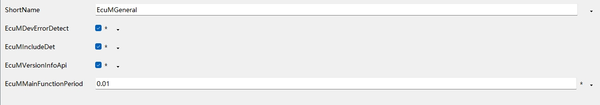
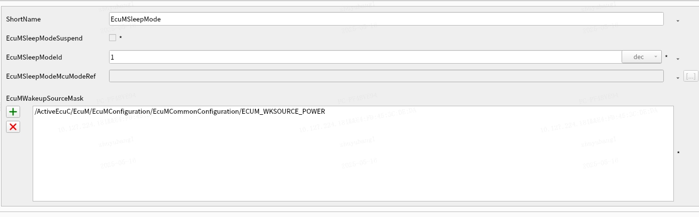
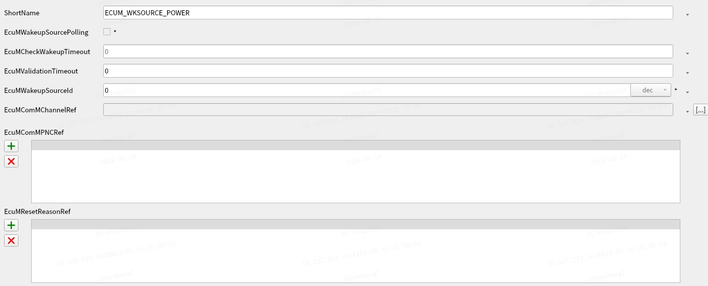
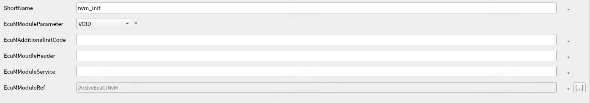
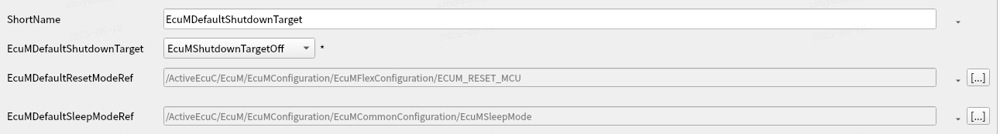
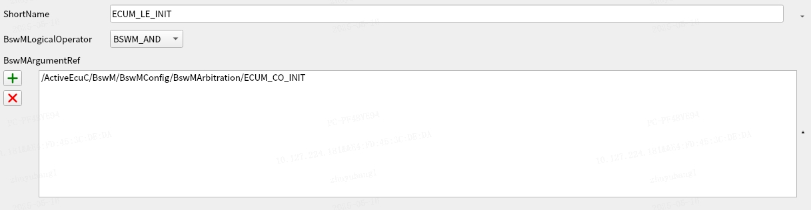
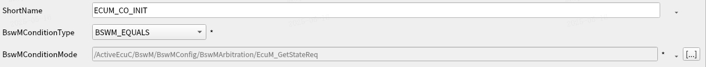
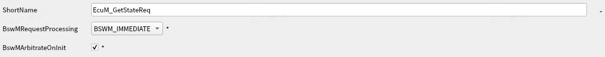
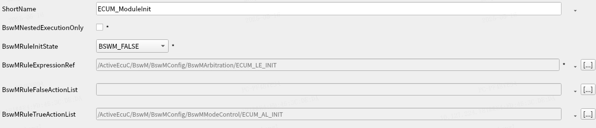

# 系统管理栈开发者手册

## 1. 简介

系统管理栈是一组轻量级的系统管理程序，为系统各项服务提供灵活、高效的多级启动能力。系统管理支持对系统中各服务状态的管理与同步，有效协调各服务间的状态依赖，能够显著提升整个系统的确定性与可用性，为复杂系统的稳定运行奠定坚实基础

## 2. 代码目录

service_management源代码在haloosspace/vcos/components/system_services/service_management目录下，目录结构如下图所示：

```plaintext
service_management          # 系统管理栈代码
├── CMakeLists.txt          # 系统管理子系统顶层构建配置，定义模块编译规则
├── DISCLAIMER.md           # 系统管理组件免责声明
├── LICENSE                 # 开源协议
├── sysm_init               # 系统管理-启动管理
│   ├── CMakeLists.txt      # 构建规则
│   ├── config_plug_in      # 配置项生成文件
│   ├── inc                 # 头文件
│   ├── Kconfig             # sysm_init模块使能配置
│   └── src                 # 源文件
├── sysm_core               # 系统管理-核心功能
│   ├── CMakeLists.txt      # 构建规则
│   ├── config_plug_in      # 配置项生成文件
│   ├── inc                 # 头文件
│   ├── Kconfig             # sysm_core模块使能配置
│   └── src                 # 源文件
└── README.md               # service_management仓库介绍

```

## 3. 主要功能描述

### 3.1. 功能讲解

#### 3.1.1. sysm_init

sysm_init功能包括分级启动，唤醒校验等全生命周期管理功能。

* **分级启动**：
sysm_init为各组件和驱动提供统一的初始化接口，支持在操作系统启动前后分别进行初始化。模块将整个启动过程进一步细分为可配置的四个阶段，用户可根据具体需求，将不同的组件和驱动灵活归入适当的初始化阶段，有效保证各模块依赖关系的正确、有序高效启动。通过这种分级、可配置的初始化机制，系统的启动流程实现了更高的精细化管理和可控性。

* **唤醒源校验**：
sysm_init提供接口供底层驱动上报唤醒源状态，唤醒校验流程包含以下几个方面：1）唤醒源有效性检查，判断触发信号是否来自已配置、合法的唤醒源。2）超时保护机制，针对唤醒信号引入超时检查，防止非法或异常唤醒源长时间滞留在校验流程，提升系统抗干扰能力。3）合法性处理与恢复，只有通过校验的唤醒源才会触发后续的唤醒流程，确保唤醒流程的规范与可靠。

#### 3.1.2. sysm_core

sysm_core负责对系统各组件状态进行统一管理与协调，其核心作用是在系统运行过程中，根据不同的运行场景、通信状态和应用需求，依托规则引擎实现系统各组件间模式的动态切换与控制，从而保障系统整体状态的一致性。其核心功能包括：

* **状态同步**：现各基础软件模块（如通信管理、网络管理、诊断管理等）之间的状态一致性与信息同步，及时响应系统内部的状态变化，确保不同模块间协同一致。

* **事件驱动**：支持基于事件的模式切换，在检测到特定事件（如网络唤醒、系统模式变更、诊断请求等）时，能够按照预设规则驱动各相关模块按需切换工作状态，从而快速适应系统运行环境的变化，提升系统的鲁棒性和自动化程度。

## 4. 功能配置方法

### 4.1. sysm_init配置项说明入门

#### 4.1.1. EcuMGeneral

EcuMGeneral 主要用于控制一些宏等开启，设置mainfunction周期等通用配置

* EcuMDevErrorDetect：用于打开det
* EcuMIncludeDet：用于包含det的头文件
* EcuMVersionInfoApi：用于启用版本查询API
* EcuMMainFunctionPeriod：设置mainfunction周期



#### 4.1.2. EcuMSleepMode

* EcuMSleepModeId：休眠模式id，id从0递增
* EcuMWakeupSourceMask：用于定义唤醒源的掩码，该掩码指定了哪些唤醒源可以正常进入唤醒校验流程



#### 4.1.3. EcuMWakeupSource

* ShortName：唤醒源名称
* EcuMValidationTimeout：唤醒源校验超时时间，超时后判定校验失败
* EcuMWakeupSourceId：唤醒源id，若有多个唤醒源，该参数从0递增
* EcuMComMChannelRef：唤醒源对应的comm通道
* EcuMComMPNCRef：唤醒源对应的comm PNC
* EcuMResetReasonRef：唤醒源对应的复位原因



#### 4.1.4. EcuMDriverInitItem

* ShortName：初始化项目名称
* EcuMModuleParameter：初始化函数入参
* EcuMAdditionalInitCode：初始化函数c代码
* EcuMMoudleHeader：初始化函数声明的头文件
* EcuMModuleRef：初始化函数引用的模块



>若手动填写EcuMAdditionalInitCode、EcuMMoudleHeader，则不需要填写EcuMModuleRef

#### 4.1.5. EcuMDefaultShutdownTarget

* EcuMDefaultShutdownTarget：默认下电目标
* EcuMDefaultResetModeRef：默认重启模式
* EcuMDefaultSleepModeRef：默认休眠模式



### 4.2. sysm_core配置项简介

#### 4.2.1. BswMGeneral

BswMGeneral 主要用于控制一些宏等开启和设备配置，简要介绍 BswMGeneral 中一些主要的配置项

* BswMCanSMEnabled：用于启用对CanSM模块的状态管理
* BswMComMEnabled：用于启用对ComM模块的状态管理
* BswMMainFunctionPeriod: 设置mainfunction周期


#### 4.2.2. BswMLogicalExpression

* BswMLogicalOperator：配置不同condition之间的关系（与、或、非）
* BswMArgumentRef：引用condition



>配置逻辑表达式，用于规则中的条件判断

#### 4.2.3. BswMModeCondition

* BswMConditionType：配置Port与BswMode之间的关系（等于、不等于）
* BswMConditionMode：引用到一个模式请求端口（Port）



>配置条件，用于组成逻辑表达式

#### 4.2.4. BswMModeRequestPort

* BswMRequestProcessing：端口改变时的触发模式（立即仲裁还是mainfunction中仲裁）
* BswMArbitrateOnInit：是否在初始化时仲裁



>其他模块在BswM中注册端口，状态变化会反应到端口上

#### 4.2.5. BswMRules

* BswMRuleInitState：规则的初始状态，评估规则所依据的状态
* BswMRuleExpressionRef：引用对应的逻辑表达式
* BswMRuleFalseActionList：逻辑表达式评估FALSE时执行的动作列表
* BswMRuleTrueActionList：逻辑表达式评估TRUE时执行的动作列表



#### 4.2.6. BswMActionList

* BswMActionListExecution：触发方式（边沿触发、水平触发）

#### 4.2.7. BswMActionListItem

* BswMAbortOnFail：模式请求失败是否终止后续操作
* BswMActionListItemIndex：动作id，从0递增
* BswMReportFailRuntimeErrorId：错误id
* BswMActionListItemRef：引用的动作

### 4.3. 使用示例

#### 4.3.1. 添加配置

* 参考4.1节，进行sysm_init配置，包括模块初始化、唤醒源以及休眠模式等配置
* 参考4.2节，进行sysm_core配置，根据实际业务场景配置相关的规则、表达式、条件、端口、动作列表以及动作。

#### 4.3.2. 模块初始化示例

```C
#include "sysm_init.h"

void main()
{
    platofrm_init();
}

void os_task_core0_init(void *args)
{
    system_init();
    
    TerminateTask();
}

```

#### 4.3.3. 规则仲裁示例

```C
#include "bswm.h"

#define PM_USER (1u)
#define PM_RUN_STATE (1u)

void pm_control(void *args)
{
    bswm_request_mode(PM_USER, PM_RUN_STATE);
}

```

## 5. 配置项参考规范

[sysm_init 配置项参考规范](../../configuration_reference/sysm_init_cfg.md)

[sysm_core 配置项参考规范](../../configuration_reference/sysm_core_cfg.md)

## 6. 应用接口参考规范

[sysm_init API 参考规范](../../api_reference/sysm_init_api.md)

[sysm_core API 参考规范](../../api_reference/sysm_core_api.md)
