# 时间同步开发者手册

## 1. 简介

时间同步功能栈提供主从节点时间同步与管理功能，为跨节点协同场景提供精确、可靠的时间基准，是跨节点协同的基础。本文提供时间同步功能栈开发的基础配置与编程方式

## 2. 代码目录

``` text
time
├── DISCLAIMER.md           # 免责声明文档
├── Kconfig                 # time仓库下的Kconfig文件，用于定义配置项
├── LICENSE                 # 项目许可证文件
├── README.md               # time仓库的readme文件，用于介绍该代码仓库
├── tsync                   # 时间同步子模块代码目录
│   ├── CMakeLists.txt      # 时间同步子模块编译脚本，用于控制编译相关资源
│   ├── configs             # 配置项生成文件目录
│   ├── inc                 # 头文件目录
│   └── src                 # 源文件目录
└── time_manager            # 用户API代码目录
    ├── CMakeLists.txt      # 用户API编译脚本，用于控制编译相关资源
    ├── config_plug_in      # 配置项生成文件目录
    ├── inc                 # 头文件目录
    └── src                 # 源文件目录
```

## 3. 主要功能描述

### 3.1. 功能讲解

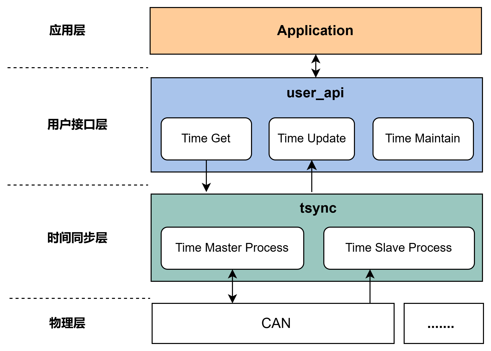

* 时间同步层可以作为主节点或从节点参与时间同步，统一主从节点的时间基准
* 用户接口层为上层应用和下层时间同步子模块提供时间获取、时间更新等接口

## 4. 功能配置方法

tsync是时间同步层的关键组件，time_manager是用户接口层的关键组件，其关键配置项介绍如下：

### 4.1. tsyn配置项介绍

#### 4.1.1. CanTSynGeneral

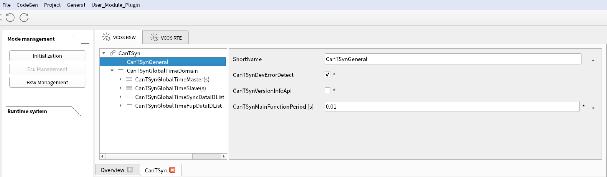

* CanTSynGeneral是tsync模块的通用配置项，其子配置项包括主函数周期（CanTSynMainFunctionPeriod）、是否开启开发错误检测（CanTSynDevErrorDetect）等等
* CanTSynMainFunctionPeriod默认值为0.01s

#### 4.1.2. CanTSynGlobalTimeDomain

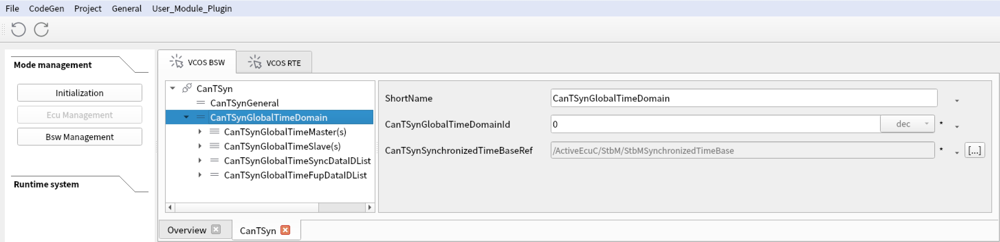

* CanTSynGlobalTimeDomain配置项用于定义tsync模块全局时间域的属性，其子配置项包括全局时间域ID（CanTSynGlobalTimeDomainId）、引用时间基（CanTSynSynchronizedTimeBaseRef）等等
* 当前仅支持一个时间域配置，CanTSynGlobalTimeDomainId默认为0；CanTSynSynchronizedTimeBaseRef需引用time_manager中定义的同步时间基

#### 4.1.3. CanTSynGlobalTimeMaster

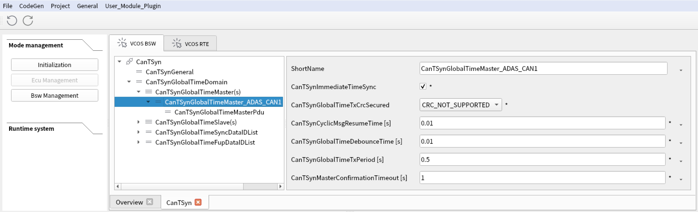

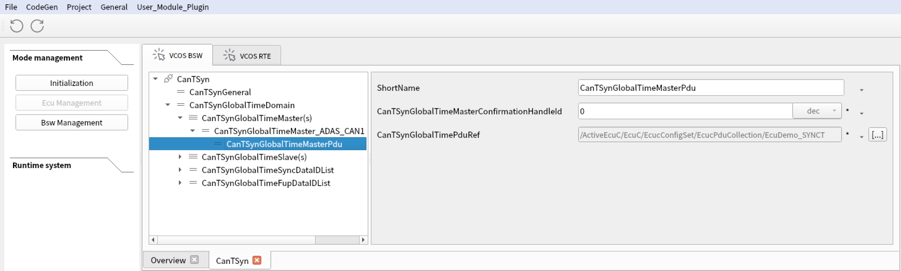

* CanTSynGlobalTimeMaster是tsync作为时间同步主节点时的配置项，其子配置项包括是否开启发送CRC验证（CanTSynGlobalTimeTxCrcSecured）、SYNC和FUP报文发送周期（CanTSynGlobalTimeTxPeriod）、报文发送PDU通道（CanTSynGlobalTimePduRef）等等
* CanTSynGlobalTimeTxCrcSecured当前仅支持CRC_NOT_SUPPORT选项；CanTSynGlobalTimeTxPeriod默认为0.5s

#### 4.1.4. CanTSynGlobalTimeSlave

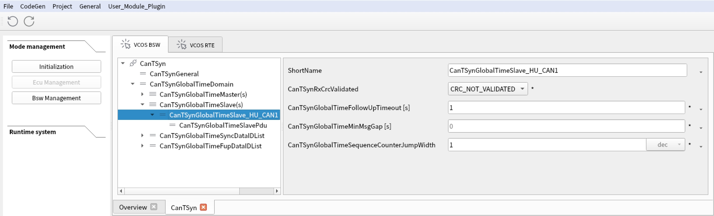

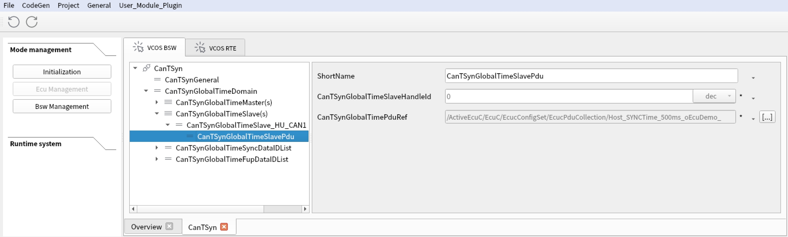

* CanTSynGlobalTimeSlave是tsync作为时间同步从节点时的配置项，其子配置项包括是否开启报文接收CRC校验（CanTSynRxCrcValidated）、FUP报文接收超时时间（CanTSynGlobalTimeFollowUpTimeout）、报文接收PDU通道（CanTSynGlobalTimePduRef）等等
* CanTSynRxCrcValidated当前仅支持CRC_NOT_VALIDATED选项；CanTSynGlobalTimeFollowUpTimeout默认为1s

#### 4.1.5. CanTSynGlobalTimeSyncDataIDList

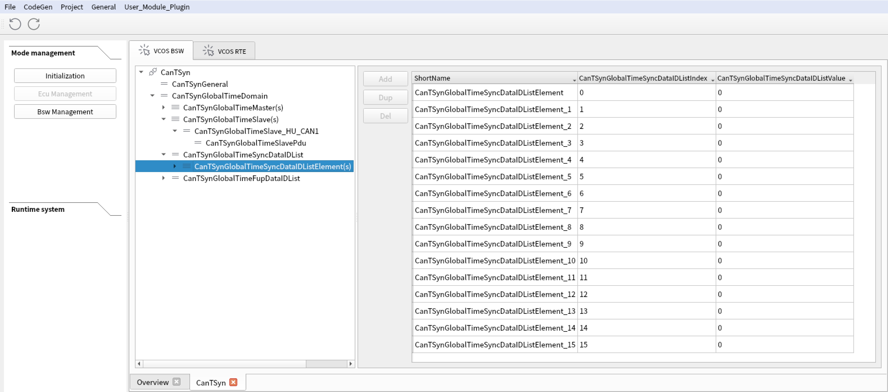

* CanTSynGlobalTimeSyncDataIDList配置项定义SYNC报文消息列表

#### 4.1.6. CanTSynGlobalTimeFupDataIDList

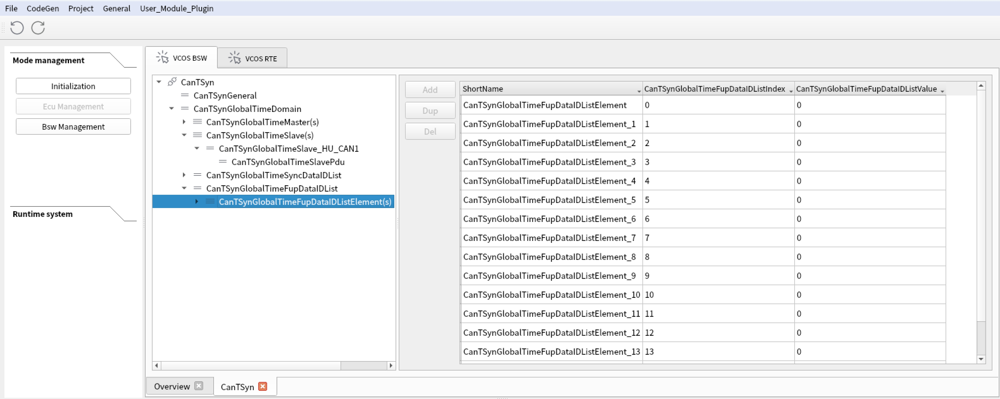

* CanTSynGlobalTimeFupDataIDList配置项定义FUP报文消息列表

### 4.2. time_manager配置项介绍

#### 4.2.1. StbMGeneral

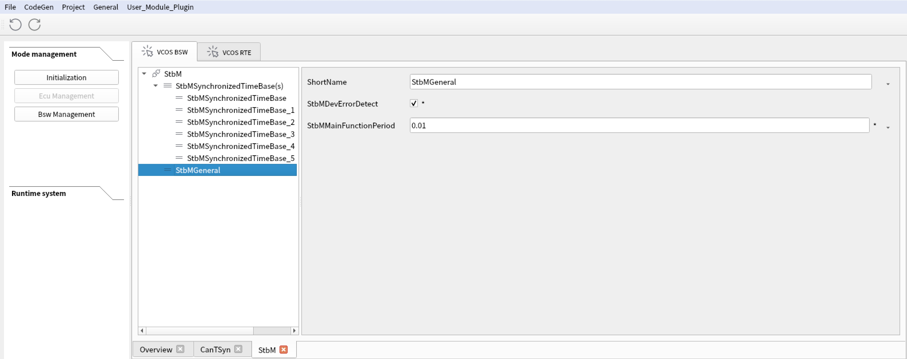

* StbMGeneral是time_manager的通用配置项，其子配置项包括主函数周期（StbMMainFunctionPeriod）、是否开启开发错误检测（StbMDevErrorDetect）等等
* StbMMainFunctionPeriod默认为0.01s

#### 4.2.2. StbMSynchronizedTimeBase

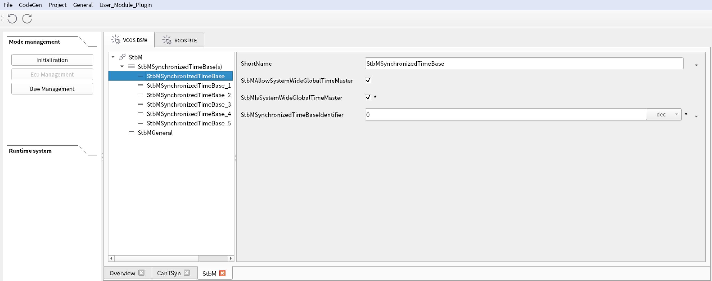

* StbMSynchronizedTimeBase配置项用于配置系统时间基的相关参数，本地时钟类型可以选择GPT时间、OS时间和ETH-MAC时间，不配置StbMLocalTimeClock子配置项时，默认选择ETH-MAC时间类型

## 5. tsyn_demo使用示例

tsyn_demo是时间同步Demo的演示工程，其使用示例如下：

### 5.1. 配置时间基参数


* 参考4.2.2节，配置系统时间基的相关参数

### 5.2. 引用时间基


* 参考4.1.2节，引用配置完成的时间基

### 5.3. 配置报文发送PDU通道


* 参考4.1.3节，配置SYNC和FUP报文发送时的PDU通道

### 5.4. 配置报文接收PDU通道


* 参考4.1.4节，配置SYNC和FUP报文接收时的PDU通道

### 5.5. 启用时间同步主节点功能

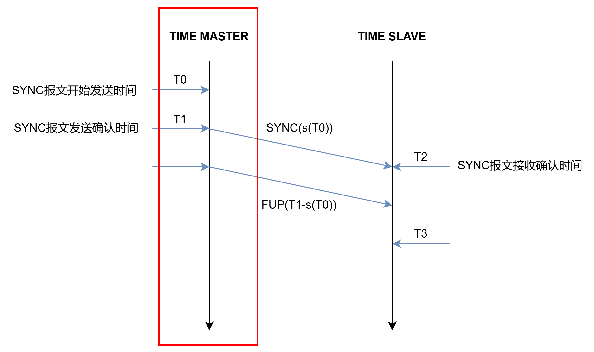

tsync时间同步主节点功能默认开启，上电后即开启SYNC和FUP报文发送，SYNC报文中携带秒信息，FUP中携带纳秒信息；其中，时间信息通过time_manager提供的接口获取，且由于本地时间基的类型默认为ETH-MAC时间，上电后从0开始自增，因此报文中携带的时间信息也是从0递增的，上位机接收到的报文展示如下：

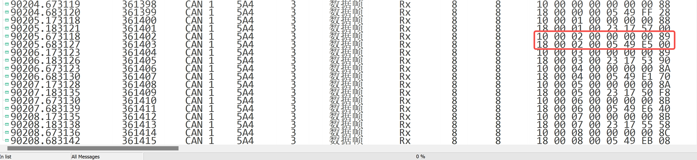

### 5.6. 启用时间同步从节点功能

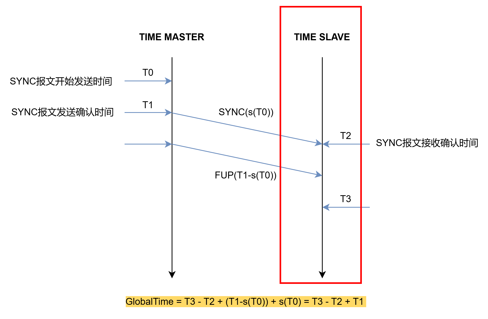

tsync时间同步从节点功能同样默认开启，可以接收主节点发送的SYNC和FUP报文、提取其携带的时间信息、计算全局时间（GlobalTime）并更新至本地；其中，时间更新也是通过time_manager提供的接口完成。

使用上位机模拟时间同步主节点，发送SYNC和FUP报文至开发板（报文的Sequence Counter需要符合配置要求），本地时间会被更新为报文中携带的时间（通过主节点向外发送的SYNC和FUP报文携带的时间信息可以看出时间已更新），整体效果如下图所示：

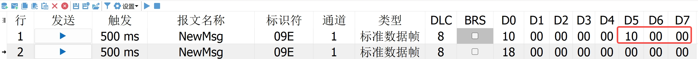

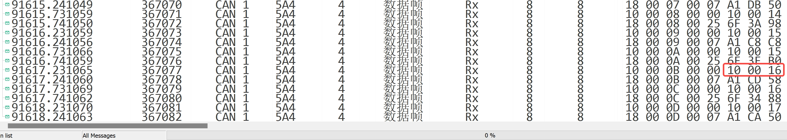

## 6. 配置项参考规范

[tsync 配置项参考规范](../../configuration_reference/time_tsync_cfg.md)

[time_manager 配置项参考规范](../../configuration_reference/time_manager_cfg.md)

## 7. 应用接口参考规范

[tsync 应用接口参考规范](../../api_reference/time_tsync_api.md)

[time_manager 应用接口参考规范](../../api_reference/time_manager.md)
