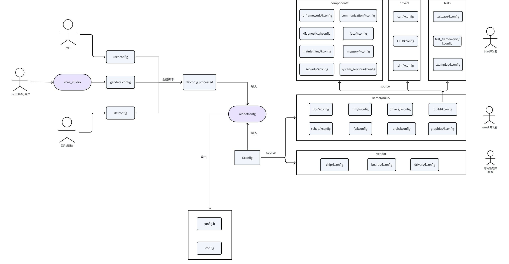
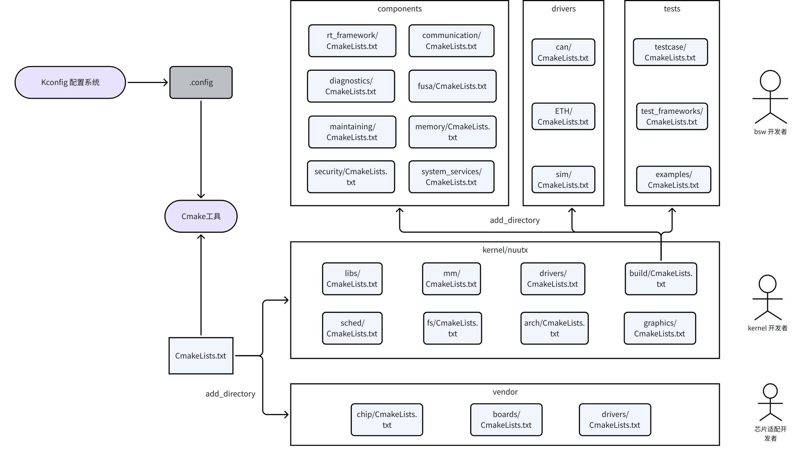
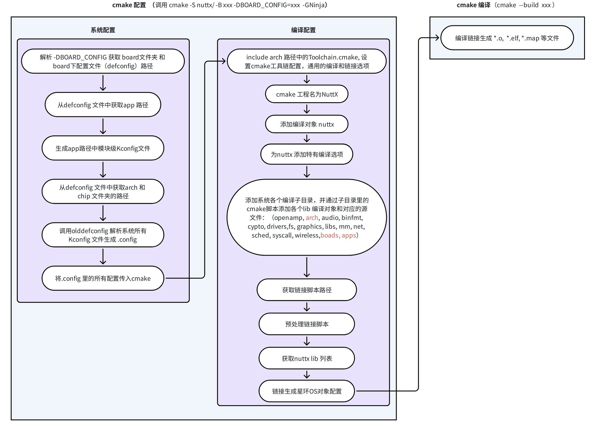

# 构建系统开发者手册

## 1. 简介

在软件定义汽车（SDV）的浪潮下，底层操作系统及其构建体系的灵活性与标准化程度直接决定了整车的研发效率。VCOS 作为理想星环OS（Halo OS）的底层核心，承载着打破传统闭源系统束缚、构建高性能且高可靠性车辆控制底座的使命

本手册专注于 VCOS 的配置与构建系统。该系统基于工业标准的 Kconfig 和 CMake 技术栈，旨在解决大规模软件开发中的模块化管理、跨芯片平台适配以及严苛的确定性响应挑战 。本手册将详细介绍其设计约束、逻辑流程及开发规范，指导开发者高效利用这一基础设施进行系统构建与扩展

## 2. 模块组成与依赖关系

VCOS 的架构设计强调高度的模块化，以适应跨部门交付、多芯片适配及严苛的裁剪需求。详细架构请参考[OVERVIEW](../../OVERVIEW.md)中【项目架构】章节

由于 VCOS 涉及上下游多方交付且代码逻辑复杂，系统展现出大型软件项目的典型特征。其配置与构建系统必须能够支撑多团队协作，并在不同技术背景的开发者之间维持统一的构建标准

## 3. 设计约束与准则

为了确保系统的可维护性与确定性，配置与构建系统的设计遵循以下严苛约束：

### 3.1. 配置系统设计准则

- 模块化和层次化，避免单一庞大的配置文件
- 依赖管理和条件控制，避免用户选择无效组合，使配置逻辑更自动化，减少人工判断
- 高可维护性，代码和配置强绑定：通过 #ifdef CONFIG_XXX 控制编译，模块扩展容易，配置和代码保持一致性
- 灵活的默认值和派生设置，用户只需选择关键选项，其他依赖配置会自动完成
- 与构建系统集成，构建系统可以读取配置项，把 CONFIG_XXX 转成编译宏或构建条件。 便于操作系统做特性裁剪
- 配置自动化和批量化

### 3.2. 构建系统设计准则

- 跨平台， 同一套脚本可以在不同的平台使用
- 和编译器/工具链解耦，嵌入式开发需要使用不同的编译器，构建系统不能与特定的编译器绑定
- 模块化和可扩展性，支持构建脚本按照目录结构拆分，并且方便三方库的集成
- 目标（target）导向构建, 提供语法明确目标的依赖，避免全局变量滥用、污染
- 配置灵活

## 4. 配置和构建工具

VCOS 放弃了传统的 Makefile 方案，转而采用 Kconfig + CMake 的现代化组合

### 4.1. 工具优势

- Kconfig： 在处理大规模、高可裁剪及具有复杂依赖关系的嵌入式系统中表现卓越
- CMake： 提供了比 Makefile 更高层次的抽象，支持多种构建生成器（如 Ninja），是跨平台协作的首选

### 4.2. CMake 与 Makefile 的对比参考

|特性|CMake|Makefile|
|-|-|-|
|跨平台性|跨平台（支持 Linux、Windows、macOS、Android、iOS 等），能生成多种构建系统（Make, Ninja, VS, Xcode）|主要依赖 GNU Make，在 Windows 下需要 MinGW/MSYS/Cygwin 等环境，跨平台性差|
|抽象程度|使用 CMakeLists.txt 描述构建逻辑，自动生成底层构建文件|需要手写具体规则（编译、链接命令），抽象层次低|
|依赖管理|内置 find_package、FetchContent，支持外部库自动查找和下载|手工指定依赖库路径、编译选项，难以管理复杂依赖|
|可维护性|模块化（add_subdirectory、target_* 系列命令），适合大型项目|大型项目维护困难，容易出现规则冗余和冲突|
|配置灵活性|内置 Debug/Release 配置，支持选项开关（option/if/else）|手动维护不同构建配置，代码量大|
|语言支持|支持 C、C++、Fortran、CUDA、ASM、Objective-C 等多语言|主要面向 C/C++，其他语言需额外写规则|
|学习曲线|语法类似函数调用，现代 CMake（3.x+）更易读|规则+变量+隐式规则，灵活但复杂，难读难维护|
|社区与生态|活跃，几乎是 C/C++ 工程的事实标准，很多库提供 CMake 配置|历史悠久，生态庞大，但现代项目逐渐转向 CMake|
|适用场景|大型、多平台、多依赖的工程|小型、单平台、依赖少的工程|

- 小项目/教学/快速实验 → Makefile 更直接
- 大型项目/跨平台/团队协作 → CMake 更合适

## 5. 配置和构建系统逻辑图

### 5.1. Kconfig 配置系统



### 5.2. CMake 构建系统



## 6. 配置和构建系统流程图



## 7. Kconfig开发说明

### 7.1 常见配置项写法

#### 7.1.1 Boolean 类型

``` Kconfig
config DEBUG
    bool "Enable debug logs"
    default y
```

- bool：布尔选项
- default y：默认启用

#### 7.1.2 整型/字符串

``` Kconfig
config BUFFER_SIZE
    int "Buffer size"
    range 128 4096
    default 1024

config DEVICE_NAME
    string "Default device name"
    default "uart0"
```

### 7.2 依赖与条件控制

#### 7.2.1 depends on

``` Kconfig
config WIFI
    bool "Enable WiFi"
    depends on NET
```

只有 NET=y 时，WIFI 才会出现。

#### 7.2.2  if/endif 语句

``` Kconfig
if DEBUG
config DEBUG_VERBOSE
    bool "Verbose debug output"
endif
```

### 7.3 菜单和分组

#### 7.3.1 菜单

``` Kconfig
menu "Networking options"

config NET_IPV4
    bool "IPv4 support"

config NET_IPV6
    bool "IPv6 support"

endmenu
```

#### 7.3.2 Choice 选择

``` Kconfig
choice
    prompt "Scheduler type"
    default SCHED_RR

config SCHED_RR
    bool "Round Robin"

config SCHED_FIFO
    bool "FIFO"

endchoice
```

### 7.4 高级技巧

#### 7.4.1  select 强制开启

``` Kconfig
config USB
    bool "USB support"

config USB_STORAGE
    bool "USB Mass Storage"
    select USB
```

选择 USB_STORAGE 时会自动启用 USB

⚠️ 注意：select 不会检查依赖，可能破坏依赖关系，需谨慎

#### 7.4.2 默认值依赖

``` Kconfig
config DEFAULT_PORT
    int "Default port number"
    default 8080 if NET
    default 0
```

当 NET 开启时默认 8080，否则默认 0

## 8. Cmake开发手册

### 8.1 模块Cmake的典型示例

``` CMake
# =====================================================
# CMakeLists.txt for Module: mymodule
# =====================================================

# 设置模块名
set(MODULE_NAME mymodule)

# 收集源码
set(${MODULE_NAME}_SRCS
    mymodule.c
    mymodule_utils.c
    # 如果有更多文件，继续加
)

# 添加库
# 作用：将该模块编译为静态库
nuttx_add_library(${MODULE_NAME}
  SRCS ${${MODULE_NAME}_SRCS}
)

# 添加头文件路径
# 作用：给目标设置头文件搜索路径
target_include_directories(${MODULE_NAME} PRIVATE
    ${CMAKE_CURRENT_SOURCE_DIR}/include
)

# 定义编译宏（可选）
# 作用：为目标设置预处理宏定义
target_compile_definitions(${MODULE_NAME} PRIVATE
    CONFIG_MYMODULE=1
)

# 定义编译选项（可选）
# 作用：为目标设置预处理宏定义
target_compile_options(${MODULE_NAME} PRIVATE -Wall -O2)


# 模块依赖（如果依赖别的驱动或库）
# 作用：确保构建顺序正确
nuttx_add_dependencies(${MODULE_NAME} drivers)
```

### 8.2 Cmake 常用的内置函数/命令

``` CMake
# ========================
# 1. 变量控制
# ========================

# 变量的定义和读取
set(VAR "hello")     # 定义普通变量
set(VAR "new" CACHE STRING "My cached variable")  # 定义全局变量
unset(VAR)  # 删除变量
set(ENV{PATH} "/usr/bin")  # 设置环境变量
message(STATUS "PATH=$ENV{PATH}")     # 读取环境变量

# 条件判断变量
if(DEFINED VAR)
  message("VAR 已定义")
endif()
if(NOT VAR)
  message("VAR 未设置或为空")
endif()
if(VAR STREQUAL "hello")
  message("VAR 等于 hello")
endif()

# 字符操作
string(LENGTH "${VAR}" LEN)  # 获取字符串长度
string(SUBSTRING "${VAR}" 0 3 SUBVAR)   # 截取子串
string(TOUPPER "${VAR}" UPPER_VAR)   # 转大写
string(REPLACE "old" "new" NEWVAR "${VAR}") # 字符串替换

# 列表操作
set(MYLIST a b c)  # 定义列表
list(APPEND MYLIST d e)  # 追加元素
list(REMOVE_ITEM MYLIST b) # 删除指定元素
list(LENGTH MYLIST LEN)  # 获取列表长度
list(GET MYLIST 0 FIRST)  # 取第一个元素


# ========================
# 2. 构建目标
# ========================
add_executable(myapp src/main.c)          # 定义可执行文件
add_library(mylib STATIC src/lib.c)       # 定义静态库
add_library(mylib_shared SHARED src/lib.c)# 定义动态库

target_link_libraries(myapp PRIVATE mylib)    # 给目标链接库
target_include_directories(myapp PRIVATE include) # 添加头文件路径
target_compile_options(myapp PRIVATE -Wall -O2)   # 添加编译选项
target_compile_definitions(myapp PRIVATE USE_DEBUG=1) # 添加宏定义

add_subdirectory(third_party/foo)         # 添加子目录
add_dependencies(myapp mylib)             # 指定依赖关系

# ========================
# 3. 文件与路径操作
# ========================
include(cmake/common.cmake)               # 引入外部 cmake 脚本
include_directories(include utils)        # 添加全局头文件路径（旧写法）
link_directories(/usr/local/lib)          # 添加全局库路径（旧写法）

file(GLOB SRC_FILES src/*.c)              # 搜索目录下的所有 .c 文件
file(MAKE_DIRECTORY ${CMAKE_BINARY_DIR}/gen) # 创建目录
file(READ README.md README_CONTENTS)      # 读取文件内容到变量

configure_file(config.h.in config.h)      # 生成配置文件（替换变量）

# ========================
# 4. 流程控制
# ========================
if(WIN32)
    message(STATUS "Windows detected")
elseif(UNIX)
    message(STATUS "Linux/Unix detected")
else()
    message(WARNING "Unknown system")
endif()

foreach(src IN LISTS SRC_FILES)
    message(STATUS "Source file: ${src}")
endforeach()

function(print_msg text)                  # 定义函数
    message(STATUS ">>> ${text}")
endfunction()

macro(print_macro text)                   # 定义宏（与函数不同：变量作用域是外层的）
    message(STATUS ">>> ${text}")
endmacro()

# ========================
# 5. 消息输出
# ========================
message(STATUS "Building project...")
# 普通信息
message(WARNING "This is a warning")
# 警告信息
message(FATAL_ERROR "Something went wrong")
# 错误并中断

# ========================
# 6. 查找和依赖管理
# ========================
find_package(OpenSSL REQUIRED)            # 查找 OpenSSL 库
find_library(MATH_LIB m)                  # 查找数学库
find_path(HEADERS_DIR mylib.h /usr/include) # 查找头文件目录
find_file(CONFIG_FILE myapp.conf /etc)    # 查找文件
find_program(PYTHON_EXE python3)          # 查找可执行程序

# ========================
# 7. 自定义命令/目标
# ========================
add_custom_command(
    OUTPUT generated.c
    COMMAND python3 gen.py > generated.c
    DEPENDS gen.py
)                                         # 定义生成文件的命令

add_custom_target(run ALL
    COMMAND ./myapp
    DEPENDS myapp
)                                         # 定义自定义目标

execute_process(COMMAND echo "Hello from CMake")  # 在配置阶段执行命令

# ========================
# 8. 安装与打包
# ========================
install(TARGETS myapp RUNTIME DESTINATION bin)    # 安装可执行文件
install(FILES include/mylib.h DESTINATION include) # 安装头文件
install(DIRECTORY assets/ DESTINATION share/myapp) # 安装目录

include(CPack)                          # 启用 CPack 打包支持
```

### 8.3 Cmake 常用内置变量总结

``` CMake
# ========================
# 1. 工程/目录相关
# ========================
CMAKE_SOURCE_DIR             # 工程根目录（最顶层 CMakeLists.txt 所在路径）
CMAKE_BINARY_DIR             # 工程构建目录（一般是 build/）
CMAKE_CURRENT_SOURCE_DIR     # 当前 CMakeLists.txt 所在目录
CMAKE_CURRENT_BINARY_DIR     # 当前构建目录
CMAKE_MODULE_PATH            # CMake 模块查找路径，可通过 set 添加自定义路径
PROJECT_NAME                 # 当前 project() 定义的工程名
PROJECT_SOURCE_DIR           # 当前 project 的源码路径
PROJECT_BINARY_DIR           # 当前 project 的构建路径

# ========================
# 2. 编译器相关
# ========================
CMAKE_C_COMPILER             # C 编译器路径
CMAKE_CXX_COMPILER           # C++ 编译器路径
CMAKE_ASM_COMPILER           # 汇编编译器路径
CMAKE_AR                     # 静态库打包工具
CMAKE_LINKER                 # 链接器
CMAKE_RANLIB                 # ranlib 工具路径

CMAKE_C_FLAGS                # C 编译选项（全局）
CMAKE_CXX_FLAGS              # C++ 编译选项（全局）
CMAKE_EXE_LINKER_FLAGS       # 链接可执行文件时的选项
CMAKE_SHARED_LINKER_FLAGS    # 链接共享库时的选项

# ========================
# 3. 构建配置
# ========================
CMAKE_BUILD_TYPE             # 构建类型（Debug / Release / RelWithDebInfo / MinSizeRel）
CMAKE_VERBOSE_MAKEFILE       # 是否显示详细编译命令（ON/OFF）
BUILD_SHARED_LIBS            # 默认是否构建为共享库（ON=SHARED，OFF=STATIC）
CMAKE_POSITION_INDEPENDENT_CODE  # 是否启用 -fPIC（默认 ON，构建共享库时必须）

# ========================
# 4. 系统信息
# ========================
CMAKE_SYSTEM_NAME            # 系统名称（Linux, Windows, Darwin 等）
CMAKE_SYSTEM_VERSION         # 系统版本
CMAKE_SYSTEM_PROCESSOR       # CPU 架构（x86_64, arm, aarch64 等）
UNIX                         # 在 UNIX 平台时为 TRUE
WIN32                        # 在 Windows 平台时为 TRUE
APPLE                        # 在 macOS/iOS 平台时为 TRUE

# ========================
# 5. 安装相关
# ========================
CMAKE_INSTALL_PREFIX         # 安装前缀，默认 /usr/local
CMAKE_INSTALL_BINDIR         # 安装可执行文件目录，默认 bin
CMAKE_INSTALL_LIBDIR         # 安装库目录，默认 lib 或 lib64
CMAKE_INSTALL_INCLUDEDIR     # 安装头文件目录，默认 include
CMAKE_INSTALL_DATAROOTDIR    # 安装数据目录，默认 share

# ========================
# 6. 测试/打包
# ========================
CMAKE_CURRENT_LIST_FILE      # 当前正在处理的 CMakeLists.txt 文件路径
CMAKE_CURRENT_LIST_LINE      # 当前正在处理的行号
CMAKE_INSTALL_CONFIG_NAME    # 安装时使用的构建配置
CMAKE_GENERATOR              # 当前使用的构建工具（Makefile, Ninja, Visual Studio 等）
```

### 8.4 VCOS2.0构建系统定义的全局变量

``` CMake
GENDATA_DIR                            # VCOS 工程gendata 目录
VCOS_DIR                               # vcos 目录名称
VENDOR_THIRD_PARTY_DRIVER_INCDIR       # 三方驱动对外头文件目录
VENDOR_THIRD_PARTY_DRIVER_C_FLAGS      # 三方驱动自定义的C编译选项（一般用来做配置的）
VENDOR_THIRD_PARTY_DRIVER_ASM_FLAGS    # 三方驱动自定义的汇编编译选项（一般用来做配置的）
NUTTX_DIR                              # vcos/kernel/nuttx 目录
NUTTX_DEFCONFIG                        # 当前平台defconfig 文件路径
NUTTX_BOARD                            # 当前板子名称
NUTTX_CONFIG                           # 当前板子配置名称
NUTTX_APPS_DIR                         # vcos/apps 目录名称
```

### 8.5 VCOS2.0 构建系统封装的函数

``` CMake
# =====================================================
# 1. 应用相关
# =====================================================
# 添加一个应用程序
# 作用：封装 add_executable() + 安装逻辑，自动处理入口函数 xxx_main()
nuttx_add_application(
  NAME hello                    # 应用名称
  SRCS hello_main.c             # 源文件
  STACKSIZE 2048                # 栈大小
  PRIORITY 100                  # 任务优先级
)

# =====================================================
# 2. 库相关
# =====================================================
# 添加驱动库
# 作用：封装 add_library()，为驱动创建静态库
nuttx_add_library(drivers
  SRCS uart.c spi.c
)

# 添加板级支持库
# 作用：为板级 BSP 代码创建静态库
nuttx_add_library(board
  SRCS board_init.c
)

# =====================================================
# 3. 目标链接
# =====================================================
# 指定链接脚本
# 作用：封装 ld -Txxx.ld，自动传递给链接器
nuttx_add_linker_script(
  ${CMAKE_CURRENT_SOURCE_DIR}/ld.script
)

# =====================================================
# 4. 配置/依赖解析
# =====================================================
# 解析函数参数
# 作用：封装 cmake_parse_arguments，简化函数参数处理
nuttx_parse_function_args()

# 添加 Kconfig 文件
# 作用：将 Kconfig 集成到 CMake 构建体系，支持 menuconfig
nuttx_add_kconfig(${CMAKE_CURRENT_SOURCE_DIR}/Kconfig)

# =====================================================
# 5. 构建工具封装
# =====================================================
# 自定义命令
# 作用：生成 bin 文件（ELF → BIN）
nuttx_add_custom_command(
  OUTPUT nuttx.bin
  COMMAND ${CMAKE_OBJCOPY} -O binary nuttx nuttx.bin
  DEPENDS nuttx
)

# 自定义目标
# 作用：确保 nuttx.bin 在构建时总会生成
nuttx_add_custom_target(bin ALL DEPENDS nuttx.bin)

# =====================================================
# 6. 依赖与子目录
# =====================================================
# 添加子目录
# 作用：封装 add_subdirectory，自动附加 NuttX 默认编译选项
nuttx_add_subdirectory(drivers)

# 添加构建依赖关系
# 作用：确保 nuttx 在链接前构建 drivers 和 board
nuttx_add_dependencies(nuttx drivers board)

# =====================================================
# 7. 安装/导出
# =====================================================
# 导出库
# 作用：将库导出供外部应用/SDK 使用
nuttx_export_library(mylib)

# 安装头文件
# 作用：将指定目录下的头文件安装到系统 include 路径
nuttx_install_headers(${CMAKE_CURRENT_SOURCE_DIR}/include)
```
