# VCOS内核开发者手册
## 1. 简介
VCOS内核是面向车辆控制的操作系统，支持任务调度、事件驱动、中断响应、时间管理等关键功能模块。为提升配置效率和可视化体验，VCOS 内核配套提供图形化配置工具，用户可通过界面化方式对操作系统内核中的各个基础模块进行直观管理与配置。

本手册围绕 VCOS 内核中的核心模块， 包括 Core、Application、Task、Spinlock、Event、Counter、ScheduleTable、ISR 等，进行功能说明与配置指导。

各模块功能简述如下：
 - Core：代表物理处理核心，实现多核任务调度与资源分离。
 - Application：定义逻辑隔离域，用于资源授权与安全管理。
 - Task：封装程序执行单元，是操作系统调度的基本实体。
 - Spinlock：实现多核环境下的资源互斥与临界区保护。
 - Event：支持任务间的事件驱动通信与同步机制。
 - Counter：提供时间基准，用于驱动定时操作与调度表。
 - ScheduleTable：基于时间驱动的任务和事件调度方案。
 - ISR：中断服务例程，响应硬件中断并触发系统任务。


## 2. 代码目录
源代码在haloosspace/components/rt_framework目录下，目录结构如下图所示：
```plaintext
components # 
└── rt_framework                # 实时框架
      ├─config_plug_in          # 配置信息
      │  ├─auto_config          # 自动配置脚本
      │  ├─base_config          # 基础配置
      │  │  ├─base_ecuc         # 内核配置
      │  │  │  └─comm_ecuc      # 配置文件
      │  │  └─bswmd             # 配置项模版
      │  │     └─comm_bswmd     # 配置文件
      │  ├─generator            # 代码生成器
      │  │  ├─context           # 基础函数脚本
      │  │  └─template          # 生成脚本
      │  │      └─ui            # 配置文件生成脚本
      │  └─validation           # 验证校验
      │      ├─config           # 语义校验
      │      └─rules            # 规则校验
      ├─inc                     # VCOS内核头文件
      └─src                     # VCOS内核源文件
```
## 3. 主要功能描述
### 3.1. 功能讲解
#### 3.1.1. Core功能说明

Core 模块是 VCOS 内核中用于支持多核处理器架构（Multi-Core CPU）的关键抽象单元。每个 Core 表示一个独立的物理处理核心，操作系统基于该模块实现Task、ISR、ScheduleTable等在多核环境下的分布式调度与控制，从而提升系统并发性能和可扩展性。

1. 多核处理架构支持
 - 支持运行单核、绑定多核等多种运行模型；
 - 每个 Core 拥有独立的调度器与运行上下文，可实现并行执行多个 Task 与 ISR。

2. 任务与中断绑定核心
 - 任务（Task）、中断（ISR）等对象可以显式配置绑定到某个 Core；
 - 操作系统仅在对应 Core 上调度这些对象，实现负载隔离与并行化控制。

3. 核心间通信与同步机制
 - 多核心之间可通过 OS 提供的跨核通信机制实现数据与控制同步；
 - 避免资源竞争与状态不一致问题，保证多核系统行为的确定性；
 - 允许在一个 Core 上通过 ISR 或 ScheduleTable 激活另一个 Core 上的 Task；

#### 3.1.2. Application功能说明  

Application 模块是 VCOS 内核中的安全隔离与访问控制单位，用于实现不同功能域或供应商模块之间的内存与运行时资源隔离。每个 OS Application 表示一个逻辑上的执行实体集合，可包含多个 Task、ISR、ScheduleTable 等内核对象，作为运行时资源的授权边界。

1. 支持运行时对象隔离
 - 每个 OS Application 拥有自己的资源空间；
 - OS 会检查 Task、ISR 等对象的归属，限制跨 Application 非授权访问；
 - 实现模块级别的访问控制，避免非法调用或资源破坏。

2. 支持授权与访问控制
 - 资源（如 Spinlock、Counter、Task）在配置时明确指定所属 Application；
 - 运行时系统通过检查调用者所属 Application，决定是否授权执行该操作；
 - 支持静态配置的访问权限模型。

3. 支持信任等级区分  
  Application 按照信任等级分为以下两类：
 - Trusted（可信）：拥有全部资源访问权限；
 - Non-Trusted（非可信）：受限资源访问，仅可调用受保护的 OS API；

#### 3.1.3. Task功能说明 

Task 模块是 VCOS 内核中最基本且核心的执行单元，用于封装应用逻辑的功能块。每个 Task 代表一个可以被 OS 调度执行的独立程序段，操作系统通过任务调度机制实现多任务并发和实时控制，是整个 RTOS 系统的调度基础。

1. 封装应用执行实体  
 - 每个 Task 定义一段固定的代码流程（入口函数），由 OS 负责创建、调度、挂起与终止；
 - 应用程序逻辑通常通过多个 Task 分离实现，提高模块化和响应性。

2. 支持两类任务类型

| **类型**  | **特性说明** |  
| :---------- | :---------- | 
| Basic Task | 无阻塞行为，运行至终点或主动释放 CPU 才结束；不能调用 WaitEvent() |
| Extended Task | 支持事件等待，可被中断、挂起、恢复，更灵活，资源开销更大 |

*Extended Task 可与 Event 配合，构建事件驱动逻辑，适合复杂状态管理与异步处理场景。*

3. 具备优先级与调度属性
 - 每个 Task 配置唯一的优先级；
 - 操作系统支持基于优先级的抢占式调度策略；
 - 支持抢占、非抢占、混合调度等类型，以平衡实时性与资源消耗。

4. Task 激活机制与激活次数限制
 - Task可以通过以下方式激活：
   - 静态激活：在系统启动时由 OS 自动调度执行；
   - 动态激活：运行时通过 ActivateTask(TaskID) 接口触发；
 - 每个任务支持配置最大激活次数，当激活次数超过最大限制时，系统将拒绝该请求并返回错误状态。

5. 任务同步与通信机制
 - 任务（Task）支持多种同步与通信方式，用于构建可靠的调度与协作体系，包括：
   - 事件机制（Event）：任务可通过事件等待与响应，配合 SetEvent 和 WaitEvent 实现任务间的同步控制；
   - 自旋锁机制（Spinlock）：用于在多核系统中控制临界资源的访问，确保任务间的互斥与一致性；
   - 时间调度表（ScheduleTable）：可通过预定义的调度表对任务进行周期性或延时激活，实现时间驱动型调度；
 - 任务还可与中断服务例程（ISR）或其他任务协同工作，构建高效的异步事件响应系统。

6. 多核系统任务绑定
 - 支持将 Task 显式绑定到某一个Core；
 - 多核系统下，任务在绑定核心中独立调度，确保负载均衡与核间隔离。

#### 3.1.4. Event功能说明  
Event 模块是 VCOS 内核中用于事件驱动型任务控制与同步的关键机制。它提供任务与 ISR、任务与任务之间的通信桥梁，使得任务的执行可以由事件条件决定是否继续，从而实现更高效的资源调度与响应行为。

1. 支持事件驱动型任务唤醒
 - Event 模块配合 Extended Task 使用；
 - Extended Task 可在调用 WaitEvent() 后挂起自己，直到指定事件发生才恢复运行；
 - 任务运行不再依赖时间或轮询，而是通过事件触发执行，提高系统效率。

2. 任务间同步机制
 - 不同任务之间可通过 SetEvent() 与 WaitEvent() 实现同步：
   - 一个任务或 ISR 设置事件；
   - 被等待的任务检测事件发生后恢复运行；
 - 实现任务级的“生产者-消费者”模型、事件链式触发等机制。

3. ISR 异步触发事件
 - ISR 可调用 SetEvent() 激活事件，使得与硬件中断相关的任务被及时唤醒；
 - 实现中断与任务的高效解耦与协作。

4. 多事件位支持
 - 每个 Extended Task 可等待多个事件位（Event Bit）；
 - 支持位操作形式的事件设置与检测，允许任务等待任意组合事件（如 OR、AND 关系）；
 - 提供以下接口操作：
   - SetEvent(TaskID, EventMask) 设置事件；
   - ClearEvent(EventMask) 清除事件；
   - GetEvent(TaskID, &EventMask) 查询当前事件状态。

5. 细粒度任务调度控制
 - Event 模块允许任务进入挂起状态，仅在条件满足时才运行，从而降低 CPU 占用率；
 - 特别适合通信协议栈、数据处理链、状态机等场景下的事件驱动处理模型。

6. 多核系统支持
 - Event 机制在多核系统中同样有效，可用于跨核同步，通过 Spinlock 或通信机制保障事件同步的一致性。

#### 3.1.5. Isr功能说明   
ISR（Interrupt Service Routine，中断服务例程）模块是 VCOS 内核中用于处理中断源的专用执行实体，当外部或内部事件触发中断时，由操作系统调度 ISR 进行快速响应处理。它是嵌入式实时系统中响应外设、传感器、定时器等事件的关键机制。

1. 支持异步中断处理
 - 当外部硬件（如通信模块、IO 外设、定时器等）触发中断时，操作系统将自动调用绑定的 ISR；
 - ISR 可执行快速数据采集、状态刷新、激活任务、设置事件等操作，实现对突发事件的实时响应。

2. 分为两种类型

| **类型**  | **功能特性** |  
| :---------- | :---------- | 
| Category 1 ISR | 不与 OS 交互，执行简单、延迟最小，无法调用 OS 服务 |  
| Category 2 ISR | 可调用部分 OS 服务（如 SetEvent、ActivateTask），由 OS 进行上下文保存和调度控制 |  

*Category 2 ISR 是可管理 ISR，Category 1 ISR 是非管理 ISR。*

3. 具备优先级控制
 - ISR 拥有独立的中断优先级，通常高于任务；
 - 多个 ISR 同时发生按照优先级的高低先后执行，中断之间不可抢占。

4. 支持任务同步与唤醒  
 - ISR 常与 Task 配合使用，用于异步触发任务执行：
   - 通过 SetEvent() 激活 Extended Task；
   - 通过 ActivateTask() 启动周期任务；
 - 实现通信栈、IO 处理、控制循环等功能的实时入口点。

5. 多核环境下中断绑定
 - 支持将 ISR 显式绑定到特定核心（Core），实现中断源与处理核心的隔离；
 - 确保在多核系统中合理分配中断负载，提高系统响应效率。

#### 3.1.6. Spinlock功能说明   
Spinlock 模块是 VCOS 内核在多核环境下提供的一种低延迟同步机制，用于在多个核心间实现对共享资源的互斥访问。它采用忙等待（busy-waiting）方式，专为访问时间短、频繁使用的关键资源设计，以有效避免数据竞争与竞态条件。Spinlock 主要用于防止多个核心在同一时间访问同一个关键资源（如共享内存、外设寄存器）。

1. 基于忙等待实现
 - 当一个核心请求未获取到 Spinlock 时，不会立即进入阻塞状态，而是不断轮询（自旋）等待锁释放；
 - 这种机制适用于持有时间极短、频繁访问的资源，可避免上下文切换带来的开销。

2. 支持嵌套访问
 - 操作系统支持同一核心上的嵌套加锁，即一个核心在持有锁的情况下可以再次请求同一个 Spinlock；
 - 这在实现递归调用或复用同步模块时非常重要。

3. 与中断控制配合
 - 获取 Spinlock 时，通过配置可以选择屏蔽当前核心的中断，避免在关键区域中被打断，确保操作原子性；
 - 释放 Spinlock 时，恢复中断状态，保障系统响应能力。

4. 支持死锁检测与错误处理
 - 操作系统支持通过配置启用死锁检测功能，用于识别多核环境下的潜在死锁场景（如两个核心互相等待对方释放锁的循环等待情况）；
 - 当检测到可能的死锁时，系统会返回特定的错误状态码，供上层模块识别并执行相应的恢复或降级策略，增强系统鲁棒性与可维护性。

5. 与 OS Application 配合授权
 - 每个 Spinlock 可配置所属 OS 应用（Application），系统在运行时会检查访问权限，确保应用隔离安全。


#### 3.1.7. Counter功能说明  
Counter 模块是 VCOS 内核时间管理的基础组件，提供系统时间计数支持，并为 ScheduleTable 等模块提供时间驱动。它本质上是一个基于定时器的递增计数器，在系统中承担周期性时间基准的角色。
内核要求操作系统至少提供一个软件或硬件Counter。一个Counter可以驱动多个调度表，一个调度表只能由一个Counter驱动。

1. 提供系统时间基准
 - Counter 以固定时间步长（Tick）递增，通常由硬件定时器或系统时钟驱动。
 - 所有基于时间的 OS 功能（如任务激活、事件设置、ScheduleTable 调度等）都依赖 Counter 的 Tick 为基础单位。

2. 驱动 ScheduleTable 调度机制
 - Counter 与 ScheduleTable 进行绑定，驱动它们按配置好的 Tick 偏移量执行操作；
 - 一个 Counter 可同时驱动多个 ScheduleTable。

3. 支持多种计数模式  
 - 可配置为递增计数器（从0开始循环至最大值）；
 - 支持溢出回绕（Wrap Around），即到达最大值后回到0，确保长期运行稳定。

4. 支持软/硬件计数器  
 - 硬件计数器（HW Counter）：由硬件定时器驱动，精度高、抖动小，适合精确控制；
 - 软件计数器（SW Counter）：由软件 Tick 函数（如 IncrementCounter()）触发，适合资源有限的系统或仿真调度。

5. 支持 Tick 调整与查询  
提供标准 API 支持以下操作：
 - 查询当前计数值（GetCounterValue()）；
 - 计算两个 Tick 之间的偏移量（GetElapsedValue()）；
 - 手动递增计数器（仅软件 Counter 使用）。

6. 支持多核分布式配置  
 - 在多核系统中，Counter 可独立分布在不同 Core 上，每个核心可使用自身的 Counter 进行调度；
 - 支持按核划分的调度域，满足时间隔离与核间独立调度需求。


#### 3.1.8. ScheduleTable功能说明  
ScheduleTable 是 VCOS 内核中用于基于时间触发的任务与事件调度管理的核心模块。它通过与计数器（Counter）配合使用，实现对任务、事件等操作的精确时间控制。其主要功能如下：
1. 基于时间驱动的任务调度
 - ScheduleTable 按照配置好的时间点（Expiry Points）激活任务（ActivateTask）或设置事件（SetEvent），确保操作按固定周期或固定时间执行；
 - 所有时间点以关联的计数器为时间基准，调度过程由 OS 定时驱动。

2. 周期性与一次性调度支持
 - 支持配置为循环（周期性）执行，也支持执行一次后终止；
 - 可满足不同应用场景下的调度需求，例如：定时执行控制任务或一次性启动序列。

3. 调度表切换机制
 - 当一个调度表执行结束后，系统可根据配置自动切换至另一个预定义的调度表，实现基于流程的任务编排控制；
 - 调度表之间的切换由内核根据预设关联完成，适用于多阶段切换场景。

4. 调度表同步
 - ScheduleTable 支持外部时钟同步功能；
 - 同步功能允许多个 ECU 或多个 ScheduleTable 之间保持时间一致性（Global Time Base），适用于通信协议栈同步调度、控制系统多节点协作等场景；
 - 支持以下同步模式：
   - Explicit synchronization（显式同步）：调度表接收同步信号后自动调整当前偏移量；
   - Implicit synchronization（隐式同步）：调度表基于系统计时逻辑进行内部自适应对齐。

5. 与时间管理模块配合
 - ScheduleTable 与 Counter 模块共同构成 VCOS内核的时间管理体系，提供从微秒级定时到任务级调度的完整支持。

## 4. 内核基础模块配置
### 4.1. Os UI配置使用方法
#### 4.1.1. 配置OsCore
步骤一：在OsCore处右键点击新增Core容器  
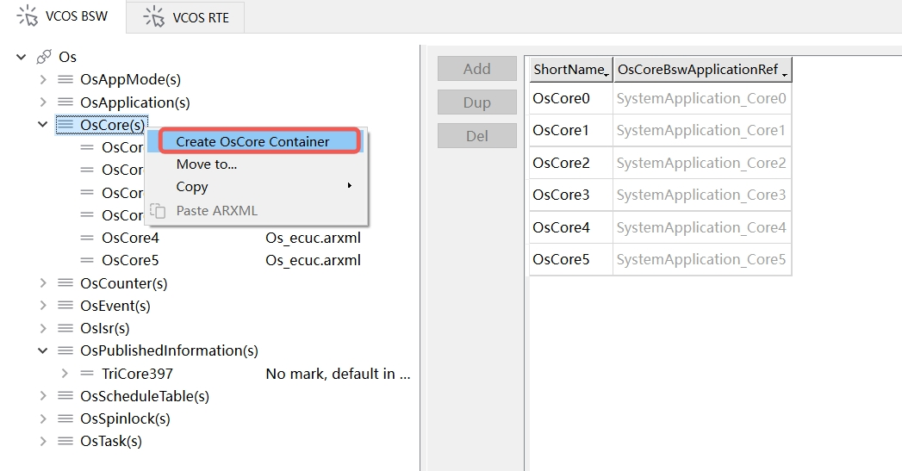  

步骤二：选择OsCore所关联的Application
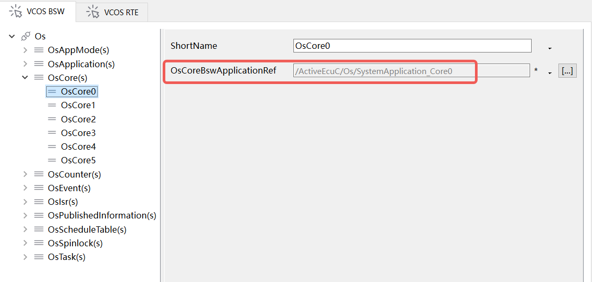

#### 4.1.2. 配置OsApplication
步骤一：在OsApplications处右键点击新增Application容器  
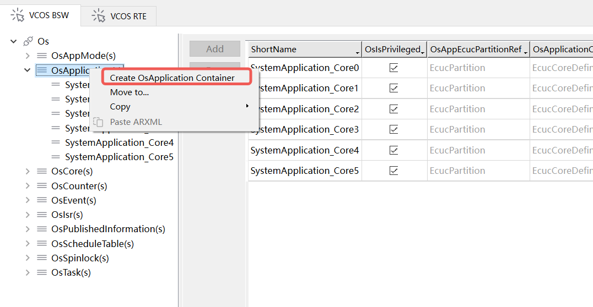  

步骤二：填写OsApplication的名称，配置属性以及关联的内核对象
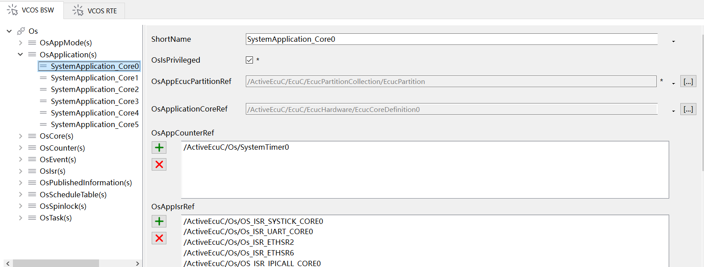 

| **配置项**  | **配置说明** |
| :---------- | :---------- |
| OslsPrivileged       |  Bool类型，勾选上时为特权模式，不勾选时为用户模式。     | 
| OsAppEcucPartitionRef       |  引用类型，用于选择所配置应用的分区，分区新建详细见本章节2.1.10 。    | 
| OsApplicationCoreRef       |  引用类型，用户可选择所配置Os-Application的所关联的Core。     | 

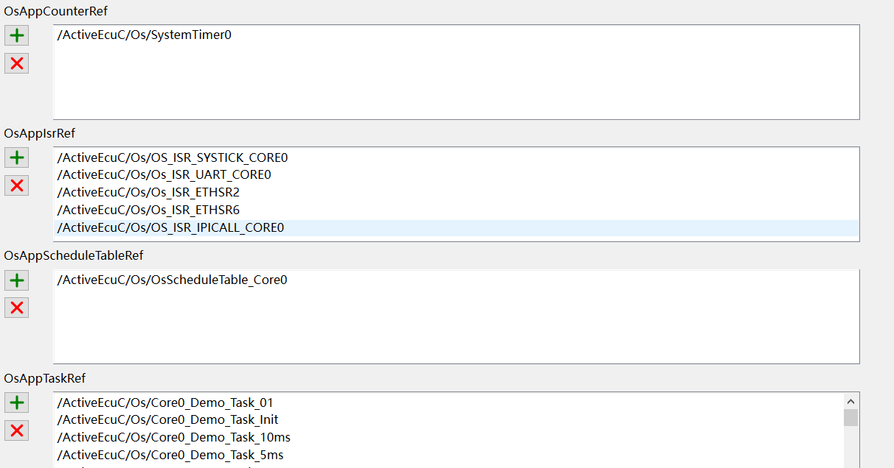 
用户可通过点击对应区域的＋或×按钮按需增加或删除Application关联的OS对象。

#### 4.1.3. 配置OsTask
步骤一：在OsTasks处右键点击新增Task容器
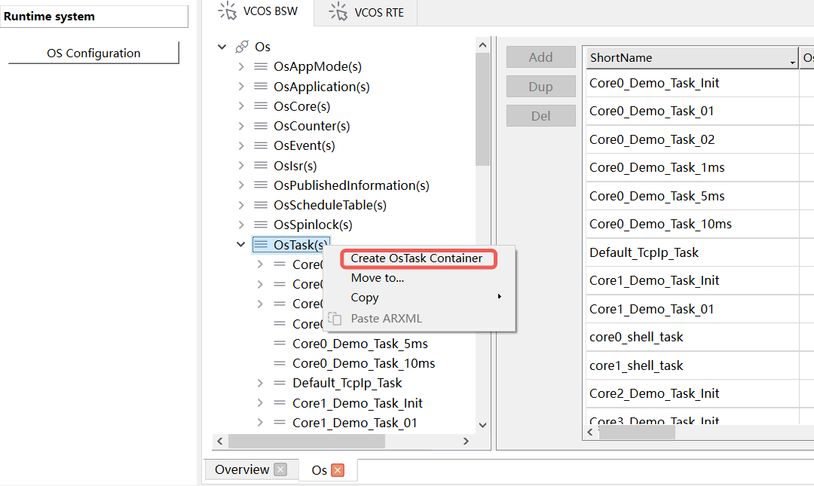

步骤二：填写新增Task配置项的值
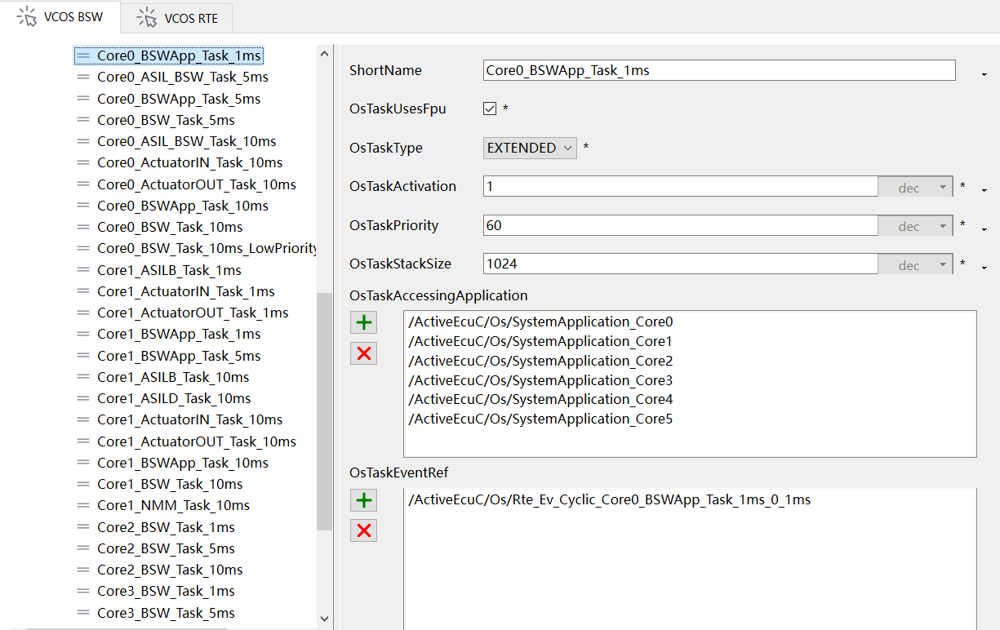

| **配置项**  | **配置说明** |
| :---------- | :---------- |
| ShortName  | Task的名称； | 
| OsTaskUsesFpu  | 当前Task是否要使用浮点运算。对于有单独浮点寄存器的平台需要配置，用于控制任务上下文切换的时候是否要做浮点寄存器保存； | 
| OsTaskSchedule | 枚举类型，选择FULL（可抢占）或NON（不可抢占）； | 
| OsTaskType | 枚举类型，选择EXTENDED（扩展任务）或BASIC（基础任务）； | 
| OsTaskActivation | 整数类型，表示任务允许激活的最大次数； | 
| OsTaskPriority | 整数类型，此为Task优先级大小； | 
| OsTaskStackSize | 整数类型，此为Task栈大小； | 
| OsTaskAccessingApplication | 引用类型，表示此Task可被哪些Application访问，可不填； | 
| OsTaskEventRef | 引用类型，表示此Task绑定哪些Event，可不填； | 

步骤三：在相应Application处引用此新增Task  
Task必须属于一个Application，若没有在相应的Application处引用，则不生成该Task的配置代码；
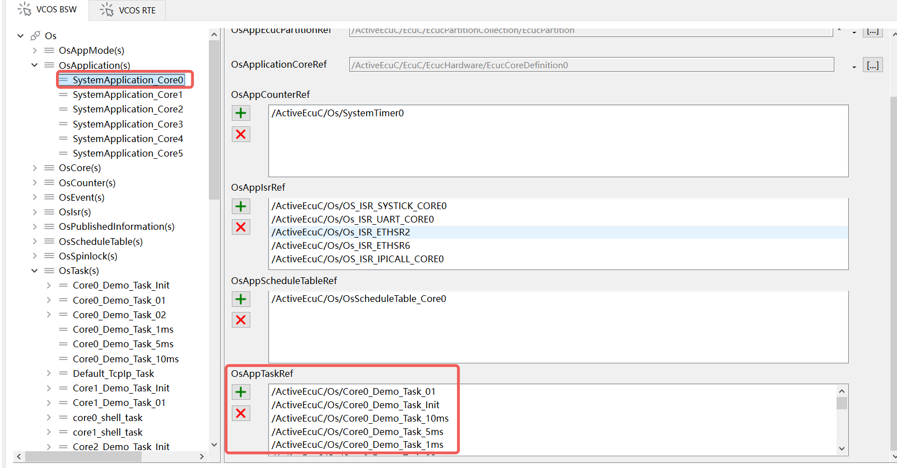

步骤四：设置新增Task为自启动类型  
若有需求需要设置此Task为自启动类型，则在此Task的名字处右键点击新增OsTaskAutoStart容器；
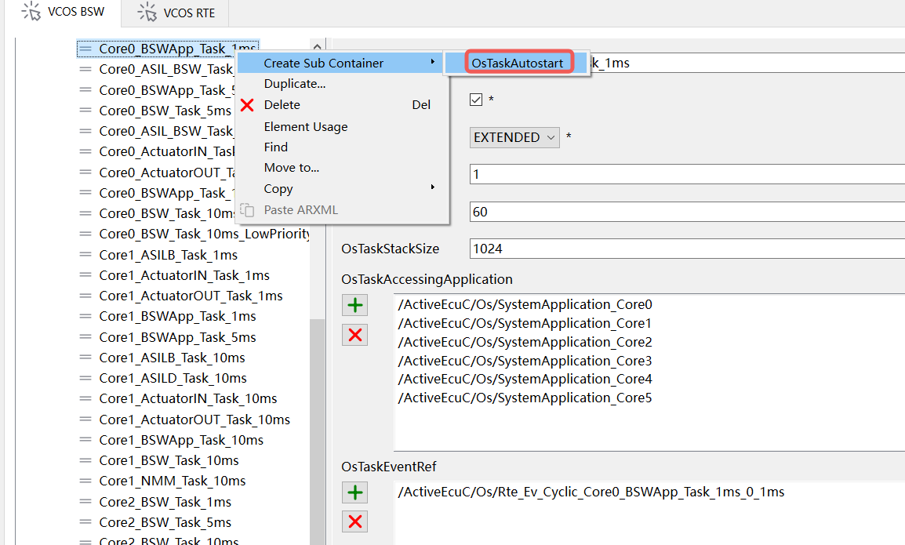
在此容器的配置项OsTaskAppModeRef中引用OSAUTOSTARTMODE类型；
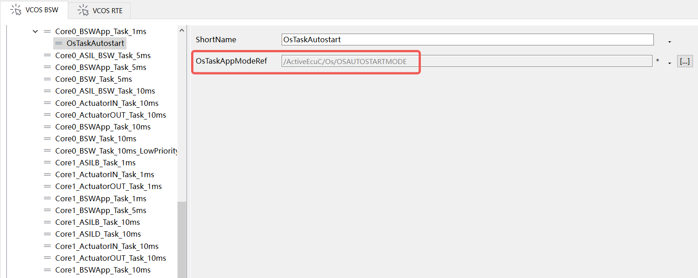

#### 4.1.4. 配置OsEvent
OsEvent支持RTE自动推导刷新和手动添加，用户无需感知自动推导。
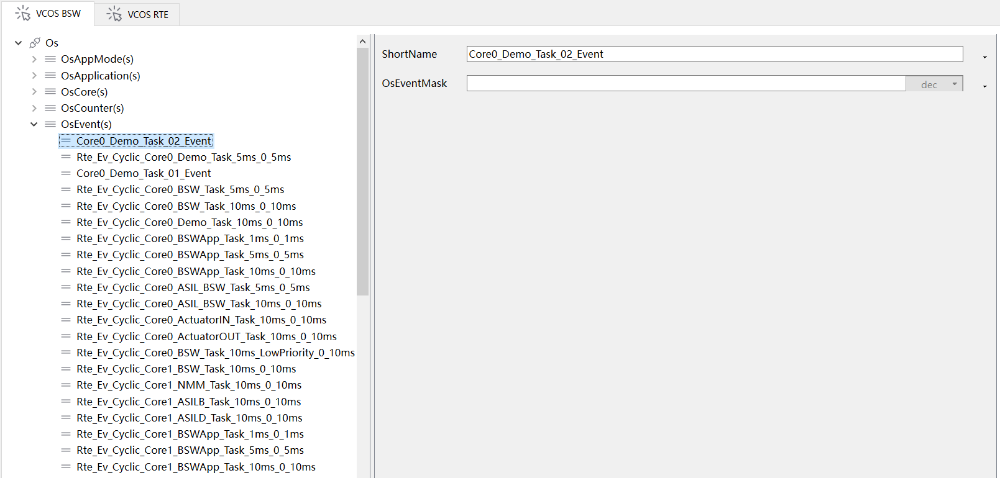

**OsEvent手动添加说明：**  
步骤一：在OsEvents处右键点击新增OsEvent容器
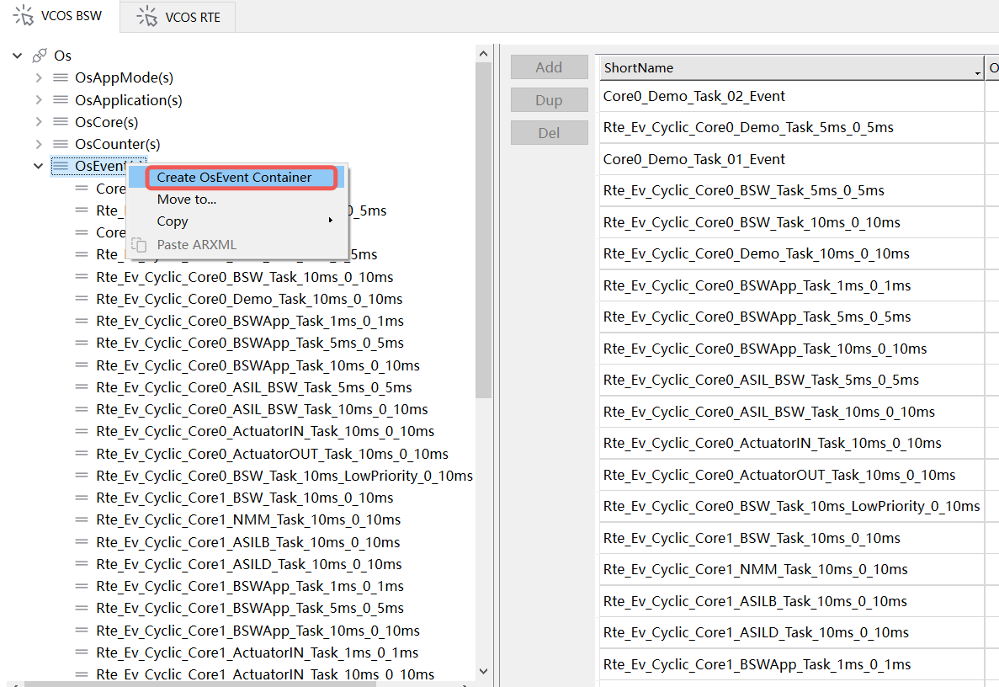

步骤二：填写新增Event配置项的值
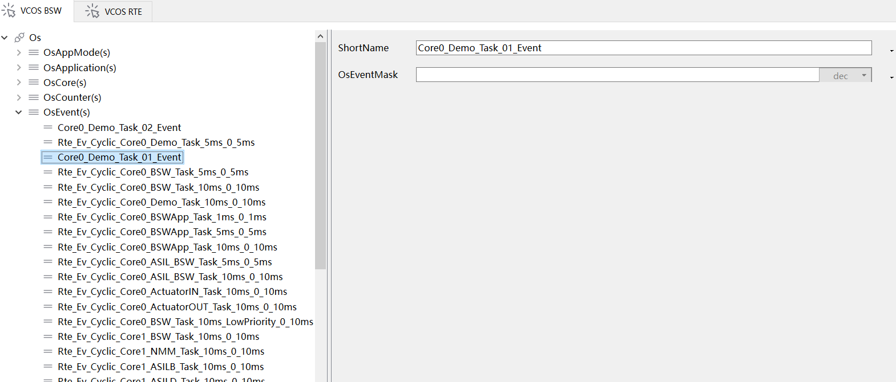  

| **配置项**  | **配置说明** | 
| :---------- | :---------- | 
| ShortName | 默认为根据RTE配置自动生成的Event事件名称 | 
| OsEventMask | 默认为根据RTE配置自动生成的Event事件掩码，用于激活、等待、清除事件 | 
  
步骤三：在需要触发该event的task处引用此新增Event
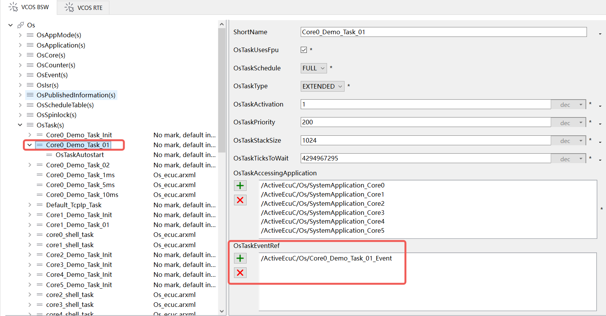

#### 4.1.5. 配置OsIsr 
步骤一：在OsIsr处右键点击新增OsIsr Container容器
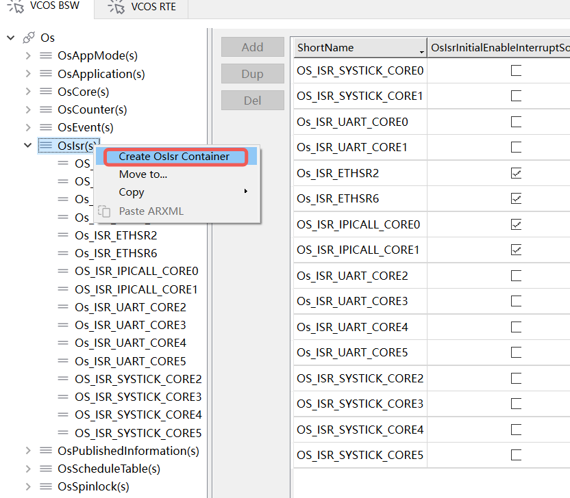

步骤二：配置Isr的属性
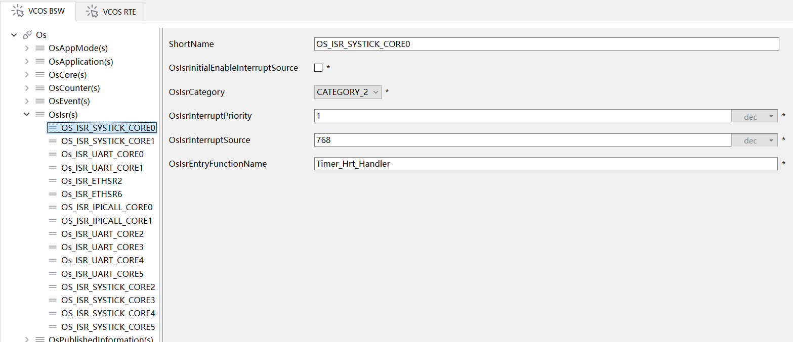

| **配置项**  | **配置说明** | 
| :---------- | :---------- | 
| ShortName  | Isr容器的名称 | 
| OsIsrInitialEnableInterruptSource  | 初始化阶段是否使能此中断 | 
| OsIsrCategory  | 中断类别，包括一类中断（CATEGORY_1），二类中断（CATEGORY_2） | 
| OsIsrInterruptPriority  | 中断优先级，有效值范围需要查询使用的硬件数据手册  | 
| OsIsrEntryFunctionName  | 中断入口函数名称配置 |  
| OsIsrInterruptSource  | 中断号配置，具体的数字需要根据实际使用的中断名称查阅数据手册 | 

步骤三：将所配置的Isr关联到目标OsApplication中
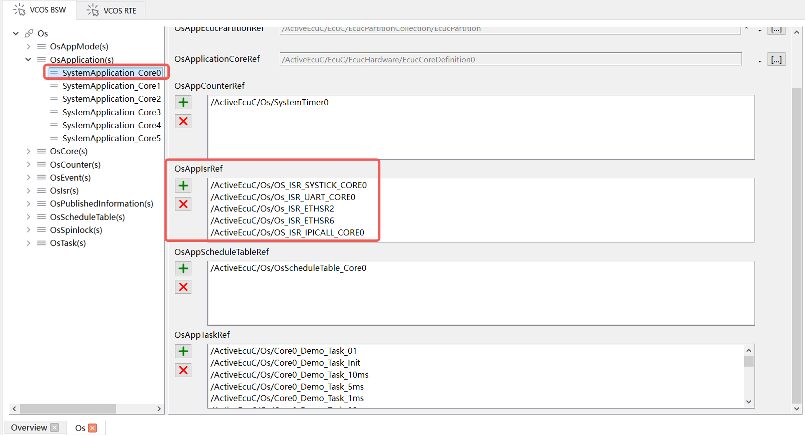

#### 4.1.6. 配置OsSpinlock
步骤一：在OsSpinlock处右键点击新增OsSpinlock容器  
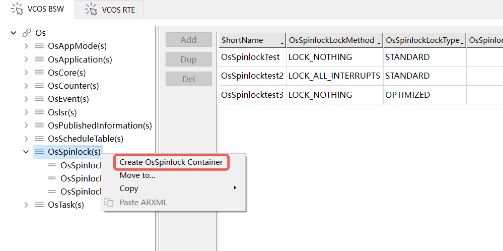

步骤二：配置OsSpinlock属性  
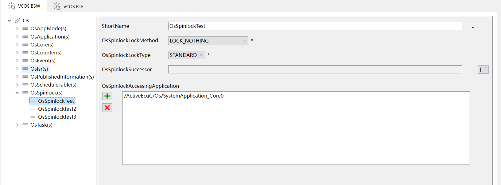


| **配置项**  | **配置说明** | 
| :---------- | :---------- | 
| ShortName | OsSpinlock容器的名称  |  
| OsSpinlockLockMethod | 当前支持三种类型,表明在持有锁期时，需要做的动作，分别为 LOCK_ALL_INTERRUPTS标识关闭所有中断，LOCK_CAT2_INTERRUPTS表示关闭二类中断 ，LOCK_WITH_RES_SCHEDULER表示只关闭Task 调度，LOCK_NOTHING表示不作特殊处理   | 
| OsSpinlockLockType | 锁是否开启检查，STANDARD表示标准模式，每次获取锁都会检查权限，是否会死锁 | 
| OsSpinlockSuccessor | 表明此锁可以直接嵌套的锁, 每个锁最多可配置一个可以嵌套的锁，也可为空 |  

#### 4.1.7. 配置OsCounter
步骤一：在OsCounter处右键点击新增OsCounter容器
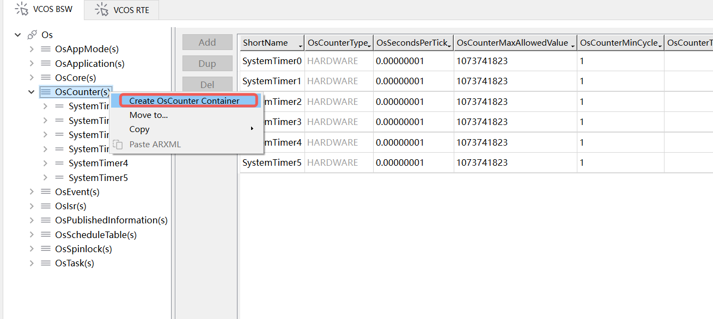

步骤二：配置Counter的属性
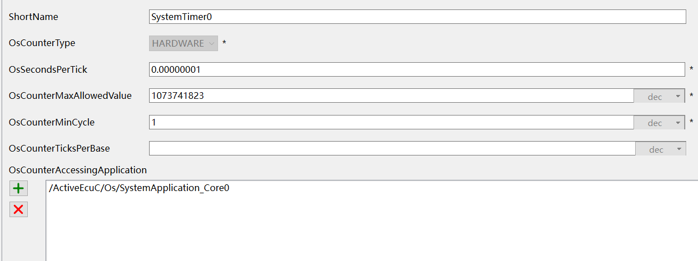

| **配置项**  | **配置说明** | 
| :---------- | :---------- | 
| ShortName | Counter的名称。 | 
| OsCounterType | • 选择Counter的类型，SOFTWARE还是HARDWARE。SOFTWARE对应SW，HARDWARE对应HRT。   <br> • 如果选择HARDWARE，则必须增加OsDriver容器，选择驱动时钟和中断。 | 
| OsSecondsPerTick | • 如果是SW：此配置项没有意义，填什么都可以。<br> • 如果是HRT：此配置项表示硬件时钟多少秒增加一个tick。例如，硬件时钟是100M频率的，则此配置项填0.00000001。如果是HRT，此配置项必须是1/硬件时钟频率(Hz)。 | 
| OsCounterMaxAllowedValue | • 如果是SW：此配置项表示Counter所被允许的最大计数值。例如，要设置成Counter最大计数10，此配置项填10。<br> • 如果是HRT：此配置项表示Counter所被允许的最大计数值，但它与硬件时钟紧密相关。例如，硬件时钟计数寄存器是32位的，则此配置项填1073741823。如果是HRT，此配置项会默认为1073741823。 | 
| OsCounterMinCycle | • 此配置项表示周期性Alarm最小能设置的周期值，一般默认为1即可。 | 
| OsCounterTicksPerBase | • 此配置项没有意义，置灰，不用填。 | 
| OsCounterAccessingApplication | • 此配置项选择可以访问此Counter的Application，如果不选择，默认为只有Counter所属的Application可以访问。 | 

步骤三：配置OsDriver容器  
如果选择HARDWARE类型，则必须创建OsDriver容器。
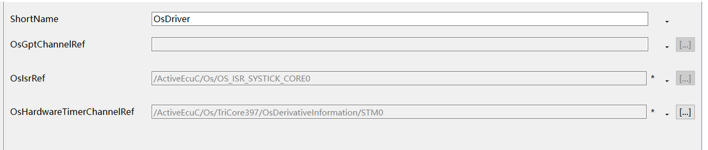

| **配置项**  | **配置说明** | 
| :---------- | :---------- | 
| ShortName | 此为OsDriver容器的名称。 | 
| OsIsrRef | 此配置项选择Isr。一个时钟源对应一个中断源，一个中断源对应一个Isr。 | 
| OsHardwareTimerChannelRef | 此配置项选择时钟源。 | 

#### 4.1.8. 配置OsScheduleTable
步骤一：新增OsScheduleTable容器  
在OsScheduleTable处右键点击新增OsScheduleTable容器：
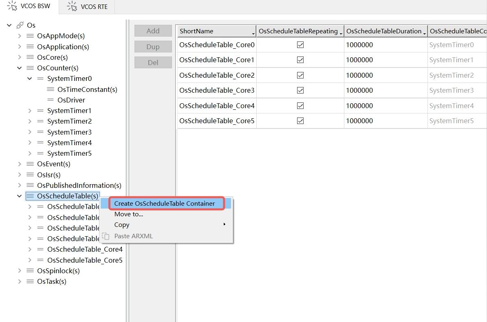


| **配置项**  | **配置说明** | 
| :---------- | :---------- | 
| ShortName | 字符串类型，此为ScheduleTable容器的名称。 |
| OsScheduleTableRepeating | 枚举类型，ScheduleTable是否为周期触发（打√为周期）。 |
| OsScheduleTableDuration | 整数类型，ScheduleTable的周期（以Tick为单位）。 |
| OsScheduleTableCounterRef | 引用类型，表示此ScheduleTable绑定哪一个Counter。 |
| OsSchTblAccessingApplication | 引用类型，表示此ScheduleTable可被哪些Application访问。 |

步骤二：新增OsScheduleTableExpiryPoint容器  
在OsScheduleTableExpiryPoint处右键点击新增OsScheduleTableExpiryPoint容器。
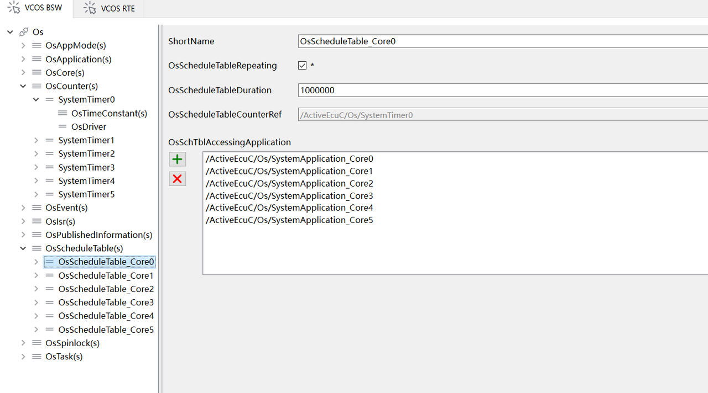
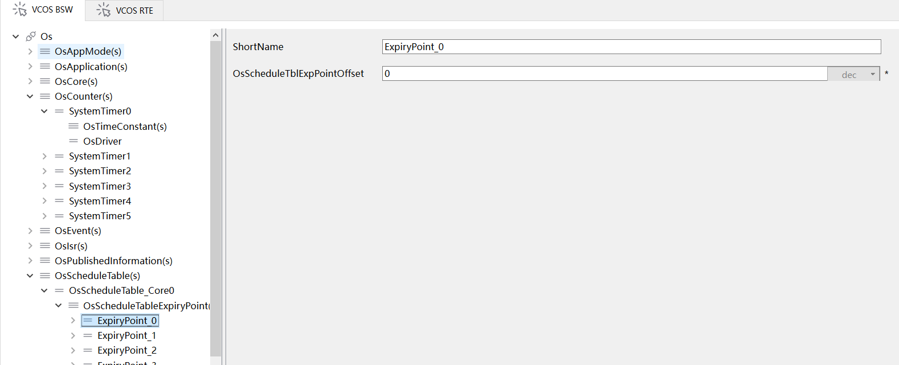

| **配置项**  | **配置说明** | 
| :---------- | :---------- | 
| ShortName | 字符串类型，此为ScheduleTableExoiryPoint容器的名称。 | 
| OsScheduleTblExpPointOffset | 整数类型，ScheduleTable到期点的偏移（以Tick为单位）。 | 


步骤三：新增OsScheduleTableEventSetting容器  
在OsScheduleTableEventSetting处右键点击新增OsScheduleTableEventSetting容器。
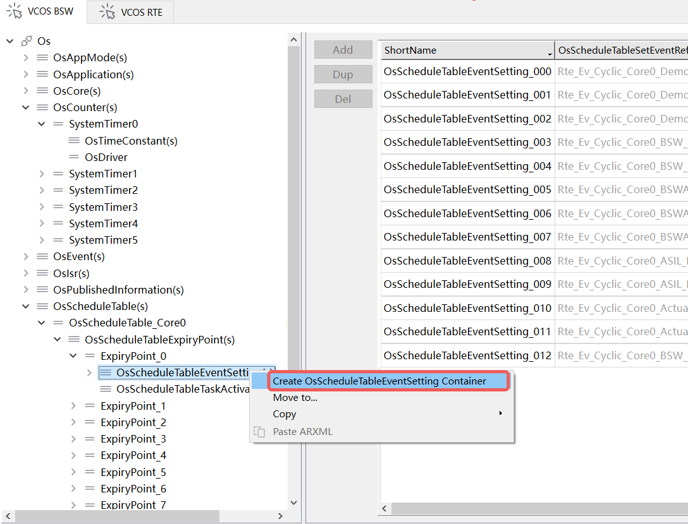
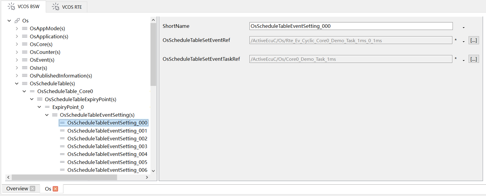

| **配置项**  | **配置说明** | 
| :---------- | :---------- | 
| ShortName | 字符串类型，此为ScheduleTableEventSetting配置的名称。 | 
| OsScheduleTableSetEventRef | 引用类型，表示激活扩展任务的哪一个事件。  | 
| OsScheduleTableSetEventTaskRef | 引用类型，表示激活哪一个扩展任务。  | 

步骤四：新增OsScheduleTableTaskActivation容器  
在OsScheduleTableTaskActivation处右键点击新增OsScheduleTableTaskActivation容器。
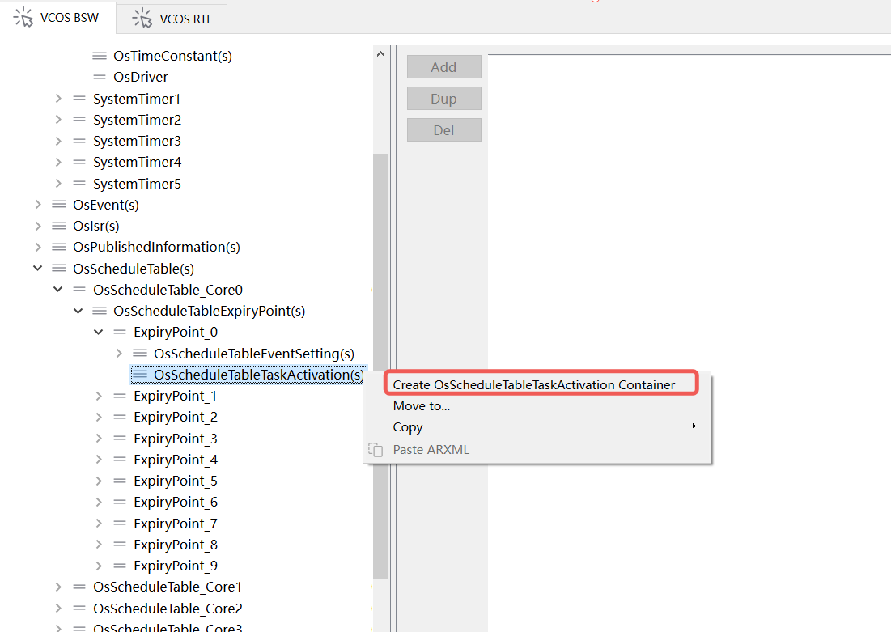
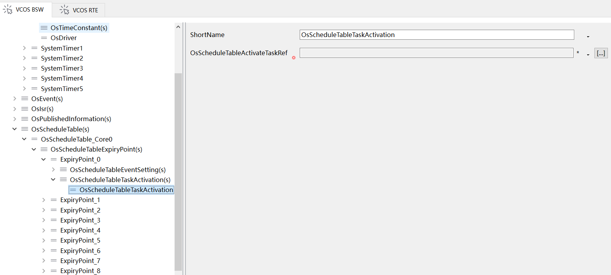

| **配置项**  | **配置说明** | 
| :---------- | :---------- | 
| ShortName | 字符串类型，此为OsScheduleTableTaskActivation配置的名称。 | 
| OsScheduleTableActivateTaskRef | 引用类型，表示激活哪一个任务。 | 

步骤五：新增OsScheduleTblAdjustableExpPoint容器  
在OsScheduleTableExpiryPoint处右键点击新增OsScheduleTblAdjustableExpPoint容器。
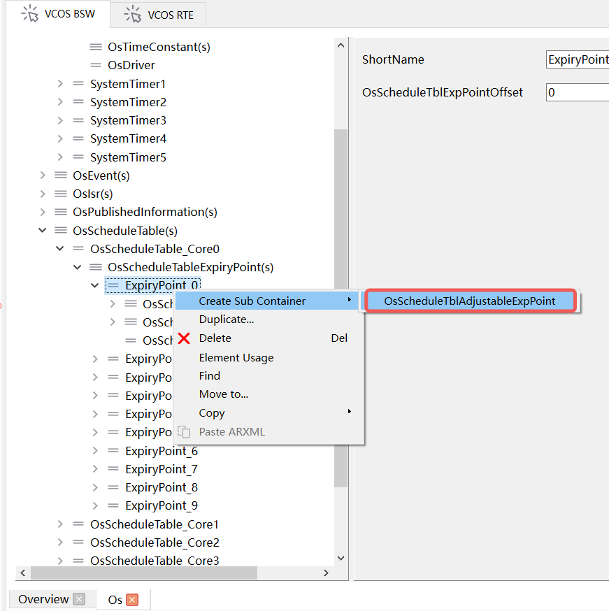
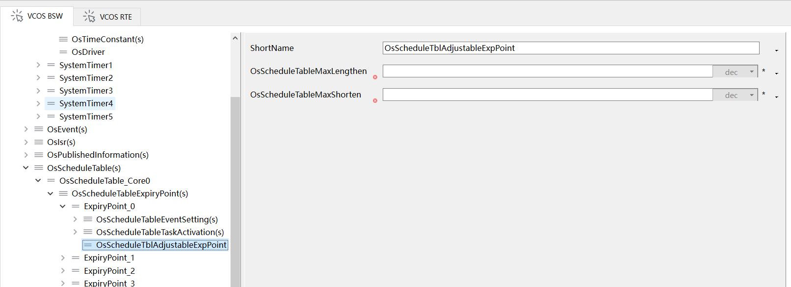

| **配置项**  | **配置说明** | 
| :---------- | :---------- | 
| ShortName | 字符串类型，此为OsScheduleTblAdjustableExpPoint配置的名称。 | 
| OsScheduleTableMaxLengthen | 整数类型，表示到期点最大可以延后的值（以Tick为单位）。 | 
| OsScheduleTableMaxShorten | 整数类型，表示到期点最大可以提前的值（以Tick为单位）。 | 

步骤六：新增OsScheduleTblAutostart容器（可选项）  
在OsScheduleTable处右键点击新增OsScheduleTableAutostart容器。
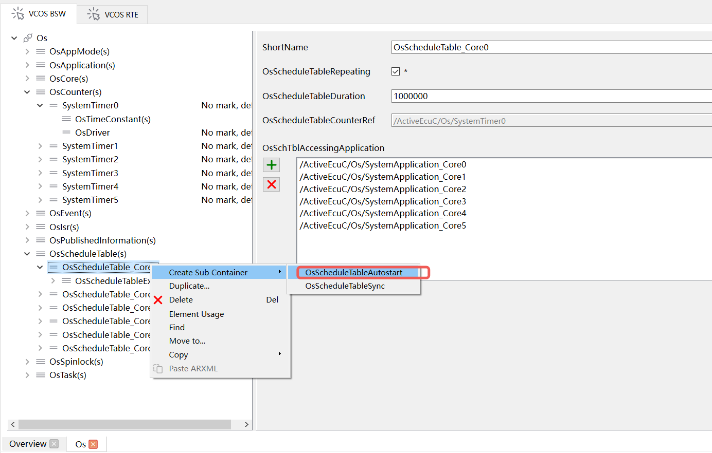
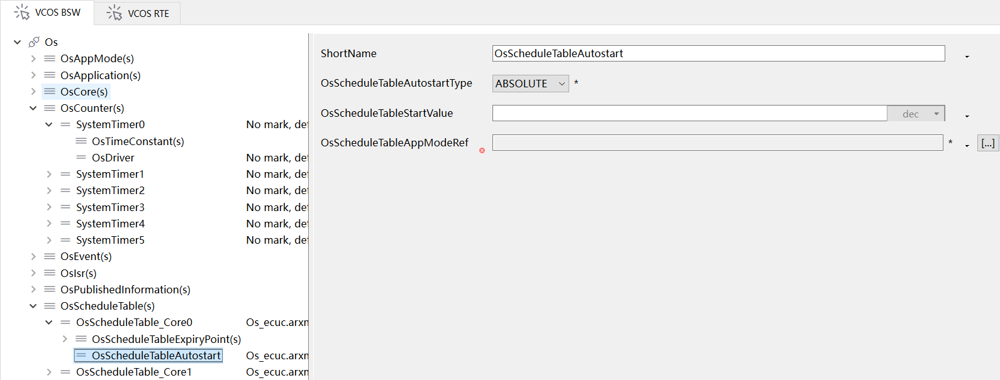

| **配置项**  | **配置说明** | 
| :---------- | :---------- | 
| ShortName | 字符串类型，此为OsScheduleTblAutostart配置的名称。 | 
| OsScheduleTableAutostartType | 枚举类型，ABSOLUTE表示绝对启动，RELATIVE表示相对启动，SYNCHRON表示同步启动。 | 
| OsScheduleTableStartValue | 整数类型，表示调度表启动的时间，用于绝对启动或者相对启动的参数，同步启动不需要该参数（以Tick为单位）。 | 
| OsScheduleTableAppModeRef | 引用类型，OSDEFAULTAPPMODE表示调度表非自启动，OSDEFAULTAPPMODE表示调度表自启动。 | 

步骤七：新增OsScheduleTblSync容器（可选项）  
在OsScheduleTable处右键点击新增OsScheduleTblSync容器。
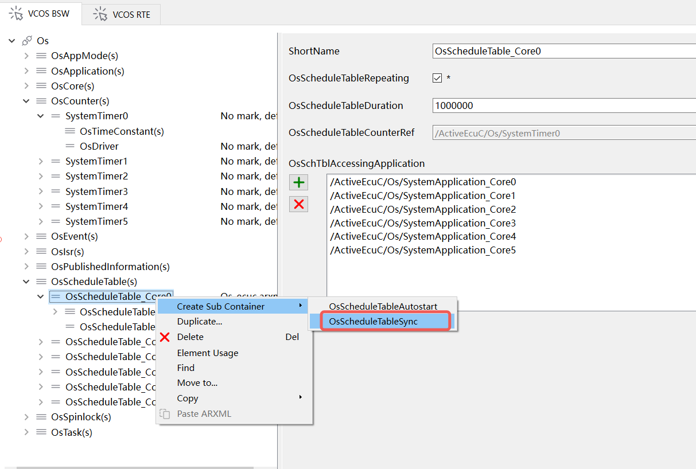
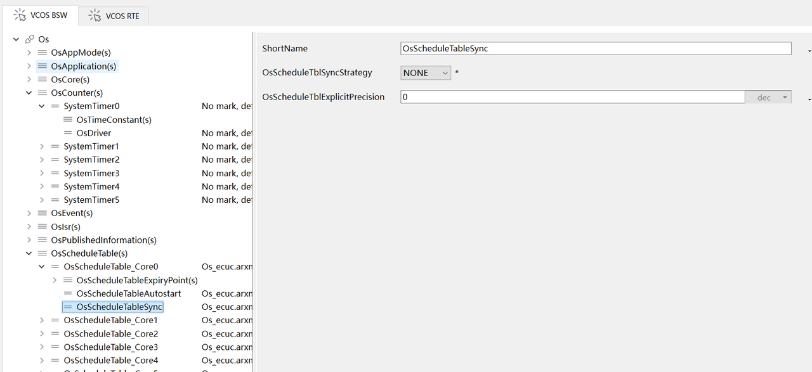

| **配置项**  | **配置说明** | 
| :---------- | :---------- | 
| ShortName | 字符串类型，此为OsScheduleTableSync配置的名称。 | 
| OsScheduleTblSyncStratey | 枚举类型，NONE表示无同步，EXPLICIT表示显式同步，IMPLICIT表示隐式同步。 | 
| OsScheduleTableExplicitPrecision | 整数类型，表示调度表显式同步的精度，默认为0。 | 

#### 4.1.9. 配置OsPublishedInformation
该选项跟随系统释放版本号以及硬件芯片型号，在新建工程时根据参考配置工程添加，不支持用户自定义配置。
 - Infineon A2G_TC397_5V_TFT开发板工程参考配置代码目录在haloosspace/examples/rt_demo/tc397_cfg
 - SemiDrive E3650_DEV_KIT开发板工程参考配置代码目录在haloosspace/examples/rt_demo/e3650_cfg

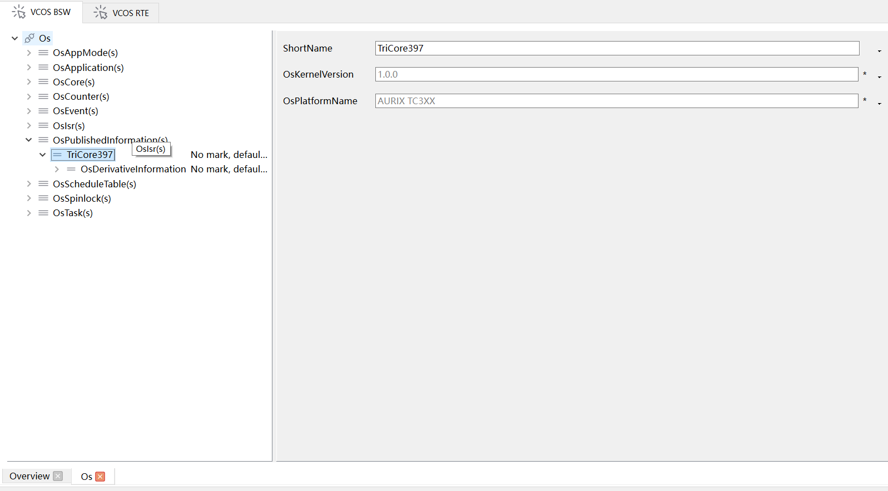

#### 4.1.10. 配置EcuC选项EcucHardware
该选项配置系统实际使用核的逻辑映射关系，在新建工程时默认添加。  
如需添加逻辑核配置：  
步骤一：在EcucCoreDefinition(s)处右键点击新增EcucCoreDefinition容器  
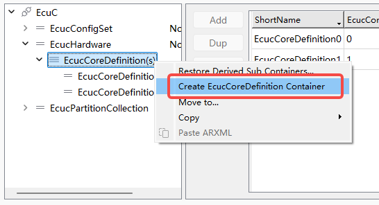

步骤二：配置CoreId与物理核映射  
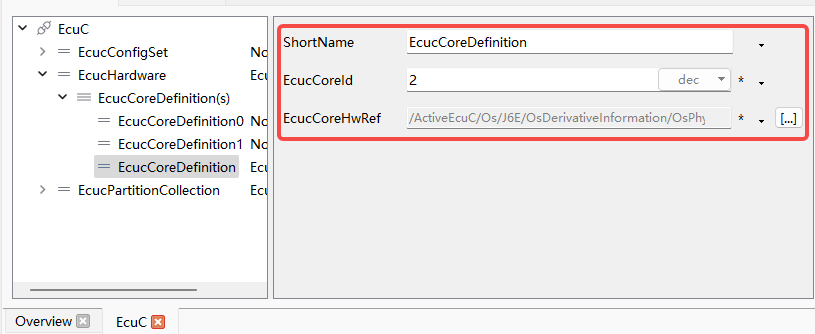  
EcucCoreId即配置的逻辑核Id号，EcucCoreHwRef为对应的物理核引用，点击右侧[...]勾选即可。

## 5. 内核维测命令  
内核维测基于VCOS提供的shell命令来实现，说明以下四个常用命令。

### 5.1. 帮助信息(help)

查看当前镜像支持的维测命令可在shell命令中键入help来查看，如下图所示。

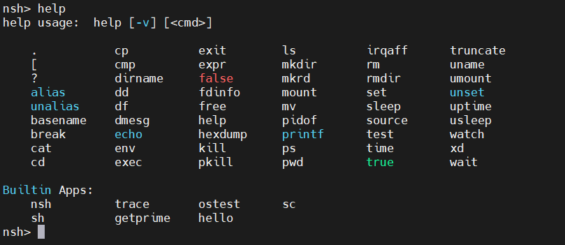

### 5.2. 查看任务状态(ps)

ps 命令是一个内置的 shell 命令，用于查看当前系统中运行的任务状态。

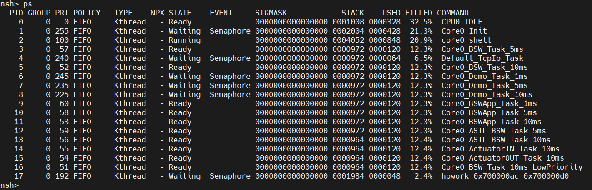

### 5.3. 切换核命令(sc)

因为VCOS内核是多核模式，每一个核上面都有对应的任务信息，借助 sc n (n为core ID，具体根据不同平台core的数量有所不同，从0开始) 命令可以切换到对应核上面查看本核的任务信息。例如借助 sc 1 切换到 Core1 上面进行当前核信息的查看，如下图所示。

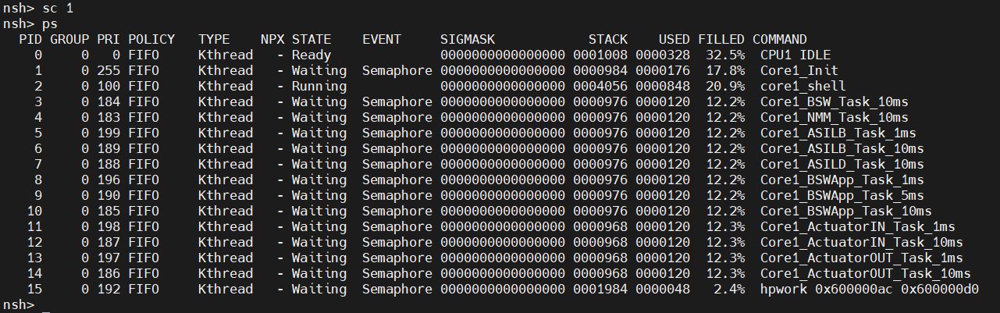

### 5.4. 内核部分测试(ostest)

ostest 命令用于测试内核部分各个模块的功能。

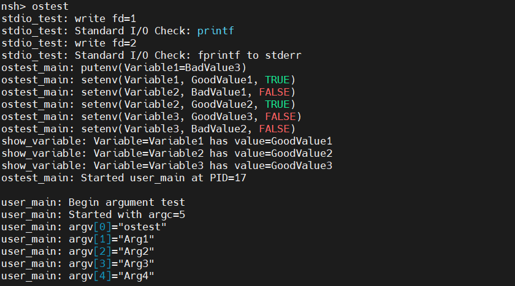

## 6. 配置项参考规范
[OS 配置项参考规范](../../configuration_reference/os_cfg.md)

## 7. 应用接口参考规范
[OS API 参考规范](../../api_reference/os_api.md)
