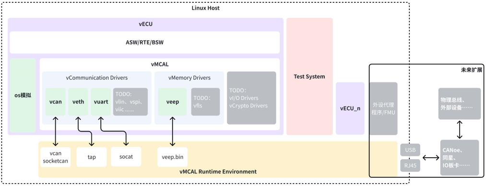
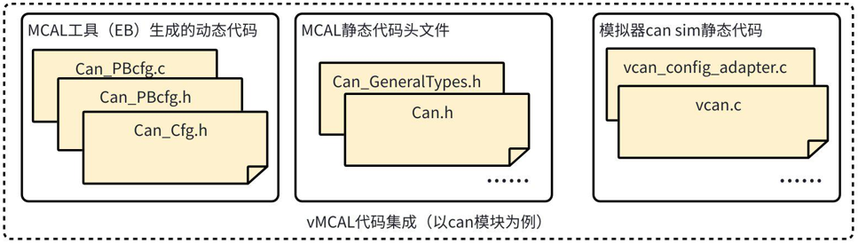

# 模拟器开发者手册

## 1. 简介

传统的汽车电子业务开发高度依赖商用编译器和特定的硬件设备。VCOS操作系统实现了基于Linux的模拟器（Simulator，简称sim），提供了一个虚拟环境来运行和调试软件代码，而无需特殊的物理硬件支持。

模拟器是运行在Linux上的一个可执行程序，通过Linux的系统软件模拟目标平台的CPU及外设，支持上层BSW模块和ASW的正常运行。

模拟器主要由以下两部分组成：

- 内核功能模拟： 模拟OS内核调度、中断等功能
- MCAL功能模拟： 虚拟MCAL（vMCAL）模拟MCAL驱动功能，具体包括以下模块的模拟：
  - can
  - uart
  - eth
  - eep

## 2. 代码目录

- 模拟器内核代码

  `vcos/kernel/nuttx/arch/sim`

  ```plaintext
  sim
  ├── CMakeLists.txt        # 模拟器内核CMake配置文件
  ├── include               # 模拟器内核头文件目录
  ├── Kconfig               # 模拟器内核Kconfig配置文件
  └── src                   # 模拟器内核功能代码目录
  ```

- 模拟器驱动代码（芯片平台无关）

  `vcos/drivers/sim`

  ```plaintext
  sim
  ├── CMakeLists.txt        # 模拟器驱动CMake配置文件
  ├── can                   # 模拟can驱动功能代码目录
  ├── eep                   # 模拟eep驱动功能代码目录
  └── eth                   # 模拟eth驱动功能代码目录
  ```

- 模拟器驱动芯片适配层代码（芯片平台相关）

  - 将芯片特定的MCAL模块初始化参数的数据结构转换为模拟器vMCAL的通用数据结构
  - 完成芯片MCAL中断相关适配
  - 芯片特定API函数名称和参数类型名称适配

  Semidrive芯片：`vcos/vendor/semidrive/chips/sim`

  Infineon芯片：`vcos/vendor/infineon/chips/sim`

  ```plaintext
  sim
  ├── CMakeLists.txt        # 模拟器芯片平台相关CMake配置文件
  ├── driver                # 模拟芯片平台相关驱动代码目录
  │   ├── can               # 模拟芯片平台相关can驱动代码目录
  │   ├── CMakeLists.txt    # 模拟芯片平台相关驱动CMake配置文件
  │   ├── ea                # 模拟芯片平台相关ea驱动代码目录
  │   ├── eep               # 模拟芯片平台相关eep驱动代码目录
  │   └── eth               # 模拟芯片平台相关eth驱动代码目录
  ├── global_inc            # 模拟芯片平台相关全局头文件目录
  ├── include               # 模拟芯片平台相关头文件目录
  ├── Kconfig               # 模拟芯片平台相关Kconfig配置文件
  └── src                   # 模拟芯片平台相关功能代码目录
  ```

## 3. 主要功能说明

### 3.1. 内核功能说明

模拟器内核作为整个模拟系统的核心，在Linux用户空间实现了RTOS的关键功能：通过Linux线程模拟CPU核心实现多核并行，通过协程模拟任务实现轻量级切换，通过信号机制模拟中断处理，高效地实现了调度机制、任务管理和中断处理等关键功能。

支持的功能：

- 任务管理：支持任务创建、删除、挂起、恢复等完整生命周期管理
- 中断处理：模拟中断触发、中断服务程序执行、中断管理等机制
- 上下文切换：模拟任务间的上下文保存与恢复
- 系统时钟：提供系统tick计数和时间管理
- BMP架构模拟：支持多核启动，提供多核执行上下文环境
- 同步原语支持：支持信号量、互斥锁、原子操作等同步原语

不支持的功能：

- 编译器与CPU架构不同：sim运行平台为x86架构，其寄存器位数、数量与目标硬件不同。编译器生成的汇编代码实现方式和代码体积均有差异
- 软件运行速度无法完全一致：虽然调度行为可以模拟，但因Linux系统的CPU频率差异、编译产生的可执行程序与目标板程序差异等因素，不一定能复现高低优先级抢占死锁等行为
- 精确的时序控制：无法模拟目标硬件的精确时钟周期和指令执行时间
- 不支持内存保护

### 3.2. MCAL功能说明

MCAL作为MCU驱动抽象层，主要作用是提供对MCU硬件访问的标准接口。vMCAL在ECU模拟器中实现了与MCAL相同的接口，并模拟对应的驱动功能。通过模拟MCAL模块功能，VCOS操作系统已支持`通信诊断`和`存储`两个功能栈在模拟器中正常运行，支持`TC397`和`E3650`芯片平台。未来将支持更多芯片平台、驱动模块和功能。



vMCAL不生成动态配置代码，而是复用工程中的MCAL动态配置C代码及其依赖的头文件。通过为每个芯片平台编写适配层代码，将特定平台的MCAL配置数据转换为vMCAL通用的数据结构，从而实现vMCAL对不同芯片平台的适配。



#### 3.2.1. sim uart 功能说明

sim uart模块基于虚拟串口设备或标准输入/输出实现uart通信模拟，用于在无物理串口情况下进行串口功能的开发与测试。模拟器优先使用基于socat创建的虚拟串口；若指定的虚拟串口不存在，则回退使用标准输入/输出。

支持的功能：

- 支持串口基本收发操作
  - 支持标准uart字符发送和接收
  - 支持非阻塞I/O操作模式

- 支持多串口实例管理
  - 支持console控制台设备和最多4个串口实例
  - 每个串口实例拥有独立的收发缓冲区

- 支持中断驱动模式
  - 支持基于工作队列的中断模拟机制
  - 支持流控制功能，防止接收缓冲区溢出

- 支持多核环境
  - 支持在多核环境下的独立操作，保证各核心串口操作的隔离性

- 支持调试输出功能
  - 提供up_putc()和up_nputs()接口
  - 无需完整的驱动框架即可使用，支持在系统初始化早期阶段的调试输出

#### 3.2.2. sim can 功能说明

sim can通过Linux内核的vcan模块实现CAN通信模拟。vcan基于SocketCAN框架构建，是一种纯软件的虚拟CAN接口，数据包在内核空间直接传输，无需CAN硬件。但在时序精确性和物理层行为方面，与真实CAN总线存在差异。

支持的功能：

- 支持中断模式下can报文的发送和接收功能
- 支持canfd协议
- 支持报文ID过滤功能
- 支持多个can通道，并支持can通道的多核部署

不支持的功能：

- 波特率设置
- 总线仲裁
- 失败重发机制
- 总线故障检测和处理
- 休眠唤醒
- 轮询模式

> 注意：sim can 的实现需要复用工程中的MCAL动态配置C代码及其依赖的头文件。由于`vcos/vendor/infineon/chips/tc397`目录未集成MCAL代码，因此 sim can 暂不支持TC397芯片。

参考例程：`multicore_com_demo/e3650_dev_kit`，该例程展示了如何在模拟器中实现can通信。

#### 3.2.3. sim eth 功能说明

sim eth是基于Linux tap实现的虚拟化以太网驱动模块，模拟真实以太网控制器行为，主要用于在没有物理网卡的情况下完成网络通信功能的开发、调试及自动化测试。

支持的功能：

- 支持二层以太网数据帧的收发
  - 支持中断模式下进行数据的发送和接收
  - 支持基于多队列优先级的数据收发

- 支持以太网时间同步
  - 以太网时间戳来自于模拟器内核层提供的REALTIME时间
  - 支持以太网包发送和接收时间戳的获取，通过中断回调将时间戳传递给上层

- 支持控制器模式的查询与管理

- 支持MAC地址查询与设置

- 支持数据包统计

不支持的功能：

- 介质无关接口（Media Independent Interface）模式配置与电气特性调整
- 全双工/半双工模式设置
- 校验和硬件卸载

#### 3.2.4. sim eep 功能说明

sim eep是基于Linux文件系统实现的虚拟化EEPROM存储模块，模拟真实EEPROM存储器行为，主要用于在没有物理EEPROM存储器的情况下完成非易失性存储功能的开发、调试及测试。首次运行模拟器时将自动创建veep.bin文件，其大小为32MB，文件内容初始全为0xFF。

支持的功能：

- 支持存储块基本读写操作
  - 支持异步模式下进行数据的读取和写入
  - 支持基于队列任务的多请求串行处理
  - 支持通过相关接口取消当前读写作业

- 支持存储块状态查询与管理
  - 支持通过配置文件设置存储块，包含基地址、大小、优先级、模式等参数
  - 支持通过相关接口设置存储块模式，从而模拟不同速度的EEPROM存储器
  - 支持通过相关接口查询存储块状态

- 支持异步操作回调机制
  - 支持读写操作完成后的回调通知，通过回调函数将操作结果传递给上层

- 支持查询文件内容
  - 基于Linux文件系统模拟EEPROM存储器，支持通过hexdump命令查看文件内容
  - 支持通过内置的veepcmd view命令查看文件内容

## 4. 编译

模拟器支持将目标工程编译为模拟器版本的可执行文件。

编译工具链安装参考[HaloOS工程编译](https://gitee.com/haloos/docs/blob/master/quick_start/02_compiling.md)章节。

以基于E3650芯片平台的rt_demo工程为例，需切换到haloosspace/vcos/build目录，执行以下命令编译生成模拟器镜像文件：

```bash
python vcos_build.py -app_name rt_demo -board_name e3650_dev_kit -compiler gcc -maketool ninja -sim 1 -all
```

## 5. 运行环境配置

下面主要说明sim运行时对Linux侧相关软件的配置要求及使用方法。

### 5.1. 基于Docker运行

Linux系统可使用Docker容器，实现与本地环境的隔离。Docker容器创建参考[HaloOS部署运行流程](https://gitee.com/haloos/docs/blob/master/quick_start/03_running.md)。

> 提示：Docker容器已预配置模拟器运行环境，使用Docker可跳过以下配置步骤

### 5.2. eth配置

1. 运行权限配置

    由于sim eth会对tap设备进行读、写、设置等操作，因此在运行时需要sudo权限，否则会报错。

2. 单域以太网配置

    实现sim eth与其他物理或虚拟网卡的通信，需要通过网桥进行桥接。在使用sim eth时，首先需要在Linux主机上创建虚拟网桥，
    然后在menuconfig中通过`CONFIG_SIM_BRIDGE_NAME`指定网桥名称（默认为br0），sim eth将自动绑定到该网桥。

    假设下位机IP地址为 `192.168.10.71/24` ，想要与上位机IP地址为 `192.168.10.254/24` 的网卡进行通信，Linux网络配置命令参考如下：

    ```bash
    # 创建网桥
    sudo ip link add name br0 type bridge
    sudo ip link set br0 up
    # 配置IP地址
    sudo ip addr add 192.168.10.254/24 dev br0
    # 若ip地址属于某一vlan网段，可增加vlan相关配置
    sudo bridge vlan add dev br0 vid {vlanid} self   # 配置允许通过的vlan，{vlanid}可配置为具体数值
    sudo ip link set dev br0 type bridge vlan_filtering 1  # 启用 VLAN 过滤
    ```

3. 多域组网以太网配置

    支持在同一Linux主机上运行多个模拟器实例，实现多域网络通信的仿真。每个模拟器实例需配置不同的网络参数：

    - 协议栈IP地址：每个域在组网内应具有独立的IP地址，IP地址配置方法详见[以太协议栈开发者手册](../components/ethernet_user_manual.md)
    - 网桥配置：各控制器的tap均绑定同一网桥即可

### 5.3. can配置

vcan 的接口名字（ifname）需要遵循`vcan{CanControllerId}`命名规则，当工程配置了 N 个 can 控制器， CanControllerId 从0开始，则 vcan 的 ifname 分别为`vcan0`, `vcan1`, ..., `vcanN-1`，这些vcan接口需要在运行模拟器的环境中按如下方法创建。

```bash
# 1. 加载Linux vcan模块
modprobe vcan

# 2. 根据配置的can控制器，依次创建所有的vcan接口
ip link add {ifname} type vcan

# 3. 依次启动所有的vcan接口
ip link set {ifname} up

# 4. 查看vcan接口状态
ifconfig | grep vcan
```

### 5.4. uart配置

1. 基于socat创建虚拟串口对`/dev/vttyS0`、`/dev/vttyM0`，其中`/dev/vttyS0`由模拟器持有，`/dev/vttyM0`由测试系统或用户持有

    ```bash
    socat -d -d PTY,link=/dev/vttyS0,raw,echo=0 PTY,link=/dev/vttyM0,raw,echo=0 &
    ```

2. 通过`CONFIG_SIM_UART0_NAME`将uart端口绑定为创建的`/dev/vttyS0`。

### 5.5. eep配置

sim eep驱动程序会自动创建veep.bin文件模拟EEPROM存储器，无需其他特殊配置。

## 6. 开发工具介绍

### 6.1. 调试工具

#### 6.1.1. GDB命令行调试

sim支持GDB调试，用户可直接在命令行中使用GDB作为调试工具，常用调试命令如下：

```bash
# 1. 启动gdb
gdb ./sim.elf

# 2. 设置初始断点
(gdb) break nsh_main
(gdb) break nx_start

# 3. 运行程序
(gdb) run

# 4. 程序停在断点，查看变量
(gdb) print g_nsh_vtbl
(gdb) info locals

# 5. 单步调试
(gdb) next
(gdb) step

# 6. 查看调用栈
(gdb) bt
```

#### 6.1.2. VSCode图形化调试

相比命令行GDB，VSCode提供了图形界面，尤其对于不熟悉GDB命令的用户，提供了更友好的调试体验。但某些高级功能仍然需要通过调试控制台直接执行GDB命令，建议根据实际需求选择合适的调试方式。在VSCode中通过GDB运行的使用方式如下：

1. 安装 C/C++ 插件

2. 配置launch.json，下文提供了一段可用的launch.json供参考

    ```json
    {
        "version": "0.2.0",
        "configurations": [
            {
                "name": "(gdb) 启动",
                "type": "cppdbg",
                "request": "launch",
                // 可依据实际情况修改可执行文件的路径
                "program": "${workspaceFolder}/output/sim.elf",
                "args": [],
                "stopAtEntry": false,
                "cwd": "${workspaceFolder}",
                "environment": [],
                "externalConsole": false,
                "MIMode": "gdb",
                "setupCommands": [
                    {
                        "description": "为 gdb 启用整齐打印",
                        "text": "-enable-pretty-printing",
                        "ignoreFailures": true
                    },
                    {
                        "description": "Ignore SIGUSR1",
                        "text": "handle SIGUSR1 nostop noprint pass",
                        "ignoreFailures": true
                    }
                ]
            }
        ]
    }
    ```

3. 启动VSCode debug

### 6.2. eth工具

#### 6.2.1. 报文在线观测工具

模拟器相关程序运行在Linux端，利用Linux下的wireshark工具即可完成eth报文的在线观测和分析。wireshark下载方式如下：

```bash
sudo apt update
sudo apt install wireshark
# 权限配置
sudo usermod -aG wireshark $USER
```

#### 6.2.2. 上位机发包工具

- ICMP包

    Linux支持ping命令，可基于ping实现上位机和模拟器的报文交互

    ```bash
    # 向目标 IP 发送 4 个 ICMP Echo 请求
    ping -c 4 192.168.10.71

    # 指定发送间隔（秒）和包大小（字节）
    ping -i 0.5 -s 1000 192.168.10.71
    ```

- ARP包

    ```bash
     arping -I eth0 192.168.1.1  # -I 指定网卡
    ```

- TCP/UDP包
  - 方式一：netcat

      使用netcat可完成TCP/UDP数据的收发

      ```bash
      sudo apt install netcat

      # 发送 UDP 数据到目标端口
      echo "Hello, UDP!" | nc -u 192.168.10.71 13800  # -u 表示 UDP 模式
      ```

  - 方式二：mNetAssist

      mNetAssist（类似Windows下的NetAssist）支持UI界面，用户可自行下载软件安装包。该工具依赖Qt4相关库，由于Qt4框架已在多个主流Linux发行版的最新版本中移除，安装时可能会遇到相关库不存在的报错，可通过以下命令手动安装该库

      ```bash
      mkdir ~/qt4-manual && cd ~/qt4-manual
      wget http://archive.ubuntu.com/ubuntu/pool/universe/q/qt4-x11/libqtcore4_4.8.7+dfsg-7ubuntu1_amd64.deb
      wget http://archive.ubuntu.com/ubuntu/pool/universe/q/qt4-x11/libqtgui4_4.8.7+dfsg-7ubuntu1_amd64.deb
      wget http://archive.ubuntu.com/ubuntu/pool/universe/q/qt4-x11/libqt4-network_4.8.7+dfsg-7ubuntu1_amd64.deb
      sudo dpkg -i *.deb
      sudo apt --fix-broken install
      ```

#### 6.2.3. 性能分析工具

Linux提供iperf3工具，可用于收发包流量统计，使用方式与windows中的iperf相同，其下载方式如下：

```bash
sudo apt update
sudo apt install iperf3
```

### 6.3. can工具

模拟器程序运行在Linux端，利用Linux下can-utils的cansend和candump工具即可完成can报文的在线观测和分析。

- 安装方式：

    ```bash
    sudo apt update
    sudo apt install can-utils
    ```

- cansend发送can报文使用方式介绍：

    ```bash
    #  can 2.0 命令格式
    cansend <接口名> <CAN_ID>#<数据>

    #  canfd 命令格式
    cansend <接口名> <CAN_ID>##<DLC><数据>

    # 示例： 向vcan0发送id为0x123的can报文
    cansend vcan0 123#112233445566

    # 示例： 向vcan0发送id为0x123的canfd报文
    cansend vcan0 123##8112233445566
    ```

- candump观测can报文使用方式介绍：

    ```bash
    # 命令格式
    candump [选项] <接口名>
    -t <类型>    # 时间戳格式：a(绝对时间) / d(间隔) / z(从0开始)
    -H          # 使用硬件时间戳（非系统时间戳）
    -c          # 彩色输出
    -l          # 日志模式（保存为 SocketCAN 紧凑格式）
    -i          # 二进制输出

    # 示例： 监听vcan0接口的报文
    candump vcan0

    # 示例： 监听多个vcan接口的报文
    candump vcan0 vcan1 vcan2

    # 示例：监听所有vcan接口的报文，并显示绝对时间戳
    candump -ta any

    # 示例：监听vcan2接口ID为0x123的报文
    candump vcan2,123:7FF

    ```

### 6.4. uart工具

Minicom是一款基于终端的串口调试工具，其核心功能是提供文本终端界面，实现双向数据传输，下载方式如下：

```bash
sudo apt update
sudo apt install minicom
```

使用时，模拟器打开/dev/vttyS0作为串口设备并进行数据读写，用minicom工具打开/dev/vttyM0，即可实现串口的交互。这是一种常见的虚拟串口对的使用模式：一个设备用于模拟器内部（模拟的硬件使用），另一个设备暴露给主机，用户可以使用任何串口工具（如minicom）连接到它，就像连接到一个真实的串口设备一样。

```bash
# 打开/dev/vttyM0
sudo minicom -D /dev/vttyM0 -b 115200

# 常用快捷键：
Ctrl+A → Z   # 查看功能帮助菜单
Ctrl+A → Q   # 退出不保存
Ctrl+A → C   # 清除屏幕
Ctrl+A → L   # 开始/停止日志记录
```

### 6.5. eep工具

#### 6.5.1. hexdump

sim eep通过在宿主机创建veep.bin文件模拟EEPROM存储器，因此，可以通过Linux系统中的二进制文件查看工具**hexdump**来查看、分析该文件，常用查看命令如下

```bash
# 最常用的格式，左边显示十六进制，右边显示ASCII字符
hexdump -C veep.bin

# 输出示例：
00000000  48 65 6c 6c 6f 20 57 6f  72 6c 64 21 0a 00 00 00  |Hello World!....|
00000010  01 02 03 04 05 06 07 08  09 0a 0b 0c 0d 0e 0f 10  |................|

# 长度控制选项 -n（指定字节数） -s（跳过字节数）
hexdump -C -s 0x100 -n 64 veep.bin
```

#### 6.5.2. veepcmd view命令

sim eep模块中开发了veepcmd view命令用于查看存储文件内容，其功能类似于hexdump。模拟器运行时可在当前终端或串口中输入 **veepcmd view -h** 来查询具体使用方法。

## 7. 配置项参考规范

sim 是模拟真实工程，无配置项，直接参考其他模块的配置参数即可。

## 8. 应用接口参考规范

sim 是模拟真实工程，对外API与真实驱动接口一致，直接参考真实驱动的API接口。
