# 实时性分析工具开发者手册

## 1.简介

实时性分析工具由[理想汽车](https://www.lixiang.com/)开发，使用Python语言实现，旨在进行实时性能分析。该工具支持多种硬件接口协议，包括以太网，能够与理想汽车的VCOS系统通过高性能报文格式进行通信，支持控制命令的交互和二进制报文收集。

通过一系列数据处理，工具可以将收集的原始报文bin文件转换为[Perfetto](https://perfetto.dev/)原生支持的pftrace格式。这些格式的文件可在[Perfetto UI](https://ui.perfetto.dev/)中进行可视化展示。此外，该工具提供了多种用于指标计算的API，方便用户使用。

使用此工具，用户能够轻松收集trace数据并进行实时性分析，以快速识别和解决性能问题。典型应用场景包括解决抖动问题，定位执行时间过长的Runnable和Task等。

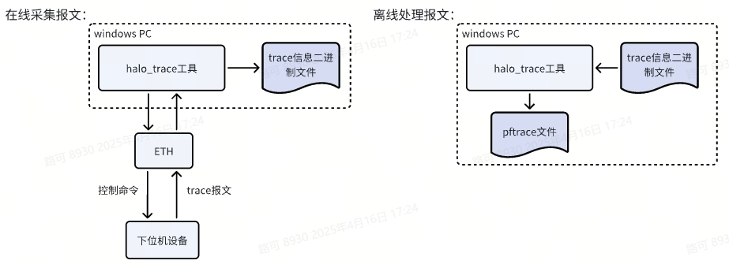

## 2.代码目录

tools_halo_trace源代码在haloosspace/tools/halo_trace目录下，目录结构如下所示：

```plaintext
halo_trace
├── README.md               # tools_halo_trace仓库的readme，要讲解该代码仓库的介绍
├── ftrace_manager.py       # ftrace文本生成和解析
├── perfetto_trace_pb2.py   # 由protoc生成，关于protobuf数据的python接口
├── pftrace_manager.py      # 根据VCOS trace报文，生成protobuf数据文件
├── trace_data.py           # 定义trace相关的数据类
├── trace_parser.py         # 定义trace报文解析方法
├── trace_processor.py      # trace工具的执行入口文件
├── trace_util.py           # 定义trace的通用方法和API
└── utils.py                # 定义非trace的通用方法
```

## 3. 主要功能描述

### 3.1.功能讲解

#### 3.1.1.可视化展示

本工具可将收集上的原始报文bin文件转换为[Perfetto](https://perfetto.dev/)原生支持的pftrace格式文件，并可通过[Perfetto UI](https://ui.perfetto.dev/)进行可视化展示，具体操作可见本文第4章。

下面主要讲解展示形式。

##### 3.1.1.1. 三层级树型UI结构

支持三层树形轨迹结构显示，第一层为设备层，第二层为内核层，第三层为：task/ISR/function/spinlock/resource/临界区

1. 设备名称，<device_name>，示例：TC397。
2. 内核名称，<core_name>，示例：Core0。
3. task轨迹名称，<device_name>\_<core_name>\_<task_name>，示例：TC397_Core0_BSW_Task_10ms。
4. ISR轨迹名称，<device_name>\_ISR\_<isr_id>\_core<core_id>，示例：TC397_ISR_1_core1。

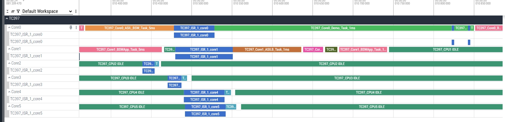

##### 3.1.1.2. 事件链展示

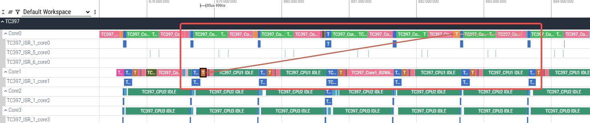

##### 3.1.1.3. Task状态展示

在内核轨迹上，会显示该内核中的 task 和 ISR 的运行情况。
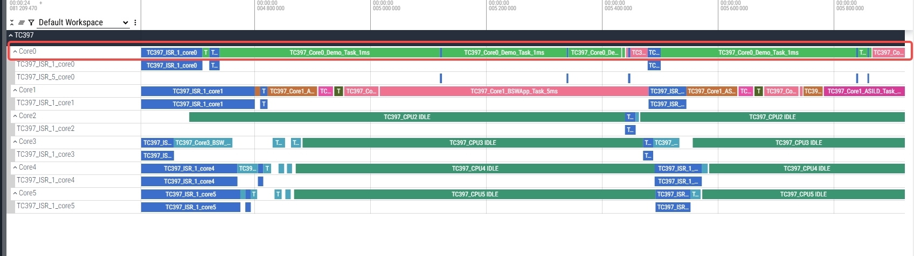

##### 3.1.1.4. 多种轨迹类型展示

1.Task轨迹

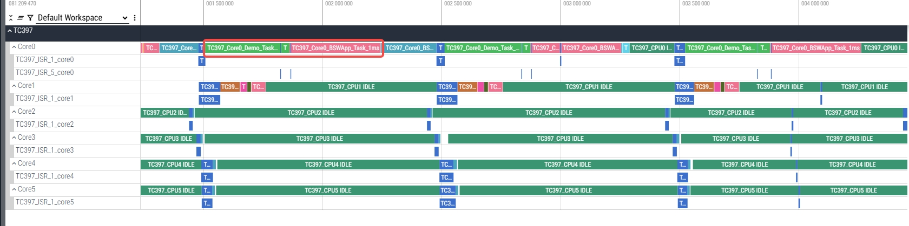

2.ISR轨迹

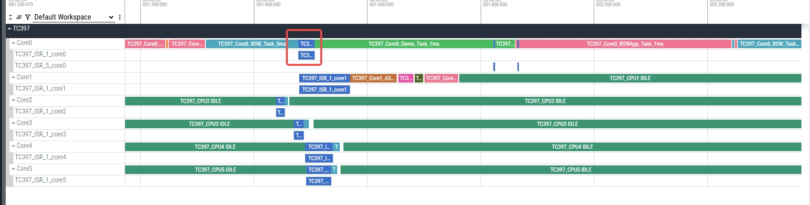

##### 3.1.1.5. 抢占功能展示

ISR 运行时，可以显示被其他 ISR 抢占的情况。
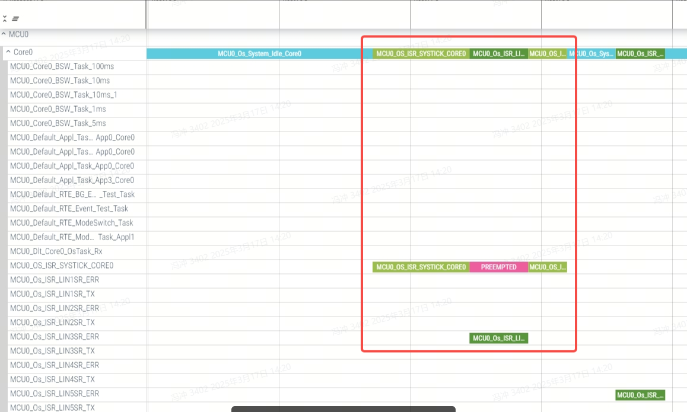

#### 3.1.2. 统计指标计算API接口

##### 3.1.2.1. 基于 bin 数据的 API

1. **Task统计指标计算API**

- **函数名**：
  def **trace_get_task_statistics** (data_dir: str, input_task_dict: Dict[str, list]) -> (res, ret_task_dict)
- **功能**：
  从 trace 数据中获取 task 信息
  
  - 包括指定 task 的 CET（最大、最小、平均）、周期 DT（最大、最小、平均）、GET（最大、最小、平均）、CET 列表。
  - 若指定 CET 或周期 DT 的时间阈值，则当超过指定的时间阈值时，输出对应异常处的时间戳。
- **输入参数**：
  data_dir：trace 脚本生成的数据目录路径
  input_task_dict：需要解析的 task 
  
  - Key 为需要解析的 task name，若 input_task_dict 为空则解析所有 task。
  - Value 为一个长度为 2 的 list，索引 0 和 1 分别表示对应 task 的 CET 阈值和 DT 阈值，若无阈值则对应索引处为 None。
- **返回值**：
  res：bool 值，True 表示解析成功，False 表示解析失败
  ret_task_dict：若解析失败则为 None
  ```
  // 时间单位均为 ns
  {
      <task_name>:
      {
          "get_avg": xx,        # GET 平均值
          "get_max": xx,        # GET 最大值
          "get_min": xx,        # GET 最小值
          "cet_avg": xx,        # CET 平均值
          "cet_max": xx,        # CET 最大值
          "cet_min": xx,        # CET 最小值
          "cet_list": [],       # CET 列表
          "cet_timestamp": [],  # CET超出阈值的时间点
          "dt_avg": xx,         # DT 平均值
          "dt_max": xx,         # DT 最大值
          "dt_min": xx,         # DT 最小值
          "dt_timestamp": [],   # DT超出阈值的时间点
      }
      ......
  }
  ```

2. **ISR统计指标计算API**

- **函数名**：
  def **trace_get_irq_statistics** (data_dir: str, input_irq_dict: Dict[str, list]) -> (res, ret_irq_dict)
- **功能**：
  从 trace 数据中获取 ISR 信息
  - 包括指定 ISR 的 CET（最大、最小、平均）、周期 DT（最大、最小、平均）、GET（最大、最小、平均）、CET 列表。
  - 若指定 CET 或周期 DT 的时间阈值，则当超过指定的时间阈值时，输出对应异常处的时间戳。
- **输入参数**：
  data_dir：trace 脚本生成的数据目录路径
  input_irq_dict：需要解析的 ISR
  
  - Key 为需要解析的 ISR name，若 input_irq_dict 为空则解析所有 ISR。
  - Value 为一个长度为 2 的 list，索引 0 和 1 分别表示对应 ISR 的 CET 阈值和 DT 阈值，若无阈值则对应索引处为 None。
- **返回值**：
  res：bool 值，True 表示解析成功，False 表示解析失败
  ret_irq_dict：若解析失败则为 None
  ```
  // 时间单位均为 ns
  {
      <isr_name>:
      {
          "get_avg": xx,        # GET 平均值
          "get_max": xx,        # GET 最大值
          "get_min": xx,        # GET 最小值
          "cet_avg": xx,        # CET 平均值
          "cet_max": xx,        # CET 最大值
          "cet_min": xx,        # CET 最小值
          "cet_list": [],       # CET 列表
          "cet_timestamp": [],  # CET超出阈值的时间点
          "dt_avg": xx,         # DT 平均值
          "dt_max": xx,         # DT 最大值
          "dt_min": xx,         # DT 最小值
          "dt_timestamp": [],   # DT超出阈值的时间点
      }
      ......
  }
  ```

3. **事件链统计指标计算API**

- **函数名**：
  def **trace_get_chain_statistics**(data_dir: str, event_chain_conf_path: str) -> (res, ret_dict)
- **功能**：
  从 trace 数据中获取事件链执行时间的统计信息
- **输入参数**：
  data_dir：trace 脚本生成的数据目录路径
  event_chain_conf_path：事件链定义文件的路径
- **返回值**：
  res：bool 值，True 表示解析成功，False 表示解析失败
  ret_irq_dict：若解析失败则为 None
  ```
  // 时间单位均为 ns
  {
      <事件链索引>:
      {
          "avg_time": xx,        # 平均执行时间
          "max_time": xx,        # 最大执行时间
          "min_time": xx,        # 最小执行时间
          "variance": xx,        # 方差
          "max_timestamp": xxx,  # 最大执行时间的时间戳
          "min_timestamp": xxx   # 最小执行时间的时间戳
      }
      ......
  }
  ```

##### 3.1.2.2.基于 ftrace 文本的 API

1. **Task统计指标计算API**

- **函数名**：

  def **get_ftrace_task_info **(ftrace_path: str, input_task_dict: Dict[str, list]) -> (res, ret_task_dict)

- **功能**：

  从 ftrace 文本中获取 task 信息

  - 包括指定 task 的 CET（最大、平均）、周期 DT（最大、最小、平均、所有数值）。
  - 若指定 CET 或周期 DT 的时间阈值，则当超过指定的时间阈值时，输出对应异常处的时间戳。

- **输入参数**：

  ftrace_path：ftrace 日志文件路径

  input_task_dict：需要解析的 task 

  - Key 为需要解析的 task name，若 input_task_dict 为空则解析所有 task。
  - Value 为一个长度为 2 的 list，索引 0 和 1 分别表示对应 task 的 CET 阈值和 DT 阈值，若无阈值则对应索引处为 None。

- **返回值**：

  res：bool 值，True 表示解析成功，False 表示解析失败

  ret_task_dict：若解析失败则为 None
  
  ```
  // 时间单位均为 ns
  {
      <task_name>:
      {
          "cet_avg": xx,        # CET 平均值
          "cet_max": xx,        # CET 最大值
          "cet_timestamp": [],  # CET超出阈值的时间点
          "dt_avg": xx,         # DT 平均值
          "dt_max": xx,         # DT 最大值
          "dt_min": xx,         # DT 最小值
          "dt_list": [],        # DT所有数值的列表
          "dt_timestamp": [],   # DT超出阈值的时间点
      }
      ......
  }
  ```
  

2. **ISR统计指标计算API**

- **函数名**：

  def **get_ftrace_irq_info** (ftrace_path: str, input_irq_dict: Dict[str, list]) -> (res, ret_irq_dict)

- **功能**：

  从 ftrace 文本中获取 ISR 信息

  - 包括指定 ISR id，计算 ISR 的 CET（最大、平均）、周期 DT（最大、最小、平均）。
  - 若指定 CET 或周期 DT 的时间阈值，则当超过指定的时间阈值时，输出对应异常处的时间戳。

- **输入参数**：

  ftrace_path：ftrace 日志文件路径

  input_irq_dict：需要解析的 ISR

  - Key 为需要解析的 ISR name，若 input_irq_dict 为空则解析所有 ISR。
  - Value 为一个长度为 2 的 list，索引 0 和 1 分别表示对应 ISR 的 CET 阈值和 DT 阈值，若无阈值则对应索引处为 None。

- **返回值**：

  res：bool 值，True 表示解析成功，False 表示解析失败

  ret_irq_dict：若解析失败则为 None

  ```
  // 时间单位均为 ns
  {
      <isr_name>:
      {
          "cet_avg": xx,        # CET 平均值
          "cet_max": xx,        # CET 最大值
          "cet_timestamp": [],  # CET超出阈值的时间点
          "dt_avg": xx,         # DT 平均值
          "dt_max": xx,         # DT 最大值
          "dt_min": xx,         # DT 最小值
          "dt_timestamp": [],   # DT超出阈值的时间点
      }
      ......
  }
  ```

## 4. 功能配置方式

用户可以先使用上位机工具在线收集报文并保存成文件（参考本文4.1），然后对收集的报文文件进行离线处理（参考本文4.2），接着输出成[Perfetto](https://perfetto.dev/)原生支持的pftrace格式文件，最后通过[Perfetto UI](https://ui.perfetto.dev/)进行可视化展示。

### 4.1. 在线收集报文

#### 4.1.1. ETH 环境准备

若使用 ETH 来获取 trace 数据，则需要进行此配置。

1.usb转网口的设备必须支持千兆。

2.假设下位机设备的IP 地址和端口号分别为 "192.168.10.71" 和 18888，需要在对应PC机设置 PC 的 IP 网段，保证局域网通畅。

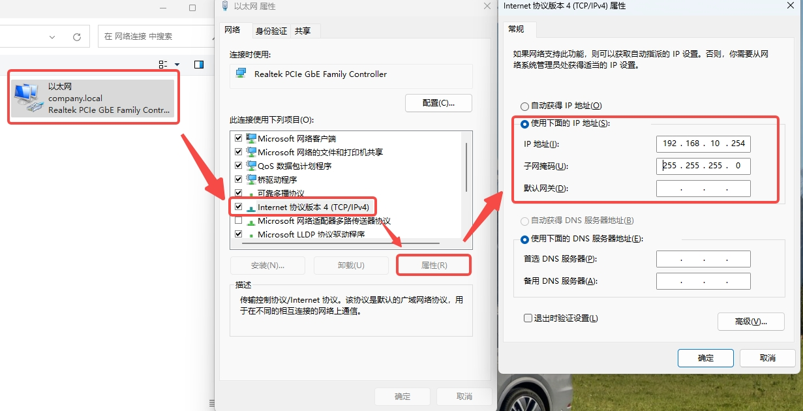

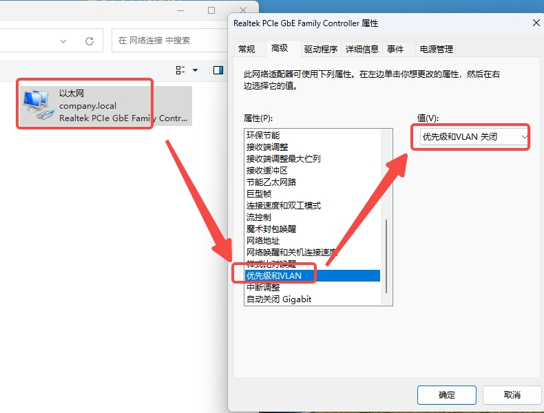

#### 4.1.2. 设备配置文件

准备设备连接信息文件，命名为 device_conf.json 文件，示例如下：

- "TC397"：设备名称，由用户自定义。
- "version_no"：版本号，填"2.0"。
- "device_id"：设备 id，唯一值，由用户自定义。
- "comm_mode"：设备 trace 数据的传输方式，目前支持 "eth"
  - 当 "comm_mode" 为 "eth" 时，"ip" 指定 下位机设备的 IP 地址，"port" 指定下位机设备的端口号。
- "serial_port"：上位机与设备连接通信的串口号，用来给设备发送指令。
- "serial_baudrate"：串口波特率，填 115200。
- "core_num"：下位机的内核个数。
- "stm_frequency"：时钟频率，若没有修改，则默认为 100000000。

```json
// device_conf.json 文件示例，实际使用时需删除json文件中的所有注释
{
    "TC397": {
        "version_no": "2.0",
        "device_id": 0,
        "comm_mode": "eth",
        "ip": "192.168.10.71",
        "port": 18888,
        "serial_port": "COM6",
        "serial_baudrate": 115200,
        "core_num": 6,
        "stm_frequency": 100000000
    }
}
```

#### 4.1.3. 采集流程

1. **开始采集**

    ```python
    python .\trace_processor.py -m online -device .\device_conf.json -log .\logs -get_config y
    ```

    参数详情

    - -m：表示获取设备trace数据的方式，eg：-m online表示在线模式
    - -device：表示设备连接信息文件的路径，由用户自定义，eg：-device .\device_conf.json
    - -log：表示 trace 报文的保存目录路径，由用户自定义，eg：-log .\logs
    - -get_config：表示工具与设备通信时，是否获取设备的配置详情信息，可选 [y, n]，默认为 y
        - 若选 y，则在接收 trace 报文前，先获取配置详情信息并保存，详情信息默认文件名为config.json
        - 若选 n，则不获取配置详情信息，直接接收 trace 报文。（ps：如果第一次采集已获取到配置详情文件，后续几次采集可以略过该步骤直接复用已有文件, 提高效率）

2. **运行过程**

    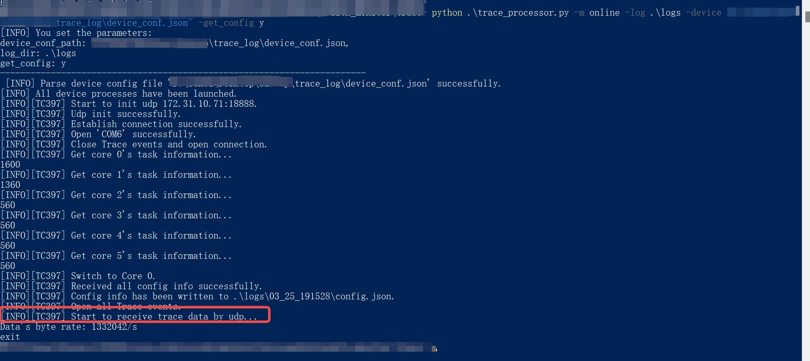

3. **停止采集**

    上位机与VCOS通讯建立后会持续采集报文，若用户想停止采集数据，可以输入"exit" 加回车来结束数据接收。

4. **输出成果**

    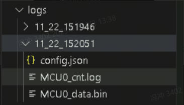

    - <device_name>_data.bin 即 trace 二进制数据文件，是设备发送的原始 trace 报文。
    - config.json 保存有各设备的配置详情信息，包括时钟频率、task、ISR 等，不能修改，详见如下说明：

    ```json
    {
        "TC397": {                               # 设备名称，与device_conf.json文件中一致
            "device_id": 0,
            "stm_frequency": 100000000,          # 时钟频率
            "Task": {                            # task 信息
                "0": [                           # task id
                    "Core0_BSW_Task_1ms",        # task 名称
                    8,                           # task 优先级
                    0                            # task 所属核ID
                ],
                "1": [
                    "Core0_BSW_Task_5ms",
                    7,
                    0
                ]
            },
            "Runnable": {                        # runnable 信息
                "0": [                           # runnable id
                    "BswM_MainFunction",         # runnable 名称
                    [                            # runnable 所属 task id列表
                        3
                    ]
                ],
                "1": [
                    "CanNm_MainFunction",
                    [
                        1
                    ]
                ]
            },
            "ISR": {                             # ISR 信息
                "0": "Os_ISR_ECAN",              # ISR ID和对应名称
                "1": "Os_ISR_ICAN",
                "2": "Os_ISR_UART",
                "3": "Os_ISR_BDCAN1"
            }
    
    ```

### 4.2. 离线处理报文

得到报文文件后，可以进行离线处理，输出成[Perfetto](https://perfetto.dev/)原生支持的pftrace格式文件，并通过[Perfetto UI](https://ui.perfetto.dev/)进行可视化展示。

#### 4.2.1. 事件链配置（非必选项）

如果用户想使用事件链功能，需要创建一个事件链配置文件 event_chain.json，事件链配置示例如下:

```json
// 文件示例，实际使用时需删除所有注释
[
    // 事件链0
    [
        // task
        {
            "node_type": "task",
            "device_name": "TC397",             # 自定义, 需要与device_conf.json文件中一致
            "task_name": "Core1_ASILB_Task_1ms" # conf.json配置文件的task列表中选择获取
        },
        // irq
        {
            "node_type": "irq",
            "device_name": "TC397",             # 自定义，需要与device_conf.json文件中一致
            "irq_name": "ISR_1_core0"           # 根据isr的ID和所在内核id填写
        }
    ],
    // 事件链1
    [
        ... // 省略
    ]
]
```

说明：

1. 事件链节点目前支持的种类有：task 和 irq。
2. 不同类型需要配置不同的字段，详见上述示例中的配置说明。

#### 4.2.2. trace 文件转 pftrace 文件

支持将 trace bin（VCOS二进制报文数据）文件转为 pftrace（Perfetto专用二进制） 文件

```python
python .\trace_processor.py -m bin_to_pftrace -data logs\11_27_180103 -chain event_chain.json
```

**参数详情**

- -m bin_to_pftrace 表示将 trace 二进制数据文件转为 pftrace 文本，必选项。
- -data logs\11_27_180103 表示二进制数据文件所在的目录路径，必选项。
- -chain .\event_chain.json 表示事件链配置文件的路径，可选项。
- -get_report，可选["y", "n"] 表示是否针对二进制数据中的 task 和 ISR 进行各项详细指标计算，并将结果写入到 -data 目录的 excel 文件中。

**转换过程**

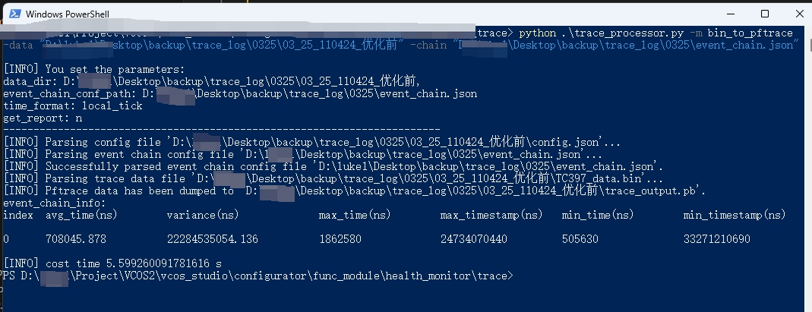

**使用pftrace**

可以用 [Perfetto UI](https://ui.perfetto.dev/) 打开 pftrace文件，详情可参考[Perfetto Docs](https://perfetto.dev/docs/)，展示样式可参考本文第3章。
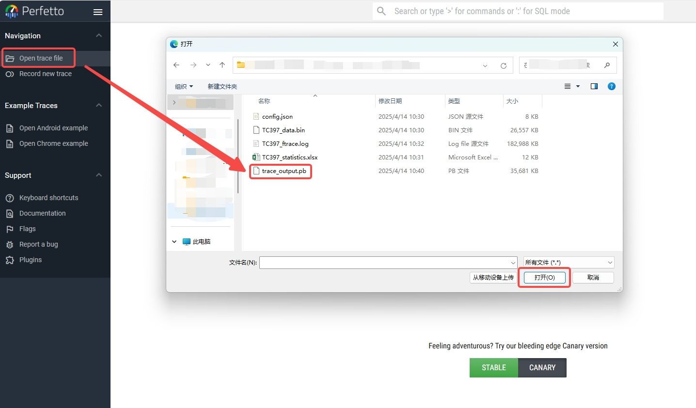

#### 4.2.3. trace 文件转 ftrace 文本文件

支持将 trace bin（VCOS二进制报文数据）文件转为 ftrace 文本文件。
ftrace 文本不支持事件链配置功能，更推荐使用上一小节的 pftrace 文件。

```shell
python .\trace_processor.py -m bin_to_ftrace -data logs\11_27_180103
```

**参数详情**

-m bin_to_ftrace 表示将 trace 二进制数据文件转为 ftrace 文本，必选项。

-data logs\11_27_180103 表示二进制数据文件所在的目录路径，必选项。

**转换过程**

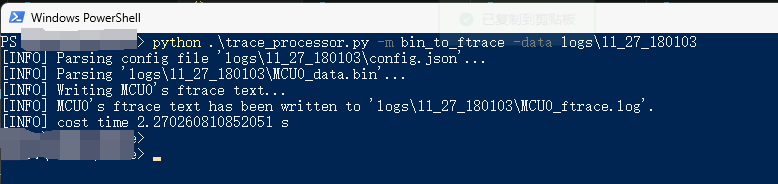

**使用ftrace**

可以用 [Perfetto UI](https://ui.perfetto.dev/) 打开 ftrace文本文件，详情可参考[Perfetto Docs](https://perfetto.dev/docs/)，ftrace文本的效果
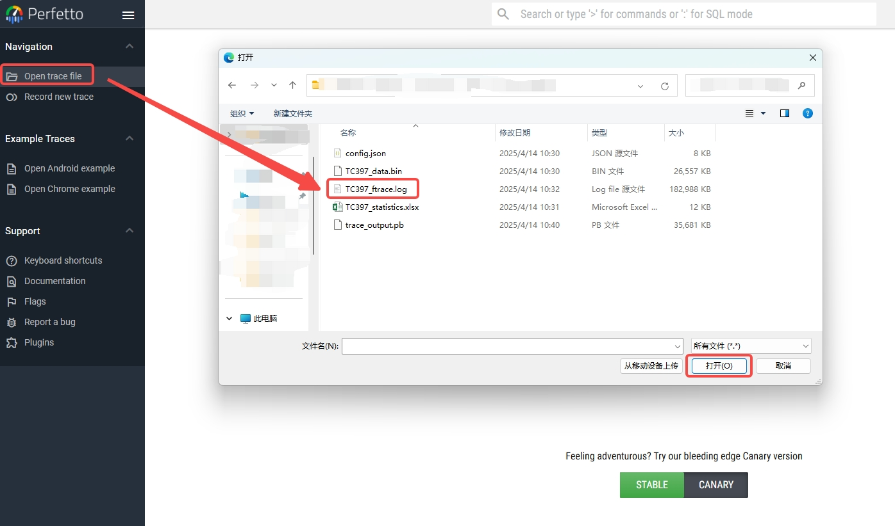
